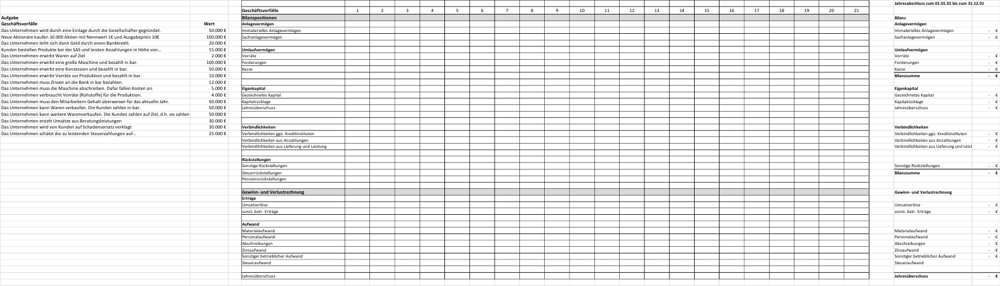

# Aufgabe 2 - Jahresabschlusserstellung

## Inhalt

1. Eigenkapitalfinanzierungen
2. Fremdkapitalfinanzierungen
3. Investitionen in Anlagevermögen
4. Investitionen in Umlaufvermögen
5. Aufwandspositionen
6. Ertragspositionen
7. Rückstellungen
8. Cash Flows
9. Abbildungen der Geschäftsvorfälle in der Bilanz
   - 9.1 Eigenkapitalfinanzierungen
   - 9.2 Fremdkapitalfinanzierungen
   - 9.3 Investitionen in Anlagevermögen
   - 9.4 Investitionen in Umlaufvermögen
   - 9.5 Gewinn- und Verlustrechnung - Aufwandspositionen
   - 9.6 Gewinn- und Verlustrechnung - Ertragspositionen
   - 9.7 Rückstellungen

Anmerkung: Nutzen Sie für die Aufgabe "Abbildungen der Geschäftsvorfälle in der Bilanz" stets ein Excel-Sheet oder das angefügte Sheet.

## 1 Eigenkapitalfinanzierungen

### Aufgabe 1 – Ansatz

Die XY AG gibt 10 Aktien aus. Nennwert ist 1€, der Ausgabepreis ist 5€. Wie hoch ist der Wert des gezeichneten Kapitals und der Kapitalrücklage?

### Aufgabe 2 – Erläuterungsfragen

1. Erläutern Sie drei Merkmale von Eigenkapital.
2. Erläutern Sie drei Arten von Eigenkapital. Worin unterscheiden sich diese?

## 2 Fremdkapitalfinanzierungen

### Aufgabe 1 – Ansatz

Ein Unternehmen XY hat einen Kredit in Höhe von 20.000€ aufgenommen. Am selben Tag ist eine Klage von einem Ex-Mitarbeiter auf Zahlung von 30.000€ wegen einer Handverletzung eingegangen. Das Unternehmen beschließt anschließend noch im nächsten Jahr eine Anlage für 50.000€ zu kaufen, die solche Verletzungen vermeidet und dafür einen Kredit aufzunehmen.

Welcher der drei Vorfälle führt zu einer Verbindlichkeit, welcher zu einer Rückstellung? Erläutern Sie.

### Aufgabe 2 – Erläuterungsfragen

1. Erläutern Sie drei Merkmale von Fremdkapital.
2. Erläutern Sie drei Arten von Verbindlichkeiten. Worin unterscheiden sich diese?

## 3 Investitionen in Anlagevermögen

### Aufgabe 1 - Ansatz

Die SAS AG kauft eine neue Produktionsmaschine für die Herstellung von Keksen. Folgende Positionen werden Ihnen am Jahresende vorgelegt, die einen Bezug zu dieser Maschine haben:

| Pos | Art der Kosten | Betrag |
|---|---|---|
| 1 | Preis des Gebäudes | 50.000 |
| 2 | Rabatte für den Erwerb vom Verkäufer | 20.000 |
| 3 | Transportkosten zum Gelände | 10.000 |
| 4 | Reinigungskosten der Maschine durch Agentur | 5.000 |
| 5 | Anbau eines Silberkatalysators | 60.000 |

Bestimmen Sie die Anschaffungskosten der Maschine und erläutern Sie, warum welche Kosten einbezogen werden bzw. nicht einbezogen werden.

### Aufgabe 2 – Erläuterungsfragen

1. Geben Sie Beispiele für Gegenstände, die im Sachanlagevermögen enthalten sind.
2. Geben Sie Beispiele für Gegenstände, die im immateriellen Anlagevermögen enthalten sind.

## 4 Investitionen in Umlaufvermögen

### Aufgabe 1 – Ansatz

Nennen Sie Beispiele für Positionen des Umlaufvermögens.

### Aufgabe 2 – Bewertung

Die A AG hat am 01.01.01 1.000 Tonnen Rohstoffe erworben zum Preis von 50€ pro Tonne, d.h. insgesamt 50.000€. Am 31.12.01 ist der Preis pro Tonne überraschend gefallen auf 40€ pro Tonne durch einen Angebotsüberhang. Mit welchem Wert sind die Rohstoffe in der Bilanz abzubilden und warum?

### Aufgabe 3 – Bewertung

Die A AG hat am 01.01.01 1.000 Tonnen Rohstoffe erworben zum Preis von 50€ pro Tonne, d.h. insgesamt 50.000€. Am 31.12.01 sind die Rohstoffe leider verfault und können nun noch als Nahrung für Professoren dienen, ihr Wert wird auf 20€ pro Tonne geschätzt. Mit welchem Wert sind die Rohstoffe in der Bilanz abzubilden und warum?

### Aufgabe 4 – Bewertung

Die A AG hat am 01.01.01 1.000 Tonnen Rohstoffe erworben zum Preis von 50€ pro Tonne, d.h. insgesamt 50.000€. Am 31.12.01 ist der Preis pro Tonne überraschend gestiegen auf 40€ pro Tonne durch einen Lieferengpass am Weltmarkt. Mit welchem Wert sind die Rohstoffe in der Bilanz abzubilden und warum?

## 5 Aufwandspositionen

### Aufgabe 1 – Abschreibungen

Unternehmen XY kauft eine Maschine für 100.000€. Die Nutzungsdauer wird auf 8 Jahre geschätzt. Als Schrottwert am Ende der Nutzungsdauer schätzen die Leute im Einkauf etwas 20.000€. Der Satz für die degressive Abschreibung ist 25% pro Jahr. Ermitteln Sie die Höhe der Abschreibung nach linearer Methode sowie nach geometrisch degressiver Methode.

## 6 Ertragspositionen

### Aufgabe 1 – Ansatz und Bewertung

Die Möbel AG hat mit 5 Kunden Kaufverträge über den Verkauf von Tischen abgeschlossen. Kunden sind z.B. bekannte Möbelgeschäfte wie Ruller, FrauMobilia und Möbel XXXS. Jeder der Kunden erwarb im Kaufvertrag jeweils 1.000 Tische zu je 30€ pro Tisch.

Prüfen Sie, ob Umsatzerlöse entstanden sind und geben Sie die Buchungssätze an.

1. Kunde 1 hat noch nicht gezahlt. Die Ware wurde noch nicht geliefert.
2. Kunde 2 hat noch nicht gezahlt. Die Ware wurde bereits ausgeliefert.
3. Kunde 3 hat die Ware bereits bezahlt. Die Ware wurde noch nicht ausgeliefert.
4. Kunde 4 hat die Ware bezahlt und die Ware wurde bereits ausgeliefert.

## 7 Rückstellungen

### Aufgabe 1 – Ansatz einer Rückstellung

Das Unternehmen XY produziert Kekse. Eine Kunde hat am 05.01.01 Klage eingereicht, da er sich an den Keksen vergiftet hat. Die Klage geht auf 100.000€. Die Anwälte der XY AG schätzen die Wahrscheinlichkeit auf ca. 80% ein, dass die Klage verloren geht, da die Kekse wirklich Gift enthielten. Muss eine Rückstellung gebildet werden?

### Aufgabe 2 – Ansatz einer Rückstellung

Das Unternehmen XY produziert Kekse. Eine Kunde hat am 05.01.01 Klage eingereicht, da er sich an den Keksen vergiftet hat. Die Klage geht auf 100.000€. Die Anwälte der XY AG schätzen die Wahrscheinlichkeit auf ca. 10% ein, dass die Klage verloren geht, da die Kekse eigentlich in Ordnung waren. Muss eine Rückstellung gebildet werden?

### Aufgabe 3 – Ansatz einer Rückstellung

Das Unternehmen XY produziert Kekse. Aktuelle Herstellkosten der Kekse sind 1€ pro Stück. Mit einem Kunden wurde ein Vertrag über den Verkauf von 100 Keksen zu 2€/pro Stück im nächsten Jahr vereinbart.

a) Am 30.12. steigen die Herstellkosten auf 1,5€ pro Stück. Ist eine Rückstellung zu bilden?

b) Am 30.12. steigen die Herstellkosten auf 2,5€ pro Stück. Ist eine Rückstellung zu bilden?

## 8 Cash Flows

### Aufgabenstellung

Sie erhalten die folgenden Geschäftsvorfälle. Geben sie an, ob es sich um einen Cash Flow handelt und welche Art von Cash Flow es ist.

1. Die Gesellschafter gründen die AG durch Einlage von 50.000€
2. Das Unternehmen nimmt einen Kredit in Höhe von 20.000€ auf.
3. Das Unternehmen erzielt Umsatzerlöse in Höhe von 100.000€, die in bar bezahlt werden.
4. Das Unternehmen bezahlt Mitarbeiter in Höhe von 50.000€.
5. Das Unternehmen erwirbt Rohstoffe für 30.000.
6. Das Unternehmen erwirbt eine Großmaschine für 70.000€
7. Das Unternehmen schreibt eine Maschine um 10.000€ ab.
8. Ein Kunde kauft eine Ware „auf Ziel“ für 30.000€.

## 9 Abbildungen der Geschäftsvorfälle in der Bilanz

Anmerkung: Nutzen Sie das bereitgestellte Excel-Sheet oder das pdf zum Eintragen der Werte. Bestimmen Sie abschließend die Bilanzsumme und den Gewinn (Jahresüberschuss des Unternehmens).

### 9.1 Eigenkapitalfinanzierungen

Sie erhalten die folgenden Geschäftsvorfälle. Bilden Sie diese in der Bilanz ab.

1. Die Gesellschafter gründen die AG durch Einlage von 50.000€
2. Neue Aktionäre kaufen Aktien für 10.000 Aktien für 100.000€. (Kaufpreis pro Aktie 10€. Nennwert ist 1€)

### 9.2 Fremdkapitalfinanzierungen

Sie erhalten die folgenden Geschäftsvorfälle. Bilden Sie diese in der Bilanz ab.

3. Das Unternehmen nimmt einen Kredit in Höhe von 20.000€ ab.
4. Das Unternehmen erhält Kundenanzahlungen in Höhe von 15.000€.
5. Das Unternehmen bezieht Rohstoffe in Höhe von 2.000€ auf Ziel.

### 9.3 Investitionen in Anlagevermögen

Sie erhalten die folgenden Geschäftsvorfälle. Bilden Sie diese in der Bilanz ab.

6. Das Unternehmen erwirbt eine Maschine für 100.000 in bar.
7. Das Unternehmen erwirbt eine Produktionskonzession für 50.000 per Überweisung.

### 9.4 Investitionen in Umlaufvermögen

Sie erhalten die folgenden Geschäftsvorfälle. Bilden Sie diese in der Bilanz ab.

8. Das Unternehmen erwirbt Rohstoffe für die Produktion in Höhe von 10.000€ in bar.

### 9.5 Gewinn- und Verlustrechnung - Aufwandspositionen

Sie erhalten die folgenden Geschäftsvorfälle. Bilden Sie diese in der Bilanz ab.

9. Das Unternehmen bezahlt 12.000 an Zinsen an die Bank.
10. Der Wert der Maschinen fällt durch die Abnutzung um 5.000€.
11. Das Unternehmen verbraucht Rohstoffe für die Produktion in Höhe von 4.000.
12. Das Unternehmen bezahlt Mitarbeitern Gehälter in Höhe von 50.000.

### 9.6 Gewinn- und Verlustrechnung - Ertragspositionen

Sie erhalten die folgenden Geschäftsvorfälle. Bilden Sie diese in der Bilanz ab.

13. Das Unternehmen verkauft Fertigerzeugnisse in Höhe von 50.000€ in bar.
14. Das Unternehmen verkauft Fertigerzeugnisse in Höhe von 50.000€ auf Ziel.
15. Das Unternehmen erbringt eine Beratungsleistung in Höhe von 30.000€, die vom Kunden in bar bezahlt wird.

### 9.7 Rückstellungen

Sie erhalten die folgenden Geschäftsvorfälle. Bilden Sie diese in der Bilanz ab.

16. Das Unternehmen wird auf Schadensersatz in Höhe von 30.000 für ein defektes Produkt verklagt.
17. Die Steuerschulden werden auf 25.000€ geschätzt.

## Jahresabschluss zum 01.01.01 bis zum 31.12.01

### Aufgabe

| Geschäftsvorfälle | Wert |
|---|---|
| Das Unternehmen wird durch eine Einlage durch die Gesellschafter gegründet. | 50.000 € |
| Neue Aktionäre kaufen 10.000 Aktien mit Nennwert 1€ und Ausgabepreis 10€ | 100.000 € |
| Das Unternehmen leiht sich dann Geld durch einen Bankkredit. | 20.000 € |
| Kunden bestellen Produkte bei der SAS und leisten Anzahlungen in Höhe von… | 15.000 € |
| Das Unternehmen erwirbt Waren auf Ziel | 2.000 € |
| Das Unternehmen erwirbt eine große Maschine und bezahlt in bar. | 100.000 € |
| Das Unternehmen erwirbt eine Konzession und bezahlt in bar. | 50.000 € |
| Das Unternehmen erwirbt Vorräte zur Produktion und bezahlt in bar. | 10.000 € |
| Das Unternehmen muss Zinsen an die Bank in bar bezahlen. | 12.000 € |
| Das Unternehmen muss die Maschine abschreiben. Dafür fallen Kosten an. | 5.000 € |
| Das Unternehmen verbraucht Vorräte (Rohstoffe) für die Produktion. | 4.000 € |
| Das Unternehmen muss den Mitarbeitern Gehalt überweisen für das aktuelle Jahr. | 50.000 € |
| Das Unternehmen kann Waren verkaufen. Die Kunden zahlen in bar. | 50.000 € |
| Das Unternehmen kann weitere Warenverkaufen. Die Kunden zahlen auf Ziel, d.h. sie zahlen erst zu einem späteren Zeitpunkt | 50.000 € |
| Das Unternehmen erzielt Umsätze aus Beratungsleistungen | 30.000 € |
| Das Unternehmen wird von Kunden auf Schadensersatz verklagt | 30.000 € |
| Das Unternehmen schätzt die zu leistenden Steuerzahlungen auf… | 25.000 € |

### Bilanzpositionen

Geschäftsvorfälle | 1 | 2 | 3 | 4 | 5 | 6 | 7 | 8 | 9 | 10 | 11 | 12 | 13 | 14 | 15 | 16 | 17 | 18 | 19 | 20 | 21

- Anlagevermögen
  - Immaterielles Anlagevermögen
  - Sachanlagevermögen
- Umlaufvermögen
  - Vorräte
  - Forderungen
  - Kasse
- Eigenkapital
  - Gezeichnetes Kapital
  - Kapitalrücklage
  - Jahresüberschuss
- Verbindlichkeiten
  - Verbindlichkeiten ggü. Kreditinstituten
  - Verbindlichkeiten aus Anzahlungen
  - Verbindlichkeiten aus Lieferung und Leistung
- Rückstellungen
  - Sonstige Rückstellungen
  - Steuerrückstellungen
  - Pensionsrückstellungen
- Gewinn- und Verlustrechnung
  - Erträge
    - Umsatzerlöse
    - sonst. betr. Erträge
  - Aufwand
    - Materialaufwand
    - Personalaufwand
    - Abschreibungen
    - Zinsaufwand
    - Sonstiger betrieblicher Aufwand
    - Steueraufwand
  - Jahresüberschuss

### Bilanz

| Position | Wert |
|---|---|
| **Anlagevermögen** | |
| Immaterielles Anlagevermögen | - € |
| Sachanlagevermögen | - € |
| **Umlaufvermögen** | |
| Vorräte | - € |
| Forderungen | - € |
| Kasse | - € |
| Bilanzsumme | - € |
| **Eigenkapital** | |
| Gezeichnetes Kapital | - € |
| Kapitalrücklage | - € |
| Jahresüberschuss | - € |
| **Verbindlichkeiten** | |
| Verbindlichkeiten ggü. Kreditinstituten | - € |
| Verbindlichkeiten aus Anzahlungen | - € |
| Verbindlichkeiten aus Lieferung und Leistung | - € |
| Sonstige Rückstellungen | - € |
| Bilanzsumme | - € |
| **Gewinn- und Verlustrechnung** | |
| Umsatzerlöse | - € |
| sonst. betr. Erträge | - € |
| Materialaufwand | - € |
| Personalaufwand | - € |
| Abschreibungen | - € |
| Zinsaufwand | - € |
| Sonstiger betrieblicher Aufwand | - € |
| Steueraufwand | |
| Jahresüberschuss | - € |

## Dateien in diesem Ordner

- `ReCo - Aufgabe 2 - Jahresabschlusserstellung - Aufgaben.pdf` — Originalaufgabenblatt, Seite 6 ist das "pdf zum Eintragen der Werte" für Kapitel 9
- `ReCo - Aufgabe 2 - Jahresabschlusserstellung - Aufgabe.xlsx` — bereitgestelltes Excel-Sheet für Kapitel 9 (Tabellenblatt "Aufgabe")
- `ReCo - Aufgabe 2 - Jahresabschlusserstellung - Aufgabe - mit Kapitalflussrechnung.xlsx` — bereitgestelltes Excel-Sheet für Kapitel 9 mit Kapitalflussrechnung (Tabellenblatt "Aufgabe")
- `images/seite-6.png` — Seite 6 des Aufgabenblatts als Bild

Quelle: `bilanzierung/origin/WDS25 - Bilanzierung (NOU)/05 2 - Aufgaben/ReCo - Aufgabe 2 - Jahresabschlusserstellung - Aufgaben/ReCo - Aufgabe 2 - Jahresabschlusserstellung - Aufgaben.pdf`, Seiten 1–6
