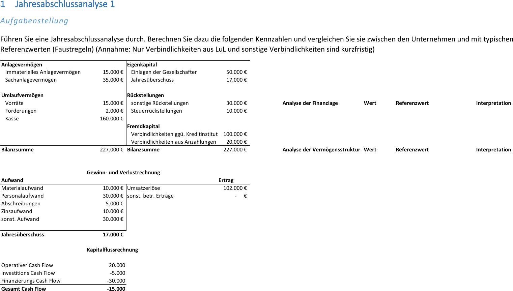
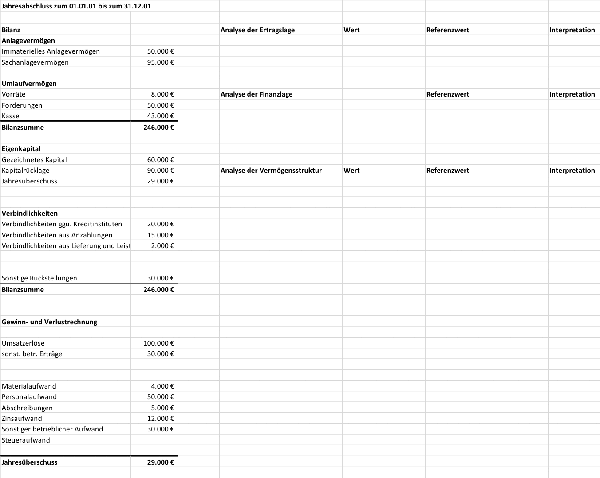
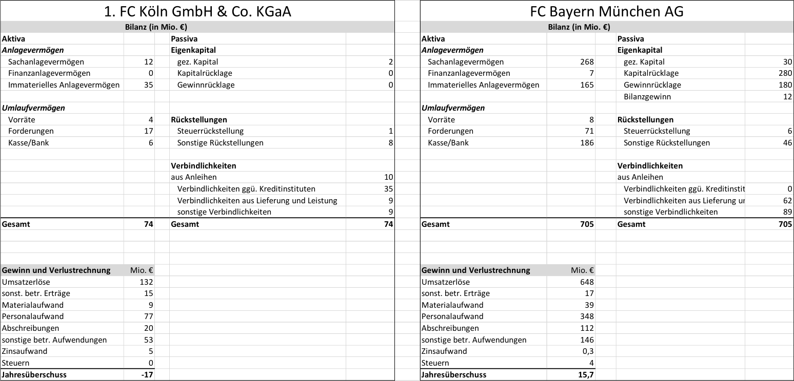
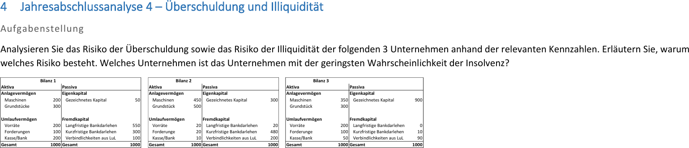

# Aufgabe 3 – Jahresabschlussanalyse

## Jahresabschlussanalyse

1. Jahresabschlussanalyse 1
2. Jahresabschlussanalyse 2
3. Jahresabschlussanalyse 3 - Fußballvereine
4. Jahresabschlussanalyse 4 – Überschuldung und Illiquidität

## 1 Jahresabschlussanalyse 1

### Aufgabenstellung

Führen Sie eine Jahresabschlussanalyse durch. Berechnen Sie dazu die folgenden Kennzahlen und vergleichen Sie sie zwischen den Unternehmen und mit typischen Referenzwerten (Faustregeln) (Annahme: Nur Verbindlichkeiten aus LuL und sonstige Verbindlichkeiten sind kurzfristig)

#### Bilanz

| Aktiva | Wert | Passiva | Wert |
|---|---|---|---|
| **Anlagevermögen** | | **Eigenkapital** | |
| Immaterielles Anlagevermögen | 15.000 € | Einlagen der Gesellschafter | 50.000 € |
| Sachanlagevermögen | 35.000 € | Jahresüberschuss | 17.000 € |
| **Umlaufvermögen** | | **Rückstellungen** | |
| Vorräte | 15.000 € | sonstige Rückstellungen | 30.000 € |
| Forderungen | 2.000 € | Steuerrückstellungen | 10.000 € |
| Kasse | 160.000 € | **Fremdkapital** | |
| | | Verbindlichkeiten ggü. Kreditinstitut | 100.000 € |
| | | Verbindlichkeiten aus Anzahlungen | 20.000 € |
| **Bilanzsumme** | 227.000 € | **Bilanzsumme** | 227.000 € |

#### Gewinn- und Verlustrechnung

| Aufwand | Wert | Ertrag | Wert |
|---|---|---|---|
| Materialaufwand | 10.000 € | Umsatzerlöse | 102.000 € |
| Personalaufwand | 30.000 € | sonst. betr. Erträge | - € |
| Abschreibungen | 5.000 € | | |
| Zinsaufwand | 10.000 € | | |
| sonst. Aufwand | 30.000 € | | |
| **Jahresüberschuss** | **17.000 €** | | |

#### Kapitalflussrechnung

| Position | Wert |
|---|---|
| Operativer Cash Flow | 20.000 |
| Investitions Cash Flow | -5.000 |
| Finanzierungs Cash Flow | -30.000 |
| **Gesamt Cash Flow** | **-15.000** |

| Analyse der Finanzlage | Wert | Referenzwert | Interpretation |
|---|---|---|---|
| | | | |

| Analyse der Vermögensstruktur | Wert | Referenzwert | Interpretation |
|---|---|---|---|
| | | | |

#### Zusatzfragen

- Das Auto im Sachanlagevermögen fährt gegen die Wand und muss im Wert von 30.000€ abgeschrieben werden. Ist das Unternehmen damit insolvent?
- Das Unternehmen muss leider noch eine Rückstellung bilden. Wie hoch darf die Rückstellung höchstens sein, damit das Unternehmen nicht überschuldet ist?

Quelle der Zusatzfragen: `ReCo - Aufgabe 3 - Jahresabschlussanalyse - Aufgabe.xlsx`, Tabellenblatt "Analyse 1", Zellen H28–H30 (stehen nicht im Aufgabenblatt-PDF)

## 2 Jahresabschlussanalyse 2

### Aufgabenstellung

Führen Sie eine Jahresabschlussanalyse durch. Berechnen Sie dazu die folgenden Kennzahlen und vergleichen Sie sie zwischen den Unternehmen und mit typischen Referenzwerten (Faustregeln) (Annahme: Nur Verbindlichkeiten aus LuL und sonstige Verbindlichkeiten sind kurzfristig)

Analyse der Ertragslage

1. Jahresüberschuss
2. EBIT
3. Umsatzrentabilität
4. Eigenkapitalrentabilität

Analyse der Finanzlage

5. Operativer Cash Flow
6. Zinsdeckungsgrad
7. Eigenkapital
8. Eigenkapitalquote

Bewerten Sie abschließend die Situation der beiden Unternehmen insgesamt.

### Jahresabschluss zum 01.01.01 bis zum 31.12.01

#### Bilanz

| Position | Wert |
|---|---|
| **Anlagevermögen** | |
| Immaterielles Anlagevermögen | 50.000 € |
| Sachanlagevermögen | 95.000 € |
| **Umlaufvermögen** | |
| Vorräte | 8.000 € |
| Forderungen | 50.000 € |
| Kasse | 43.000 € |
| **Bilanzsumme** | **246.000 €** |
| **Eigenkapital** | |
| Gezeichnetes Kapital | 60.000 € |
| Kapitalrücklage | 90.000 € |
| Jahresüberschuss | 29.000 € |
| **Verbindlichkeiten** | |
| Verbindlichkeiten ggü. Kreditinstituten | 20.000 € |
| Verbindlichkeiten aus Anzahlungen | 15.000 € |
| Verbindlichkeiten aus Lieferung und Leistung | 2.000 € |
| Sonstige Rückstellungen | 30.000 € |
| **Bilanzsumme** | **246.000 €** |

#### Gewinn- und Verlustrechnung

| Position | Wert |
|---|---|
| Umsatzerlöse | 100.000 € |
| sonst. betr. Erträge | 30.000 € |
| Materialaufwand | 4.000 € |
| Personalaufwand | 50.000 € |
| Abschreibungen | 5.000 € |
| Zinsaufwand | 12.000 € |
| Sonstiger betrieblicher Aufwand | 30.000 € |
| Steueraufwand | |
| **Jahresüberschuss** | **29.000 €** |

| Analyse der Ertragslage | Wert | Referenzwert | Interpretation |
|---|---|---|---|
| | | | |

| Analyse der Finanzlage | Wert | Referenzwert | Interpretation |
|---|---|---|---|
| | | | |

| Analyse der Vermögensstruktur | Wert | Referenzwert | Interpretation |
|---|---|---|---|
| | | | |

## 3 Jahresabschlussanalyse 3 – Fußballvereine

### Information

Ihnen sind die Jahresabschlüsse der beiden Fußballvereine Bayern München AG sowie 1. FC Köln GmbH und Co KG a.A. in vereinfachter Form gegeben.

### Aufgabenstellung

Führen Sie eine Jahresabschlussanalyse durch. Berechnen Sie dazu die folgenden Kennzahlen und vergleichen Sie sie zwischen den Unternehmen und mit typischen Referenzwerten (Faustregeln) (Annahme: Nur Verbindlichkeiten aus LuL und sonstige Verbindlichkeiten sind kurzfristig)

Analyse der Ertragslage

1. Jahresüberschuss
2. EBIT
3. Umsatzrentabilität
4. Eigenkapitalrentabilität

Analyse der Finanzlage

5. Zinsdeckungsgrad
6. Eigenkapital
7. Eigenkapitalquote

Bewerten Sie abschließend die Situation der beiden Unternehmen insgesamt.

### 1. FC Köln GmbH & Co. KGaA

#### Bilanz (in Mio. €)

| Aktiva | Wert | Passiva | Wert |
|---|---|---|---|
| **Anlagevermögen** | | **Eigenkapital** | |
| Sachanlagevermögen | 12 | gez. Kapital | 2 |
| Finanzanlagevermögen | 0 | Kapitalrücklage | 0 |
| Immaterielles Anlagevermögen | 35 | Gewinnrücklage | 0 |
| **Umlaufvermögen** | | **Rückstellungen** | |
| Vorräte | 4 | Steuerrückstellung | 1 |
| Forderungen | 17 | Sonstige Rückstellungen | 8 |
| Kasse/Bank | 6 | **Verbindlichkeiten** | |
| | | aus Anleihen | 10 |
| | | Verbindlichkeiten ggü. Kreditinstituten | 35 |
| | | Verbindlichkeiten aus Lieferung und Leistung | 9 |
| | | sonstige Verbindlichkeiten | 9 |
| **Gesamt** | **74** | **Gesamt** | **74** |

#### Gewinn und Verlustrechnung

| Position | Mio. € |
|---|---|
| Umsatzerlöse | 132 |
| sonst. betr. Erträge | 15 |
| Materialaufwand | 9 |
| Personalaufwand | 77 |
| Abschreibungen | 20 |
| sonstige betr. Aufwendungen | 53 |
| Zinsaufwand | 5 |
| Steuern | 0 |
| **Jahresüberschuss** | **-17** |

### FC Bayern München AG

#### Bilanz (in Mio. €)

| Aktiva | Wert | Passiva | Wert |
|---|---|---|---|
| **Anlagevermögen** | | **Eigenkapital** | |
| Sachanlagevermögen | 268 | gez. Kapital | 30 |
| Finanzanlagevermögen | 7 | Kapitalrücklage | 280 |
| Immaterielles Anlagevermögen | 165 | Gewinnrücklage | 180 |
| | | Bilanzgewinn | 12 |
| **Umlaufvermögen** | | **Rückstellungen** | |
| Vorräte | 8 | Steuerrückstellung | 6 |
| Forderungen | 71 | Sonstige Rückstellungen | 46 |
| Kasse/Bank | 186 | **Verbindlichkeiten** | |
| | | aus Anleihen | |
| | | Verbindlichkeiten ggü. Kreditinstituten | 0 |
| | | Verbindlichkeiten aus Lieferung und Leistung | 62 |
| | | sonstige Verbindlichkeiten | 89 |
| **Gesamt** | **705** | **Gesamt** | **705** |

#### Gewinn und Verlustrechnung

| Position | Mio. € |
|---|---|
| Umsatzerlöse | 648 |
| sonst. betr. Erträge | 17 |
| Materialaufwand | 39 |
| Personalaufwand | 348 |
| Abschreibungen | 112 |
| sonstige betr. Aufwendungen | 146 |
| Zinsaufwand | 0,3 |
| Steuern | 4 |
| **Jahresüberschuss** | **15,7** |

## 4 Jahresabschlussanalyse 4 – Überschuldung und Illiquidität

### Aufgabenstellung

Analysieren Sie das Risiko der Überschuldung sowie das Risiko der Illiquidität der folgenden 3 Unternehmen anhand der relevanten Kennzahlen. Erläutern Sie, warum welches Risiko besteht. Welches Unternehmen ist das Unternehmen mit der geringsten Wahrscheinlichkeit der Insolvenz?

### Bilanz 1

| Aktiva | Wert | Passiva | Wert |
|---|---|---|---|
| **Anlagevermögen** | | **Eigenkapital** | |
| Maschinen | 200 | Gezeichnetes Kapital | 50 |
| Grundstücke | 300 | | |
| **Umlaufvermögen** | | **Fremdkapital** | |
| Vorräte | 200 | Langfristige Bankdarlehen | 550 |
| Forderungen | 100 | Kurzfristige Bankdarlehen | 300 |
| Kasse/Bank | 200 | Verbindlichkeiten aus LuL | 100 |
| **Gesamt** | **1000** | **Gesamt** | **1000** |

### Bilanz 2

| Aktiva | Wert | Passiva | Wert |
|---|---|---|---|
| **Anlagevermögen** | | **Eigenkapital** | |
| Maschinen | 450 | Gezeichnetes Kapital | 300 |
| Grundstücke | 500 | | |
| **Umlaufvermögen** | | **Fremdkapital** | |
| Vorräte | 20 | Langfristige Bankdarlehen | 20 |
| Forderungen | 20 | Kurzfristige Bankdarlehen | 480 |
| Kasse/Bank | 10 | Verbindlichkeiten aus LuL | 200 |
| **Gesamt** | **1000** | **Gesamt** | **1000** |

### Bilanz 3

| Aktiva | Wert | Passiva | Wert |
|---|---|---|---|
| **Anlagevermögen** | | **Eigenkapital** | |
| Maschinen | 350 | Gezeichnetes Kapital | 900 |
| Grundstücke | 300 | | |
| **Umlaufvermögen** | | **Fremdkapital** | |
| Vorräte | 200 | Langfristige Bankdarlehen | 0 |
| Forderungen | 100 | Kurzfristige Bankdarlehen | 10 |
| Kasse/Bank | 50 | Verbindlichkeiten aus LuL | 90 |
| **Gesamt** | **1000** | **Gesamt** | **1000** |

## Dateien in diesem Ordner

- `ReCo - Aufgabe 3 - Jahresabschlussanalyse - Aufgaben.pdf` — Originalaufgabenblatt
- `ReCo - Aufgabe 3 - Jahresabschlussanalyse - Aufgabe.xlsx` — Excel-Sheet mit den Tabellenblättern "Analyse 1" und "Analyse 2"
- `SOLUTION.md` — die im Original-PDF in weißer Schrift hinterlegten Werte zu "Jahresabschlussanalyse 1"
- `images/seite-2.png`, `images/seite-4.png`, `images/seite-6.png`, `images/seite-7.png` — Seiten 2, 4, 6 und 7 des Aufgabenblatts als Bild

Quelle: `bilanzierung/origin/WDS25 - Bilanzierung (NOU)/05 2 - Aufgaben/ReCo - Aufgabe 3 - Jahresabschlussanalyse - Aufgaben/ReCo - Aufgabe 3 - Jahresabschlussanalyse - Aufgaben.pdf`, Seiten 1–7
