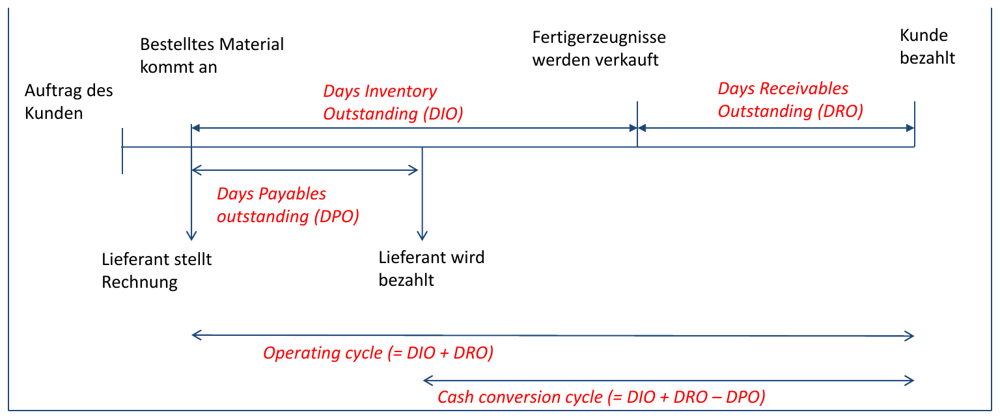

# Beurteilung der Finanzlage

## Jahresabschlussanalyse

**Ziele**

Zielübersicht siehe [Aufgabenstellung und Ziele](../01-aufgabenstellung-und-ziele/TOPIC.md) (Folie 96 wiederholt Folie 90).

## Jahresabschlussanalyse

**Beurteilung der Finanzlage**

Ziele

- Die Analyse der Finanzlage ermöglicht einen Einblick in die Liquiditätssituation und Kapitalstruktur eines Unternehmens, was entscheidend für dessen Stabilität und Solvenz ist.
- Ziel ist es, das Risiko einer möglichen Insolvenz des Unternehmens zu ermitteln.
- In Deutschland gibt es hierbei zwei Gründe für die Insolvenz eines Unternehmens: Illiquidität und Überschuldung.

Insolvenzgründe (§§ 17 bis 19 InsO)

| (drohende) Illiquidität | Überschuldung |
|---|---|
| d.h. Zahlungsverpflichtungen kann (künftig) nicht nachgekommen werden | d.h. Eigenkapital < 0 |

- Ziel von Kennzahlen der Finanzlage ist es daher diese Risiken zu messen.

## Jahresabschlussanalyse

**Beurteilung der Finanzlage – Operativer Cash Flow und Zinsdeckungsgrad**

Operativer Cash Flow

Interpretation: Der operative Cash Flow zeigt an, wieviel Geld aus dem operativen Geschäft verdient wurde. Dieser sollte ausreichen, um die Neuinvestition in Anlagevermögen decken zu können.

Als Faustregel sollte der Operative Cash Flow größer als der Investitions Cash Flow sein.

Zinsdeckungsgrad = EBIT / Zinsaufwand

Der Zinsdeckungsgrad überprüft, wie gut man mit den operativen Cash Flow den Zinsaufwand decken kann. D.h. ob man genügend finanzielle Mittel aus dem operativen Geschäft generiert, um den Zinsaufwand decken zu können und Illiquidität zu vermeiden.

Als Faustregel sollte der Zinsdeckungsgrad für gesunde Unternehmen mindestens 2 (bzw. 200%) sein.

## Jahresabschlussanalyse

**Beurteilung der Finanzlage – Eigenkapital und Eigenkapitalquote**

Eigenkapital

Das Eigenkapital stellt das Vermögen dar, dass dem Unternehmen gehört und zeigt wieviel das Unternehmen bilanziell wert ist. Es dient zudem als Verlustpuffer für das Unternehmen, da negative Jahresüberschüsse das Eigenkapital mindern.

Als Faustregel sollte das Eigenkapital immer positiv sein. Sonst ist das Unternehmen überschuldet. Je höher das Eigenkapital ist, desto besser..

Eigenkapitalquote = Eigenkapital / Gesamtkapital

Höhere Werte zeigen höhere Stabilität. Das Eigenkapital dient als Verlustpuffer für das Unternehmen als hat eine Garantiefunktion für die Gläubiger im Fall der Insolvenz.

Durchschnittlich haben Unternehmen eine Eigenkapitalquote von 33% .

## Jahresabschlussanalyse

**Beurteilung der Finanzlage – Eigenkapital und Eigenkapitalquote**

- Der Operating Cycle (Betriebszyklus) ist der Zeitraum vom Eintreffen des Lagers bis zum endgültigen Geldeingang. Es stellt den Bedarf an kurzfristiger Finanzierung dar.
- Der Cash Conversion Cycle (Bargeldumwandlungszyklus) beginnt mit der Auszahlung von Bargeld für Materialien (Auszahlung von Bargeld) und endet mit dem Einzug von Bargeld aus Forderungen (Bargeldeinzug). Eine späte Bezahlung des Lieferanten reduziert den Bedarf an kurzfristiger Finanzierung.

Quelle: `bilanzierung/origin/WDS25 - Bilanzierung (NOU)/04 1 - Folien/Bilanzierung - Q4 2026/Bilanzierung - Q4 2026.pdf`, Folien 96–100
