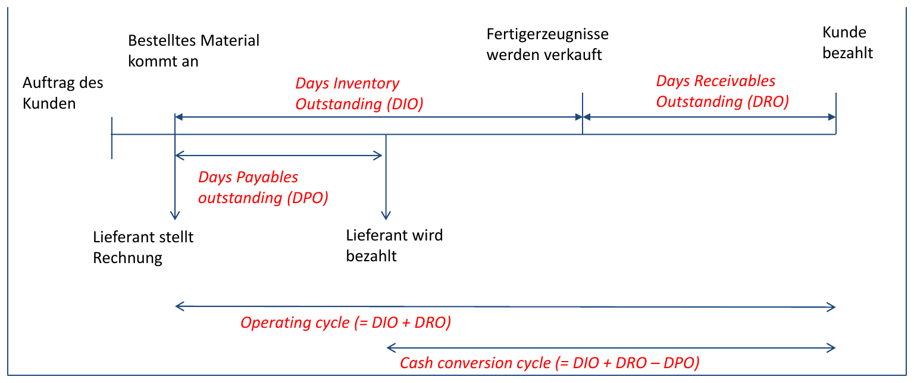

# Beurteilung der Vermögensstruktur

## Jahresabschlussanalyse

**Ziele**

Zielübersicht siehe [Aufgabenstellung und Ziele](../01-aufgabenstellung-und-ziele/TOPIC.md) (Folie 101 wiederholt Folie 90).

## Jahresabschlussanalyse

**Beurteilung der Vermögensstruktur**

- Der Operating Cycle (Betriebszyklus) ist der Zeitraum vom Eintreffen des Lagers bis zum endgültigen Geldeingang. Es stellt den Bedarf an kurzfristiger Finanzierung dar.
- Der Cash Conversion Cycle (Bargeldumwandlungszyklus) beginnt mit der Auszahlung von Bargeld für Materialien (Auszahlung von Bargeld) und endet mit dem Einzug von Bargeld aus Forderungen (Bargeldeinzug). Eine späte Bezahlung des Lieferanten reduziert den Bedarf an kurzfristiger Finanzierung.

## Jahresabschlussanalyse

**Beurteilung der Vermögensstruktur**

Days inventory outstanding (DIO) = 365 * Vorräte / Umsatzerlöse

Interpretation: Die Kennzahl misst die Anzahl der Tage in denen Kapital als Vorratsbestand gebunden ist. Ein niedriger Wert impliziert einen geringen Vorratsbestand durch z.B. Just-In-Time Bestellungen. Damit fallen geringere Kapitalkosten und Kosten für Lagerhaltung an. Je geringer desto besser.

Days receivables outstanding (DRO) = 365 * Forderungsbestand / Umsatzerlöse

Interpretation: Die Kennzahl DRO misst wie lange (in Tagen) es dauet, bis die Kunden ihre Rechnungen bezahlt haben. Niedrige Werte implizieren eine schnelle Bezahlung, so dass Kapitalkosten und das Risiko eines Forderungsausfalle reduziert werden. Je geringer desto besser.

## Jahresabschlussanalyse

**Beurteilung der Vermögensstruktur**

Days payables outstanding (DPO) = 365 * Verb. auf LuL / Umsatzerlöse

Interpretation: Die Kennzahl DPO misst die Anzahl an Tagen, die es dauert, bis das Unternehmen seine eigenen Verbindlichkeiten bezahlt. Je höher die Kennzahl, desto länger kann das Unternehmen mit dem Geld arbeiten. Je höher desto besser.

## Jahresabschlussanalyse

**Beurteilung der Vermögensstruktur**

| Company | Ticker | Industry | Accounts Receivable Days | Inventory Days | Accounts Payable Days | CCC |
|---|---|---|---|---|---|---|
| Pepsico | PEP | Soft Drinks | 40 | 46 | 135 | −49 |
| Amazon.com | AMZN | Internet Retail | 7 | 34 | 62 | −21 |
| Microsoft | MSFT | Software | 71 | 24 | 109 | −14 |
| Southwest Airlines | LUV | Airlines | 8 | 8 | 31 | −15 |
| Carnival | CCL | Cruise Lines | 11 | 13 | 24 | 0 |
| McDonald's | MCD | Restaurants | 15 | 3 | 13 | 5 |
| Kroger Company | KR | Food Retailers | 4 | 29 | 25 | 8 |
| FedEx | FDX | Air Freight | 39 | 6 | 20 | 25 |
| Starbucks | SBUX | Restaurants | 11 | 58 | 21 | 48 |
| Cisco Systems | CSCO | Communications Equip. | 38 | 31 | 19 | 50 |
| Bristol-Myers Squibb | BMY | Pharmaceuticals | 55 | 113 | 109 | 59 |
| Sears Holdings | SHLD | Department Stores | 7 | 111 | 41 | 77 |
| Nordstrom | JWN | Department Stores | 82 | 62 | 50 | 94 |
| CBS | CBS | Broadcasting | 85 | 32 | 18 | 99 |
| Nike | NKE | Footwear | 55 | 83 | 37 | 101 |
| Constellation Brands | STZ | Distillers and Vintners | 79 | 306 | 50 | 335 |
| Pulte Homes | PHM | Home Builders | 1 | 566 | 23 | 544 |
| Major U.S. Firms (value-weighted average) | | | 43 | 63 | 63 | 43 |

Source: www.capitaliq.com

Quelle: `bilanzierung/origin/WDS25 - Bilanzierung (NOU)/04 1 - Folien/Bilanzierung - Q4 2026/Bilanzierung - Q4 2026.pdf`, Folien 101–105
