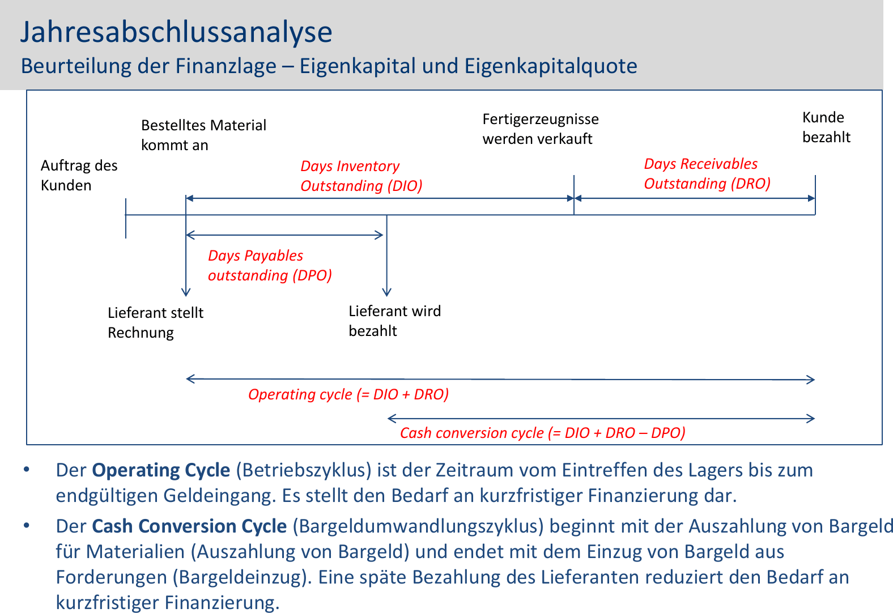
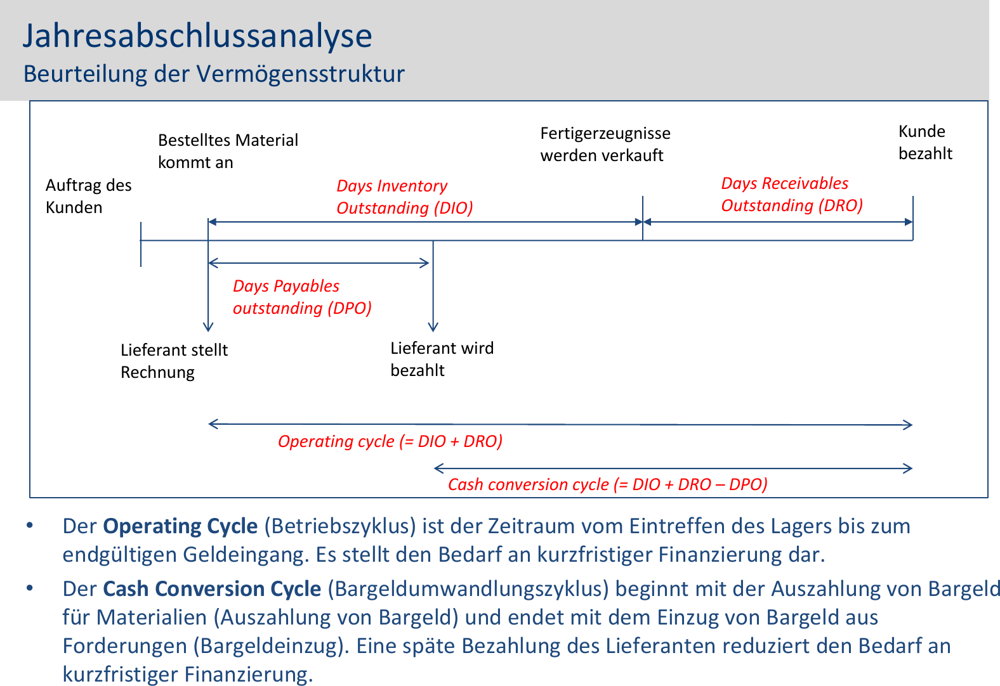
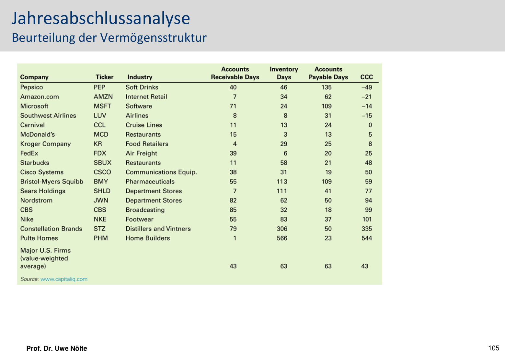

# Jahresabschlussanalyse

## Inhaltsübersicht

A) Jahresabschluss

1. Jahresabschlussgrundlagen
2. Jahresabschlusserstellung
3. Jahresabschlussanalyse

## Inhaltsübersicht

Bilanzierung und Jahresabschluss

1. Jahresabschlussgrundlagen
2. Jahresabschlusserstellung
3. Jahresabschlussanalyse

## Jahresabschlussanalyse

**Aufgabenstellung**

Ihr Unternehmen hat einen neuen Großkunden gefunden. Allerdings ist sich die Finanzabteilung nicht sicher, ob der Kunde wirklich liquide ist und auch zukünftig seine Rechnungen bezahlen kann. Sie sollen daher eine Jahresabschlussanalyse durchführen und eine Aussage über die Bonität des Kunden machen. Folgende Daten erhalten Sie.

Bilanz

| Aktiva | Wert | Passiva | Wert |
|---|---|---|---|
| **Anlagevermögen** | | **Eigenkapital** | |
| Immaterielles Anlagevermögen | 15.000 € | Einlagen der Gesellschafter | 50.000 € |
| Sachanlagevermögen | 35.000 € | Jahresüberschuss | 17.000 € |
| **Umlaufvermögen** | | **Rückstellungen** | |
| Vorräte | 15.000 € | sonstige Rückstellungen | 30.000 € |
| Forderungen | 2.000 € | Steuerrückstellungen | 10.000 € |
| Kasse | 160.000 € | **Fremdkapital** | |
| | | Verbindlichkeiten ggü. Kreditinstituten | 100.000 € |
| | | Verbindlichkeiten aus Anzahlungen | 20.000 € |
| **Bilanzsumme** | 227.000 € | **Bilanzsumme** | 227.000 € |

Gewinn- und Verlustrechnung

| Aufwand | Wert | Ertrag | Wert |
|---|---|---|---|
| Materialaufwand | 10.000 € | Umsatzerlöse | 102.000 € |
| Personalaufwand | 30.000 € | sonst. betr. Erträge | - € |
| Abschreibungen | 5.000 € | | |
| Zinsaufwand | 10.000 € | | |
| sonst. Aufwand | 30.000 € | | |
| **Jahresüberschuss** | 17.000 € | | |

## Jahresabschlussanalyse

**Ziele**

Ziele

- Die Jahresabschlussanalyse dient dazu, die finanzielle Lage, die wirtschaftliche Leistungsfähigkeit und die Ertragskraft eines Unternehmens anhand der im Jahresabschluss ausgewiesenen Daten zu beurteilen.
- Durch die Analyse von Bilanz, Gewinn- und Verlustrechnung (GuV) und teilweise auch von Anhang und Lagebericht können wertvolle Erkenntnisse über die Vermögens-, Finanz- und Ertragslage eines Unternehmens gewonnen werden.
- Banken, Investoren und Rating-Agenturen nutzen die Jahresabschlussanalyse, um die Kreditwürdigkeit und das Risiko eines Unternehmens abzuschätzen.

## Jahresabschlussanalyse

**Ziele**

Ziele

| Beurteilung der Ertragslage | Beurteilung der Finanzlage | Beurteilung der Vermögensstruktur |
|---|---|---|
| Durch die Analyse der Ertragslage wird ersichtlich, wie effizient ein Unternehmen arbeitet und ob es nachhaltig Gewinne erzielt. Kennzahlen wie die Eigenkapitalrendite, Gesamtkapitalrendite oder Umsatzrendite zeigen, wie gut das Unternehmen seine Ressourcen in Gewinne umwandelt. | Sie ermöglicht einen Einblick in die Liquiditätssituation und Kapitalstruktur eines Unternehmens, was entscheidend für dessen Stabilität und Solvenz ist. | Hier wird untersucht, wie das Vermögen eines Unternehmens verteilt ist, also wie hoch die Anteile des Anlage- und Umlaufvermögens sind. Auch die Zusammensetzung der Vorräte und Forderungen kann auf Effizienzpotenziale oder Risiken, etwa durch hohe Lagerbestände oder ausstehende Forderungen, hinweisen. |

## Jahresabschlussanalyse

**Beurteilung der Ertragslage - EBIT**

Wichtige Kennzahlen

- Das EBIT steht für Earnings Before Interest and Taxes (auf Deutsch: Ergebnis vor Zinsen und Steuern). Es stellt den operativen Gewinn eines Unternehmens vor Abzug von Zinsaufwendungen und Steuern zeigt. Der EBIT gibt somit Aufschluss darüber, wie profitabel das Kerngeschäft eines Unternehmens ist, unabhängig von seiner Finanzierungsstruktur und Steuerlast.

Zielwert: Das EBIT sollte größer als der Zinsaufwand sein.

- Das EBITDA steht für Earnings Before Interest and Taxes, Depreciation and Amortisation. Es stellt den operativen Gewinn eines Unternehmens vor Abzug von Zinsaufwendungen, Steuern und Abschreibungen (Depreciation).

## Jahresabschlussanalyse

**Beurteilung der Ertragslage - Jahresüberschuss**

Wichtige Kennzahlen

- Der Jahresüberschuss ist das Hauptziel jeder unternehmerischen Tätigkeit. Die absolute Höhe zeigt an, ob das Unternehmen einen Gewinn erzielt hat, d.h. die Erträge alle Aufwendungen/Kosten übersteigen.

Zielwert: Der Jahresüberschuss sollte größer als 0 sein.

## Jahresabschlussanalyse

**Beurteilung der Ertragslage - Eigenkapitalrentabilität**

Definition

Der Jahresüberschuss ist das Hauptziel jeder unternehmerischen Tätigkeit. Die absolute Höhe hat jedoch keine Aussagekraft. Erst durch die Relation zum dafür notwendigen Kapital erhält man Informationen, ob sich eine Investition gelohnt hat. Dies wird durch die Rentabilität, d.h. das Verhältnis von Gewinn zu Eigenkapital gemessen.

Eigenkapitalrentabilität = Jahresüberschuss / Durchschn. Eigenkapital

Die Eigenkapitalrentabilität kann von den Unternehmenseigner verwendet werden, um zu überprüfen, ob sich die Investition in das Unternehmen gelohnt hat. Sie kann daher verglichen werden mit z.B. eine Investition in Aktien in ein anderes Unternehmen oder zur Investition auf ein Bankkonto + Risikoprämie für den Wagniszuschlag für Unternehmer.

Als Faustregel sollte die EK-Rentabilität bei ca. 6%-8% jährlich liegen.

## Jahresabschlussanalyse

**Beurteilung der Ertragslage - Umsatzrendite**

Interpretation

Die Umsatzrendite zeigt an, wie viel % der Umsatzerlöse dem Unternehmen als Gewinn übrig bleiben sind oder „wieviel € pro 100.- Euro Umsatz als Gewinn übrig bleiben“. Sie gibt dabei vor allem Informationen über die Kostenstruktur eines Unternehmens, je höher die Marge desto geringer die Kosten im Vergleich zum Umsatz.

Umsatzrendite = Jahresüberschuss / Umsatzerlöse

Beispiel

- Kiosk A erzielt 5.000€ Umsatz im Monat. Aufgrund der hohen Einkaufspreise liegen die operativen Kosten bei 4.900€ im Monat. Der Jahresüberschuss beträgt 100€, die Umsatzrendite daher nur 2%.
- Kiosk B erzielt auch 5.000€ Umsatz im Monat. Aufgrund einer besseren Einkaufsabteilung liegen die operativen Kosten hier nur bei 3.000€. Der Jahresübschuss beträgt 2.000€, die Umsatzrendite beträgt daher 40%.

Als Faustregel sollte die Umsatzrendite > 5% sein.

## Jahresabschlussanalyse

**Beurteilung der Ertragslage - Umsatzrendite**

Interpretation

- Die Höhe der optimalen Umsatzrendite variiert stark je nach Branche, Unternehmensgröße und Marktbedingungen. Eine allgemeine Zielgröße lässt sich daher nicht universell festlegen. Im Allgemeinen gilt jedoch:
- Handelsunternehmen: 1–5 % Umsatzrendite sind hier üblich, da die Margen oft gering sind, aber hohe Umsätze generiert werden.
- Industrie- und Produktionsunternehmen: Hier liegt die Umsatzrendite häufig zwischen 5–10 %. Diese Unternehmen können durch effizientere Prozesse und größere Produktionsvolumen höhere Margen erzielen.
- Dienstleistungsunternehmen: Zwischen 10–20 % sind in vielen Dienstleistungsbranchen, wie z. B. Beratung, üblich, da die Kostenstrukturen oft flexibler und die Margen höher sind.
- Technologie- und Softwareunternehmen: In diesem Sektor sind Umsatzrenditen von über 20% keine Seltenheit, da oft geringe variable Kosten und skalierbare Geschäftsmodelle bestehen.

Als Faustregel sollte die Umsatzrendite > 5% sein.

## Jahresabschlussanalyse

**Ziele**

Ziele

| Beurteilung der Ertragslage | Beurteilung der Finanzlage | Beurteilung der Vermögensstruktur |
|---|---|---|
| Durch die Analyse der Ertragslage wird ersichtlich, wie effizient ein Unternehmen arbeitet und ob es nachhaltig Gewinne erzielt. Kennzahlen wie die Eigenkapitalrendite, Gesamtkapitalrendite oder Umsatzrendite zeigen, wie gut das Unternehmen seine Ressourcen in Gewinne umwandelt. | Sie ermöglicht einen Einblick in die Liquiditätssituation und Kapitalstruktur eines Unternehmens, was entscheidend für dessen Stabilität und Solvenz ist. | Hier wird untersucht, wie das Vermögen eines Unternehmens verteilt ist, also wie hoch die Anteile des Anlage- und Umlaufvermögens sind. Auch die Zusammensetzung der Vorräte und Forderungen kann auf Effizienzpotenziale oder Risiken, etwa durch hohe Lagerbestände oder ausstehende Forderungen, hinweisen. |

## Jahresabschlussanalyse

**Beurteilung der Finanzlage**

Ziele

- Die Analyse der Finanzlage ermöglicht einen Einblick in die Liquiditätssituation und Kapitalstruktur eines Unternehmens, was entscheidend für dessen Stabilität und Solvenz ist.
- Ziel ist es, das Risiko einer möglichen Insolvenz des Unternehmens zu ermitteln.
- In Deutschland gibt es hierbei zwei Gründe für die Insolvenz eines Unternehmens: Illiquidität und Überschuldung.

Insolvenzgründe (§§ 17 bis 19 InsO)

| (drohende) Illiquidität | Überschuldung |
|---|---|
| d.h. Zahlungsverpflichtungen kann (künftig) nicht nachgekommen werden | d.h. Eigenkapital < 0 |

- Ziel von Kennzahlen der Finanzlage ist es daher diese Risiken zu messen.

## Jahresabschlussanalyse

**Beurteilung der Finanzlage – Operativer Cash Flow und Zinsdeckungsgrad**

Operativer Cash Flow

Interpretation: Der operative Cash Flow zeigt an, wieviel Geld aus dem operativen Geschäft verdient wurde. Dieser sollte ausreichen, um die Neuinvestition in Anlagevermögen decken zu können.

Als Faustregel sollte der Operative Cash Flow größer als der Investitions Cash Flow sein.

Zinsdeckungsgrad = EBIT / Zinsaufwand

Der Zinsdeckungsgrad überprüft, wie gut man mit den operativen Cash Flow den Zinsaufwand decken kann. D.h. ob man genügend finanzielle Mittel aus dem operativen Geschäft generiert, um den Zinsaufwand decken zu können und Illiquidität zu vermeiden.

Als Faustregel sollte der Zinsdeckungsgrad für gesunde Unternehmen mindestens 2 (bzw. 200%) sein.

## Jahresabschlussanalyse

**Beurteilung der Finanzlage – Eigenkapital und Eigenkapitalquote**

Eigenkapital

Das Eigenkapital stellt das Vermögen dar, dass dem Unternehmen gehört und zeigt wieviel das Unternehmen bilanziell wert ist. Es dient zudem als Verlustpuffer für das Unternehmen, da negative Jahresüberschüsse das Eigenkapital mindern.

Als Faustregel sollte das Eigenkapital immer positiv sein. Sonst ist das Unternehmen überschuldet. Je höher das Eigenkapital ist, desto besser..

Eigenkapitalquote = Eigenkapital / Gesamtkapital

Höhere Werte zeigen höhere Stabilität. Das Eigenkapital dient als Verlustpuffer für das Unternehmen als hat eine Garantiefunktion für die Gläubiger im Fall der Insolvenz.

Durchschnittlich haben Unternehmen eine Eigenkapitalquote von 33% .

## Jahresabschlussanalyse

**Beurteilung der Finanzlage – Eigenkapital und Eigenkapitalquote**

- Auftrag des Kunden
- Bestelltes Material kommt an
- Days Inventory Outstanding (DIO)
- Fertigerzeugnisse werden verkauft
- Days Receivables Outstanding (DRO)
- Kunde bezahlt
- Lieferant stellt Rechnung
- Days Payables outstanding (DPO)
- Lieferant wird bezahlt
- Operating cycle (= DIO + DRO)
- Cash conversion cycle (= DIO + DRO – DPO)

- Der Operating Cycle (Betriebszyklus) ist der Zeitraum vom Eintreffen des Lagers bis zum endgültigen Geldeingang. Es stellt den Bedarf an kurzfristiger Finanzierung dar.
- Der Cash Conversion Cycle (Bargeldumwandlungszyklus) beginnt mit der Auszahlung von Bargeld für Materialien (Auszahlung von Bargeld) und endet mit dem Einzug von Bargeld aus Forderungen (Bargeldeinzug). Eine späte Bezahlung des Lieferanten reduziert den Bedarf an kurzfristiger Finanzierung.

## Jahresabschlussanalyse

**Ziele**

Ziele

| Beurteilung der Ertragslage | Beurteilung der Finanzlage | Beurteilung der Vermögensstruktur |
|---|---|---|
| Durch die Analyse der Ertragslage wird ersichtlich, wie effizient ein Unternehmen arbeitet und ob es nachhaltig Gewinne erzielt. Kennzahlen wie die Eigenkapitalrendite, Gesamtkapitalrendite oder Umsatzrendite zeigen, wie gut das Unternehmen seine Ressourcen in Gewinne umwandelt. | Sie ermöglicht einen Einblick in die Liquiditätssituation und Kapitalstruktur eines Unternehmens, was entscheidend für dessen Stabilität und Solvenz ist. | Hier wird untersucht, wie das Vermögen eines Unternehmens verteilt ist, also wie hoch die Anteile des Anlage- und Umlaufvermögens sind. Auch die Zusammensetzung der Vorräte und Forderungen kann auf Effizienzpotenziale oder Risiken, etwa durch hohe Lagerbestände oder ausstehende Forderungen, hinweisen. |

## Jahresabschlussanalyse

**Beurteilung der Vermögensstruktur**

- Auftrag des Kunden
- Bestelltes Material kommt an
- Days Inventory Outstanding (DIO)
- Fertigerzeugnisse werden verkauft
- Days Receivables Outstanding (DRO)
- Kunde bezahlt
- Lieferant stellt Rechnung
- Days Payables outstanding (DPO)
- Lieferant wird bezahlt
- Operating cycle (= DIO + DRO)
- Cash conversion cycle (= DIO + DRO – DPO)

- Der Operating Cycle (Betriebszyklus) ist der Zeitraum vom Eintreffen des Lagers bis zum endgültigen Geldeingang. Es stellt den Bedarf an kurzfristiger Finanzierung dar.
- Der Cash Conversion Cycle (Bargeldumwandlungszyklus) beginnt mit der Auszahlung von Bargeld für Materialien (Auszahlung von Bargeld) und endet mit dem Einzug von Bargeld aus Forderungen (Bargeldeinzug). Eine späte Bezahlung des Lieferanten reduziert den Bedarf an kurzfristiger Finanzierung.

## Jahresabschlussanalyse

**Beurteilung der Vermögensstruktur**

Days inventory outstanding (DIO) = 365 * Vorräte / Umsatzerlöse

Interpretation: Die Kennzahl misst die Anzahl der Tage in denen Kapital als Vorratsbestand gebunden ist. Ein niedriger Wert impliziert einen geringen Vorratsbestand durch z.B. Just-In-Time Bestellungen. Damit fallen geringere Kapitalkosten und Kosten für Lagerhaltung an. Je geringer desto besser.

Days receivables outstanding (DRO) = 365 * Forderungsbestand / Umsatzerlöse

Interpretation: Die Kennzahl DRO misst wie lange (in Tagen) es dauet, bis die Kunden ihre Rechnungen bezahlt haben. Niedrige Werte implizieren eine schnelle Bezahlung, so dass Kapitalkosten und das Risiko eines Forderungsausfalle reduziert werden. Je geringer desto besser.

## Jahresabschlussanalyse

**Beurteilung der Vermögensstruktur**

Days payables outstanding (DPO) = 365 * Verb. auf LuL / Umsatzerlöse

Interpretation: Die Kennzahl DPO misst die Anzahl an Tagen, die es dauert, bis das Unternehmen seine eigenen Verbindlichkeiten bezahlt. Je höher die Kennzahl, desto länger kann das Unternehmen mit dem Geld arbeiten. Je höher desto besser.

## Jahresabschlussanalyse

**Beurteilung der Vermögensstruktur**

Quelle: `bilanzierung/origin/WDS25 - Bilanzierung (NOU)/04 1 - Folien/Bilanzierung - Q4 2026/Bilanzierung - Q4 2026.pdf`, Seiten 86–105
