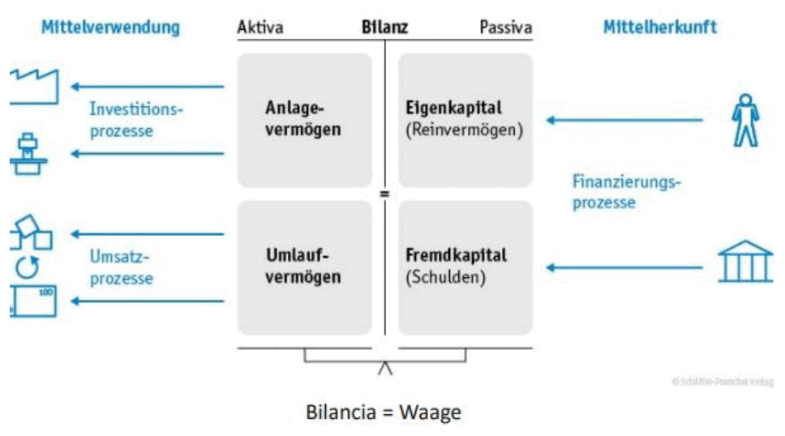

# Jahresabschlussbestandteile und Grundlagen der Bilanz

## Bestandteile nach Größenkriterien

Frage: Welche Bestandteile sind im Jahresabschluss?

- Bestandteile: Bilanz, GuV, Kapitalflussrechnung, Anhang, Lagebericht
- Bestandteile von Jahresabschlüssen sind für Kapitalgesellschaften nach § 267 HGB von verschiedenen Größenkriterien abhängig: je nach Größenklasse unterschiedliche Jahresabschlussbestandteile notwendig.

Bestandteile insgesamt

| | | Bilanz | GuV | Anhang | Lagebericht | Kapitalflussrechnung | Eigenkapitalveränderungsrechnung |
|---|---|---|---|---|---|---|---|
| Personengesellschaft | | x | x | | | | |
| Kapitalgesellschaft | Kleinst | x | x | x | | | |
| Kapitalgesellschaft | Kleine | x | x | x | | | |
| Kapitalgesellschaft | Mittlere | x | x | x | x | | |
| Kapitalgesellschaft | Große | x | x | x | x | | |
| Als Vergleich | Konzernabschlüsse | x | x | x | x | x | x |

## Bilanz – Zweck

Vermittlung eines Bildes der Vermögens- und Finanzlage des Unternehmens (§264 (2) HGB). Dazu in der Bilanz abgebildete Positionen:

- **Passivseite (rechts):** Herkunft der Finanzierungsmittel eines Unternehmens.
  - Finanzierung grundsätzlich durch Einlagen der Eigentümer (Eigenkapital) oder durch Leihen von Geld, z.B. von Banken (Fremdkapital).
  - Eigenkapital gehört dem Unternehmen langfristig und steht für immer zur Verfügung; Fremdkapital muss nach einer gewissen Zeit zurückgezahlt werden.
- **Aktivseite (links):** wofür das bereitgestellte Geld investiert wurde – grundsätzlich in
  - langfristige Vermögensgegenstände (Anlagevermögen) (z.B. Maschinen, Autos, Computer, etc.) oder
  - kurzfristige Vermögensgegenstände (Umlaufvermögen) (z.B. Rohstoffe zur Produktion, Kassenbestände oder offene Forderungen von Kunden)

## Bilanz – Struktur gemäß §266 HGB - Kontenform

Bilanzstruktur für Kapitalgesellschaften in §266 festgelegt; Vermögensgegenstände und Kapitalpositionen nach absteigender Liquidierbarkeit aufgelistet.

| Aktiva | Passiva |
|---|---|
| A. Anlagevermögen | A. Eigenkapital |
| I. Immaterielle Vermögensgegenstände | I. Gezeichnetes Kapital |
| II. Sachanlagen | II. Kapitalrücklage |
| III. Finanzanlagevermögen | III. Gewinnrücklage |
| | IV. Gewinnvortrag |
| B. Umlaufvermögen | V. Jahresüberschuss |
| I. Vorräte | VI. Bilanzgewinn |
| II. Forderungen | |
| II. Wertpapiere | B. Rückstellungen |
| IV. Kasse | 1. Rückstellungen für Pensionen |
| | 2. Steuerrückstellungen |
| | 3. sonstige Rückstellungen |
| | C. Verbindlichkeiten |
| | 1. Anleihen davon konvertibel |
| | 2. Verbindlichkeiten gegenüber Kreditinstituten |
| | 3. erhaltene Anzahlungen auf Bestellungen |
| | 4. Verbindlichkeiten aus Lieferungen und Leistungen |
| C. Rechnungsabgrenzungsposten | C. Rechnungsabgrenzungsposten |
| D. Aktive latente Steuern | D. Passive latente Steuern |
| Aktiva gesamt | Passiva gesamt |

## Bilanz – Struktur gemäß §266 HGB - Staffelform

Bilanz auch in Staffelform (Spaltenform) darstellbar, d.h. Positionen untereinander in einer Spalte. Summe der Aktiva muss der Summe der Passiva entsprechen.

Jahresabschluss zum Geschäftsjahr vom 01.01.2023 bis zum 31.12.2023

Bilanz — Aktiva

| | 31.12.2023 EUR | 31.12.2022 EUR |
|---|---|---|
| A. Anlagevermögen | 3.338.404,61 | 825.674,39 |
| I. Immaterielle Vermögensgegenstände | 102.058,00 | 70.456,00 |
| II. Sachanlagen | 3.236.346,61 | 755.218,39 |
| B. Umlaufvermögen | 1.056.526,05 | 1.053.059,84 |
| I. Vorräte | 446.836,74 | 418.660,77 |
| II. Forderungen und sonstige Vermögensgegenstände | 118.028,88 | 170.287,99 |
| III. Kassenbestand, Bundesbankguthaben, Guthaben bei Kreditinstituten und Schecks | 491.660,43 | 464.111,08 |
| C. Rechnungsabgrenzungsposten | 8.449,25 | 6.795,76 |
| Summe Aktiva | 4.403.379,91 | 1.885.529,99 |

Bilanz — Passiva

| | 31.12.2023 EUR | 31.12.2022 EUR |
|---|---|---|
| A. Eigenkapital | 1.842.947,49 | 1.741.593,41 |
| I. Gezeichnetes Kapital | 25.000,00 | 25.000,00 |
| II. Bilanzgewinn | 1.817.947,49 | 1.716.593,41 |
| B. Rückstellungen | 53.666,68 | 75.687,14 |
| C. Verbindlichkeiten | 2.506.765,74 | 68.249,44 |
| Summe Passiva | 4.403.379,91 | 1.885.529,99 |

## Grundlagen der Bilanz

- Ein Unternehmen hat im Laufe eines Geschäftsjahres eine Vielzahl von Transaktionen, sog. „Geschäftsvorfälle“ (z.B. Kauf von Maschinen, Verkauf von Produkten, Bezahlung von Mitarbeitern, etc.); für jeden Vorfall gibt es in der Regel eine Rechnung.
- Jeder Geschäftsvorfall / jede Rechnung wird in sog. „Büchern“ im Rechnungswesen dokumentiert, d.h. „gebucht“.
- Buchungen immer auf zwei Konten bzw. Positionen der Bilanz und GuV (sog. „Doppelte Buchführung (Doppik)“.
- Diese Konten bilden immer zwei Seiten einer Buchung ab, jeweils im Soll und Haben; Summe der Sollbuchungen muss immer der Summe der Habenbuchungen entsprechen.
- Z.B. Produkt für 10 Euro verkauft: Wert deines Lagerbestands reduziert sich um 10 Euro, dein Kassenbestand steigt um 10 Euro.

Quelle: `bilanzierung/origin/WDS25 - Bilanzierung (NOU)/04 1 - Folien/Bilanzierung - Q4 2026/Bilanzierung - Q4 2026.pdf`, Folien 31–37
