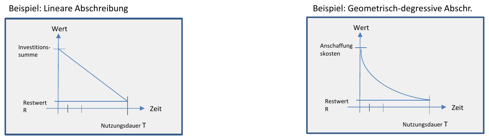

# GuV und Aufwendungen

## GuV – Zweck

1. **Ermittlung des Periodenergebnisses:** Hauptzweck der GuV: Berechnung des Gewinns oder Verlusts, den ein Unternehmen innerhalb eines bestimmten Zeitraums erzielt hat. Zeigt, ob das Unternehmen profitabel arbeitet und wie viel Überschuss oder Fehlbetrag erwirtschaftet wurde. Jahresüberschuss = Differenz aller Erträge und aller Aufwendungen; zeigt, was das Unternehmen verdient hat.
2. **Analyse der Ertrags- und Aufwandsstruktur:** detaillierte Einblicke in die Erträge (z. B. Umsatzerlöse) und Aufwendungen (z. B. Materialkosten, Personalaufwand, Abschreibungen) des Unternehmens; hilft dem Management zu verstehen, welche Kosten und Einnahmen maßgeblich zum Erfolg oder Misserfolg beitragen.
3. **Grundlage für Steuerberechnungen:** Grundlage für die Ermittlung des steuerpflichtigen Einkommens eines Unternehmens; zeigt den steuerlichen Gewinn, auf dessen Basis Steuern berechnet und an das Finanzamt abgeführt werden.

## Begriffliche Grundlagen: Aufwendungen und Erträge

**Definition Aufwand:** Wertverlust des Eigenkapitals eines Unternehmens für die während einer Abrechnungsperiode verbrauchten Güter, Dienstleistungen und öffentlichen Abgaben.

| Aufwendungen | Beispiel |
|---|---|
| Bestandsminderung | Abgang von fertigen Erzeugnissen für den Verkauf |
| Materialaufwand | Verbrauch von Rohstoffen zur Produktion, z.B. Kakao |
| Personalaufwand | Geld- und Sachleistungen an Mitarbeiter während des Geschäftsjahres als Arbeitsentgelt, z.B. Gehalt. |
| Abschreibungen | Planmäßige und außerplanmäßige Wertminderungen von Sachanlagen und immateriellen Anlagen, z.B. Patente und Maschinen. |
| Sonstige betriebliche Aufwendungen | Sammelposten für alles, was nicht unter 1-3 fällt, z.B. Werbeaufwendungen, Reisespesen, Provisionen, Mieten und Pachten, Leasingaufwendungen, etc. |
| Zinsaufwand | Zinsen, die für die Überlassung von Kapital entstehen (z.B. durch Kredit) |

Gesamte operative Aufwendungen des Unternehmens

## Beispiel Materialaufwand: Das Unternehmen verbraucht Rohstoffe für die Produktion

Das Unternehmen verbraucht für 8.000€ Vorräte (Rohstoffe) für die Produktion. Die 8.000 € sind Materialaufwand des laufenden Jahres (Materialaufwand in der GuV) und mindern den Wert der Vorräte.

| Aktiva — Bilanz | Passiva |
|---|---|
| Umlaufvermögen | Fremdkapital |
| Vorräte -8.000 | |

| Aufwand — GuV | Ertrag |
|---|---|
| Materialaufwand 8.000 | |

## Beispiel Personalaufwand: Das Unternehmen muss Mitarbeiter bezahlen

Das Unternehmen muss den Mitarbeitern 30.000 an Gehalt überweisen für das aktuelle Jahr. Die 30.000 € sind Aufwand des laufenden Jahres (Personalaufwand in der GuV) und mindern den Wert des Kassenbestands bzw. Bankguthaben.

| Aktiva — Bilanz | Passiva |
|---|---|
| Umlaufvermögen | Fremdkapital |
| Kasse -30.000 | |

| Aufwand — GuV | Ertrag |
|---|---|
| Personalaufwand 30.000 | |

## Beispiel Zinsaufwand: Das Unternehmen bezahlt die Zinsen für den Kredit

Das Unternehmen muss 10.000 Zinsen an die Bank in bar bezahlen. Die 10.000 € sind Aufwand des laufenden Jahres (Zinsaufwand in der GuV) und mindern den Bestand an Kasse bzw. Bankguthaben.

| Aktiva — Bilanz | Passiva |
|---|---|
| Umlaufvermögen | Fremdkapital |
| Kasse -10.000 | |

| Aufwand — GuV | Ertrag |
|---|---|
| Zinsaufwand 10.000 | |

## Beispiel Abschreibungen: Das Unternehmen muss die Server abschreiben

Das Unternehmen muss eine Maschine abschreiben; dafür fallen 5.000€ Kosten an. Die 5.000 € sind Aufwand des laufenden Jahres (Abschreibungen in der GuV) und mindern den Wert des Servers.

| Aktiva — Bilanz | Passiva |
|---|---|
| Anlagevermögen | Fremdkapital |
| Sachanlagevermögen -5.000 | |

| Aufwand — GuV | Ertrag |
|---|---|
| Abschreibungen 5.000 | |

## Planmäßige Abschreibungen

Gesetzliche Grundlage: §253 (3), S. 1

- „Bei Vermögensgegenständen des Anlagevermögens, deren Nutzung zeitlich begrenzt ist, sind die Anschaffungs- oder die Herstellungskosten um planmäßige Abschreibungen zu vermindern.“

Gesetzliche Grundlage: (§253 (3), S. 2))

- Für planmäßige Abschreibungen muss der Abschreibungsplan enthalten:
  - die zu verteilenden Anschaffungskosten abzgl. Resterlöse,
  - die voraussichtliche Nutzungsdauer und
  - die ausgewählte Abschreibungsmethode
- Ausgangsbetrag: Anschaffungskosten. Sofern wesentlich, ist ein geplanter Resterlös durch Subtraktion zu berücksichtigen (da damit der laufende Wertverlust verringert wird).
- Planmäßige Nutzungsdauer orientiert sich an der wirtschaftlichen - nicht technischen - Nutzungsdauer (Investitionsrechnung); Grundlage für ihre Bemessung bilden meist sog. steuerliche AfA-Tabellen.

## Abschreibungsmethoden

Als Abschreibungsmethoden haben sich die folgenden etabliert:

| Beispiel: Lineare Abschreibung | Beispiel: Geometrisch-degressive Abschr. |
|---|---|
| Ablauf: - Bestimmung der Anschaffungskosten - Bestimmung des Restwerts - Bestimmung der Nutzungsdauer - Berechnung der jährlichen Abschreib. | Ablauf: - Bestimmung der Anschaffungskosten - Bestimmung des Restwerts - Bestimmung der Nutzungsdauer - Berechnung der jährlichen Abschreib. |
| Prinzip - Jährlich gleichbleibende Abschreibungskosten | Prinzip - Anfangs hohe, dann fallende Abschreibungen im Zeitablauf |
| Abschreibung = (Kaufpreis − Restwert) / Nutzungdaher | Abschreibung = Kaufpreis * Abschreibungssatz |

## Sachanlagevermögen: Außerplanmäßige Abschreibung

- Folgebewertung: Wegen der handelsrechtlichen Bilanzierungszwecke gilt hier das Niederstwertprinzip.
- Gesetzliche Grundlage (§253 (3)): „Bei Vermögensgegenständen des Anlagevermögens sind bei voraussichtlich dauernder Wertminderung außerplanmäßige Abschreibungen vorzunehmen, um diese mit dem niedrigeren Wert anzusetzen, der ihnen am Abschlussstichtag beizulegen ist.“
- Konten: Außerplanmäßige Abschreibungen sind ebenso Teil des GuV-Position „Abschreibungen“ gem. §275 HGB.

Quelle: `bilanzierung/origin/WDS25 - Bilanzierung (NOU)/04 1 - Folien/Bilanzierung - Q4 2026/Bilanzierung - Q4 2026.pdf`, Folien 58–66
