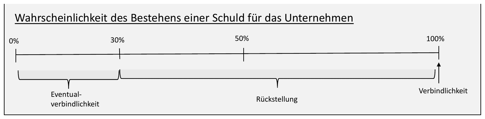

# Rückstellungen

## Rückstellungen

**Beispiel Deutsche Messe AG**

Definition und Erklärung

- Verbindlichkeiten sind Schulden, die 100% sicher sind.
- Rückstellungen sind Schulden, die nicht 100% sicher, aber möglich sind (>30%)
- Eventualverbindlichkeiten sind Schulden, die unwahrscheinlich sind. (<30%)

Folgen

- Verbindlichkeiten und Rückstellungen werden gebucht und in der Bilanz gezeigt. Eventualverbindlichkeiten werden nicht in der Bilanz gezeigt, sondern lediglich im Anhang beschrieben.

## Abbildungen von Rückstellungen in der Bilanz

**Arten von Rückstellungen**

Definition

Rückstellungen sind Bilanzposten, die ein Unternehmen für zukünftige Verpflichtungen oder Aufwendungen bildet, deren genaue Höhe oder Fälligkeit noch ungewiss ist. Rückstellungen werden auf der Passivseite der Bilanz als Fremdkapital ausgewiesen, da sie Verpflichtungen gegenüber Dritten darstellen, die das Unternehmen in der Zukunft belasten könnten.

Relevante Rückstellungsarten

| Rückstellungen für ungewisse Verbindlichkeiten | Pensionsrückstellungen | Steuerrückstellungen |
|---|---|---|
| …für Verpflichtungen, deren Eintritt zwar wahrscheinlich, aber hinsichtlich der Höhe oder des Zeitpunkts ungewiss ist. Dazu gehören z. B. Prozessrückstellungen (für mögliche Gerichts- oder Anwaltskosten), Gewährleistungsrückstellungen oder Umweltverpflichtungen | …für Verpflichtungen aus betrieblichen Altersvorsorgezusagen an Mitarbeiter. Diese Rückstellungen berücksichtigen zukünftige Zahlungen an Mitarbeiter im Ruhestand und erfordern häufig langfristige Ansparungen. | …für noch nicht gezahlte Steuern, deren genaue Höhe aber zum Abschlussstichtag nicht feststeht. Beispiele sind Rückstellungen für Körperschaftsteuer oder Gewerbesteuer, falls eine Steuerprüfung noch aussteht |

## Abbildungen von Rückstellungen in der Bilanz

**Kunden verklagen das Unternehmen – Sonstige Rückstellungen**

Beispiel

- Ein Kunde hat ein defektes Produkt erhalten und sich daran verletzt. Nun verklagt er unser Unternehmen auf Schadensersatz in Höhe von 80.000€. Der Ausgang der Klage ist am Abschlusstichtag ungewiss.
- Die Klage ist eine potentielle Verpflichtung, die das Unternehmen bezahlen muss. Da die Schuld dieses Jahr entstanden ist, ist sie ein Aufwand des aktuellen Jahres in der GuV.

| Aktiva — Bilanz | Passiva |
|---|---|
| Umlaufvermögen | Rückstellungen |
| | Sonstige Rückstellungen 80.000 |

| Aufwand — GuV | Ertrag |
|---|---|
| Sonst. betr. Aufwand 80.000 | |

## Abbildungen von Rückstellungen in der Bilanz

**Das Finanzamt erwartet Steuerzahlungen vom Unternehmen - Steuerrückstellungen**

Beispiel

- Unser Unternehmen schätzt die Steuerschulden des nächsten Jahres auf 50.000 € ein.
- Dies stellt geschätzte Schulden des Unternehmens dar (Verpflichtung).
- Diese sind im laufenden Jahr entstanden (Steueraufwand).

| Aktiva — Bilanz | Passiva |
|---|---|
| Umlaufvermögen | Rückstellungen |
| | Steuerrückstellungen 50.000 |

| Aufwand — GuV | Ertrag |
|---|---|
| Steueraufwand 50.000 | |

## Abbildungen von Rückstellungen in der Bilanz

**Das Mitarbeiter erhält eine Pensionszusage vom Unternehmen - Pensionsrückstellungen**

Beispiel

- Ein Mitarbeiter erhält eine Zusage für eine Pensionszahlung vom Unternehmen, wenn er in Rente geht. Diese wird auf 30.000€ geschätzt, die vom Unternehmen dann gezahlt werden müssen.
- Das Unternehmen erhält damit eine Verbindlichkeit, die in der Zukunft bezahlt werden muss. Da dies einem Aufwand für Mitarbeiter entspricht, ist dies Personalaufwand.

| Aktiva — Bilanz | Passiva |
|---|---|
| Umlaufvermögen | Rückstellungen |
| | Pensionsrückstellungen 30.000 |

| Aufwand — GuV | Ertrag |
|---|---|
| Personalaufwand 30.000 | |

Quelle: `bilanzierung/origin/WDS25 - Bilanzierung (NOU)/04 1 - Folien/Bilanzierung - Q4 2026/Bilanzierung - Q4 2026.pdf`, Folien 73–77
