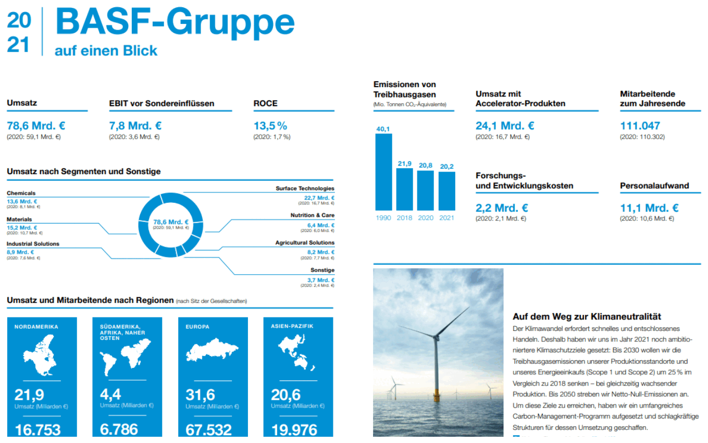

# Anhang und Lagebericht

## Anhang

**Zweck des Anhangs:** Der Anhang stellt ein Berichtsinstrument dar. Er enthält vor allem qualitative Informationen, die die Zahlen aus GuV und Bilanz erläutern und ergänzen sollen.

Inhalte des Anhangs sind z.B.

- Die verwendeten Abschreibungsmethoden
- Die Ausnutzung von Ansatzwahlrechten bei selbst geschaffenen, immateriellen Vermögenswerten und Disagios

## Lagebericht

Lagebericht als Teil der Unternehmenspublizität einer Kapitalgesellschaft

Pflichtbestandteile (§§ 289 Abs. 1 HGB) u.a.

- Darstellung des Geschäftsverlaufs und Geschäftsergebnis mit den wichtigsten finanziellen Kennzahlen
- Lage der Kapitalgesellschaft
- Voraussichtliche Entwicklung mit ihren Chancen und Risiken (Prognosebericht)

Sollbestandteile (§§ 289 Abs. 2 HGB) u.a.

1. Risikomanagementziele und -methoden sowie Methoden zur Risikoabsicherung
2. Preisänderungs-, Ausfall- und Liquiditätsrisiken sowie Risiken aus Zahlungsströmen
3. Zweigniederlassungen der Gesellschaft
4. Den Bereich F&E

Pflichtbestandteile für börsennotierte Unternehmen (§§ 289b,c HGB) — CSR-Themen u.a.

1. Nicht-finanzielle Erklärung inklusive
   1. Umweltbelange (z.B. CO2-Emissionen, Wasserverbrauch, Nutzung erneuerbarer Energien, etc.)
   2. Arbeitnehmerbelange (z.B. Gleichstellungsthemen, Arbeitsbedingungen, Gesundheitsschutz, etc.)
   3. Sozialbelange

## Lagebericht – Beispiel BASF

Quelle: `bilanzierung/origin/WDS25 - Bilanzierung (NOU)/04 1 - Folien/Bilanzierung - Q4 2026/Bilanzierung - Q4 2026.pdf`, Folien 83–85
