# Jahresabschlusserstellung

## Inhaltsübersicht

Bilanzierung und Jahresabschluss

1. Jahresabschlussgrundlagen
2. Jahresabschlusserstellung
3. Jahresabschlussanalyse

## Jahresabschlussbestandteile

**Bestandteile nach Größenkriterien**

Frage: Welche Bestandteile sind im Jahresabschluss?

Die Bestandteile von Jahresabschlüssen sind für Kapitalgesellschaften nach § 267 HGB von verschiedenen Größenkriterien abhängig:

- Je nach Größenklasse sind unterschiedliche Jahresabschlussbestandteile notwendig:

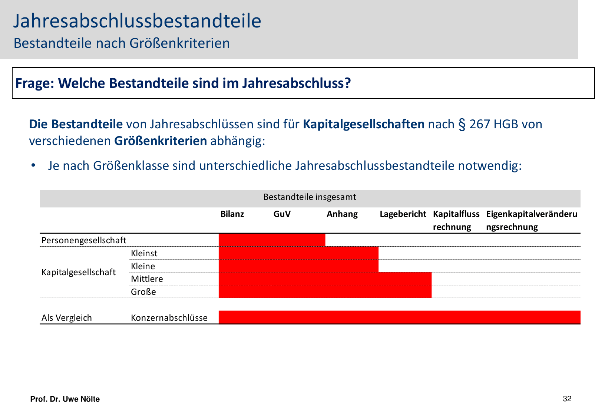

Bestandteile insgesamt

- Bilanz
- GuV
- Anhang
- Lagebericht
- Kapitalflussrechnung
- Eigenkapitalveränderungsrechnung

- Personengesellschaft
- Kapitalgesellschaft
  - Kleinst
  - Kleine
  - Mittlere
  - Große
- Als Vergleich
  - Konzernabschlüsse

## Jahresabschlussbestandteile

**Bilanz**

Bestandteile

- Bilanz
- GuV
- Kapitalflussrechnung
- Anhang
- Lagebericht

Zweck der Bilanz

- Vermittlung eines Bildes der Vermögens- und Finanzlage des Unternehmens (§264 (2) HGB). Hierzu werden die folgenden Positionen in der Bilanz abgebildet:

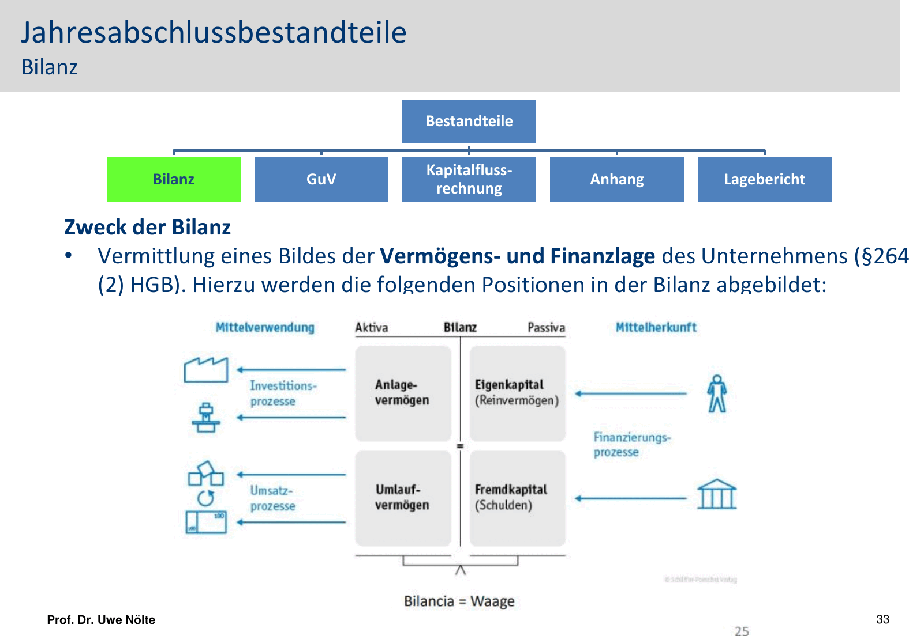

## Jahresabschlussbestandteile

**Bilanz**

Zweck der Bilanz

- Die Passivseite (rechts) der Bilanz zeigt die Herkunft der Finanzierungsmittel eines Unternehmens.
  - Unternehmen können sich grundsätzlich durch Einlagen der Eigentümer finanzieren (Eigenkapital) oder durch das Leihen von Geld z.B. von Banken (Fremdkapital).
  - Das Eigenkapital gehört dem Unternehmen langfristig und steht für immer zur Verfügung. Das Fremdkapital muss nach einer gewissen Zeit zurückgezahlt werden.
- Die Aktivseite (links) zeigt an, wofür das bereitgestellte Geld investiert wurde. Unternehmen können dabei grundsätzlich investieren in
  - langfristige Vermögensgegenstände (Anlagevermögen) investieren (z.B. Maschinen, Autos, Computer, etc.) oder
  - kurzfristige Vermögensgegenstände (Umlaufvermögen) (z.B. Rohstoffe zur Produktion, Kassenbestände oder offene Forderungen von Kunden)

## Jahresabschlussbestandteile

**Bilanz – Struktur gemäß §266 HGB - Kontenform**

Bilanz

| Aktiva | Passiva |
|---|---|
| A. Anlagevermögen | A. Eigenkapital |
| I. Immaterielle Vermögensgegenstände | I. Gezeichnetes Kapital |
| II. Sachanlagen | II. Kapitalrücklage |
| III. Finanzanlagevermögen | III. Gewinnrücklage |
| | IV. Gewinnvortrag |
| B. Umlaufvermögen | V. Jahresüberschuss |
| I. Vorräte | VI. Bilanzgewinn |
| II. Forderungen | |
| II. Wertpapiere | B. Rückstellungen |
| IV. Kasse | 1. Rückstellungen für Pensionen |
| | 2. Steuerrückstellungen |
| | 3. sonstige Rückstellungen |
| | C. Verbindlichkeiten |
| | 1. Anleihen davon konvertibel |
| | 2. Verbindlichkeiten gegenüber Kreditinstituten |
| | 3. erhaltene Anzahlungen auf Bestellungen |
| | 4. Verbindlichkeiten aus Lieferungen und Leistungen |
| C. Rechnungsabgrenzungsposten | C. Rechnungsabgrenzungsposten |
| D. Aktive latente Steuern | D. Passive latente Steuern |
| Aktiva gesamt | Passiva gesamt |

Die Bilanzstruktur ist für Kapitalgesellschaften in §266 festgelegt. Die Vermögensgegenstände und Kapitalpositionen werden dabei nach absteigender Liquidierbarkeit aufgelistet.

## Jahresabschlussbestandteile

**Bilanz – Struktur gemäß §266 HGB - Staffelform**

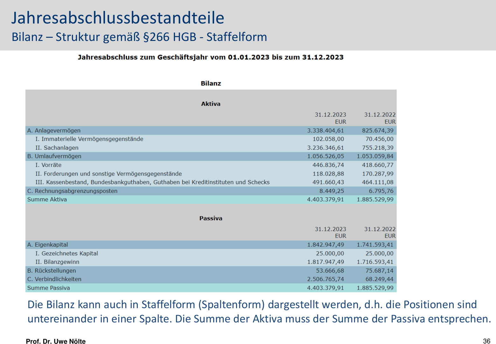

Die Bilanz kann auch in Staffelform (Spaltenform) dargestellt werden, d.h. die Positionen sind untereinander in einer Spalte. Die Summe der Aktiva muss der Summe der Passiva entsprechen.

## Jahresabschlussbestandteile

**Grundlagen der Bilanz**

Grundlagen

- Ein Unternehmen hat im Laufe eines Geschäftsjahres eine Vielzahl von Transaktionen, sog. „Geschäftsvorfälle“ (z.B. Kauf von Maschinen, Verkauf von Produkten, Bezahlung von Mitarbeitern, etc.) Für jeden Vorfall gibt es in der Regel eine Rechnung.
- Jeder Geschäftsvorfall / jede Rechnung eines Unternehmens wird in sog. „Büchern“ im Rechnungswesen dokumentiert, d.h. „gebucht“.
- Die Buchungen erfolgen immer auf zwei Konten bzw. Positionen der Bilanz und GuV (sog. „Doppelte Buchführung (Doppik)“.
- Diese Konten bilden immer zwei Seiten einer Buchung ab, jeweils im Soll und Haben. Die Summe der Sollbuchungen muss dabei immer der Summe der Habenbuchungen entsprechen. Wird z.B. ein Produkt für 10 Euro verkauft, reduziert sich der Wert deines Lagerbestands um 10 Euro und dein Kassenbestand steigt um 10 Euro.

## Abbildungen von Finanzierungen in der Bilanz

**Eigentümer gründen das Unternehmen mit 50.000€**

Beispiel

- Schulze und Miller gründen die SAS AG durch die Einlage von 50.000€.
- Das Unternehmen erhält damit 50.000€ in bar von den Eigentümern (Kapitalherkunft)
- Das geld wird im ersten Schritt auf ein Bankkonto gelegt. (Kapitalverwendung)

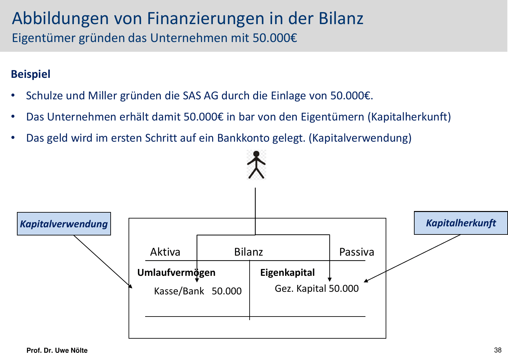

Kapitalverwendung / Kapitalherkunft

| Aktiva — Bilanz | Passiva |
|---|---|
| Umlaufvermögen | Eigenkapital |
| Kasse/Bank 50.000 | Gez. Kapital 50.000 |

## Abbildungen von Finanzierungen in der Bilanz

**Arten von Eigenkapital**

Eigenkapital: Was ist Eigenkapital?

- Eigenkapital ist der Teil des Kapitals eines Unternehmens, der den Eigentümern oder Gesellschaftern gehört. Es stellt die finanzielle Grundlage des Unternehmens dar und wird in der Bilanz auf der Passivseite ausgewiesen. Eigenkapital ergibt sich als Differenz zwischen den Vermögenswerten (Aktiva) und den Verbindlichkeiten (Fremdkapital) eines Unternehmens.

Merkmale von Eigenkapital

- Risikoübernahme: Eigenkapital trägt das volle unternehmerische Risiko. Im Fall einer Insolvenz werden Verbindlichkeiten gegenüber Gläubigern (Fremdkapitalgebern) vorrangig bedient, und das Eigenkapital kann verloren gehen.
- Unbefristet: Eigenkapital steht dem Unternehmen grundsätzlich unbefristet zur Verfügung und muss nicht zurückgezahlt werden.
- Anspruch auf Gewinn: Eigenkapitalgeber haben Anspruch auf den Gewinn des Unternehmens, entweder als Dividenden (bei Aktiengesellschaften) oder als Entnahmen (bei Einzelunternehmen und Personengesellschaften).
- Mitbestimmung: Eigenkapitalgeber (z. B. Aktionäre) haben in der Regel ein Mitspracherecht bei wichtigen Unternehmensentscheidungen

## Abbildungen von Finanzierungen in der Bilanz

**Arten von Eigenkapital**

Eigenkapital

| Gezeichnetes Kapital | Kapitalrücklage | Gewinnrücklage | Gewinnvortrag | Jahresüberschuss |
|---|---|---|---|---|
| Das Grundkapital bei einer Aktiengesellschaft (AG) und das Stammkapital bei einer Gesellschaft mit beschränkter Haftung (GmbH). Es ist das von den Gesellschaftern eingebrachte Kapital und bildet die Basis des Eigenkapital | Kapitalrücklagen entstehen, wenn die Gesellschafter zusätzlich zum gezeichneten Kapital Kapital einbringen. Zum Beispiel bei einem Agio (Aufgeld) bei der Ausgabe neuer Aktien über den Nennwert. | Die Gewinnrücklagen bestehen aus nicht ausgeschütteten Gewinnen, die das Unternehmen im Laufe der Zeit angesammelt hat. Sie dienen dazu, die finanzielle Stabilität des Unternehmens zu stärken und Risiken abzufedern | Der Gewinnvortrag ist der Teil des Jahresüberschusses, der nicht ausgeschüttet wird und auf das nächste Jahr vorgetragen wird. Ein Verlustvortrag ist ein auf das nächste Geschäftsjahr vorgetragener Verlust. | Der Jahresüberschuss ergibt sich als Differenz von Erträgen und Aufwendungen. Er erhöht das Eigenkapital eines Unternehmens. |

## Abbildungen von Finanzierungen in der Bilanz

**Arten von Eigenkapital - Beispieltransaktionen**

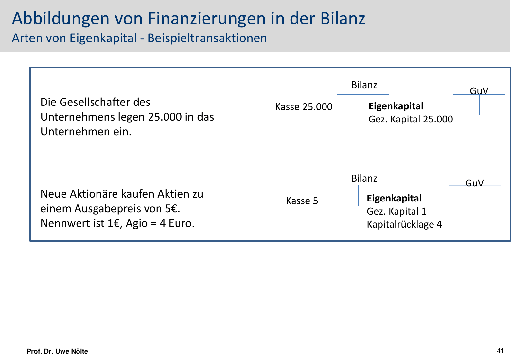

Die Gesellschafter des Unternehmens legen 25.000 in das Unternehmen ein.

| Bilanz | | GuV |
|---|---|---|
| Kasse 25.000 | Eigenkapital; Gez. Kapital 25.000 | |

Neue Aktionäre kaufen Aktien zu einem Ausgabepreis von 5€. Nennwert ist 1€, Agio = 4 Euro.

| Bilanz | | GuV |
|---|---|---|
| Kasse 5 | Eigenkapital; Gez. Kapital 1; Kapitalrücklage 4 | |

## Abbildungen von Finanzierungen in der Bilanz

**Schulden des Unternehmen**

Gesetzliche Grundlage (§246 (1) HGB)

- „Der Jahresabschluss hat sämtliche Vermögensgegenstände, Schulden, Rechnungsabgrenzungsposten sowie Aufwendungen und Erträge zu enthalten (…)“
- Schulden sind „Verpflichtungen eines Unternehmens gegenüber Dritten“.
- Fremdkapital bzw. Schulden bezeichnet die finanziellen Mittel, die ein Unternehmen von externen Geldgebern erhält und die es zu einem bestimmten Zeitpunkt oder unter bestimmten Bedingungen zurückzahlen muss. Es stellt eine der beiden Hauptfinanzierungsquellen eines Unternehmens dar, neben dem Eigenkapital. Fremdkapital wird in der Bilanz auf der Passivseite ausgewiesen und umfasst alle Verpflichtungen des Unternehmens gegenüber Dritten. Schulden und Fremdkapital kann deckungsgleich verwendet werden.

## Abbildungen von Finanzierungen in der Bilanz

**Arten von Eigenkapital**

Fremdkapital: Was ist Fremdkapital?

Merkmale von Fremdkapital

- Rückzahlungspflicht:
  Fremdkapital muss an die Gläubiger (z. B. Banken, Lieferanten) zurückgezahlt werden, oft inklusive Zinsen.
- Zeitlich begrenzt:
  Die Verfügbarkeit von Fremdkapital ist auf eine bestimmte Laufzeit begrenzt (z. B. ein Darlehen mit einer Laufzeit von fünf Jahren).
- Keine Mitbestimmungsrechte:
  Fremdkapitalgeber haben keine Mitbestimmungsrechte im Unternehmen, im Gegensatz zu Eigenkapitalgebern.
- Verzinsung:
  Fremdkapital ist in der Regel verzinslich, d. h., der Gläubiger erhält eine Gegenleistung für die Bereitstellung der Mittel (z. B. Zinsen bei Krediten).

## Abbildungen von Finanzierungen in der Bilanz

**Schulden des Unternehmen**

Gesetzliche Grundlage (§246 (1) HGB)

- „Der Jahresabschluss hat sämtliche Vermögensgegenstände, Schulden, Rechnungsabgrenzungsposten sowie Aufwendungen und Erträge zu enthalten (…)“

Arten von Schulden

| Verbindlichkeiten | Rückstellungen |
|---|---|
| Verbindlichkeiten sind hinsichtlich ihrer Existenz, Höhe und Fälligkeit sicher. | Rückstellungen sind hinsichtlich ihrer Existenz, Höhe oder Fälligkeit unsicher, aber wahrscheinlich. |

## Abbildungen von Finanzierungen in der Bilanz

**Arten von Verbindlichkeiten**

Verbindlichkeiten

| Verbindlichkeiten ggü. Kreditinstituten | Erhaltene Anzahlungen | Verbindlichkeiten aus Lieferung und Leistung | Sonstige Verbindlichkeiten |
|---|---|---|---|
| Verbindlichkeiten gegenüber Kreditinstituten sind Schulden, die ein Unternehmen oder eine Person bei Banken oder anderen Kreditinstituten hat. Diese Schulden entstehen, wenn ein Kreditinstitut einem Unternehmen finanzielle Mittel in Form von Darlehen, Krediten oder Überziehungen auf einem Bankkonto zur Verfügung stellt. | Erhaltene Anzahlungen sind Schulden eines Unternehmens, die durch Anzahlungen von Kunden für zukünftige Leistungen oder Produkte entstehen. Das Unternehmen hat hierbei seine Lieferpflicht noch nicht erfüllt, der Kunde seine Zahlungspflicht hingegen schon. | Verbindlichkeiten aus Lieferung und Leistung sind kurzfristige Schulden eines Unternehmens gegenüber seinen Lieferanten. Sie entstehen, wenn ein Unternehmen Waren oder Dienstleistungen erhält, die es noch nicht sofort bezahlt hat. Diese Verbindlichkeiten zählen zu den kurzfristigen Verbindlichkeiten. | Sonstige Verbindlichkeiten umfassen alle Schulden, die nicht direkt aus der Geschäftstätigkeit (also dem Einkauf von Waren oder Dienstleistungen) oder aus Krediten bei Banken stammen, also z.B. Verbindlichkeiten ggü. Mitarbeitern, Verbindlichkeiten ggü. der Sozialversicherung oder ggü. dem Finanzamt. |

## Abbildungen von Finanzierungen in der Bilanz

**Das Unternehmen leiht sich 100.000€ bei der Bank**

Beispiel

- Das Unternehmen leiht sich dann 100.000 durch einen Bankkredit.
- Das Unternehmen erhält damit 100.000€ in bar von einem Kreditinstitut, die es zurückzahlen muss (Kapitalherkunft)
- Das Geld wird im dann wieder auf ein Bankkonto gelegt. (Kapitalverwendung)

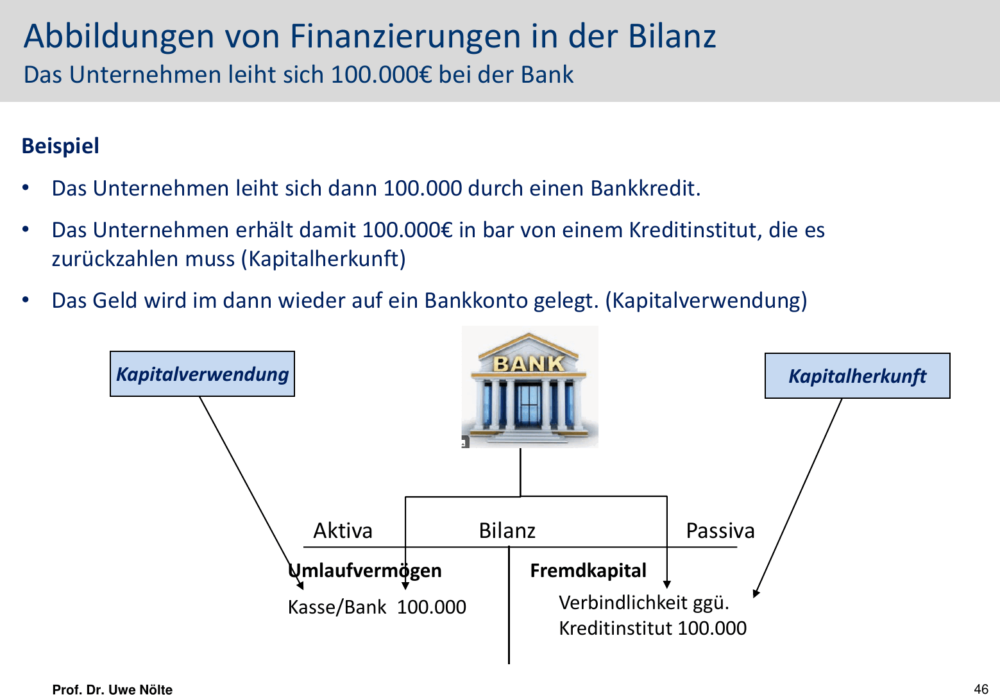

Kapitalverwendung / Kapitalherkunft

| Aktiva — Bilanz | Passiva |
|---|---|
| Umlaufvermögen | Fremdkapital |
| Kasse/Bank 100.000 | Verbindlichkeit ggü. Kreditinstitut 100.000 |

## Abbildungen von Finanzierungen in der Bilanz

**Kunden bestellen und leisten Anzahlungen**

Beispiel

- Kunden bestellen Produkte bei der SAS und leisten Anzahlungen in Höhe von 20.000€.
- Das Unternehmen erhält damit 20.000€ in bar von Kunden, die es zurückzahlen muss, wenn es nicht liefern kann (Kapitalherkunft).
- Es wird im ersten Schritt wieder auf ein Bankkonto gelegt. (Kapitalverwendung)

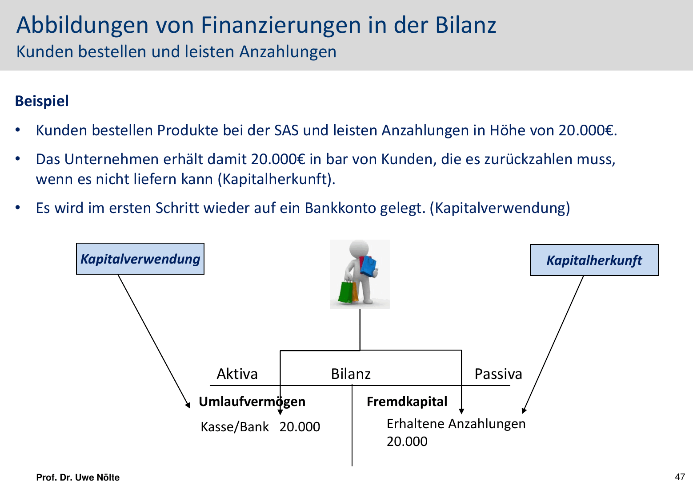

Kapitalverwendung / Kapitalherkunft

| Aktiva — Bilanz | Passiva |
|---|---|
| Umlaufvermögen | Fremdkapital |
| Kasse/Bank 20.000 | Erhaltene Anzahlungen 20.000 |

## Abbildungen von Finanzierungen in der Bilanz

**Das Unternehmen bestellt und zahlt „auf Ziel“**

Beispiel

- Das Unternehmen erhält eine Lieferung von Rohstoffen für die Produktion in Höhe von 8.000€ auf Ziel. D.h. die Bezahlung erfolgt erst zu einem späteren Zeitpunkt.
- Das Unternehmen erhält damit Rohstoffe von Lieferanten, die sie bezahlen muss. Dies stellt eine Schuld dar. (Kapitalherkunft)
- Die Rohstoffe werden auf Lager gelegt. (Kapitalverwendung)

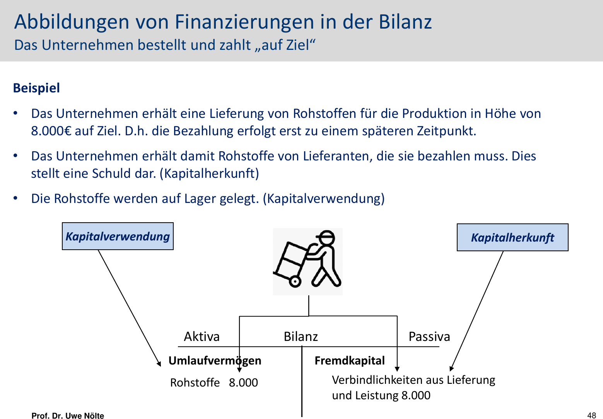

Kapitalverwendung / Kapitalherkunft

| Aktiva — Bilanz | Passiva |
|---|---|
| Umlaufvermögen | Fremdkapital |
| Rohstoffe 8.000 | Verbindlichkeiten aus Lieferung und Leistung 8.000 |

## Abbildungen von Investitionen in der Bilanz

**Kauf von Sachanlagevermögen**

Definition

- Das Sachanlagevermögen in der Bilanz umfasst alle physischen, langfristigen Vermögenswerte eines Unternehmens, die für den Geschäftsbetrieb notwendig sind und ihm langfristig Nutzen bringen.

Sachanlagevermögen

| Grundstücke und Gebäude | Technische Anlagen und Maschinen | Betriebs- und Geschäftsausstattung |
|---|---|---|
| Grundstücke und die darauf errichteten Gebäude gehören zu den wichtigsten Bestandteilen des Sachanlagevermögens, insbesondere für Unternehmen in der Industrie und im Einzelhandel | Dazu zählen Produktionsmaschinen und technische Anlagen, die für die Herstellung von Produkten benötigt werden. Sie bilden oft den Hauptteil des Anlagevermögens in Produktionsunternehmen. | Darunter fallen alle Gegenstände, die zur Büro- oder Betriebsausstattung gehören, wie Büroeinrichtungen, Computer, Möbel und andere Arbeitsmittel |

## Abbildungen von Investitionen in der Bilanz

**Ansatz und Bewertung**

Definition

- Die Erstbewertung des Anlagevermögens erfolgt gem. §253 (1), S. 1-2 zu Anschaffungskosten (AK): Diese ergeben sich wie folgt.

Anschaffungskosten: 1. Definition

§ 255 (1) HGB: Aufwendungen ...

- zum Erwerb eines VG,
- zur Versetzung in einen betriebsbereiten Zustand,
- dem VG einzeln zurechenbar.

Anschaffungskosten: 2. Umsetzung

```
  Anschaffungspreis (ohne MwSt)
- Anschaffungspreisminderungen
+ Anschaffungsnebenkosten
  (soweit einzeln zurechenbar)
+ nachträgliche Anschaffungskosten
———————————————————
= Anschaffungskosten (HGB und StR)
```

## Abbildungen von Investitionen in der Bilanz

**Kauf einer Serveranlage**

Beispiel

- Das Unternehmen erwirbt eine große Serveranlage für 40.000 und bezahlt in bar.
- Das Sachanlagevermögen steigt damit um 40.000€.
- Der Kassen- oder Kontostand fällt damit um 40.000€.

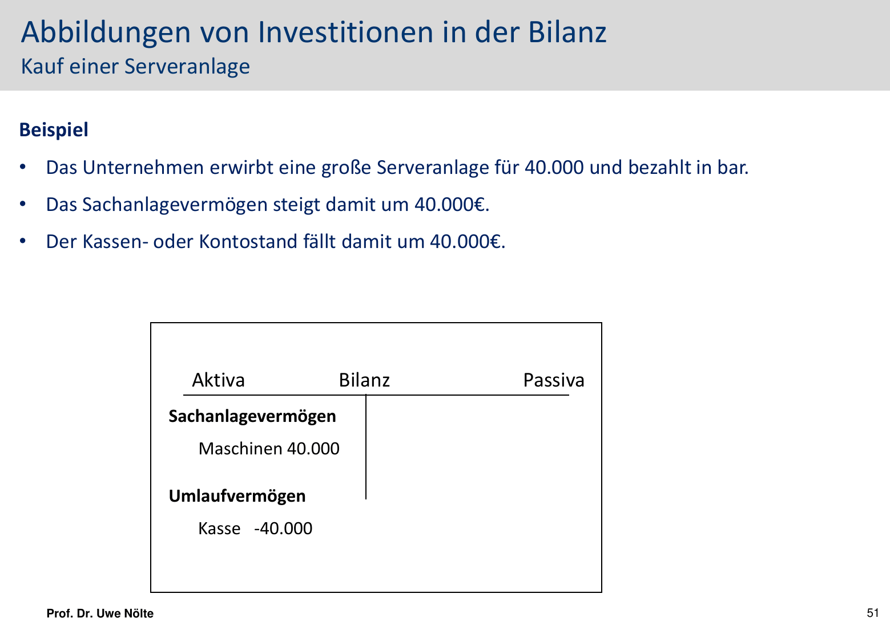

| Aktiva — Bilanz | Passiva |
|---|---|
| Sachanlagevermögen | |
| Maschinen 40.000 | |
| Umlaufvermögen | |
| Kasse -40.000 | |

## Abbildungen von Investitionen in der Bilanz

**Kauf von immateriellen Vermögensgegenständen**

Definition

- Das immaterielle Anlagevermögen in der Bilanz umfasst alle nicht-physischen, langfristigen Vermögenswerte eines Unternehmens, die für den Geschäftsbetrieb notwendig sind und ihm langfristig Nutzen bringen.

Immaterielles Anlagevermögen

| Patente und Lizenzen | Marken und Warenzeichen | Urheberrechte |
|---|---|---|
| Patente sind Schutzrechte für technische Erfindungen, die dem Unternehmen einen exklusiven Vorteil verschaffen. Lizenzen sind Nutzungsrechte, die ein Unternehmen an geistigem Eigentum anderer besitzt, beispielsweise zur Nutzung einer Software. | Markenrechte und Warenzeichen repräsentieren das Branding und die Wiedererkennbarkeit eines Unternehmens und können als immaterielle Vermögenswerte bilanziert werden, sofern sie käuflich erworben wurden. | Urheberrechte schützen kreative Werke wie Texte, Musik oder Bilder, die oft von Medienunternehmen als immaterielle Vermögenswerte bilanziert werden. |

## Abbildungen von Investitionen in der Bilanz

**Kauf eines Patents**

Beispiel

- Das Unternehmen erwirbt ein Patent für 15.000 und bezahlt in bar.
- Das immaterielle Anlagevermögen steigt damit um 15.000€.
- Der Kassen- oder Kontostand fällt damit um 15.000€.

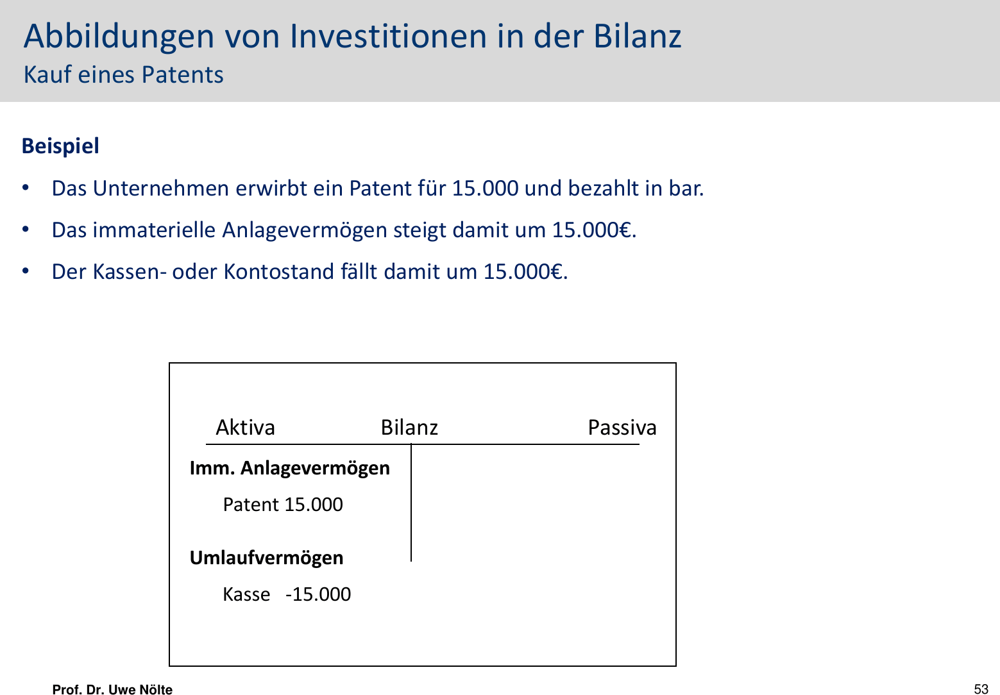

| Aktiva — Bilanz | Passiva |
|---|---|
| Imm. Anlagevermögen | |
| Patent 15.000 | |
| Umlaufvermögen | |
| Kasse -15.000 | |

## Abbildungen von Investitionen in der Bilanz

**Kauf von Vorräten**

Definition

- Vorräte in der Bilanz sind Bestände an Rohstoffen, Materialien, unfertigen und fertigen Erzeugnissen sowie Handelswaren, die ein Unternehmen für seine Produktion und den Verkauf hält. Vorräte spiegeln die Ressourcen eines Unternehmens wider, die zur Weiterverarbeitung, zum Verkauf oder zur Unterstützung der laufenden Geschäftstätigkeit benötigt werden.
- Typische Beispiel sind Rohstoffe, Unfertige Erzeugnisse und fertige Erzeugnisse.
- Ein zu hoher Lagerbestand an Vorräten kann zu höheren Lagerkosten, einer geringeren Liquidität (wenig Cash) und Zinskosten führen.

Vorräte

- Rohstoffe
- Unfertige Erzeugnisse
- Fertige Erzeugnisse

## Abbildungen von Investitionen in der Bilanz

**Ansatz und Bewertung**

Definition

- Die Erstbewertung des Umlaufvermögens erfolgt gem. §253 (1), S. 1-2 zu Anschaffungskosten (AK): Diese ergeben sich wie folgt.

Anschaffungskosten: 1. Definition

§ 255 (1) HGB: Aufwendungen ...

- zum Erwerb eines VG,
- zur Versetzung in einen betriebsbereiten Zustand,
- dem VG einzeln zurechenbar.

Anschaffungskosten: 2. Umsetzung

```
  Anschaffungspreis (ohne MwSt)
- Anschaffungspreisminderungen
+ Anschaffungsnebenkosten
  (soweit einzeln zurechenbar)
+ nachträgliche Anschaffungskosten
———————————————————
= Anschaffungskosten (HGB und StR)
```

- Skontobeträge sind nicht in die AK einzubeziehen (unabhängig davon ob genutzt oder nicht).
- Finanzierungskosten sind i.d.R. nicht direkt zurechenbar.
- Allg. Bonuszahlungen sind i.d.R. nicht direkt zurechenbar.

## Abbildungen von Investitionen in der Bilanz

**Kauf von Vorräten**

Beispiel

- Das Unternehmen erwirbt Vorräte zur Produktion für 25.000 und bezahlt in bar.
- Das Vorratsvermögen steigt damit um 25.000€.
- Der Kassen- oder Kontostand fällt damit um 25.000€.

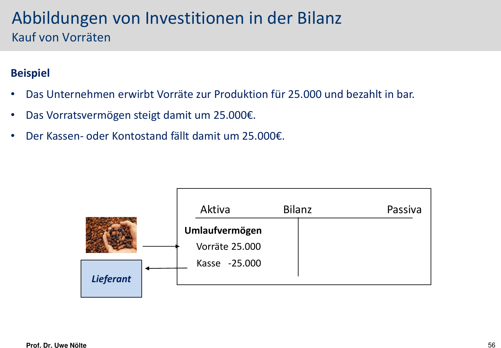

| Aktiva — Bilanz | Passiva |
|---|---|
| Umlaufvermögen | |
| Vorräte 25.000 | |
| Kasse -25.000 | |

## Abbildungen von Investitionen in der Bilanz

**Bewertung von Vorräten**

Wie werden Veränderungen im Marktwert der VG erfasst?

| | |
|---|---|
| Abschreibungspflicht | Strenges Niederstwertprinzip: Alle Wertminderungen müssen am Abschlussstichtag erfasst werden, unabhängig davon, ob sie voraussichtlich von Dauer sind (§ 253 (4) HGB). |
| Anschaffungskostenprinzip | Umlaufvermögen und Anlagevermögen dürfen NICHT über ihre Anschaffungskosten hinaus hoch bewertet werden. |

Wie wird festgestellt, ob eine Wertminderung vorliegt?

Buchwert > Marktpreis ? Wenn ja, dann außerplanmäßige Abschreibung

## Jahresabschlussbestandteile

**GuV – Zweck**

Zweck der GuV

1. Ermittlung des Periodenergebnisses
   - Der Hauptzweck der GuV ist die Berechnung des Gewinns oder Verlusts, den ein Unternehmen innerhalb eines bestimmten Zeitraums erzielt hat. Sie zeigt, ob das Unternehmen profitabel arbeitet und wie viel Überschuss oder Fehlbetrag erwirtschaftet wurde. Der Jahresüberschuss ist die Differenz aller Erträge und aller Aufwendungen. Er zeigt, was das Unternehmen verdient hat.
2. Analyse der Ertrags- und Aufwandsstruktur
   - Die GuV gibt detaillierte Einblicke in die Erträge (z. B. Umsatzerlöse) und Aufwendungen (z. B. Materialkosten, Personalaufwand, Abschreibungen) des Unternehmens. Dies hilft dem Management, zu verstehen, welche Kosten und Einnahmen maßgeblich zum Erfolg oder Misserfolg beitragen.
3. Grundlage für Steuerberechnungen
   - Die GuV bildet die Grundlage für die Ermittlung des steuerpflichtigen Einkommens eines Unternehmens. Sie zeigt den steuerlichen Gewinn, auf dessen Basis Steuern berechnet und an das Finanzamt abgeführt werden.

## Begriffliche Grundlagen

**Aufwendungen und Erträge**

Definition Aufwand

Wertverlust des Eigenkapitals eines Unternehmens für die während einer Abrechnungsperiode verbrauchten Güter, Dienstleistungen und öffentlichen Abgaben.

| Aufwendungen | Beispiel |
|---|---|
| Bestandsminderung | Abgang von fertigen Erzeugnissen für den Verkauf |
| Materialaufwand | Verbrauch von Rohstoffen zur Produktion, z.B. Kakao |
| Personalaufwand | Geld- und Sachleistungen an Mitarbeiter während des Geschäftsjahres als Arbeitsentgelt, z.B. Gehalt. |
| Abschreibungen | Planmäßige und außerplanmäßige Wertminderungen von Sachanlagen und immateriellen Anlagen, z.B. Patente und Maschinen. |
| Sonstige betriebliche Aufwendungen | Sammelposten für alles, was nicht unter 1-3 fällt, z.B. Werbeaufwendungen, Reisespesen, Provisionen, Mieten und Pachten, Leasingaufwendungen, etc. |
| Zinsaufwand | Zinsen, die für die Überlassung von Kapital entstehen (z.B. durch Kredit) |

Gesamte operative Aufwendungen des Unternehmens

## Abbildungen von Materialaufwand in der Bilanz und GuV

**Das Unternehmen verbraucht Rohstoffe für die Produktion**

Beispiel

- Das Unternehmen verbraucht für 8.000€ Vorräte (Rohstoffe) für die Produktion.
  - Die 8.000 € stellen Materialaufwand des laufenden Jahres dar (Materialaufwand in der GuV)
  - Die 8.000 € mindern den Wert der Vorräte.

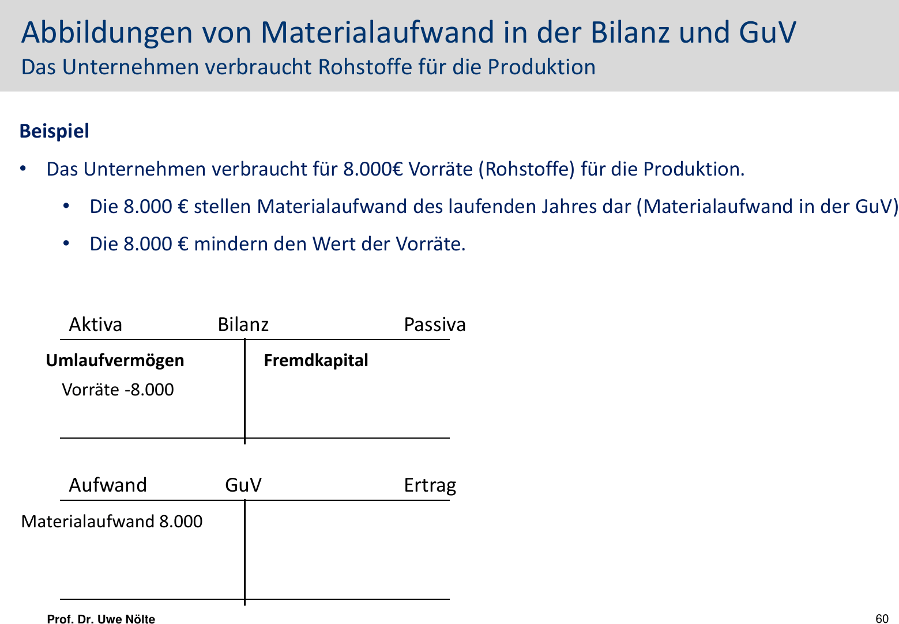

| Aktiva — Bilanz | Passiva |
|---|---|
| Umlaufvermögen | Fremdkapital |
| Vorräte -8.000 | |

| Aufwand — GuV | Ertrag |
|---|---|
| Materialaufwand 8.000 | |

## Abbildungen von Personalaufwand in der Bilanz und GuV

**Das Unternehmen muss Mitarbeiter bezahlen**

Beispiel

- Das Unternehmen muss den Mitarbeitern 30.000 an Gehalt überweisen für das aktuelle Jahr.
  - Die 30.000 € stellen Aufwand des laufenden Jahres dar (Personalaufwand in der GuV)
  - Die 30.000 € mindern den Wert des Kassenbestands bzw. Bankguthaben.


| Aktiva — Bilanz | Passiva |
|---|---|
| Umlaufvermögen | Fremdkapital |
| Kasse -30.000 | |

| Aufwand — GuV | Ertrag |
|---|---|
| Personalaufwand 30.000 | |

## Abbildungen von Aufwand in der Bilanz und GuV

**Das Unternehmen bezahlt die Zinsen für den Kredit**

Beispiel

- Das Unternehmen muss 10.000 Zinsen an die Bank in bar bezahlen.
  - Die 10.000 € stellen Aufwand des laufenden Jahres dar (Zinsaufwand in der GuV)
  - Die 10.000 € mindern den Bestand an Kasse bzw. Bankguthaben.

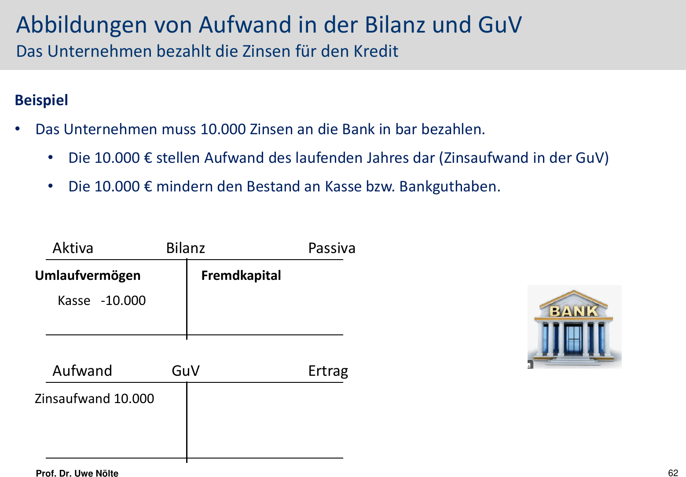

| Aktiva — Bilanz | Passiva |
|---|---|
| Umlaufvermögen | Fremdkapital |
| Kasse -10.000 | |

| Aufwand — GuV | Ertrag |
|---|---|
| Zinsaufwand 10.000 | |

## Abbildungen von Abschreibungen in der Bilanz und GuV

**Das Unternehmen muss die Server abschreiben**

Beispiel

- Das Unternehmen muss eine Maschine abschreiben. Dafür fallen 5.000€ Kosten an.
  - Die 5.000 € stellen Aufwand des laufenden Jahres dar (Abschreibungen in der GuV)
  - Die 5.000 € mindern den Wert des Servers.


| Aktiva — Bilanz | Passiva |
|---|---|
| Anlagevermögen | Fremdkapital |
| Sachanlagevermögen -5.000 | |

| Aufwand — GuV | Ertrag |
|---|---|
| Abschreibungen 5.000 | |

## Abbildungen von Abschreibungen in der Bilanz und GuV

**Das Unternehmen muss die Server abschreiben**

Gesetzliche Grundlage:

Planmäßige Abschreibungen: §253 (3), S. 1

- „Bei Vermögensgegenständen des Anlagevermögens, deren Nutzung zeitlich begrenzt ist, sind die Anschaffungs- oder die Herstellungskosten um planmäßige Abschreibungen zu vermindern.“

Gesetzliche Grundlage: (§253 (3), S. 2))

- Für planmäßige Abschreibungen muss der Abschreibungsplan
  - die zu verteilenden Anschaffungskosten abzgl. Resterlöse,
  - die voraussichtliche Nutzungsdauer und
  - die ausgewählte Abschreibungsmethode

  enthalten.
- Der Ausgangsbetrag sind die Anschaffungskosten. Sofern wesentlich, ist ein geplanter Resterlös durch Subtraktion zu berücksichtigten (da damit der laufende Wertverlust verringert wird).
- Die planmäßige Nutzungsdauer orientiert sich an der wirtschaftlichen - nicht technischen - Nutzungsdauer (Investitionsrechnung). Sog. steuerliche AfA-Tabellen bilden meist die Grundlage für die Bemessung der Nutzungsdauer.
- Als Abschreibungsmethoden haben sich die folgenden etabliert:

## Abbildungen von Abschreibungen in der Bilanz und GuV

**Abschreibungsmethoden**

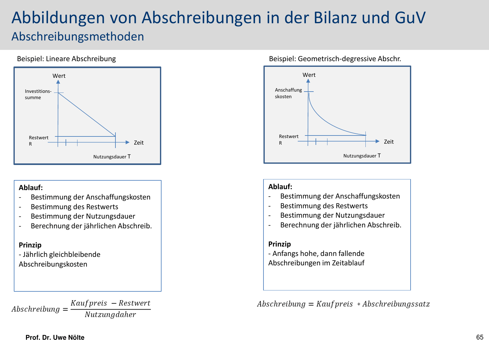

| Beispiel: Lineare Abschreibung | Beispiel: Geometrisch-degressive Abschr. |
|---|---|
| Wert; Investitionssumme; Restwert R; Zeit; Nutzungsdauer T | Wert; Anschaffungskosten; Restwert R; Zeit; Nutzungsdauer T |
| Ablauf: - Bestimmung der Anschaffungskosten - Bestimmung des Restwerts - Bestimmung der Nutzungsdauer - Berechnung der jährlichen Abschreib. | Ablauf: - Bestimmung der Anschaffungskosten - Bestimmung des Restwerts - Bestimmung der Nutzungsdauer - Berechnung der jährlichen Abschreib. |
| Prinzip - Jährlich gleichbleibende Abschreibungskosten | Prinzip - Anfangs hohe, dann fallende Abschreibungen im Zeitablauf |

## Sachanlagevermögen

**Außerplanmäßige Abschreibung**

Wegen der handelsrechtlichen Bilanzierungszwecke gilt hier für die Folgebewertung das Niederstwertprinzip:

Gesetzliche Grundlage (§253 (3))

„Bei Vermögensgegenständen des Anlagevermögens sind bei voraussichtlich dauernder Wertminderung außerplanmäßige Abschreibungen vorzunehmen, um diese mit dem niedrigeren Wert anzusetzen, der ihnen am Abschlussstichtag beizulegen ist.“

Konten:

Außerplanmäßige Abschreibungen sind ebenso Teil des GuV-Position „Abschreibungen“ gem. §275 HGB.

## Abbildungen von Erträgen in der GuV

**Arten von Erträgen**

Definition Ertrag

Wertzuwachs des Eigenkapitals eines Unternehmens für die während einer Abrechnungsperiode erbrachten Leistungen, entweder durch Herstellung oder Verkauf.

Erträge

| Umsatzerlöse | Sonstige betriebliche Erträge | Bestandserhöhungen | Andere aktivierte Eigenleistungen |
|---|---|---|---|
| Umsatzerlöse sind Erträge aus den Verkauf von Produkten, die aus dem eigentlichen Betriebszweck resultieren | Sonstige betriebliche Erträge sind Erträge aus Nebengeschäften, die betriebsfremden Zwecken. Z.B. Gewinn aus dem Verkauf von Produktionsmaschinen, Auflösung von Rückstellungen o.ä. | Bestandserhöhung sind Erträge aus der Erschaffung von Gegenständen des Umlaufvermögens, die noch nicht verkauft wurden. | Andere aktivierte Eigenleistungen sind Erträge aus der Erschaffung von Gegenständen des Anlagevermögens, die selbst genutzt werden sollen. |

## Abbildungen von Erträgen in der GuV

**Ansatz von Erträgen in der GuV**

Schwebendes Geschäft als Ausgangslage

- Wird ein Vertrag abgeschlossen, haben beide Parteien daraus eine Verpflichtung:
  - Der Verkäufer muss ein Produkt liefern oder eine Dienstleistung erbringen (Leistungspflicht)
  - Der Käufer muss bezahlen (Zahlungspflicht.
- Solange keine der Parteien diese Pflicht erfüllt hat, gilt der Vertrag als „schwebendes Geschäft“. Schwebende Geschäfte werden grundsätzlich nicht erfasst.

Entstehung der Forderung bei Erfüllung der Leistungspflicht

- Hat der Verkäufer seine Leistungspflicht durch Lieferung oder Leistung bereits erfüllt ist eine Forderungen aus Lieferung und Leistung entstanden. Sie stellt das Recht auf Zahlung dar. Zahlt der Käufer zu einem späteren Zeitpunkt, erlischt dieses Recht und damit die Forderung.

Entstehungszeitpunkt

- Das Realisationsprinzip gem. §252 (Nr. 4, S.2) regelt, wann ein Unternehmen eine Lieferung oder Leistung erfüllt hat, d.h. zu welchem Zeitpunkt ein Ertrag entsteht.
- Ein Erlös aus dem Verkauf von Sachgütern, oder Dienstleistungen gilt erst zu dem Zeitpunkt als realisiert, wenn die Lieferung vollzogen bzw. die Dienstleistung beendet ist. Ein Lieferung gilt mit dem Zeitpunkt des „Gefahrenübergangs“ als erbracht. ➔ Die Forderung und der Umsatz entstehen zum Zeitpunkt des Gefahrenübergangs. Ab diesem Zeitpunkt kann gebucht werden.

## Abbildungen von Erträgen in der GuV

**Ansatz von Erträgen in der GuV**

Typische Fälle

Beispiel: Zeitpunkt 1

- Ein Kunde betritt ein Bäckereigeschäft und bestellt ein Brötchen für 1€. Der Verkäufer sagt „In Ordnung“.

Analyse

- Hiermit wurde ein Vertrag über den Kauf eines Brötchens abgeschlossen. Beide Parteien haben nun eine Verpflichtung. Der Käufer hat die Zahlungsverpflichtung, der Verkäufer die Lieferverpflichtung. Beide Verpflichtungen wurden noch nicht erfüllt.

Zeitpunkt 2a) (Erfüllung durch Verkäufer)

- Der Verkäufer legt das Brötchen auf den Tresen, der Kunde nimmt es.

Analyse

- Der Verkäufer hat seine Lieferverpflichtung erfüllt, der Gefahrenübergang hat stattgefunden, die Forderung auf Zahlung ist entstanden. Der Verkäufer kann den Umsatz und die Forderung buchen.

Zeitpunkt 2b) (Erfüllung durch Käufer)

- Der Käufer legt 1€ auf den Tresen, der Verkäufer nimmt es.

Analyse

- Der Käufer hat seine Zahlungsverpflichtung erfüllt. Aus Sicht des Verkäufers hat der Gefahrenübergang jedoch noch nicht stattgefunden; weder Forderung noch Umsatz sind entstanden. Der Verkäufer muss den gestiegenen Kassenbestand und eine erhaltene Anzahlung buchen, jedoch keine Forderung und keinen Umsatz.

## Abbildungen von Erträgen in der Bilanz und GuV

**Das Unternehmen verkauft in bar**

Beispiel

- Das Unternehmen kann Waren im Wert von 100.000 verkaufen. Die Kunden zahlen in bar.
  - Die 100.000 € stellen Ertrag des laufenden Jahres dar (Umsatzerlöse in der GuV)
  - Die 100.000 € erhöhen den Wert des Kassenbestands bzw. Bankguthaben.

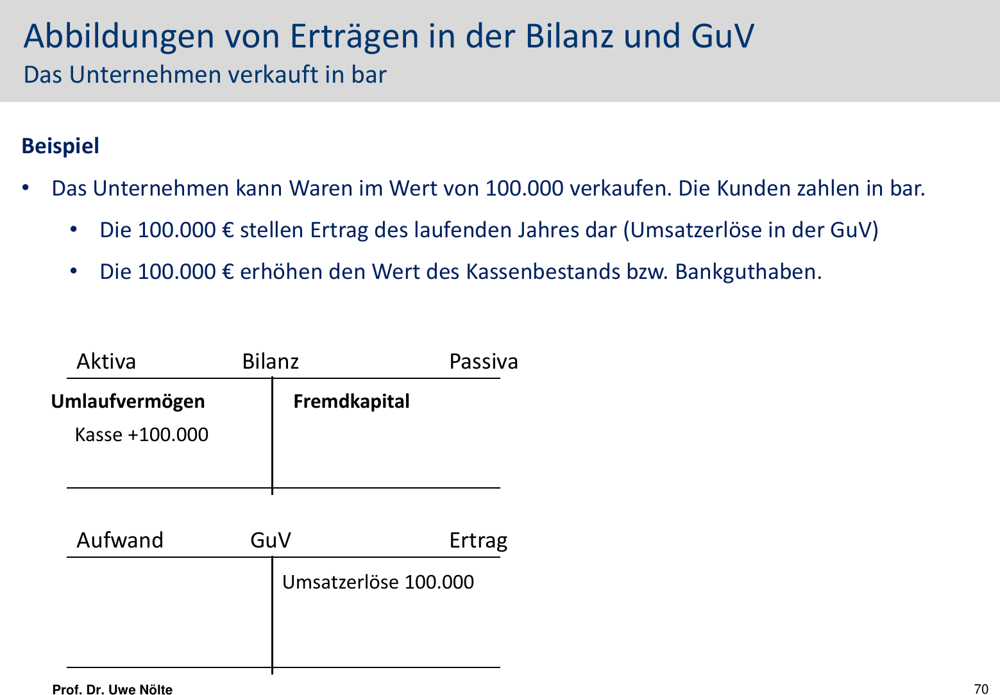

| Aktiva — Bilanz | Passiva |
|---|---|
| Umlaufvermögen | Fremdkapital |
| Kasse +100.000 | |

| Aufwand — GuV | Ertrag |
|---|---|
| | Umsatzerlöse 100.000 |

## Abbildungen von Erträgen in der Bilanz und GuV

**Das Unternehmen verkauft auf Ziel**

Beispiel

- Das Unternehmen kann weitere Waren im Wert von 180.000 verkaufen. Die Kunden zahlen auf Ziel, d.h. sie zahlen erst zu einem späteren Zeitpunkt.
  - Die 180.000 € stellen Ertrag des laufenden Jahres dar (Umsatzerlöse in der GuV).
  - Die 180.000 € erhöhen den Wert der Forderungen aus Lieferung und Leistung.

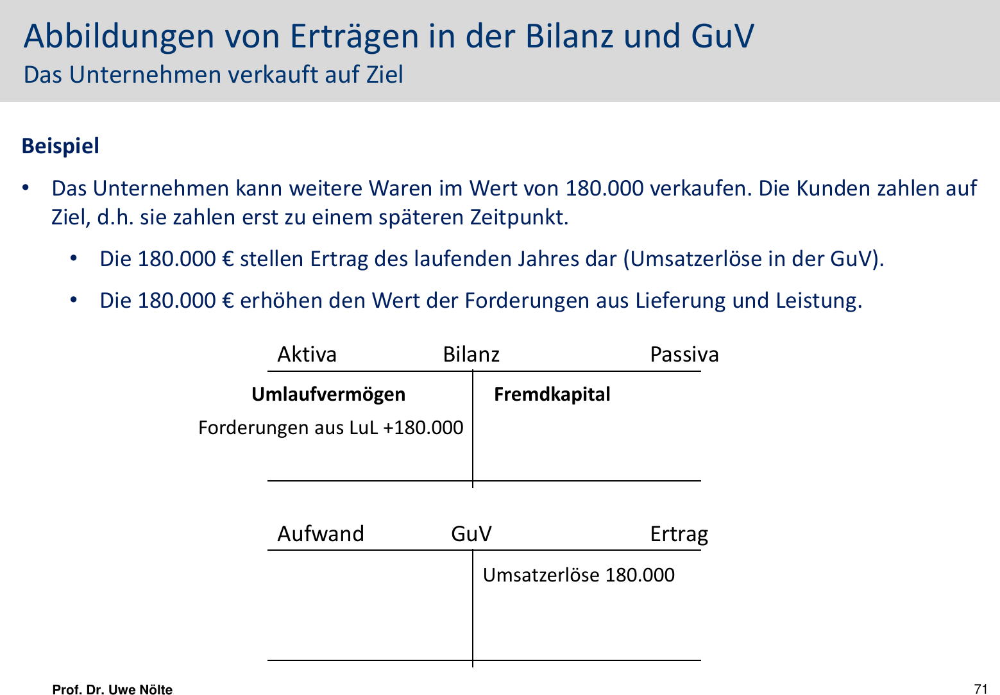

| Aktiva — Bilanz | Passiva |
|---|---|
| Umlaufvermögen | Fremdkapital |
| Forderungen aus LuL +180.000 | |

| Aufwand — GuV | Ertrag |
|---|---|
| | Umsatzerlöse 180.000 |

## Abbildungen von Erträgen in der Bilanz und GuV

**Das Unternehmen erzielt sonstige betriebliche Erträge**

Beispiel

- Das Unternehmen erbringt Beratungsleistungen, die nichts mit dem eigentlichen Geschäft zu tun haben und erhält dafür 20.000€ in bar.
  - Die 20.000 € stellen sonstigen Ertrag des laufenden Jahres dar (in der GuV)
  - Die 20.000 € erhöhen den Wert der Kasse.

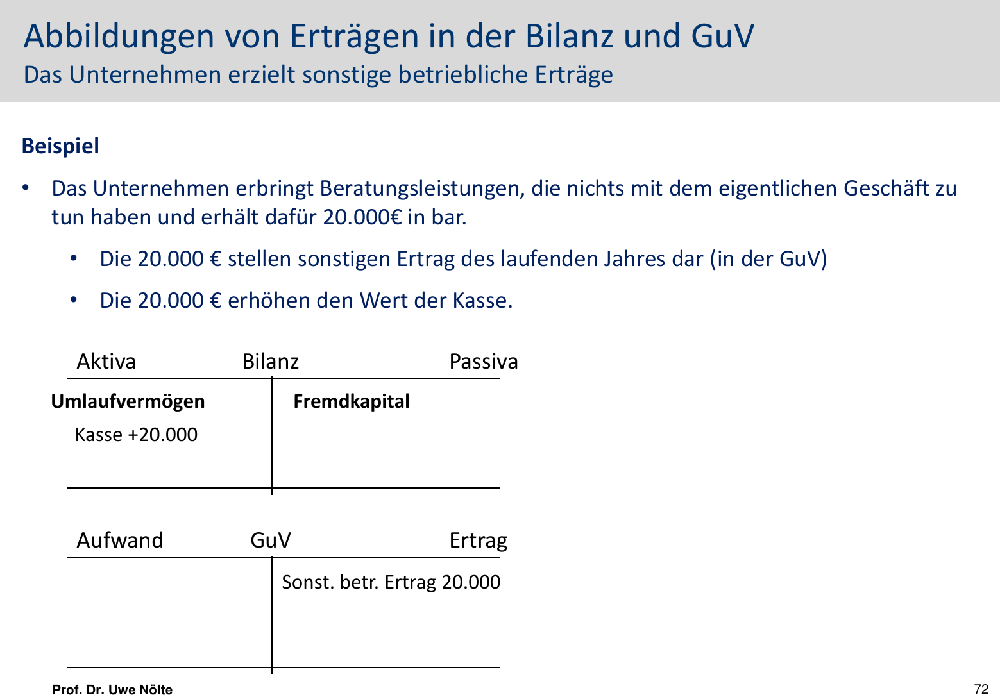

| Aktiva — Bilanz | Passiva |
|---|---|
| Umlaufvermögen | Fremdkapital |
| Kasse +20.000 | |

| Aufwand — GuV | Ertrag |
|---|---|
| | Sonst. betr. Ertrag 20.000 |

## Rückstellungen

**Beispiel Deutsche Messe AG**

Definition und Erklärung

- Verbindlichkeiten sind Schulden, die 100% sicher sind.
- Rückstellungen sind Schulden, die nicht 100% sicher, aber möglich sind (>30%)
- Eventualverbindlichkeiten sind Schulden, die unwahrscheinlich sind. (<30%)

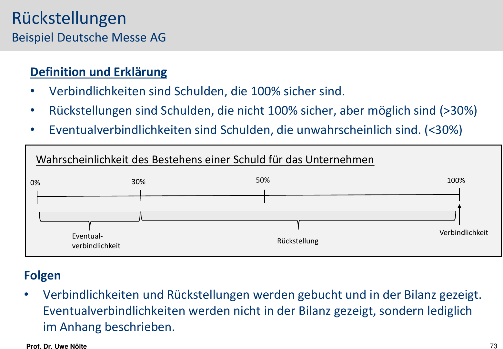

Wahrscheinlichkeit des Bestehens einer Schuld für das Unternehmen

0% — 30% — 50% — 100%

- Eventualverbindlichkeit
- Rückstellung
- Verbindlichkeit

Folgen

- Verbindlichkeiten und Rückstellungen werden gebucht und in der Bilanz gezeigt. Eventualverbindlichkeiten werden nicht in der Bilanz gezeigt, sondern lediglich im Anhang beschrieben.

## Abbildungen von Rückstellungen in der Bilanz

**Arten von Rückstellungen**

Definition

Rückstellungen sind Bilanzposten, die ein Unternehmen für zukünftige Verpflichtungen oder Aufwendungen bildet, deren genaue Höhe oder Fälligkeit noch ungewiss ist. Rückstellungen werden auf der Passivseite der Bilanz als Fremdkapital ausgewiesen, da sie Verpflichtungen gegenüber Dritten darstellen, die das Unternehmen in der Zukunft belasten könnten.

Relevante Rückstellungsarten

| Rückstellungen für ungewisse Verbindlichkeiten | Pensionsrückstellungen | Steuerrückstellungen |
|---|---|---|
| …für Verpflichtungen, deren Eintritt zwar wahrscheinlich, aber hinsichtlich der Höhe oder des Zeitpunkts ungewiss ist. Dazu gehören z. B. Prozessrückstellungen (für mögliche Gerichts- oder Anwaltskosten), Gewährleistungsrückstellungen oder Umweltverpflichtungen | …für Verpflichtungen aus betrieblichen Altersvorsorgezusagen an Mitarbeiter. Diese Rückstellungen berücksichtigen zukünftige Zahlungen an Mitarbeiter im Ruhestand und erfordern häufig langfristige Ansparungen. | …für noch nicht gezahlte Steuern, deren genaue Höhe aber zum Abschlussstichtag nicht feststeht. Beispiele sind Rückstellungen für Körperschaftsteuer oder Gewerbesteuer, falls eine Steuerprüfung noch aussteht |

## Abbildungen von Rückstellungen in der Bilanz

**Kunden verklagen das Unternehmen – Sonstige Rückstellungen**

Beispiel

- Ein Kunde hat ein defektes Produkt erhalten und sich daran verletzt. Nun verklagt er unser Unternehmen auf Schadensersatz in Höhe von 80.000€. Der Ausgang der Klage ist am Abschlusstichtag ungewiss.
- Die Klage ist eine potentielle Verpflichtung, die das Unternehmen bezahlen muss. Da die Schuld dieses Jahr entstanden ist, ist sie ein Aufwand des aktuellen Jahres in der GuV.

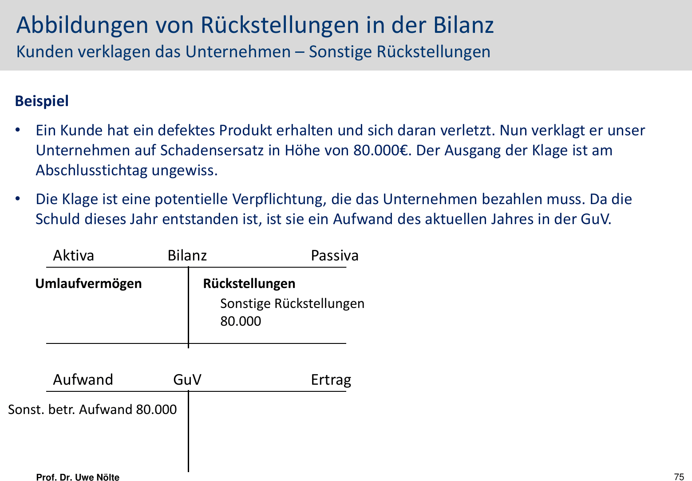

| Aktiva — Bilanz | Passiva |
|---|---|
| Umlaufvermögen | Rückstellungen |
| | Sonstige Rückstellungen 80.000 |

| Aufwand — GuV | Ertrag |
|---|---|
| Sonst. betr. Aufwand 80.000 | |

## Abbildungen von Rückstellungen in der Bilanz

**Das Finanzamt erwartet Steuerzahlungen vom Unternehmen - Steuerrückstellungen**

Beispiel

- Unser Unternehmen schätzt die Steuerschulden des nächsten Jahres auf 50.000 € ein.
- Dies stellt geschätzte Schulden des Unternehmens dar (Verpflichtung).
- Diese sind im laufenden Jahr entstanden (Steueraufwand).

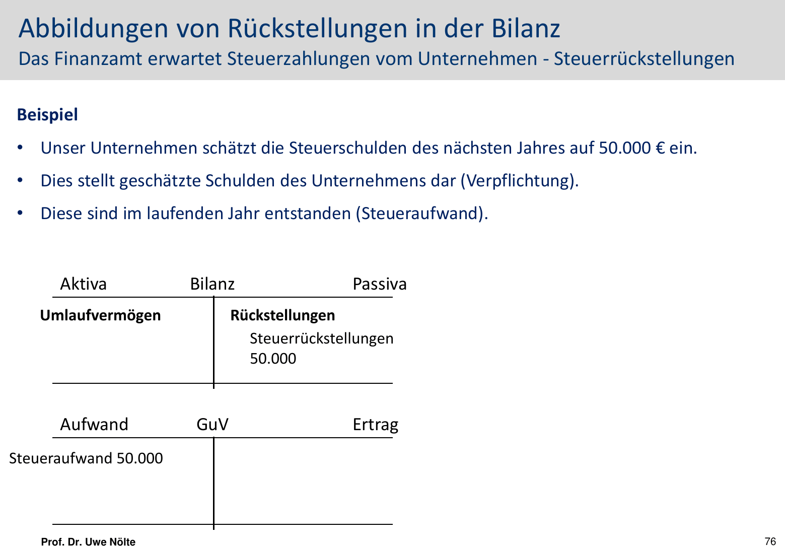

| Aktiva — Bilanz | Passiva |
|---|---|
| Umlaufvermögen | Rückstellungen |
| | Steuerrückstellungen 50.000 |

| Aufwand — GuV | Ertrag |
|---|---|
| Steueraufwand 50.000 | |

## Abbildungen von Rückstellungen in der Bilanz

**Das Mitarbeiter erhält eine Pensionszusage vom Unternehmen - Pensionsrückstellungen**

Beispiel

- Ein Mitarbeiter erhält eine Zusage für eine Pensionszahlung vom Unternehmen, wenn er in Rente geht. Diese wird auf 30.000€ geschätzt, die vom Unternehmen dann gezahlt werden müssen.
- Das Unternehmen erhält damit eine Verbindlichkeit, die in der Zukunft bezahlt werden muss. Da dies einem Aufwand für Mitarbeiter entspricht, ist dies Personalaufwand.


| Aktiva — Bilanz | Passiva |
|---|---|
| Umlaufvermögen | Rückstellungen |
| | Pensionsrückstellungen 30.000 |

| Aufwand — GuV | Ertrag |
|---|---|
| Personalaufwand 30.000 | |

## Jahresabschlussbestandteile

**Kapitalflussrechnung**

Zweck der Kapitalflussrechnung

Die Kapitalflussrechnung (Cashflow-Statement) ist ein wesentlicher Bestandteil des Jahresabschlusses und ergänzt die Bilanz und Gewinn- und Verlustrechnung. Sie zeigt die Zahlungsströme eines Unternehmens während eines bestimmten Zeitraums und hat folgende Zwecke:

1. Analyse der Liquidität
   - Die Kapitalflussrechnung gibt Aufschluss darüber, wie viel Geld ein Unternehmen tatsächlich erwirtschaftet und zur Verfügung hat. Sie zeigt, ob das Unternehmen in der Lage ist, seinen Zahlungsverpflichtungen wie Löhne, Lieferantenrechnungen und Kreditzahlungen nachzukommen.
2. Beurteilung der Zahlungsströme aus operativer Tätigkeit
   - Die Kapitalflussrechnung gibt Einblick in die Geldflüsse aus der laufenden Geschäftstätigkeit. Dieser operative Cashflow zeigt, ob das Unternehmen aus dem Kerngeschäft genügend Einzahlungen generiert, um seine laufenden Kosten zu decken, ohne auf externe Finanzierung angewiesen zu sein.

## Jahresabschlussbestandteile

**Kapitalflussrechnung**

Zweck der Kapitalflussrechnung

3. Bewertung der Investitionsfähigkeit
   - Sie zeigt, wie viel Kapital für Investitionen in langfristige Vermögenswerte wie Maschinen, Immobilien oder Technologien verwendet wurde (Cash Flow aus Investitionstätigkeit). Dies ist wichtig, um zu beurteilen, ob das Unternehmen seine Marktposition stärkt und für die Zukunft wächst.
4. Finanzierungsstruktur verstehen
   - Die Kapitalflussrechnung gibt Einblick in die Finanzierungsaktivitäten, z. B. wie viel Kapital durch Kredite, Anleihen oder Eigenkapitalbeschaffung aufgenommen oder zurückgezahlt wurde (Cash Flow aus Finanzierungstätigkeit). Diese Informationen sind entscheidend für die Beurteilung der Verschuldung und der Kapitalstruktur eines Unternehmens.

## Jahresabschlussbestandteile

**Kapitalflussrechnung**

Beispielhafte Kapitalflussrechnung

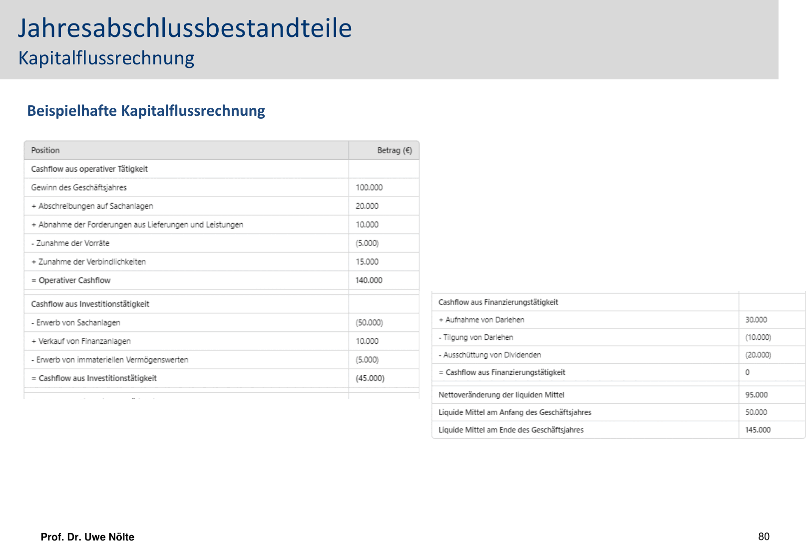

## Begriffliche Grundlagen

**Ein- und Auszahlungen (Cash Flows)**

Definition

Als „Einzahlung“ (positiver Cash Flow) bzw. „Auszahlung“ (negativer Cash Flow) bezeichnet man einen Zu- und Abfluss von liquiden Mitteln aus dem Unternehmen. Darin eingeschlossen sind physische Geldmittel sowie Bankguthaben.

Arten von Cash Flows

| Operativer Cash Flow | Investitions-Cash Flow | Finanzierungs-Cash Flow |
|---|---|---|
| Cashflow aus laufender Geschäftstätigkeit | Cashflow aus Investitionstätigkeit | Cashflow aus Finanzierungstätigkeit |
| Bildet operative Zahlungsflüsse ab. | Bildet die Zahlungsflüsse aus Investitionen und Desinvestitionen in langfristiges Anlagevermögen ab | Bildet die Zahlungsflüsse aus Finanzierungen ab, die im Eigenkapital oder Fremdkapital gebucht werden. |
| Z.B. Auszahlungen an Lieferanten, Einzahlungen aus Verkäufen | Z.B. Auszahlung für den Erwerb einer Maschine. | Z.B. Aufnahme von Darlehen, Rückzahlung von Darlehen, Aufnahme von Eigenkapital |

## Jahresabschlussbestandteile

**Kapitalflussrechnung**

Erklärung der einzelnen Positionen:

- Cashflow aus operativer Tätigkeit: Dies ist der Zahlungsfluss aus der Hauptgeschäftstätigkeit. Er wird berechnet, indem der Jahresgewinn um nicht zahlungswirksame Posten wie Abschreibungen sowie Veränderungen im Umlaufvermögen angepasst wird. In diesem Beispiel ergibt der operative Cashflow 140.000 €.
- Cashflow aus Investitionstätigkeit: Dieser Bereich zeigt die Investitionen und Desinvestitionen in das Anlagevermögen. Hier hat das Unternehmen Sachanlagen erworben (Ausgabe von 50.000 €) und Finanzanlagen verkauft (Einnahme von 10.000 €). Der Netto-Cashflow aus Investitionstätigkeit beträgt -45.000 €.
- Cashflow aus Finanzierungstätigkeit: Dieser Abschnitt umfasst die Ein- und Auszahlungen im Zusammenhang mit der Finanzierung des Unternehmens. Hier wurden neue Darlehen aufgenommen (30.000 €), bestehende Darlehen zurückgezahlt (10.000 €), und Dividenden wurden ausgeschüttet (20.000 €). In diesem Beispiel ist der Finanzierungscashflow neutral.

Gesamtergebnis

- Die Kapitalflussrechnung zeigt eine Nettoveränderung der liquiden Mittel von 95.000 €, sodass das Unternehmen am Ende des Geschäftsjahres über 145.000 € liquide Mittel verfügt.

## Jahresabschlussbestandteile

**Anhang**

Zweck des Anhangs

Der Anhang stellt ein Berichtsinstrument dar. Er enthält vor allem qualitative Informationen, die die Zahlen aus GuV und Bilanz erläutern und ergänzen sollen.

Inhalte des Anhangs sind z.B.

- Die verwendeten Abschreibungsmethoden
- Die Ausnutzung von Ansatzwahlrechten bei selbst geschaffenen, immateriellen Vermögenswerten und Disagios

## Jahresabschlussbestandteile

**Lagebericht**

Lagebericht als Teil der Unternehmenspublizität einer Kapitalgesellschaft

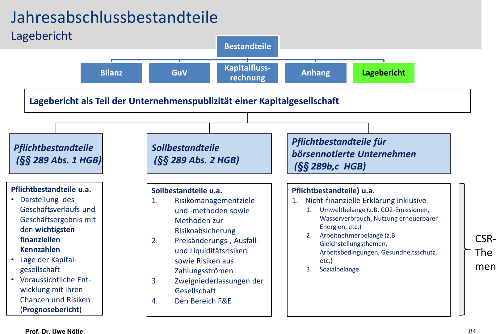

Pflichtbestandteile (§§ 289 Abs. 1 HGB)

Pflichtbestandteile u.a.

- Darstellung des Geschäftsverlaufs und Geschäftsergebnis mit den wichtigsten finanziellen Kennzahlen
- Lage der Kapitalgesellschaft
- Voraussichtliche Entwicklung mit ihren Chancen und Risiken (Prognosebericht)

Sollbestandteile (§§ 289 Abs. 2 HGB)

Sollbestandteile u.a.

1. Risikomanagementziele und -methoden sowie Methoden zur Risikoabsicherung
2. Preisänderungs-, Ausfall- und Liquiditätsrisiken sowie Risiken aus Zahlungsströmen
3. Zweigniederlassungen der Gesellschaft
4. Den Bereich F&E

Pflichtbestandteile für börsennotierte Unternehmen (§§ 289b,c HGB)

Pflichtbestandteile) u.a.

1. Nicht-finanzielle Erklärung inklusive
   1. Umweltbelange (z.B. CO2-Emissionen, Wasserverbrauch, Nutzung erneuerbarer Energien, etc.)
   2. Arbeitnehmerbelange (z.B. Gleichstellungsthemen, Arbeitsbedingungen, Gesundheitsschutz, etc.)
   3. Sozialbelange

## Jahresabschlussbestandteile

**Lagebericht – Beispiel BASF**

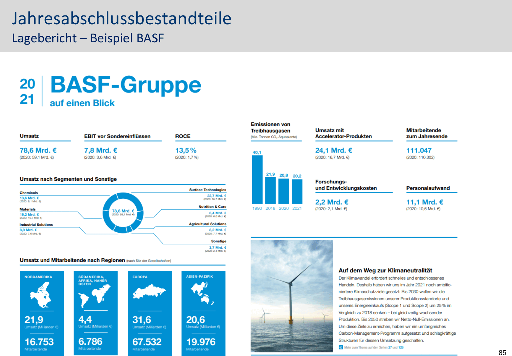

Quelle: `bilanzierung/origin/WDS25 - Bilanzierung (NOU)/04 1 - Folien/Bilanzierung - Q4 2026/Bilanzierung - Q4 2026.pdf`, Seiten 31–85
