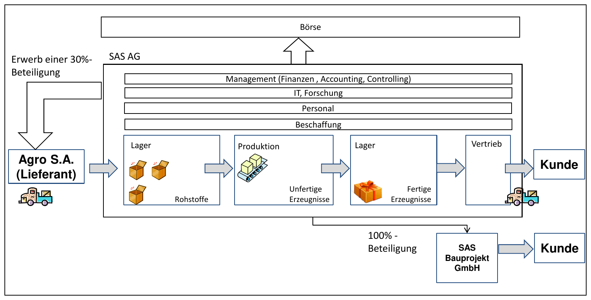

# Einführung und Definitionen

## Inhaltsübersicht

Bilanzierung und Jahresabschluss

1. Jahresabschlussgrundlagen
2. Jahresabschlusserstellung
3. Jahresabschlussanalyse

## Literaturverzeichnis

Vorlesungsbegleitende Literatur:

- Coenenberg et al. „Jahresabschluss- und Jahresabschlussanalyse“, 25. Auflage oder frühere Auflage
- Viele andere Titel sind auch möglich

Klausurunterlagen

- Nicht programmierbarer Taschenrechner
- kein HGB, keine Gesetze

## Einführendes Beispiel: Sweets and Sounds

- Thomas Miller und Howard Schulze sind zwei New Yorker, die total verrückt nach Schokolade sind. Aus Liebesgründen hat es sie im August 2010 nach Hamburg gezogen, wo sie seitdem mit ihren Frau leben. Als sie einmal nach einer durchgetanzten Nacht in einem netten Café an der Hamburger Außenalster sitzen, kommt ihre Unterhaltung auf das Thema Kekse, die früher von ihren Großmütter für sie gebacken wurden.
- Nach einer Weile der angeregten und euphorischen Berichte über die Qualität der Kekse merken beide, wie angetan und aufgeregt sie bei diesem Thema sind. Da beide schon immer eine gründerische Ader besessen haben, entscheiden sie spontan zusammen ihr eigenes Geschäft zur Produktion und Verkauf von Süßwaren aller Art zu eröffnen. Da beide auch der Überzeugung sind, dass die Themen Süßes und Musik sehr gut zusammenpassen und sie in ihren Geschäften auch gute Musik spielen wollen, nennen sie ihr Geschäft „Sweets and Sounds (SAS)“.
- Sie entscheiden, so bald wie möglich mit der Planung zu beginnen und ihr Geschäft zum 01.01.2011 zu eröffnen.
- Ihre Aufgabe wird es im Verlauf der Vorlesung sein, die beiden bei den bilanziellen Fragestellungen zu unterstützen.

## Der Fall der SAS AG – Fragestellungen im Laufe des Semesters

## Inhaltsübersicht

1. Jahresabschlussgrundlagen
   1. Aufstellungspflichten
   2. Prüfungspflichten
   3. Veröffentlichungspflichten
   4. Funktionen des Jahresabschlusses

## Definitionen

**Übersicht**

Definitionen

- Der Jahresabschluss ist der rechnerische Abschluss eines kaufmännischen Geschäftsjahres. Er stellt die Vermögens-, Finanz- und Ertragslage eines Unternehmens dar und beinhaltet den Abschluss der Buchhaltung, die Zusammenstellung von Dokumenten zur Rechnungslegung sowie deren Prüfung, Bestätigung und Veröffentlichung.
- Ein Geschäftsjahr wird auch als Wirtschaftsjahr bezeichnet, in der Regel umfasst es zwölf Monate und ist deckungsgleich mit dem Kalenderjahr.
- Das Geschäftsjahr kann vom Kalenderjahr abweichen, wenn damit das normale Geschäft des Unternehmens besser abgebildet wird (z.B. verwenden Fußballvereine ein Geschäftsjahr vom 1. Juli bis 30. Juni des Folgejahres).
- Ebenso kann es Rumpfgeschäftsjahre geben, die nur einen Teil des Kalenderjahres abbilden. Ein Rumpfgeschäftsjahr ist ein Geschäftsjahr eines Unternehmens, das weniger als zwölf Monate umfasst (weil z.B. der Termin für den Jahresabschluss verlegt wurde).

## Aufstellung, Veröffentlichung, Prüfung

**Übersicht**

1. Aufstellungspflicht
   - Vorstand / Geschäftsführer stellen den Jahresabschluss auf
2. Prüfungspflicht
   - Abschlussprüfer prüft den Jahresabschluss
3. Offenlegungspflicht
   - Jahresabschluss wird offengelegt / veröffentlicht

Quelle: `bilanzierung/origin/WDS25 - Bilanzierung (NOU)/04 1 - Folien/Bilanzierung - Q4 2026/Bilanzierung - Q4 2026.pdf`, Folien 2–8
