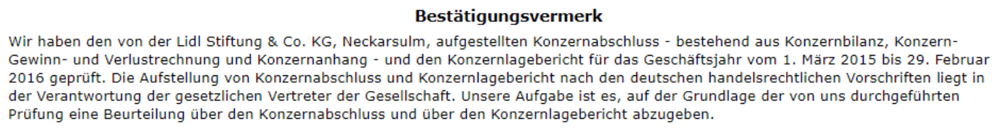
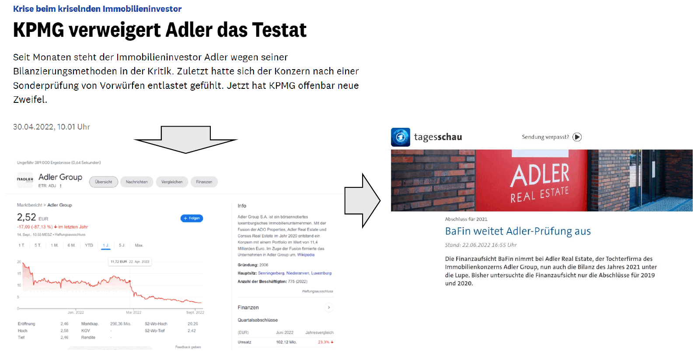

# Prüfungspflichten

## Gesetzliche Grundlage

§316 HGB: (1) „Der Jahresabschluss und der Lagebericht von Kapitalgesellschaften, die nicht kleine im Sinne des § 267 Abs. 1 sind, sind durch einen Abschlussprüfer zu prüfen.“

| Größe der KapGes bzw. haftungsbeschränkten PHG (§267 & § 267a) | Bilanzsumme (BS) in Mio. € | Umsatzerlöse (UE) in Mio. € | Zahl der Arbeitnehmer (AN) |
|---|---|---|---|
| Kleinst | BS ≤ 0,35 | UE ≤ 0,7 | AN ≤ 10 |
| Klein | 0,35 < BS ≤ 6 | 0,7 < UE ≤ 12 | 10 < AN ≤ 50 |
| Mittelgroß | 6 < BS ≤ 20 | 12 < UE ≤ 40 | 50 < AN ≤ 250 |
| Groß | BS > 20 | UE > 40 | AN > 250 |

- Die Zugehörigkeit zu einer bestimmten Klasse orientiert sich daran, ob die Gesellschaft an zwei aufeinanderfolgenden Abschlussstichtagen mindestens zwei der drei Grenzwerte überschreitet. Die Grenzwerte gelten für den Einzelabschluss.
- Allerdings gilt eine Gesellschaft gemäß § 267 (3) S. 2 HGB stets als groß, wenn sie mit Aktien und/oder Anleihen einen organisierten Markt in Anspruch nimmt bzw. eine Zulassung zum Handel beantragt ist. Organisierte Märkte sind Märkte, die einer hohen Transparenzpflicht unterliegen.
- Die Angabe der Mitarbeiterzahl findet sich bei Kapitalgesellschaften gem. §285, Nr. 7 HGB im Anhang.

## Was wird geprüft?

| Größenklassen (§267 HGB) | Was wird geprüft? |
|---|---|
| Große Kapitalgesellschaften | Jahresabschluss (Bilanz, GuV, Anhang); Lagebericht, Bericht des Aufsichtsrates, Vorschlag und Beschluss über Ergebnisverwendung (§ 325 Abs. 1 HGB) |
| Mittelgroße Kapitalgesellschaften | Bilanz in der für kleine Kapitalgesellschaften geltenden Form (§ 266 (1) S. 3 HGB), aber mit zusätzlichen Angaben gem. § 327 (1) HGB, Anhang verkürzt nach § 327 (2) HGB, übrige Unterlagen wie große Kapitalgesellschaften. (§§ 325 (1), 327 HGB) |
| Kleine/Kleinst-Kapitalgesellschaften | Kleine KapG i. S. v. § 267 (1) HGB sind publizitäts-, aber nicht prüfungspflichtig (§ 316 (1) HGB) |

## Die Big Four

- Big Four bezeichnet das Oligopol der vier größten Wirtschaftsprüfungsgesellschaften der Welt: Deloitte, EY), KPMG und PricewaterhouseCoopers (PwC). Es steht für rund 67 Prozent des weltweiten Umsatzes in der Wirtschaftsprüfung.
- Die Big Four prüfen einen Großteil der börsennotierten Unternehmen weltweit, unter anderem nahezu alle Gesellschaften in den großen Aktienindizes S&P 500 (USA), DAX (Deutschland) und FTSE 100 (Großbritannien).
- In Deutschland werden von den 160 börsennotierten Unternehmen, die die vier wichtigsten deutschen Aktienindizes DAX, MDAX, SDAX und TecDAX bilden, 142 von den Big Four geprüft.

Die größten Wirtschaftsprüfungsgesellschaften in Deutschland

| | Unternehmen | Umsatz in Mill. € | Mitarbeiterzahl |
|---|---|---|---|
| 1 | PrivewaterhouseCoopers AG, Frankfurt | 1231,2 | 8121 |
| 2 | KPMG AG, Berlin | 1118,1 | 6303 |
| 3 | Ernst & Young AG, Stuttgart | 911,7 | 5582 |
| 4 | Deloitte & Touch GmbH, München | 517,0 | 3422 |
| 5 | BDO Deutsche Warentreuhand AG, Hamburg | 177,9 | 1755 |
| 6 | Rödl & Partner Gruppe, Nürnberg | 110,6 | 1520 |
| 7 | Rölfs Partner Gruppe, Düsseldorf | 66,7 | 442 |
| 8 | Dr. Ebner, Dr. Stolz & Partner Gruppe, Stuttgart | 57,7 | 432 |
| 9 | RSM Hemmelrath GmbH | 45,0 | 400 |
| 10 | Warth & Klein Gruppe, Düsseldorf | 43,0 | 380 |

Alle Angaben für 2006 — Quelle: Lünendonk

## Ergebnis

- Das Ergebnis der Prüfung ist ein Testat durch den Abschlussprüfer/Wirtschaftsprüfer. (§316 (a) HGB), das als Bestätigungsvermerk Teil des Jahresabschlusses wird.
- Mögliche Ergebnisse des Testats: uneingeschränkt, eingeschränkt, verweigert

## Praxisbeispiel Adler Real Estate / Adler Group

Quelle: `bilanzierung/origin/WDS25 - Bilanzierung (NOU)/04 1 - Folien/Bilanzierung - Q4 2026/Bilanzierung - Q4 2026.pdf`, Folien 17–21
