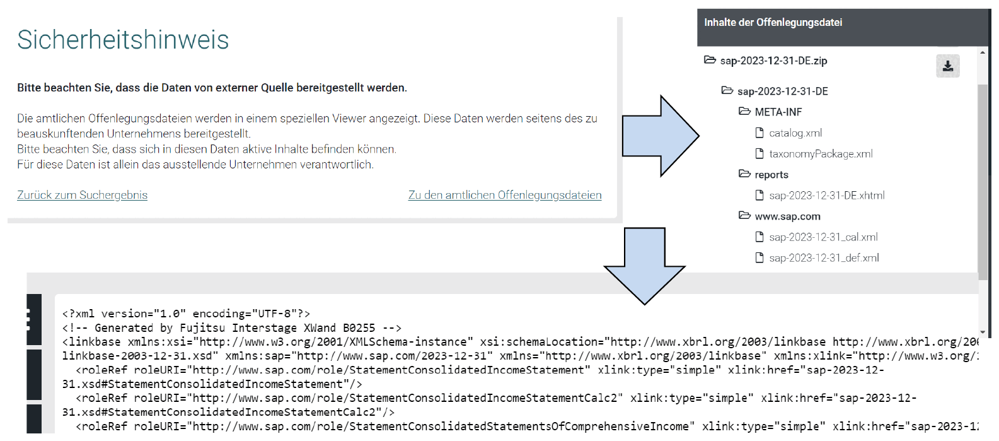

# Veröffentlichungspflichten

## Offenlegungspflicht (Publizität)

Gesetzliche Grundlage

- Die Offenlegung der unterschiedlichen Bestandteile des Jahresabschlusses wird in den §§ 325ff HGB geregelt.
- Die Unterlagen sind grundsätzlich beim elektronischen Bundesanzeiger einzureichen und vom Betreiber des Bundesanzeigers zu veröffentlichen.
- Personengesellschaften und Einzelkaufleute sind von der Offenlegung befreit, es sei denn sie überschreiten gewissen Größenkriterien nach dem Publizitätsgesetz.
- Die Pflichten hängen dabei auch von der Größe der Gesellschaft ab.

| Größenklassen (§267 HGB) | Was wird im Bundesanzeiger veröffentlicht? | Art der Offenlegung und Fristen |
|---|---|---|
| Große Kapitalgesellschaften | Bilanz, GuV, Anhang und Lagebericht in der in §266 und §275 geltenden Form | Innerhalb von 12 Monaten nach dem Abschlussstichtag (§ 325 (1) HGB) |

## Offenlegungspflicht (Publizität)

| Größenklassen (§267 HGB) | Was wird im Bundesanzeiger veröffentlicht? | Art der Offenlegung und Frist |
|---|---|---|
| Mittelgroße Kapitalgesellschaften 1) | Verkürzte Bilanz in der für kleine Kapitalgesellschaften geltenden Form (§ 266 (1) S. 3 HGB), aber mit zusätzlichen Angaben gem. § 327 (1) HGB, Anhang verkürzt nach § 327 (2) HGB, | Bekanntmachung im elektronischen Bundesanzeiger (§ 325 (1) und (2) HGB); Innerhalb von 12 Monaten nach dem Abschlussstichtag (§ 325 (1) HGB) |
| Kleine/Kleinst Kapitalgesellschaften 1) | Verkürzte Bilanz ohne detaillierte Aufgliederung des Anlagevermögens und des Eigen- und Fremdkapitals; Verkürzte GuV mit „Rohergebnis“ statt Aufgliederung der Erträge und Aufwendungen (§276); Auch kein Ausweis der GuV möglich (§326a HGB) | Bekanntmachung im elektronischen Bundesanzeiger (§ 325 (1) und (2) HGB); Innerhalb von 12 Monaten nach dem Abschlussstichtag (§ 325 (1) HGB) |

1) Erleichterungen bezüglich der Publizität gelten nur, sofern diese Unternehmen nicht kapitalmarktorientiert im Sinne des § 267 (3) HGB sind oder im Bundesbesitz stehen (§ 65 (1) Nr. 4 BHO)

## Offenlegungspflicht (Publizität)

**Spezialregelung des Publizitätsgesetzes**

Interpretation

- Das Publizitätsgesetz (PublG) in Deutschland regelt die Offenlegungspflichten bestimmter Unternehmen, die über die allgemeinen Anforderungen des Handelsgesetzbuchs (HGB) hinausgehen.

Relevant für

- Einzelunternehmen und Personengesellschaften , die an zwei aufeinanderfolgenden Abschlussstichtagen zwei der drei folgenden Merkmale überschreiten:
  - Bilanzsumme: 65 Millionen Euro
  - Umsatzerlöse: 130 Millionen Euro
  - Arbeitnehmer: 5.000 im Jahresdurchschnitt

Anforderungen an die Offenlegung und Prüfung

Aufstellungspflichten: Diese Unternehmen müssen ihren Jahresabschluss, bestehend aus Bilanz, Gewinn- und Verlustrechnung, Lagebericht sowie Anhang, veröffentlichen.

Prüfung: Der Jahresabschluss muss von einem Wirtschaftsprüfer geprüft werden.

## Veröffentlichung in XBRL

Gesetzliche Grundlage

- In Deutschland müssen bestimmte Unternehmen ihren Jahresabschluss im XBRL-Format (eXtensible Business Reporting Language) veröffentlichen. Dies betrifft hauptsächlich kapitalmarktorientierte Unternehmen sowie bestimmte große Unternehmen und Unternehmensgruppen.
  - Börsennotierte Unternehmen müssen ihre Jahresabschlüsse und Konzernabschlüsse in einem elektronischen Format, das XBRL einschließt, bei der Bundesanstalt für Finanzdienstleistungsaufsicht (BaFin) einreichen.
  - Große Kapitalgesellschaften und haftungsbeschränkte Personenhandelsgesellschaften, die bestimmte Größenkriterien erfüllen, müssen ihre Jahresabschlüsse im elektronischen Bundesanzeiger veröffentlichen. Diese Jahresabschlüsse werden auch im XBRL-Format verlangt

## Veröffentlichung in XBRL

**Beispiel SAP Konzern**

Interpretation

- Die Veröffentlichung in XML oder XBRL dient dazu, dass z.B. Analysten oder Banken, die Informationen leichter und automatisch verarbeiten können.

Quelle: `bilanzierung/origin/WDS25 - Bilanzierung (NOU)/04 1 - Folien/Bilanzierung - Q4 2026/Bilanzierung - Q4 2026.pdf`, Folien 22–26
