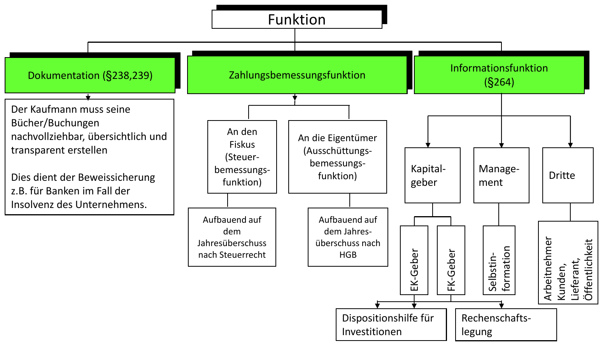

# Funktionen des Jahresabschlusses

## Funktionen des Jahresabschlusses

Funktion

- Dokumentation (§238,239)
- Zahlungsbemessungsfunktion
- Informationsfunktion (§264)

Dokumentation (§238,239)

Der Kaufmann muss seine Bücher/Buchungen nachvollziehbar, übersichtlich und transparent erstellen

Dies dient der Beweissicherung z.B. für Banken im Fall der Insolvenz des Unternehmens.

Zahlungsbemessungsfunktion

- An den Fiskus (Steuerbemessungsfunktion)
  - Aufbauend auf dem Jahresüberschuss nach Steuerrecht
- An die Eigentümer (Ausschüttungsbemessungsfunktion)
  - Aufbauend auf dem Jahresüberschuss nach HGB

Informationsfunktion (§264)

- Kapitalgeber
  - EK-Geber
  - FK-Geber
  - Dispositionshilfe für Investitionen
- Management
  - Selbstinformation
  - Rechenschaftslegung
- Dritte
  - Arbeitnehmer
  - Kunden, Lieferant, Öffentlichkeit

## Funktionen des Jahresabschlusses

**Informationsfunktion**

Frage: Wen soll der Jahresabschluss informieren und wo ist das festgelegt?

Gesetzliche Grundlage: § 264 Abs. 2 (HGB):

„Der Jahresabschluss der Kapitalgesellschaft hat unter Beachtung der Grundsätze ordnungsmäßiger Buchführung ein den tatsächlichen Verhältnissen entsprechendes Bild der Vermögens-, Finanz- und Ertragslage der Kapitalgesellschaft zu vermitteln.“

Zweck der Informationsfunktion

Der Jahresabschluss dient dazu externe Adressaten über die Lage des Unternehmens zu informieren. Beispielsweise wollen

- Aktionäre über den Rentabilität ihrer Investition informiert werden
- Banken über die Sicherheit und des Insolvenzrisikos ihres Kreditnehmers
- Die Vorstände und Geschäftsführer über die Effizienz der internen Prozesse informiert werden
- Mitarbeiter über die Sicherheit ihres Arbeitsgebers oder Lieferanten über die Sicherheit der Zahlung ihrer Forderungen

Da Kapitalgesellschaften nicht mit dem privaten Vermögen des Unternehmers haften sollen die externen Adressaten durch Informationen abgesichert werden.

## Funktionen des Jahresabschlusses

**Zahlungsbemessungsfunktion - Steuern**

Frage: Was bedeutet die „Zahlungsbemessungsfunktion (Steuern)“?

Gesetzliche Grundlage: §140 AO und §5 Abs. 1 EStG:

Das Maßgeblichkeitsprinzip ist bei der Bilanzierung zu beachten und besagt, dass die bei der Aufstellung der Handelsbilanz geltenden Grundsätze ordnungsmäßiger Buchführung auch bei der Aufstellung der Steuerbilanz zu berücksichtigen sind. Es ist in Deutschland im § 5 Abs. 1 Satz 1 EStG verankert.

Zweck der Zahlungsbemessungsfunktion (Steuern)

Der Fiskus verlangt vom Unternehmen die Zahlung von Steuern (Körperschaftsteuern, Gewerbesteuer). Die Besteuerung erfolgt nach dem Leistungsprinzip, d.h. nur wenn das Unternehmen Gewinne erzielt, sollte es Steuern auf diese Gewinne zahlen.

Damit die Unternehmen nicht extra für den Fiskus eine eigene Berechnung des zu versteuernden Einkommens erstellen müssen, koppelt sich der Fiskus einfach an den Jahresabschluss. Der Jahresüberschuss nach HGB dient damit als maßgebliche Grundlage (ist maßgeblich) für die Berechnung des zu versteuernden Einkommens (Maßgeblichkeitsprinzip).

## Funktionen des Jahresabschlusses

**Zahlungsbemessungsfunktion - Dividenden**

Frage: Was bedeutet die „Zahlungsbemessungsfunktion (Ausschüttungen)“?

Gesetzliche Grundlage: §58 (4) AktG:

„Die Aktionäre haben Anspruch auf den Bilanzgewinn des Unternehmens (…)“

Zweck der Zahlungsbemessungsfunktion (Ausschüttungen)

Die Gesellschafter des Unternehmens sind Eigentümer des Unternehmens. Daher gehören ihnen die Gewinne des Unternehmens. Nach Aktiengesetz haben sie daher ein Recht auf die Ausschüttung des Jahresüberschusses/Bilanzgewinn des Unternehmens an sich selbst.

Die maximale Ausschüttung ist dabei auf die Höhe des erzielten Jahresüberschusses begrenzt (mit Ausnahmen). Der Jahresabschluss dient daher auch zur Ermittlung der maximalen Ausschüttung an die Gesellschafter.

Einlagen der Gesellschafter, die eingezahlt wurden, dürfen nicht als Ausschüttung ausgezahlt werden. (§57 (1) AktG)

Quelle: `bilanzierung/origin/WDS25 - Bilanzierung (NOU)/04 1 - Folien/Bilanzierung - Q4 2026/Bilanzierung - Q4 2026.pdf`, Folien 27–30
