# Jahresabschlussgrundlagen

## Inhaltsübersicht

Bilanzierung und Jahresabschluss

1. Jahresabschlussgrundlagen
2. Jahresabschlusserstellung
3. Jahresabschlussanalyse

## Literaturverzeichnis

Vorlesungsbegleitende Literatur:

- Coenenberg et al. „Jahresabschluss- und Jahresabschlussanalyse“, 25. Auflage oder frühere Auflage
- Viele andere Titel sind auch möglich

Klausurunterlagen

- Nicht programmierbarer Taschenrechner
- kein HGB, keine Gesetze

## Einführendes Beispiel: Sweets and Sounds

- Thomas Miller und Howard Schulze sind zwei New Yorker, die total verrückt nach Schokolade sind. Aus Liebesgründen hat es sie im August 2010 nach Hamburg gezogen, wo sie seitdem mit ihren Frau leben. Als sie einmal nach einer durchgetanzten Nacht in einem netten Café an der Hamburger Außenalster sitzen, kommt ihre Unterhaltung auf das Thema Kekse, die früher von ihren Großmütter für sie gebacken wurden.
- Nach einer Weile der angeregten und euphorischen Berichte über die Qualität der Kekse merken beide, wie angetan und aufgeregt sie bei diesem Thema sind. Da beide schon immer eine gründerische Ader besessen haben, entscheiden sie spontan zusammen ihr eigenes Geschäft zur Produktion und Verkauf von Süßwaren aller Art zu eröffnen. Da beide auch der Überzeugung sind, dass die Themen Süßes und Musik sehr gut zusammenpassen und sie in ihren Geschäften auch gute Musik spielen wollen, nennen sie ihr Geschäft „Sweets and Sounds (SAS)“.
- Sie entscheiden, so bald wie möglich mit der Planung zu beginnen und ihr Geschäft zum 01.01.2011 zu eröffnen.
- Ihre Aufgabe wird es im Verlauf der Vorlesung sein, die beiden bei den bilanziellen Fragestellungen zu unterstützen.

## Der Fall der SAS AG – Fragestellungen im Laufe des Semesters

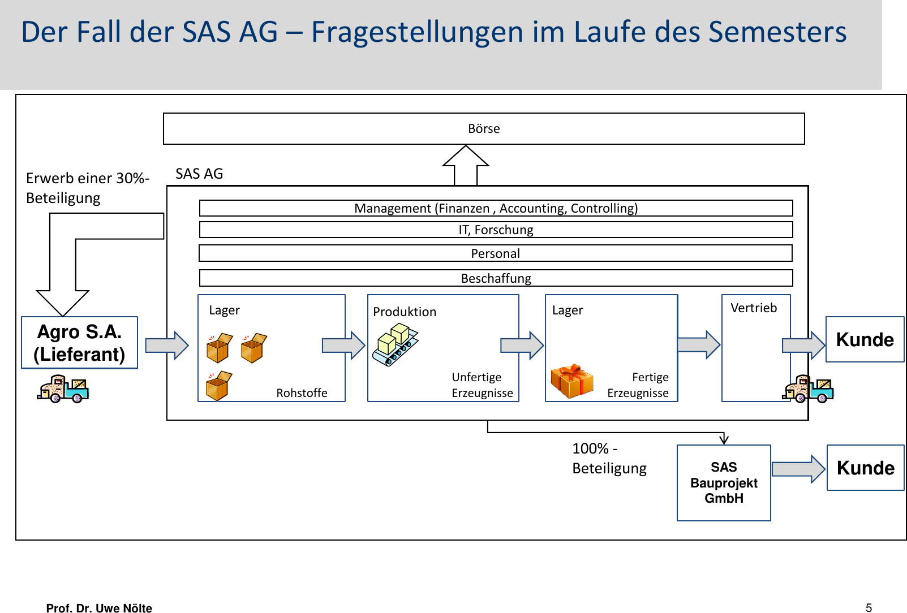

## Inhaltsübersicht

1. Jahresabschlussgrundlagen
   1. Aufstellungspflichten
   2. Prüfungspflichten
   3. Veröffentlichungspflichten
   4. Funktionen des Jahresabschlusses

## Definitionen

**Übersicht**

Definitionen

- Der Jahresabschluss ist der rechnerische Abschluss eines kaufmännischen Geschäftsjahres. Er stellt die Vermögens-, Finanz- und Ertragslage eines Unternehmens dar und beinhaltet den Abschluss der Buchhaltung, die Zusammenstellung von Dokumenten zur Rechnungslegung sowie deren Prüfung, Bestätigung und Veröffentlichung.
- Ein Geschäftsjahr wird auch als Wirtschaftsjahr bezeichnet, in der Regel umfasst es zwölf Monate und ist deckungsgleich mit dem Kalenderjahr.
- Das Geschäftsjahr kann vom Kalenderjahr abweichen, wenn damit das normale Geschäft des Unternehmens besser abgebildet wird (z.B. verwenden Fußballvereine ein Geschäftsjahr vom 1. Juli bis 30. Juni des Folgejahres).
- Ebenso kann es Rumpfgeschäftsjahre geben, die nur einen Teil des Kalenderjahres abbilden. Ein Rumpfgeschäftsjahr ist ein Geschäftsjahr eines Unternehmens, das weniger als zwölf Monate umfasst (weil z.B. der Termin für den Jahresabschluss verlegt wurde).

## Aufstellung, Veröffentlichung, Prüfung

**Übersicht**

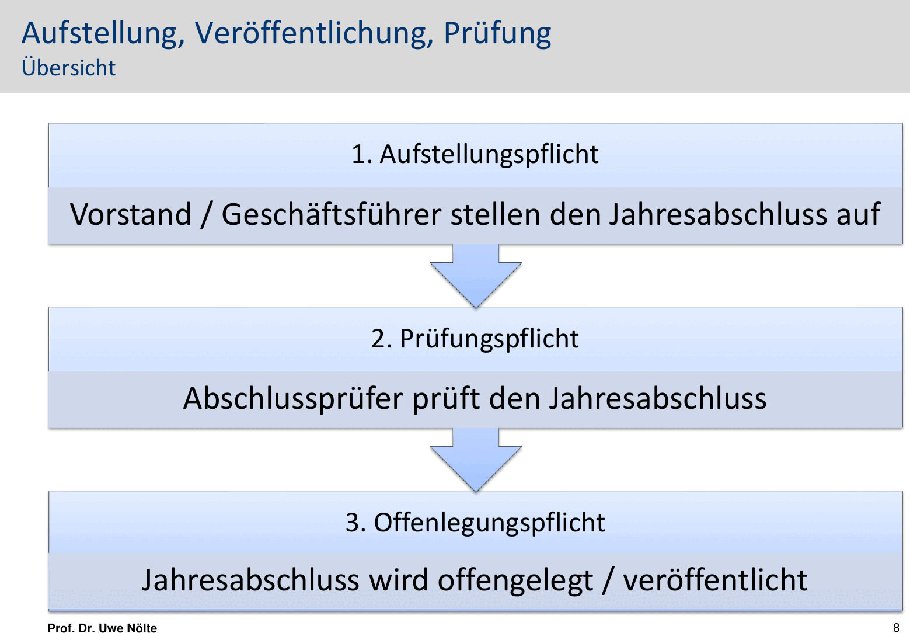

1. Aufstellungspflicht
   - Vorstand / Geschäftsführer stellen den Jahresabschluss auf
2. Prüfungspflicht
   - Abschlussprüfer prüft den Jahresabschluss
3. Offenlegungspflicht
   - Jahresabschluss wird offengelegt / veröffentlicht

## Aufstellungspflicht

**Übersicht über mögliche Erstellungspflichten**

Jahresabschlussvielfalt für deutsche Unternehmen

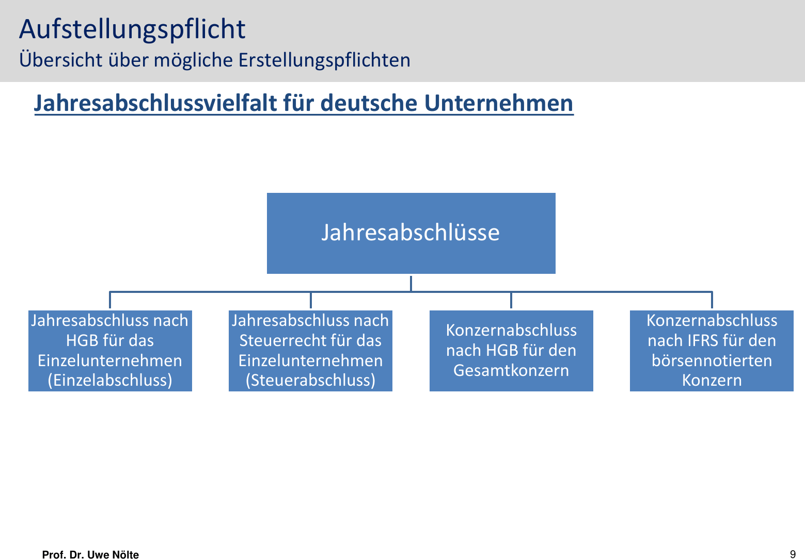

Jahresabschlüsse

- Jahresabschluss nach HGB für das Einzelunternehmen (Einzelabschluss)
- Jahresabschluss nach Steuerrecht für das Einzelunternehmen (Steuerabschluss)
- Konzernabschluss nach HGB für den Gesamtkonzern
- Konzernabschluss nach IFRS für den börsennotierten Konzern

## Aufstellungspflicht

**Jahresabschluss nach Handelsrecht**

Frage: Wer muss einen Jahresabschluss aufstellen?

Gesetzliche Grundlage

- Alle deutschen Kaufleute sind gem. §§ 238 bis 243 HGB zur
  - Buchführungspflicht (§238) nach HGB,
  - zur Aufstellung eines Inventars (§240) und
  - zur Aufstellung eines Abschlusses (§242) verpflichtet.
- Kapitalgesellschaften (AGs, GmbHs) sind automatisch Kaufleute, kraft ihrer Rechtsform (Formkaufmann (§6 HGB))
- Personengesellschaften, die ein Gewerbe betrieben, sind in der Regel kraft ihrer Tätigkeit Kaufleute.
- Ausnahmen
  - gem. des neu eingeführten § 241a HGB: Einzelkaufleute, die an den Abschlussstichtagen von zwei aufeinander folgenden Geschäftsjahren nicht mehr als 800 T € Umsatzerlöse und 80 T € Jahresüberschuss aufweisen, sind von der Verpflichtung zur Buchführung, Inventur und Bilanzierung nach HGB befreit.
  - Gem. §264 (3) und (4): Kapitalgesellschaften, die in den Konzernabschluss der Mutter einbezogen werden und bei der alle Gesellschafter dem zustimmen, müssen ebenfalls keinen Jahresabschluss zu erstellen.

## Aufstellungspflicht

**Kaufmannsarten**

Frage: Welche Kaufmannsarten gibt es?

Kaufmannsarten

| IST-Kaufmann | Kann-Kaufmann | Form-Kaufmann |
|---|---|---|
| Istkaufmann ist eine Natürliche Person, die ein Handelsgewerbe betreibt. Ein Handelsgewerbe ist ein Gewerbebetrieb, das einen in kaufmännischer Weise eingerichteten Geschäftsbetrieb erfordert. Z.B. Bäckerei, Metzgerei, Großindustrie. | Kannkaufmann ist eine natürliche Person, die kein Handelsgewerbe betreibt aber die Firma ihres Unternehmens freiwillig in das Handelsregister eintragen lässt. Dies steht in Abgrenzung zum Istkaufmann. | Formkaufmann ist ein Begriff aus dem Handelsgesetzbuch (HGB). Er beschreibt einen Kaufmann, der diese Eigenschaft „kraft Rechtsform“ (also durch seine Rechtsform) automatisch erhält. Hierzu zählen im Wesentlichen Kapitalgesellschaften und eingetragene Genossenschaften. |

## Aufstellungspflicht

**Kaufmannsarten**

Frage: Welche Unterschied besteht zwischen Kapital- und Personengesellschaften?

Rechtsform der Gesellschaft

| Personengesellschaft | Kapitalgesellschaft |
|---|---|
| Die Gesellschafter einer Personengesellschaft haften unbeschränkt, das heißt mit dem Gesellschaftsvermögen und mit ihrem Privatvermögen. Daher besteht keine Pflicht für ein Mindesteigenkapital. Beispiele für Personengesellschaften sind: Gesellschaft bürgerlichen Rechts (GbR), Partnerschaftsgesellschaft (PartG), offene Handelsgesellschaft (OHG), Kommanditgesellschaft (KG). | Die Kapitalgesellschaft ist eine eigenständige juristische Person, d.h. kann selbständig Rechtsgeschäfte eingehen. Kapitalgesellschaften steht das Eigenkapital im Vordergrund, das die Gesellschafter durch Übertragung eines Teils ihres Privatvermögens einbringen. Die Gesellschafter haften nicht mit ihrem Privatvermögen für Schulden der Gesellschaft. Dafür unterliegt die Kapitalgesellschaft umfangreichen Transparenz und Kapitalaufbringungsregelungen zum Schutz der Gläubiger, z.B. durch ein Mindesteigenkapital (GmbH: 25.000€, AG: 50.000€) |

## Aufstellungspflicht

**Jahresabschluss nach Steuerrecht (StR)**

Alle deutschen Kaufleute sind verpflichtet zur Rechnungslegung nach Steuerrecht (§§ 140 f. AO) („Steuerbilanz“)

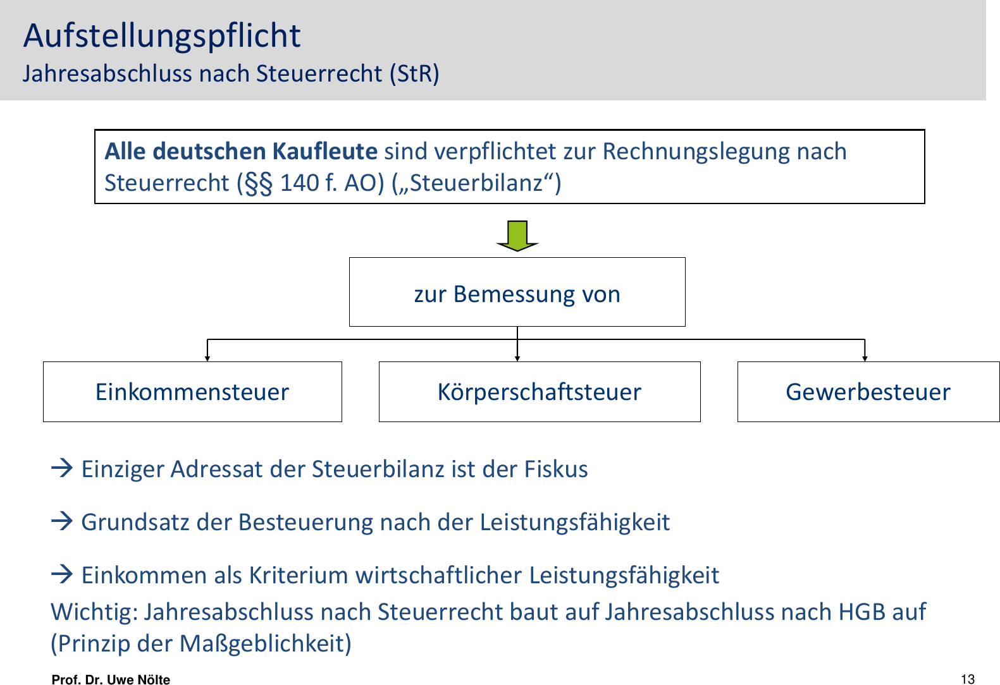

zur Bemessung von

- Einkommensteuer
- Körperschaftsteuer
- Gewerbesteuer

→ Einziger Adressat der Steuerbilanz ist der Fiskus

→ Grundsatz der Besteuerung nach der Leistungsfähigkeit

→ Einkommen als Kriterium wirtschaftlicher Leistungsfähigkeit

Wichtig: Jahresabschluss nach Steuerrecht baut auf Jahresabschluss nach HGB auf (Prinzip der Maßgeblichkeit)

## Aufstellungspflicht

**Konzernabschluss nach Handelsrecht**

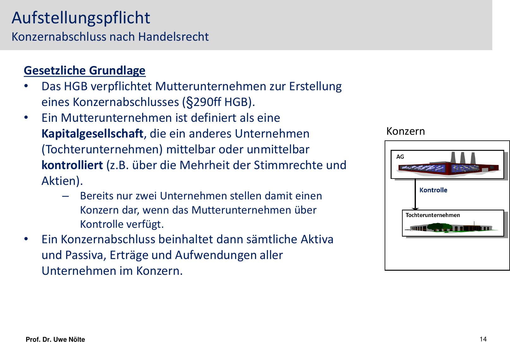

Gesetzliche Grundlage

- Das HGB verpflichtet Mutterunternehmen zur Erstellung eines Konzernabschlusses (§290ff HGB).
- Ein Mutterunternehmen ist definiert als eine Kapitalgesellschaft, die ein anderes Unternehmen (Tochterunternehmen) mittelbar oder unmittelbar kontrolliert (z.B. über die Mehrheit der Stimmrechte und Aktien).
  - Bereits nur zwei Unternehmen stellen damit einen Konzern dar, wenn das Mutterunternehmen über Kontrolle verfügt.
- Ein Konzernabschluss beinhaltet dann sämtliche Aktiva und Passiva, Erträge und Aufwendungen aller Unternehmen im Konzern.

## Aufstellungspflicht

**Konzernabschluss nach IFRS**

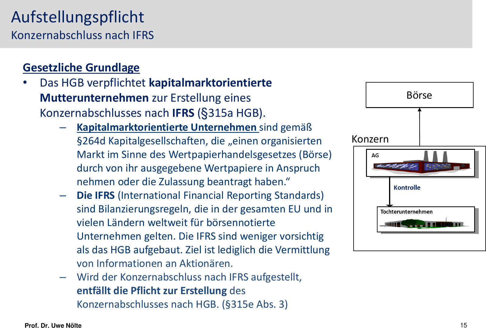

Gesetzliche Grundlage

- Das HGB verpflichtet kapitalmarktorientierte Mutterunternehmen zur Erstellung eines Konzernabschlusses nach IFRS (§315a HGB).
  - Kapitalmarktorientierte Unternehmen sind gemäß §264d Kapitalgesellschaften, die „einen organisierten Markt im Sinne des Wertpapierhandelsgesetzes (Börse) durch von ihr ausgegebene Wertpapiere in Anspruch nehmen oder die Zulassung beantragt haben.“
  - Die IFRS (International Financial Reporting Standards) sind Bilanzierungsregeln, die in der gesamten EU und in vielen Ländern weltweit für börsennotierte Unternehmen gelten. Die IFRS sind weniger vorsichtig als das HGB aufgebaut. Ziel ist lediglich die Vermittlung von Informationen an Aktionären.
  - Wird der Konzernabschluss nach IFRS aufgestellt, entfällt die Pflicht zur Erstellung des Konzernabschlusses nach HGB. (§315e Abs. 3)

## Aufstellungspflicht

**Ablauf**

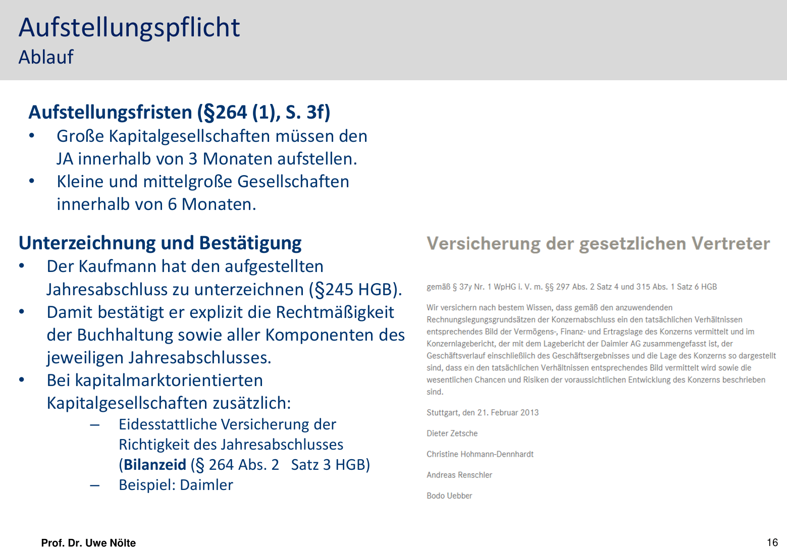

Aufstellungsfristen (§264 (1), S. 3f)

- Große Kapitalgesellschaften müssen den JA innerhalb von 3 Monaten aufstellen.
- Kleine und mittelgroße Gesellschaften innerhalb von 6 Monaten.

Unterzeichnung und Bestätigung

- Der Kaufmann hat den aufgestellten Jahresabschluss zu unterzeichnen (§245 HGB).
- Damit bestätigt er explizit die Rechtmäßigkeit der Buchhaltung sowie aller Komponenten des jeweiligen Jahresabschlusses.
- Bei kapitalmarktorientierten Kapitalgesellschaften zusätzlich:
  - Eidesstattliche Versicherung der Richtigkeit des Jahresabschlusses (Bilanzeid (§ 264 Abs. 2 Satz 3 HGB)
  - Beispiel: Daimler

## Prüfungspflicht

Gesetzliche Grundlage

§316 HGB: (1) „Der Jahresabschluss und der Lagebericht von Kapitalgesellschaften, die nicht kleine im Sinne des § 267 Abs. 1 sind, sind durch einen Abschlussprüfer zu prüfen.“

| Größe der KapGes bzw. haftungsbeschränkten PHG (§267 & § 267a) | Bilanzsumme (BS) in Mio. € | Umsatzerlöse (UE) in Mio. € | Zahl der Arbeitnehmer (AN) |
|---|---|---|---|
| Kleinst | BS ≤ 0,35 | UE ≤ 0,7 | AN ≤ 10 |
| Klein | 0,35 < BS ≤ 6 | 0,7 < UE ≤ 12 | 10 < AN ≤ 50 |
| Mittelgroß | 6 < BS ≤ 20 | 12 < UE ≤ 40 | 50 < AN ≤ 250 |
| Groß | BS > 20 | UE > 40 | AN > 250 |

- Die Zugehörigkeit zu einer bestimmten Klasse orientiert sich daran, ob die Gesellschaft an zwei aufeinanderfolgenden Abschlussstichtagen mindestens zwei der drei Grenzwerte überschreitet. Die Grenzwerte gelten für den Einzelabschluss.
- Allerdings gilt eine Gesellschaft gemäß § 267 (3) S. 2 HGB stets als groß, wenn sie mit Aktien und/oder Anleihen einen organisierten Markt in Anspruch nimmt bzw. eine Zulassung zum Handel beantragt ist. Organisierte Märkte sind Märkte, die einer hohen Transparenzpflicht unterliegen.
- Die Angabe der Mitarbeiterzahl findet sich bei Kapitalgesellschaften gem. §285, Nr. 7 HGB im Anhang.

## Prüfungspflicht

| Größenklassen (§267 HGB) | Was wird geprüft? |
|---|---|
| Große Kapitalgesellschaften | Jahresabschluss (Bilanz, GuV, Anhang); Lagebericht, Bericht des Aufsichtsrates, Vorschlag und Beschluss über Ergebnisverwendung (§ 325 Abs. 1 HGB) |
| Mittelgroße Kapitalgesellschaften | Bilanz in der für kleine Kapitalgesellschaften geltenden Form (§ 266 (1) S. 3 HGB), aber mit zusätzlichen Angaben gem. § 327 (1) HGB, Anhang verkürzt nach § 327 (2) HGB, übrige Unterlagen wie große Kapitalgesellschaften. (§§ 325 (1), 327 HGB) |
| Kleine/Kleinst-Kapitalgesellschaften | Kleine KapG i. S. v. § 267 (1) HGB sind publizitäts-, aber nicht prüfungspflichtig (§ 316 (1) HGB) |

## Prüfungspflicht

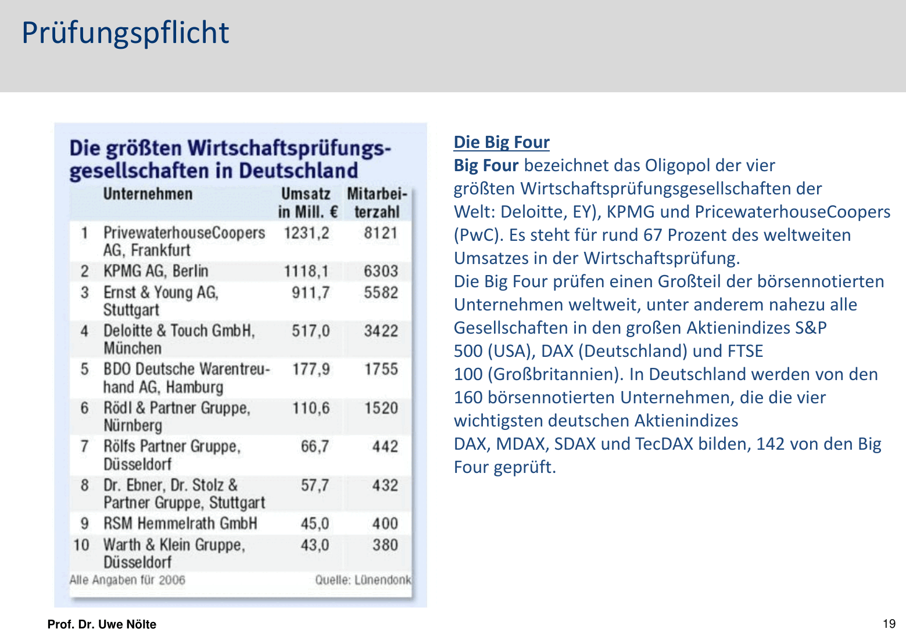

Die Big Four

Big Four bezeichnet das Oligopol der vier größten Wirtschaftsprüfungsgesellschaften der Welt: Deloitte, EY), KPMG und PricewaterhouseCoopers (PwC). Es steht für rund 67 Prozent des weltweiten Umsatzes in der Wirtschaftsprüfung.

Die Big Four prüfen einen Großteil der börsennotierten Unternehmen weltweit, unter anderem nahezu alle Gesellschaften in den großen Aktienindizes S&P 500 (USA), DAX (Deutschland) und FTSE 100 (Großbritannien). In Deutschland werden von den 160 börsennotierten Unternehmen, die die vier wichtigsten deutschen Aktienindizes DAX, MDAX, SDAX und TecDAX bilden, 142 von den Big Four geprüft.

## Prüfungspflicht

Ergebnis:

- Das Ergebnis der Prüfung ist ein Testat durch den Abschlussprüfer/Wirtschaftsprüfer. (§316 (a) HGB), das als Bestätigungsvermerk Teil des Jahresabschlusses wird.

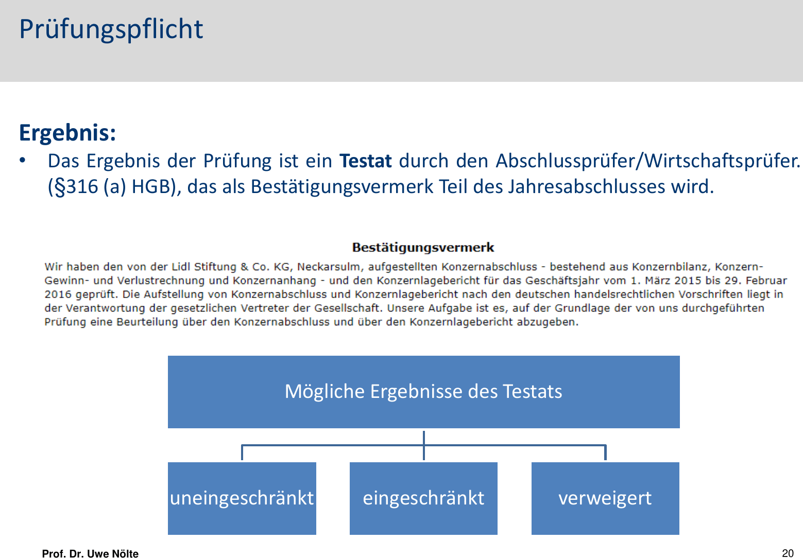

Mögliche Ergebnisse des Testats

- uneingeschränkt
- eingeschränkt
- verweigert

## Prüfungspflicht

**Praxisbeispiel Adler Real Estate / Adler Group**

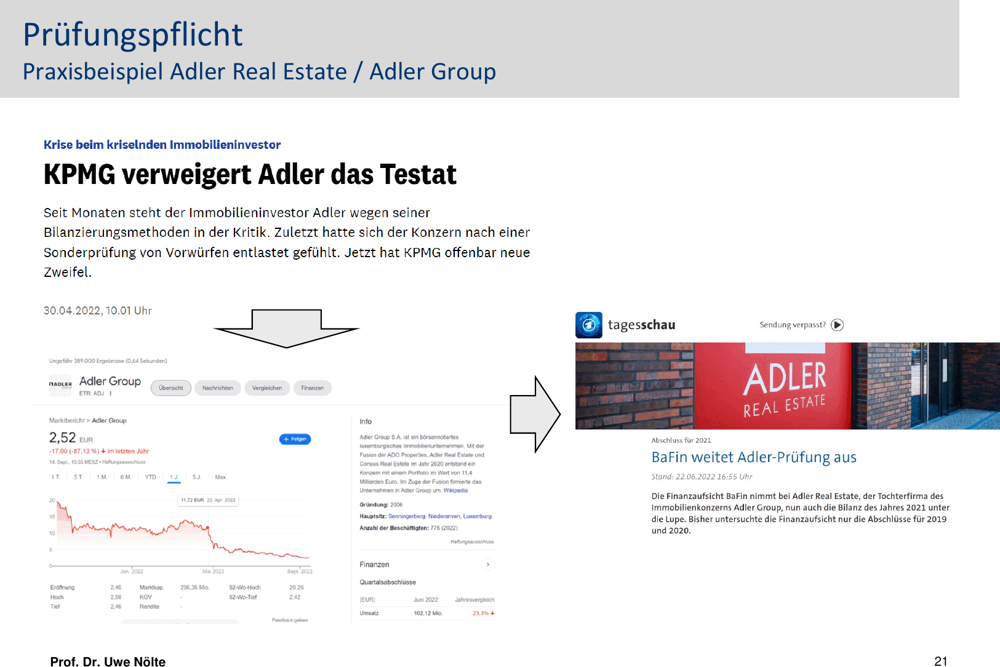

## Offenlegungspflicht (Publizität)

Gesetzliche Grundlage

- Die Offenlegung der unterschiedlichen Bestandteile des Jahresabschlusses wird in den §§ 325ff HGB geregelt.
- Die Unterlagen sind grundsätzlich beim elektronischen Bundesanzeiger einzureichen und vom Betreiber des Bundesanzeigers zu veröffentlichen.
- Personengesellschaften und Einzelkaufleute sind von der Offenlegung befreit, es sei denn sie überschreiten gewissen Größenkriterien nach dem Publizitätsgesetz.
- Die Pflichten hängen dabei auch von der Größe der Gesellschaft ab.

| Größenklassen (§267 HGB) | Was wird im Bundesanzeiger veröffentlicht? | Art der Offenlegung und Fristen |
|---|---|---|
| Große Kapitalgesellschaften | Bilanz, GuV, Anhang und Lagebericht in der in §266 und §275 geltenden Form | Innerhalb von 12 Monaten nach dem Abschlussstichtag (§ 325 (1) HGB) |

## Offenlegungspflicht (Publizität)

| Größenklassen (§267 HGB) | Was wird im Bundesanzeiger veröffentlicht? | Art der Offenlegung und Frist |
|---|---|---|
| Mittelgroße Kapitalgesellschaften 1) | Verkürzte Bilanz in der für kleine Kapitalgesellschaften geltenden Form (§ 266 (1) S. 3 HGB), aber mit zusätzlichen Angaben gem. § 327 (1) HGB, Anhang verkürzt nach § 327 (2) HGB, | Bekanntmachung im elektronischen Bundesanzeiger (§ 325 (1) und (2) HGB); Innerhalb von 12 Monaten nach dem Abschlussstichtag (§ 325 (1) HGB) |
| Kleine/Kleinst Kapitalgesellschaften 1) | Verkürzte Bilanz ohne detaillierte Aufgliederung des Anlagevermögens und des Eigen- und Fremdkapitals; Verkürzte GuV mit „Rohergebnis“ statt Aufgliederung der Erträge und Aufwendungen (§276); Auch kein Ausweis der GuV möglich (§326a HGB) | Bekanntmachung im elektronischen Bundesanzeiger (§ 325 (1) und (2) HGB); Innerhalb von 12 Monaten nach dem Abschlussstichtag (§ 325 (1) HGB) |

1) Erleichterungen bezüglich der Publizität gelten nur, sofern diese Unternehmen nicht kapitalmarktorientiert im Sinne des § 267 (3) HGB sind oder im Bundesbesitz stehen (§ 65 (1) Nr. 4 BHO)

## Offenlegungspflicht (Publizität)

**Spezialregelung des Publizitätsgesetzes**

Interpretation

- Das Publizitätsgesetz (PublG) in Deutschland regelt die Offenlegungspflichten bestimmter Unternehmen, die über die allgemeinen Anforderungen des Handelsgesetzbuchs (HGB) hinausgehen.

Relevant für

- Einzelunternehmen und Personengesellschaften , die an zwei aufeinanderfolgenden Abschlussstichtagen zwei der drei folgenden Merkmale überschreiten:
  - Bilanzsumme: 65 Millionen Euro
  - Umsatzerlöse: 130 Millionen Euro
  - Arbeitnehmer: 5.000 im Jahresdurchschnitt

Anforderungen an die Offenlegung und Prüfung

Aufstellungspflichten: Diese Unternehmen müssen ihren Jahresabschluss, bestehend aus Bilanz, Gewinn- und Verlustrechnung, Lagebericht sowie Anhang, veröffentlichen.

Prüfung: Der Jahresabschluss muss von einem Wirtschaftsprüfer geprüft werden.

## Veröffentlichung in XBRL

Gesetzliche Grundlage

- In Deutschland müssen bestimmte Unternehmen ihren Jahresabschluss im XBRL-Format (eXtensible Business Reporting Language) veröffentlichen. Dies betrifft hauptsächlich kapitalmarktorientierte Unternehmen sowie bestimmte große Unternehmen und Unternehmensgruppen.
  - Börsennotierte Unternehmen müssen ihre Jahresabschlüsse und Konzernabschlüsse in einem elektronischen Format, das XBRL einschließt, bei der Bundesanstalt für Finanzdienstleistungsaufsicht (BaFin) einreichen.
  - Große Kapitalgesellschaften und haftungsbeschränkte Personenhandelsgesellschaften, die bestimmte Größenkriterien erfüllen, müssen ihre Jahresabschlüsse im elektronischen Bundesanzeiger veröffentlichen. Diese Jahresabschlüsse werden auch im XBRL-Format verlangt

## Veröffentlichung in XBRL

**Beispiel SAP Konzern**

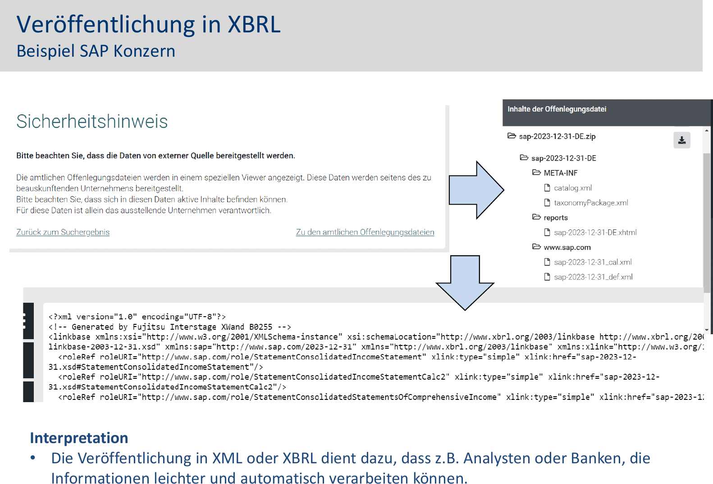

Interpretation

- Die Veröffentlichung in XML oder XBRL dient dazu, dass z.B. Analysten oder Banken, die Informationen leichter und automatisch verarbeiten können.

## Funktionen des Jahresabschlusses

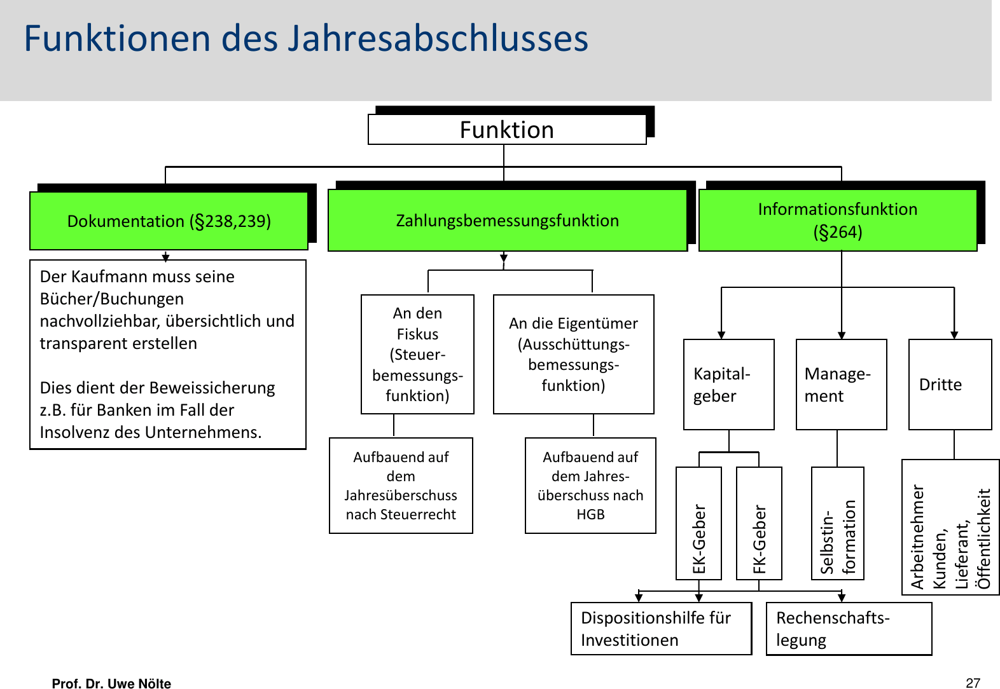

Funktion

- Dokumentation (§238,239)
- Zahlungsbemessungsfunktion
- Informationsfunktion (§264)

Dokumentation (§238,239)

Der Kaufmann muss seine Bücher/Buchungen nachvollziehbar, übersichtlich und transparent erstellen

Dies dient der Beweissicherung z.B. für Banken im Fall der Insolvenz des Unternehmens.

Zahlungsbemessungsfunktion

- An den Fiskus (Steuerbemessungsfunktion)
  - Aufbauend auf dem Jahresüberschuss nach Steuerrecht
- An die Eigentümer (Ausschüttungsbemessungsfunktion)
  - Aufbauend auf dem Jahresüberschuss nach HGB

Informationsfunktion (§264)

- Kapitalgeber
  - EK-Geber
  - FK-Geber
  - Dispositionshilfe für Investitionen
- Management
  - Selbstinformation
  - Rechenschaftslegung
- Dritte
  - Arbeitnehmer
  - Kunden, Lieferant, Öffentlichkeit

## Funktionen des Jahresabschlusses

**Informationsfunktion**

Frage: Wen soll der Jahresabschluss informieren und wo ist das festgelegt?

Gesetzliche Grundlage: § 264 Abs. 2 (HGB):

„Der Jahresabschluss der Kapitalgesellschaft hat unter Beachtung der Grundsätze ordnungsmäßiger Buchführung ein den tatsächlichen Verhältnissen entsprechendes Bild der Vermögens-, Finanz- und Ertragslage der Kapitalgesellschaft zu vermitteln.“

Zweck der Informationsfunktion

Der Jahresabschluss dient dazu externe Adressaten über die Lage des Unternehmens zu informieren. Beispielsweise wollen

- Aktionäre über den Rentabilität ihrer Investition informiert werden
- Banken über die Sicherheit und des Insolvenzrisikos ihres Kreditnehmers
- Die Vorstände und Geschäftsführer über die Effizienz der internen Prozesse informiert werden
- Mitarbeiter über die Sicherheit ihres Arbeitsgebers oder Lieferanten über die Sicherheit der Zahlung ihrer Forderungen

Da Kapitalgesellschaften nicht mit dem privaten Vermögen des Unternehmers haften sollen die externen Adressaten durch Informationen abgesichert werden.

## Funktionen des Jahresabschlusses

**Zahlungsbemessungsfunktion - Steuern**

Frage: Was bedeutet die „Zahlungsbemessungsfunktion (Steuern)“?

Gesetzliche Grundlage: §140 AO und §5 Abs. 1 EStG:

Das Maßgeblichkeitsprinzip ist bei der Bilanzierung zu beachten und besagt, dass die bei der Aufstellung der Handelsbilanz geltenden Grundsätze ordnungsmäßiger Buchführung auch bei der Aufstellung der Steuerbilanz zu berücksichtigen sind. Es ist in Deutschland im § 5 Abs. 1 Satz 1 EStG verankert.

Zweck der Zahlungsbemessungsfunktion (Steuern)

Der Fiskus verlangt vom Unternehmen die Zahlung von Steuern (Körperschaftsteuern, Gewerbesteuer). Die Besteuerung erfolgt nach dem Leistungsprinzip, d.h. nur wenn das Unternehmen Gewinne erzielt, sollte es Steuern auf diese Gewinne zahlen.

Damit die Unternehmen nicht extra für den Fiskus eine eigene Berechnung des zu versteuernden Einkommens erstellen müssen, koppelt sich der Fiskus einfach an den Jahresabschluss. Der Jahresüberschuss nach HGB dient damit als maßgebliche Grundlage (ist maßgeblich) für die Berechnung des zu versteuernden Einkommens (Maßgeblichkeitsprinzip).

## Funktionen des Jahresabschlusses

**Zahlungsbemessungsfunktion - Dividenden**

Frage: Was bedeutet die „Zahlungsbemessungsfunktion (Ausschüttungen)“?

Gesetzliche Grundlage: §58 (4) AktG:

„Die Aktionäre haben Anspruch auf den Bilanzgewinn des Unternehmens (…)“

Zweck der Zahlungsbemessungsfunktion (Ausschüttungen)

Die Gesellschafter des Unternehmens sind Eigentümer des Unternehmens. Daher gehören ihnen die Gewinne des Unternehmens. Nach Aktiengesetz haben sie daher ein Recht auf die Ausschüttung des Jahresüberschusses/Bilanzgewinn des Unternehmens an sich selbst.

Die maximale Ausschüttung ist dabei auf die Höhe des erzielten Jahresüberschusses begrenzt (mit Ausnahmen). Der Jahresabschluss dient daher auch zur Ermittlung der maximalen Ausschüttung an die Gesellschafter.

Einlagen der Gesellschafter, die eingezahlt wurden, dürfen nicht als Ausschüttung ausgezahlt werden. (§57 (1) AktG)

Quelle: `bilanzierung/origin/WDS25 - Bilanzierung (NOU)/04 1 - Folien/Bilanzierung - Q4 2026/Bilanzierung - Q4 2026.pdf`, Seiten 2–30
