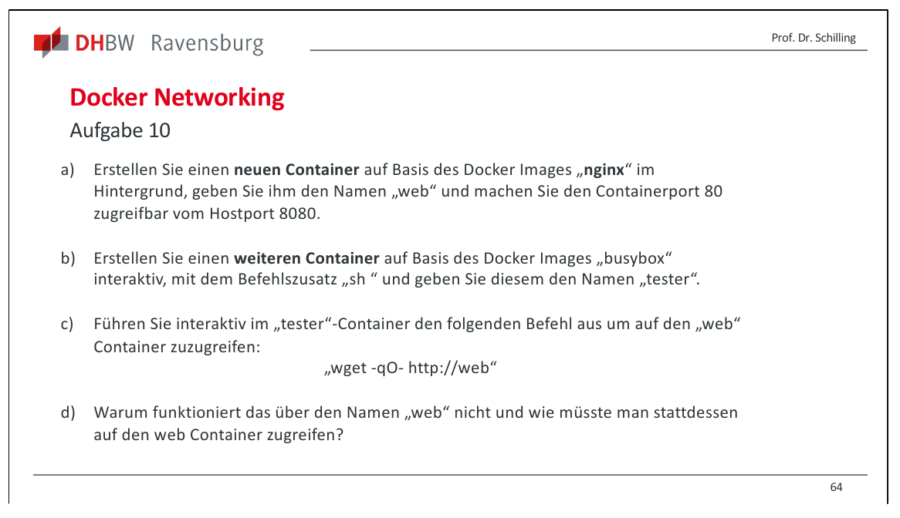

# Aufgabe 10

Docker Networking

a) Erstellen Sie einen neuen Container auf Basis des Docker Images „nginx“ im
Hintergrund, geben Sie ihm den Namen „web“ und machen Sie den Containerport 80
zugreifbar vom Hostport 8080.

b) Erstellen Sie einen weiteren Container auf Basis des Docker Images „busybox“
interaktiv, mit dem Befehlszusatz „sh “ und geben Sie diesem den Namen „tester“.

c) Führen Sie interaktiv im „tester“-Container den folgenden Befehl aus um auf den „web“
Container zuzugreifen:

```sh
wget -qO- http://web
```

d) Warum funktioniert das über den Namen „web“ nicht und wie müsste man stattdessen
auf den web Container zugreifen?



## Dateien in diesem Ordner

| Datei | Zweck |
| --- | --- |
| `TASKS.md` | diese Aufgabenstellung |
| `images/seite-62.png` | Folienseite der Aufgabenstellung |
| `Aufgabe_11_Lösung.pdf` | Lösung zu dieser Aufgabe (Deckblatt „Docker Networking / Aufgabe 11“) |

## Hinweis zur Zuordnung

Die Lösungsdatei heißt `Aufgabe_11_Lösung.pdf` und trägt das Deckblatt „Docker Networking / Aufgabe 11“. Ihr Inhalt ist wortgleich die Aufgabenstellung dieser Folie, die der Foliensatz „Aufgabe 10“ nennt. Ab Docker Networking sind die Lösungsdateien eins höher nummeriert als der Foliensatz. Der Dateiname wurde nicht geändert, damit die Datei in Moodle wiederzufinden ist.

Quelle: cloud-computing/origin/WDS125 - Cloud Computing (SCA)/05 Docker/3-Docker/3-Docker.pdf, Seite 62
