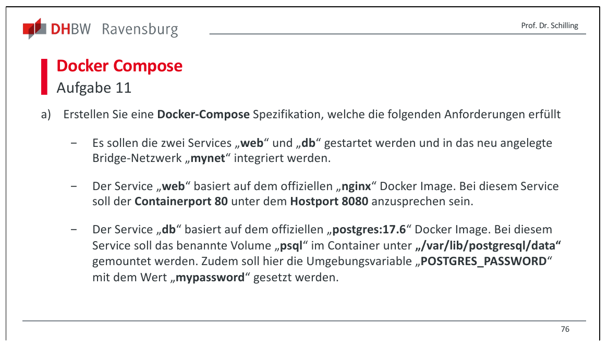
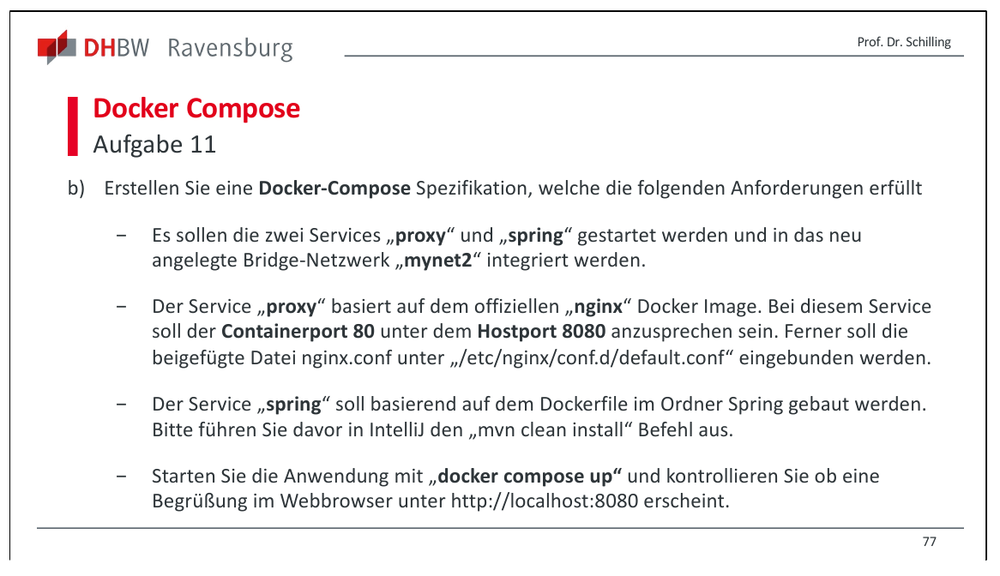

# Aufgabe 11

Docker Compose

## a) Erstellen Sie eine Docker-Compose Spezifikation, welche die folgenden Anforderungen erfüllt

- Es sollen die zwei Services „web“ und „db“ gestartet werden und in das neu angelegte
  Bridge-Netzwerk „mynet“ integriert werden.

- Der Service „web“ basiert auf dem offiziellen „nginx“ Docker Image. Bei diesem Service
  soll der Containerport 80 unter dem Hostport 8080 anzusprechen sein.

- Der Service „db“ basiert auf dem offiziellen „postgres:17.6“ Docker Image. Bei diesem
  Service soll das benannte Volume „psql“ im Container unter „/var/lib/postgresql/data“
  gemountet werden. Zudem soll hier die Umgebungsvariable „POSTGRES_PASSWORD“
  mit dem Wert „mypassword“ gesetzt werden.

## b) Erstellen Sie eine Docker-Compose Spezifikation, welche die folgenden Anforderungen erfüllt

- Es sollen die zwei Services „proxy“ und „spring“ gestartet werden und in das neu
  angelegte Bridge-Netzwerk „mynet2“ integriert werden.

- Der Service „proxy“ basiert auf dem offiziellen „nginx“ Docker Image. Bei diesem Service
  soll der Containerport 80 unter dem Hostport 8080 anzusprechen sein. Ferner soll die
  beigefügte Datei nginx.conf unter „/etc/nginx/conf.d/default.conf“ eingebunden werden.

- Der Service „spring“ soll basierend auf dem Dockerfile im Ordner Spring gebaut werden.
  Bitte führen Sie davor in IntelliJ den „mvn clean install“ Befehl aus.

- Starten Sie die Anwendung mit „docker compose up“ und kontrollieren Sie ob eine
  Begrüßung im Webbrowser unter http://localhost:8080 erscheint.

## Dateien in diesem Ordner

| Datei | Zweck |
| --- | --- |
| `TASKS.md` | diese Aufgabenstellung |
| `images/seite-74.png`, `images/seite-75.png` | Folienseiten der Aufgabenstellung |
| `Aufgabe_11.zip` | Startprojekt aus `origin/` (`Aufgabe_11/compose.yml` leer, `Aufgabe_11/proxy/nginx.conf`, `Aufgabe_11/spring/Dockerfile` samt Gradle-Projekt) |
| `Aufgabe_12_Lösung.pdf` | Lösung zu dieser Aufgabe (Deckblatt „Docker Compose / Aufgabe 12“) |

## Hinweis zur Zuordnung

Die Lösungsdatei heißt `Aufgabe_12_Lösung.pdf` und trägt das Deckblatt „Docker Compose / Aufgabe 12“. Ihr Inhalt ist die Aufgabenstellung dieser Folien, die der Foliensatz „Aufgabe 11“ nennt. Dort steht „postgres“ statt „postgres:17.6“, „docker-compose up“ statt „docker compose up“ und „http://localhost“ statt „http://localhost:8080“. Ab Docker Networking sind die Lösungsdateien eins höher nummeriert als der Foliensatz.

Quelle: cloud-computing/origin/WDS125 - Cloud Computing (SCA)/05 Docker/3-Docker/3-Docker.pdf, Seiten 74–75
