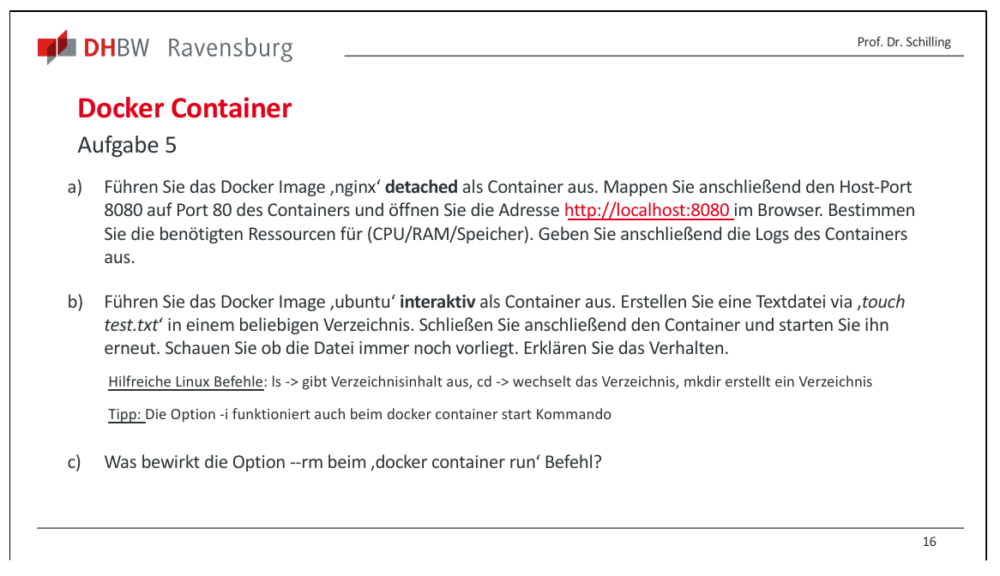

# Aufgabe 5

Docker Container

a) Führen Sie das Docker Image ‚nginx‘ **detached** als Container aus. Mappen Sie anschließend den Host-Port
8080 auf Port 80 des Containers und öffnen Sie die Adresse http://localhost:8080 im Browser. Bestimmen
Sie die benötigten Ressourcen für (CPU/RAM/Speicher). Geben Sie anschließend die Logs des Containers
aus.

b) Führen Sie das Docker Image ‚ubuntu‘ **interaktiv** als Container aus. Erstellen Sie eine Textdatei via ‚touch
test.txt‘ in einem beliebigen Verzeichnis. Schließen Sie anschließend den Container und starten Sie ihn
erneut. Schauen Sie ob die Datei immer noch vorliegt. Erklären Sie das Verhalten.

Hilfreiche Linux Befehle: ls -> gibt Verzeichnisinhalt aus, cd -> wechselt das Verzeichnis, mkdir erstellt ein Verzeichnis

Tipp: Die Option -i funktioniert auch beim docker container start Kommando

c) Was bewirkt die Option --rm beim ‚docker container run‘ Befehl?

## Dateien in diesem Ordner

| Datei | Zweck |
| --- | --- |
| `TASKS.md` | diese Aufgabenstellung |
| `images/seite-16.png` | Folienseite der Aufgabenstellung |
| `Aufgabe_5_Lösung.pdf` | Lösung aus `origin/`; Deckblatt: „Docker Container / Aufgabe 5“ |

Quelle: cloud-computing/origin/WDS125 - Cloud Computing (SCA)/05 Docker/3-Docker/3-Docker.pdf, Seite 16
