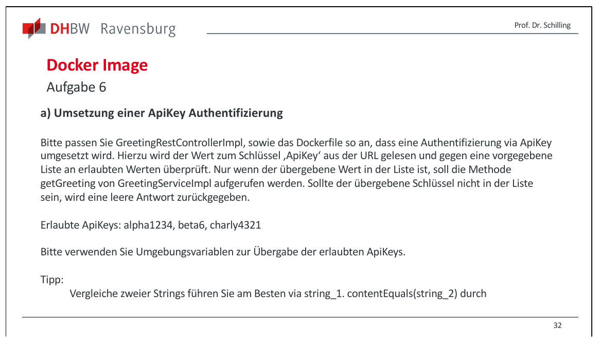
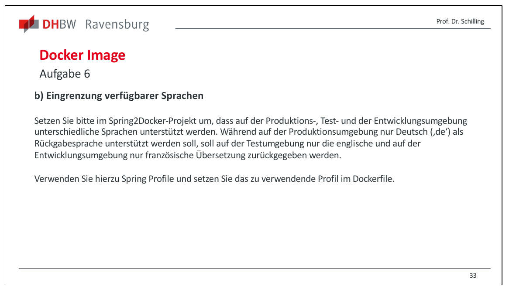

# Aufgabe 6

Docker Image

## a) Umsetzung einer ApiKey Authentifizierung

Bitte passen Sie GreetingRestControllerImpl, sowie das Dockerfile so an, dass eine Authentifizierung via ApiKey
umgesetzt wird. Hierzu wird der Wert zum Schlüssel ‚ApiKey‘ aus der URL gelesen und gegen eine vorgegebene
Liste an erlaubten Werten überprüft. Nur wenn der übergebene Wert in der Liste ist, soll die Methode
getGreeting von GreetingServiceImpl aufgerufen werden. Sollte der übergebene Schlüssel nicht in der Liste
sein, wird eine leere Antwort zurückgegeben.

Erlaubte ApiKeys: alpha1234, beta6, charly4321

Bitte verwenden Sie Umgebungsvariablen zur Übergabe der erlaubten ApiKeys.

Tipp:

Vergleiche zweier Strings führen Sie am Besten via string_1. contentEquals(string_2) durch

## b) Eingrenzung verfügbarer Sprachen

Setzen Sie bitte im Spring2Docker-Projekt um, dass auf der Produktions-, Test- und der Entwicklungsumgebung
unterschiedliche Sprachen unterstützt werden. Während auf der Produktionsumgebung nur Deutsch (‚de‘) als
Rückgabesprache unterstützt werden soll, soll auf der Testumgebung nur die englische und auf der
Entwicklungsumgebung nur französische Übersetzung zurückgegeben werden.

Verwenden Sie hierzu Spring Profile und setzen Sie das zu verwendende Profil im Dockerfile.

## Dateien in diesem Ordner

| Datei | Zweck |
| --- | --- |
| `TASKS.md` | diese Aufgabenstellung |
| `images/seite-32.png`, `images/seite-33.png` | Folienseiten der Aufgabenstellung |
| `Aufgabe_6.zip` | Startprojekt aus `origin/` (Gradle-Projekt `Aufgabe_6` mit `Dockerfile`, `GreetingRestControllerImpl.java`, `GreetingServiceImpl.java`) |
| `Aufgabe_6_Lösung.zip` | Lösung aus `origin/` (gleiches Projekt mit `GreetingServiceImplProd.java`, `GreetingServiceImplTest.java` und angepasstem `Dockerfile`) |

Quelle: cloud-computing/origin/WDS125 - Cloud Computing (SCA)/05 Docker/3-Docker/3-Docker.pdf, Seiten 32–33
