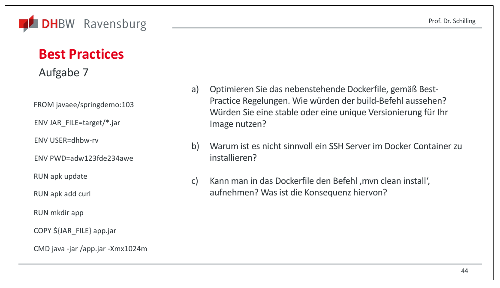

# Aufgabe 7

Best Practices

```dockerfile
FROM javaee/springdemo:103

ENV JAR_FILE=target/*.jar
ENV USER=dhbw-rv

ENV PWD=adw123fde234awe

RUN apk update

RUN apk add curl

RUN mkdir app

COPY ${JAR_FILE} app.jar

CMD java -jar /app.jar -Xmx1024m
```

a) Optimieren Sie das nebenstehende Dockerfile, gemäß Best-Practice Regelungen. Wie würden der build-Befehl aussehen? Würden Sie eine stable oder eine unique Versionierung für Ihr Image nutzen?

b) Warum ist es nicht sinnvoll ein SSH Server im Docker Container zu installieren?

c) Kann man in das Dockerfile den Befehl ‚mvn clean install‘, aufnehmen? Was ist die Konsequenz hiervon?



## Dateien in diesem Ordner

| Datei | Zweck |
| --- | --- |
| `TASKS.md` | diese Aufgabenstellung |
| `images/seite-41.png` | Folienseite der Aufgabenstellung |
| `Aufgabe_7_Lösung.pdf` | Lösung aus `origin/`; Deckblatt: „Best Practices / Aufgabe 7“ |

Quelle: cloud-computing/origin/WDS125 - Cloud Computing (SCA)/05 Docker/3-Docker/3-Docker.pdf, Seite 41
