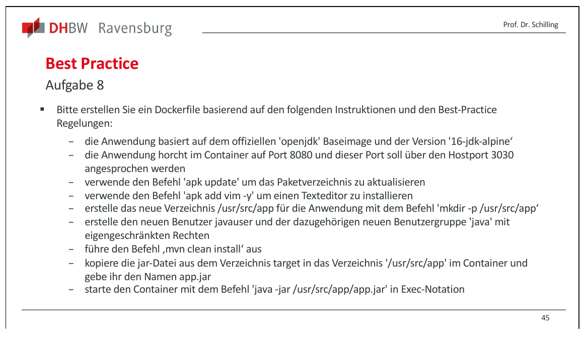

# Aufgabe 8

Best Practice

Bitte erstellen Sie ein Dockerfile basierend auf den folgenden Instruktionen und den Best-Practice
Regelungen:

- die Anwendung basiert auf dem offiziellen 'openjdk' Baseimage und der Version '16-jdk-alpine‘
- die Anwendung horcht im Container auf Port 8080 und dieser Port soll über den Hostport 3030 angesprochen werden
- verwende den Befehl 'apk update' um das Paketverzeichnis zu aktualisieren
- verwende den Befehl 'apk add vim -y' um einen Texteditor zu installieren
- erstelle das neue Verzeichnis /usr/src/app für die Anwendung mit dem Befehl 'mkdir -p /usr/src/app‘
- erstelle den neuen Benutzer javauser und der dazugehörigen neuen Benutzergruppe 'java' mit eigengeschränkten Rechten
- führe den Befehl ‚mvn clean install‘ aus
- kopiere die jar-Datei aus dem Verzeichnis target in das Verzeichnis '/usr/src/app' im Container und gebe ihr den Namen app.jar
- starte den Container mit dem Befehl 'java -jar /usr/src/app/app.jar' in Exec-Notation

## Dateien in diesem Ordner

| Datei | Zweck |
| --- | --- |
| `TASKS.md` | diese Aufgabenstellung |
| `images/seite-42.png` | Folienseite der Aufgabenstellung |
| `Aufgabe_8_Lösung.pdf` | Lösung aus `origin/`; Deckblatt: „Aufgabe / Aufgabe 8“ |

Quelle: cloud-computing/origin/WDS125 - Cloud Computing (SCA)/05 Docker/3-Docker/3-Docker.pdf, Seite 42
