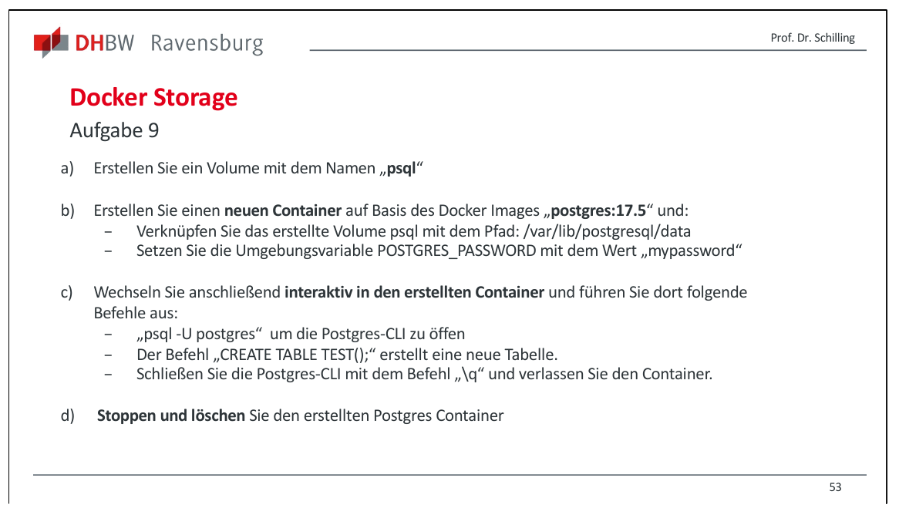
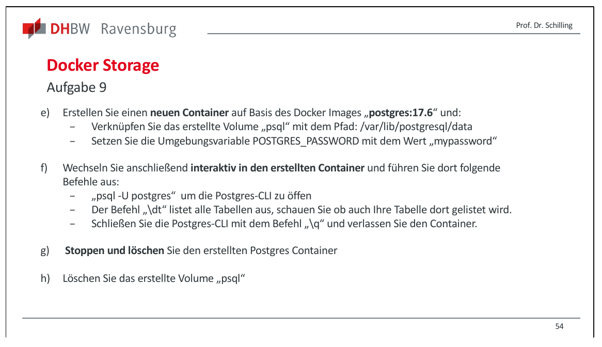

# Aufgabe 9

Docker Storage

a) Erstellen Sie ein Volume mit dem Namen „psql“

b) Erstellen Sie einen neuen Container auf Basis des Docker Images „postgres:17.5“ und:

- Verknüpfen Sie das erstellte Volume psql mit dem Pfad: /var/lib/postgresql/data
- Setzen Sie die Umgebungsvariable POSTGRES_PASSWORD mit dem Wert „mypassword“

c) Wechseln Sie anschließend interaktiv in den erstellten Container und führen Sie dort folgende
Befehle aus:

- „psql -U postgres“ um die Postgres-CLI zu öffen
- Der Befehl „CREATE TABLE TEST();“ erstellt eine neue Tabelle.
- Schließen Sie die Postgres-CLI mit dem Befehl „\q“ und verlassen Sie den Container.

d) Stoppen und löschen Sie den erstellten Postgres Container

e) Erstellen Sie einen neuen Container auf Basis des Docker Images „postgres:17.6“ und:

- Verknüpfen Sie das erstellte Volume „psql“ mit dem Pfad: /var/lib/postgresql/data
- Setzen Sie die Umgebungsvariable POSTGRES_PASSWORD mit dem Wert „mypassword“

f) Wechseln Sie anschließend interaktiv in den erstellten Container und führen Sie dort folgende
Befehle aus:

- „psql -U postgres“ um die Postgres-CLI zu öffen
- Der Befehl „\dt“ listet alle Tabellen aus, schauen Sie ob auch Ihre Tabelle dort gelistet wird.
- Schließen Sie die Postgres-CLI mit dem Befehl „\q“ und verlassen Sie den Container.

g) Stoppen und löschen Sie den erstellten Postgres Container

h) Löschen Sie das erstellte Volume „psql“

## Dateien in diesem Ordner

| Datei | Zweck |
| --- | --- |
| `TASKS.md` | diese Aufgabenstellung |
| `images/seite-50.png`, `images/seite-51.png` | Folienseiten der Aufgabenstellung |
| `Aufgabe_9_Lösung.pdf` | Lösung aus `origin/`; Deckblatt: „Docker Storage / Aufgabe 9“ |

Quelle: cloud-computing/origin/WDS125 - Cloud Computing (SCA)/05 Docker/3-Docker/3-Docker.pdf, Seiten 50–51
