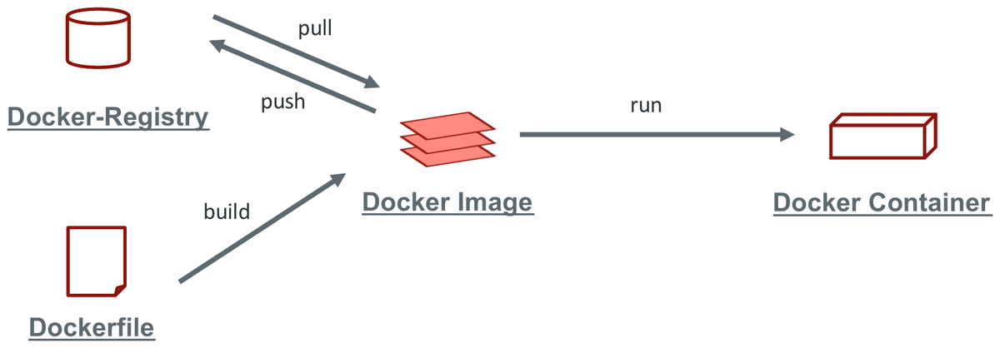

# Grundlagen

## Paradigma (Seite 3)

- Manueller Aufwand: Hafenarbeiter betreten Schiff und entladen die Fracht.
- Gefahr: Kein sicheres Arbeitsumfeld.
- Performance: Hafenbrücken werden zum Flaschenhals.
- Unsichere Dauer: Keine Planung da abhängig von Verfügbarkeit der Arbeiter.

- Standardisierung: 90% aller Frachtcontainer sind Standardcontainer.
- Sicherheit: Massive Reduktion der Frachtschäden und Diebstähle.
- Performance: Sehr kurze Dauer für Ladung und Endladung, durch Infrastruktur.
- Planung: Standardisierte Intrastruktur gibt Planungssicherheit für Dauer und Kosten.

### Notizen

Das Grundparadigma von Docker ist der Standardcontainer in der Frachtschifffahrt. Vor
der Einführung bestand für die Ladung und die Entladung von Schiffen ein sehr hoher
manueller Aufwand, da die Arbeiter das Schiff betreten mussten und die Fracht händisch
aufnehmen mussten. Dies resultierte in Transportschäden und gefährdete zum Teil die
Sicherheit der Arbeiter, da die Hafenbrücken oft zum Flaschenhals wurden. Ferner
entstand durch die unklare Verfügbarkeit von Arbeitern am Hafen, sowie den
Behinderungen beim Entladen und der Verfügbarkeit von Lagerplatz eine unklare
Planungsgrundlage. Frachtschäden und Frachtdiebstähle waren keine Seltenheit.

Die Einführung der Standardcontainer löste einen regelrechten Paradigmenwechsel aus,
der die Frachtschifffahrt massiv veränderte. Angesichts dessen, dass heute ca. 90% aller
Frachtcontainer Standardcontainer sind ist die gesamte Infrastruktur an den Häfen und
den Schiffen auf die Standardcontainer optimiert. Die Einführung der Frachtcontainer
reduzierte maßgeblich die Vorfälle an Transportschäden und Diebstählen. Ferner
konnten die Zeiten für die Ladung und Entladung enorm verkürzt werden. Ein Vergleich
der ersten Jahre zeigt das insbesondere: So benötigte eine 18-köpfige Crew vor
Einführung der Standardcontainer eine 8 Stunden Schicht um 80 Tonnen zu entladen.
Nach der Einführung der Standardcontainer konnte eine 9-köpfige Crew in der gleichen
Zeit 2000 Tonnen entladen.

## Was ist Docker (Seite 4)

- Docker ist ein Werkzeug mit dem Anwendungen gebaut, verteilt und betrieben werden können.
- Es ist der de-facto Standard zur Prozessvirtualisierung unter Nutzung der Kernelfunktionen cgroups und namespaces.
- Docker ist kostenlos und der Code der Ausführungsumgebung, sowie dem Speicherformat wurden teilweise offengelegt, wodurch die Technologie große Verbreitung fand.
- Ähnlich zum Container in der Schifffahrt legte Docker den Grundstein für weitere Werkzeuge und Umsetzungen des Cloud Computing.
- Docker besteht aus einem Client der Befehle absetzt und einem Deamon (Server), der die Befehle entgegennimmt und ausführt.

### Notizen

Analog zum Standardcontainer, ist Docker eine Software, die dazu dient ausführbare
Anwendungen zu bauen, zu verteilen und zu betreiben. Hierzu ist Docker egal welche
Programmiersprache verwendet wird, es wird ein standardisiertes und portables Abbild
(Image) der Anwendung und der notwendigen Systemkonfiguration erzeugt. Der
Empfänger des Abbildes (Images) kann nach Erhalt, das Abbild direkt ausführen. Um
diesen einfachen Workflow umzusetzen, nutzt Docker die Prozessvirtualisierung, die auf
den Linux-Kernfunktionen cgroups und namespaces basiert. Aufgrund der intuitiven
Handhabung und der freien Nutzung gewann Docker massive Popularität und ist heute
der de-facto Standard zur Prozessvirtualisierung. Ohne zu übertreiben kann man
festhalten, dass ähnlich zur Frachtschifffahrt, Docker den Grundstein für eine nachhaltige
Veränderungen des Anwendungsbetriebs gelegt hat und so das Entstehen weiterer
Werkezuge für den optimierten Betrieb von Cloud Computing ermöglichte.

Docker besteht aus zwei wichtigen Bestandteilen:

1. Dem Docker-Client, dies ist ein Kommandozeilen-Programm, das die eigegebenen Befehle übersetzt und via einer Rest-Schnittstelle an den Docker-Deamon überträgt.
2. Dem Docker-Deamon, der verantwortlich ist für die Erstellung und Parametrisierung der Linux-Container und die Überführung der portablen Abbilder in ausführbare Einheiten vornimmt.

## Docker — Überblick (Seite 5)

### Notizen

Das folgende Schaubild gibt einen grundlegenden Überblick über die wichtigen
Grundpfeiler von Docker. Zentral bei der Verwendung von Docker ist das Docker Image.
Das Docker Image ist eine Beschreibung der Laufzeitumgebung samt aller notwendigen
Konfigurationen. Ein Docker Image selbst ist nicht ausführbar. Eine
Laufzeitrepräsentation eines Docker Images ist der Docker Container. Docker Images
werden über eine Docker Registry verteilt. Das heißt Images können dort abgelegt und
bezogen werden. Darüber hinaus können Docker Images über die Verwendung eines
Dockerfiles selbst erstellt werden.

Eine Hilfe zur Verinnerlichung dieses Workflows kann sein sich ein Docker Image als ein
Kuchenrezept vorzustellen. Anhand des Rezepts lassen sich ein oder mehrere Kuchen
dieser Art parallel oder nacheinander erstellen. Das Rezept kann über eine
Internetplattform (vgl. Docker Registry) verteilt und bezogen werden. Darüber hinaus
lässt sich das Rezept in eigener kreativer Arbeit verfassen (vgl. Dockerfile).

Quelle: cloud-computing/origin/WDS125 - Cloud Computing (SCA)/05 Docker/3-Docker/3-Docker.pdf, Seiten 3–5
