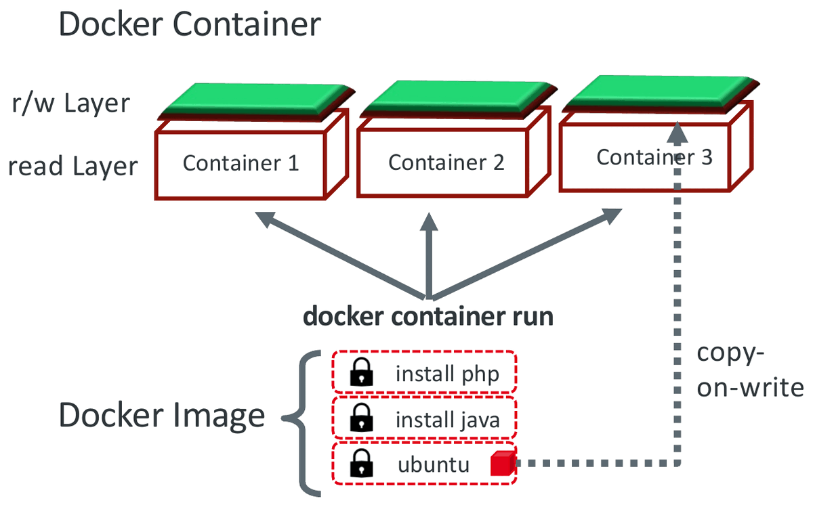

# 1. Docker Container

Starten und Kontrollieren von Docker Container

## Überblick

Docker Image

- Read-Only
- Beschreibung der Laufzeit-Umgebung und des auszuführenden Prozesses
- Portabel

Docker Container

- Laufzeit Repräsentation
- Leichte Replikation
- Keine Hardwarebindung

### Notizen

- Docker Images sind ein zentraler Grundstein von Docker; Docker Container sind die Ausführungseinheiten.
- Docker Images werden nicht direkt ausgeführt. Stattdessen wird eine Kopie des Images gemacht und diese ausgeführt (der sogenannte Docker Container).
- Hierdurch können mehrere Container zeitgleich basierend auf dem gleichen Image ausgeführt werden. Dies vereinfacht die Umsetzung einer horizontalen Skalierung elementar.
- Was immer in einem Container passiert, beeinflusst nicht das Docker Image oder andere Container. Das heißt alle Änderungen im Container sind nicht permanent.
- Starker Kontrast zu virtuellen Maschinen: Dort wird die Abbilddatei auch ausgeführt, sodass alle Änderungen zur Laufzeit auch dauerhaft im Image gespeichert werden.

## Container

- Bei der Ausführung eines Docker-Images werden alle Instruktion darin zu einem read-only Dateisystem überführt.
- Jeder Docker-Container besitzt eine beschreibbare Schicht in der Änderungen gemäß dem Copy-On-Write Prinzip vorgenommen werden.
- Nach Beenden des Docker Containers wird die beschreibbare Schicht gelöscht.



### Notizen

- Das read-only Dateisystem wird im Rahmen eines Containers ausführbar gemacht.
- Die beschreibbare Schicht ist eine temporäre, schreibbare Dateiablage, die jeder Container zusätzlich zu dem read-only Dateisystem bekommt. Sie bildet die Grundlage zur Umsetzung des copy-on-write Prinzips.
- copy-on-write beschreibt die Vorgehensweise zur Veränderung einer Datei innerhalb eines Containers: Da das gesamte Dateisystem des Containers nur lesbar ist, können keine Änderungen vorgenommen werden. Dateien werden deshalb zur Veränderung in die temporär beschreibbare Schicht kopiert und dort wird die Kopie der entsprechenden Datei verändert, daher der Name copy-on-write.

## Befehlssyntax

```sh
docker container run -d hello-world
```

| Docker Client | Objektklasse (opt.) | Befehl | Optionale Parameter | Objektinstanz von Image oder Container |
| --- | --- | --- | --- | --- |
| `docker` | `container` | `run` | `-d` | `hello-world` |
|  |  | `stop` |  | `682` |
|  |  | `rm` |  |  |

### Notizen

- Alle Docker Befehle bezüglich der Verwaltung von Containern haben den gleichen syntaktischen Aufbau.
- Docker Client: muss im System installiert sein.
- Objektklasse: auf sie wirkt sich das Kommando aus. Hier ist dies der Container, im nächsten Kapitel wird auch die Objektklasse Image verwendet.
- Befehl: der tatsächliche Befehl, der ausgeführt werden soll (bspw. ‚run‘ -> Startet einen Container, ‚stop‘ -> Stoppt einen Container, ‚rm‘ -> Löscht einen Container).
- Optionale Parameter: erweitern oder modifizieren den entsprechenden Befehl.
- Objektinstanz: auf sie soll der Befehl ausgeführt werden.
- Bei der Verwendung der ContainerIds reicht es in der Regel aus die ersten drei Zeichen zu verwenden, da der Docker Deamon automatisch auf dieser Grundlage den Rest der Id auflöst.

## Überblick wichtiger Befehle

|  |  |
| --- | --- |
| `docker container run hello-world` | Erstellt einen neuen Container für das Docker Image ‚hello-world‘ und führt diesen aus. |
| `docker container stop 684` | Stoppt den Container mit der Id, die mit ‚684‘ beginnt. |
| `docker container rm 684` | Löscht den Container mit der Id, die mit ‚684‘ beginnt |
| `docker container list` | Listet alle Container samt ihres Status auf. |
| `docker container stats 684` | Gibt Statistiken zur Ressourcennutzung der Container aus. |
| `docker container logs 684` | Gibt den Kommandozeilenoutput des Containers ‚684‘ aus. |

### Notizen

- `docker container run` nimmt ein Imagenamen entgegen.
- `docker container stop` hält einen laufenden Docker Container an und wird mit der konkreten ContainerId verwendet. Anschließend können gestoppte Container mit `docker container rm` gelöscht werden.
- `docker container list` gibt alle laufenden Container aus.
- `docker container stats` gibt Details zum Laufzeitverhalten sowie der Ressourcennutzung der einzelnen Container zurück.
- `docker container logs` gefolgt von der konkreten ContainerId: die Logausgaben des Containers einsehen.

## Hands-On - Die „Hello-World“ Anwendung

https://killercoda.com/playgrounds/scenario/kubernetes

```sh
docker container run hello-world
```

1. Docker Client ruft Docker Deamon auf
2. Docker Deamon schaut ob das benötigte Image lokal vorliegt.
3. Docker Deamon kontaktiert die Docker Registry und sucht dort nach dem Image
4. Docker Deamon lädt das Image von der Registry
5. Docker Deamon erstellt einen Docker Container basierend auf dem Image.
6. Docker Deamon gibt den Output des Containers auf der Befehlszeile aus
7. Docker Deamon stoppt den Container


### Notizen

- Nach einer kurzen Ladephase erscheint die offizielle Begrüßung “Hello from Docker!“. Diese unscheinbare Nachricht erforderte, dass im Hintergrund wichtige Schritte durchgeführt wurden.
- Das Image (‚hello-world‘) befindet sich nicht im lokalen Zugriff des Docker Deamon. Deshalb schaut er bei der Registry „Docker Hub“ nach diesem Image.
- Der erstellte Docker Container wird ausgeführt und seine Ausgabe beim Benutzer ausgegeben.

## Optionen zur Ausführung

|  |  |
| --- | --- |
| `docker container run -p 80:80 nginx` | Die Option „-p“ steht für „publish“ und ermöglicht es Netzwerkverkehr der auf den Host geht zu einem Container umzuleiten. Hierbei wird zuerst der eingehende Port und dann der Containerport spezifiziert. |
| `docker container run -d -p 80:80 nginx` | Ohne Anpassungen läuft der Container im attached Mode (nur solange, wie er auf der Befehlseingabe aktiv ist. Die Option „-d“ für „detach“ ermöglicht es Container im Hintergrund weiterlaufen zu lassen, hierbei wird die Id des Containers zurückgegeben |
| `docker container run -it nginx bash` | Die Kombination „-it“ steht für „interactive“ und „tty“ und ermöglicht es Startkommandos eines Containers gegen den mitgegebenen Befehl zu ersetzen. |

### Notizen

- Mit den Optionen wird das Laufzeitverhalten eines Containers beeinflusst.
- publish: Eingehende Netzwerkports des Host-OS werden an einen konkreten Port des Containers weitergeleitet. Notation: `-p <HostPort>:<ContainerPort>`
- ‚attached mode‘ (Standardverhalten): Die Ausführung des Containers ist im Vordergrund und die Kommandozeile ist für die Ausgabe des Containers geblockt. Mit ‚-d‘ (kurz für ‚detached‘) kann die Kommandozeile für andere Befehle genutzt werden.
- Im Standardverhalten werden nur die Logausgaben auf der Kommandozeile ausgegeben. Um auch Befehle in einem Container auszuführen wird „-it“ verwendet: Der Benutzer bekommt eine interaktive Befehlseingabe im Container.

## Hands-On – Starten & Stoppen von Containern

|  |  |
| --- | --- |
| `docker container run -d -p 80:80 nginx` | Start eines nginx Webservers im Hintergrund (siehe letzte Folie). |
| `docker container list` | Der Befehl „list“ gibt alle aktuell laufenden Container aus. Mit der Option „-a“ für „all“ werden auch gestoppte Container gelistet. |
| `docker container stop ac1` | Da die Ids der Container in der Regel stark variieren, reichen die ersten drei Zeichen der Id aus um den Container zu stoppen |
| `docker container start ac1` | Starten des einst gestoppten Containers. |

```text
CONTAINER ID   IMAGE   COMMAND                  CREATED          STATUS         PORTS                NAMES
ac10940abf78   nginx   "/docker-entrypoint.…"   24 seconds ago   Up 3 seconds   0.0.0.0:80->80/tcp   mystifying_wescoff
```

### Notizen

- Der nginx Webserver horcht auf Port 80 des Hosts.
- `docker container start` kann einen gestoppten Container wieder starten, aber nicht dazu verwendet werden um einen neuen Docker Container zu starten.

## Hands-On Überwachung von Containern

|  |  |
| --- | --- |
| `docker container run -d -p 80:80 nginx` | Das folgende Hand-On basiert wieder auf der Ausführung eines nginx Webservers, der im Hintergrund auf Port 80 hört. |
| `docker container list` | Wir geben eine Liste aller laufenden Container aus, um die konkrete ContainerId zu identifizieren. |
| `docker container stats ac1` | Wir kontrollieren die Ressourcennutzung des Containers mit dem Befehl stats. |
| `docker container logs ac1` | Mit dem Befehl logs wird der Inhalt der Logdatei des Containers ausgegeben. |

```text
CONTAINER ID   IMAGE   COMMAND                  CREATED          STATUS         PORTS                NAMES
ac10940abf78   nginx   "/docker-entrypoint.…"   24 seconds ago   Up 3 seconds   0.0.0.0:80->80/tcp   mystifying_wescoff
```

Quelle: cloud-computing/origin/WDS125 - Cloud Computing (SCA)/05 Docker/3-Docker/3-Docker.pdf, Seiten 7–15
