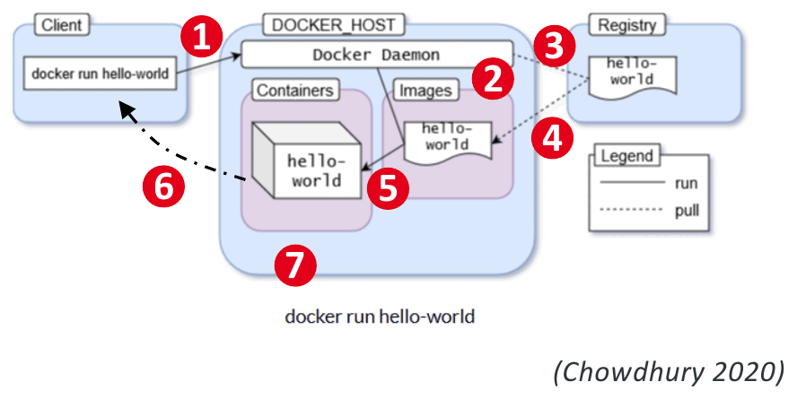

# 1. Docker Container

Starten und Kontrollieren von Docker Container

## Überblick (Seite 7)

Docker Image

- Read-Only
- Beschreibung der Laufzeit-Umgebung und des auszuführenden Prozesses
- Portabel

Docker Container

- Laufzeit Repräsentation
- Leichte Replikation
- Keine Hardwarebindung

### Notizen

Wie bereits ausgeführt stellen Docker Images einen zentralen Grundstein von Docker
dar. Im Folgenden grenzen wir diese von Docker Containern (den Ausführungseinheiten)
ab. Docker Images sind nur lesbar (read-only) und lasen sich nicht verändern. Ferner
werden Docker Images nicht direkt ausgeführt. Stattdessen wird eine Kopie des Images
gemacht und diese ausgeführt (der sogenannte Docker Container). Hierdurch ist es
möglich, dass mehrere Container zeitgleich basierend auf dem gleichen Image
ausgeführt werden. Dies vereinfacht die Umsetzung einer horizontalen Skalierung
elementar. Was immer in einem Container passiert, beeinflusst nicht das Docker Image
oder andere Container. Das heißt alle Änderungen im Container sind nicht permanent.

Dieses Handling von Images und Containern, steht im starken Kontrast zur Umsetzung
von virtuellen Maschinen, bei denen die Abbilddatei auch ausgeführt wird, sodass alle
Änderungen zur Laufzeit auch dauerhaft im Image gespeichert werden.

## Container (Seite 8)

- Bei der Ausführung eines Docker-Images werden alle Instruktion darin zu einem read-only Dateisystem überführt.
- Jeder Docker-Container besitzt eine beschreibbare Schicht in der Änderungen gemäß dem Copy-On-Write Prinzip vorgenommen werden.
- Nach Beenden des Docker Containers wird die beschreibbare Schicht gelöscht.


### Notizen

Schauen wir uns im Folgenden das Zusammenspiel zwischen Docker Image und Docker
Container genauer an. Sobald ein Docker Image ausgeführt wird, werden alle
Instruktionen darin in ein read-only Dateisystem überführt und im Rahmen eines
Containers ausführbar gemacht. Zusätzlich zu dem read-only Dateisystem bekommt
jeder Container eine temporäre, schreibbare Dateiablage, die nach Beenden des
Containers gelöscht wird. Diese Schicht bildet die Grundlage zur Umsetzung des copy-on-
write Prinzips. Dieses Prinzip beschreibt die Vorgehensweise zur Veränderung einer Datei
innerhalb eines Containers. Da das gesamte Dateisystem des Containers nur lesbar ist,
können keine Änderungen vorgenommen werden. Damit man dennoch im Rahmen
eines Containers Dateiänderungen vornehmen kann, werden diese zur Veränderung in
die temporär beschreibbare Schicht kopiert und dort wird dann die Kopie der
entsprechenden Datei verändert, daher der Name copy-on-write. Die temporäre Schicht
wird nach Beenden des Containers gelöscht.

## Befehlssyntax (Seite 9)

```sh
docker container run -d hello-world
```

| Docker Client | Objektklasse (opt.) | Befehl | Optionale Parameter | Objektinstanz von Image oder Container |
| --- | --- | --- | --- | --- |
| `docker` | `container` | `run` | `-d` | `hello-world` |
|  |  | `stop` |  | `682` |
|  |  | `rm` |  |  |

### Notizen

Alle Docker Befehle bezüglich der Verwaltung von Containern haben den gleichen
syntaktischen Aufbau. Das erste Befehlsargument bezieht sich auf den Docker Client, der
im System installiert sein muss. Das zweite Befehlsargument referenziert die
Objektklasse auf die sich das Kommando auswirkt. Im Folgenden ist dies der Container,
im nächsten Kapitel verwenden wir auch die Objektklasse Image. Als nächstes wird der
tatsächliche Befehl spezifiziert, der ausgeführt werden soll (bspw. ‚run‘ -> Startet einen
Container, ‚stop‘ -> Stoppt einen Container, ‚rm‘ -> Löscht einen Container). Nach der
Spezifikation des Befehls werden optionale Parameter eingesetzt, welche den
entsprechenden Befehl erweitern oder modifizieren. Abschließend wird die
Objektinstanz, auf die der Befehl ausgeführt werden soll, benannt. Bei der Verwendung
der ContainerIds ist zu beachten, dass es in der Regel ausreicht die ersten drei Zeichen zu
verwenden, da der Docker Deamon automatisch auf dieser Grundlage den Rest der Id
auflöst.

## Überblick wichtiger Befehle (Seite 10)

|  |  |
| --- | --- |
| `docker container run hello-world` | Erstellt einen neuen Container für das Docker Image ‚hello-world‘ und führt diesen aus. |
| `docker container stop 684` | Stoppt den Container mit der Id, die mit ‚684‘ beginnt. |
| `docker container rm 684` | Löscht den Container mit der Id, die mit ‚684‘ beginnt |
| `docker container list` | Listet alle Container samt ihres Status auf. |
| `docker container stats 684` | Gibt Statistiken zur Ressourcennutzung der Container aus. |
| `docker container logs 684` | Gibt den Kommandozeilenoutput des Containers ‚684‘ aus. |

### Notizen

Die folgende Übersicht gibt einen Überblick über die wichtigsten Befehle zum Verwalten
von Docker Containern. Der Befehl ‚docker container run‘ nimmt ein Imagenamen
entgegen und erstellt hierzu einen neuen Docker Container, der auch gleich gestartet
wird. Um einen laufenden Docker Container anzuhalten wird der Befehl ‚docker
container stop‘ mit der konkreten ContainerId verwendet. Anschließend können
gestoppte Container mit dem Befehl ‚docker container rm‘ gelöscht werden. Mit dem
Befehl ‚docker container list‘ werden alle laufenden Container ausgegeben. Details zum
Laufzeitverhalten, sowie der Ressourcennutzung der einzelnen Container gibt der Befehl
‚docker container stats‘ zurück. Abschließend ermöglicht es der Befehl ‚docker
container logs‘ gefolgt von der konkreten ContainerId die Logausgaben des Containers
einzusehen.

## Hands-On (Seite 11)

https://killercoda.com/playgrounds/scenario/kubernetes

## Hands-On - Die „Hello-World“ Anwendung (Seite 12)

```sh
docker container run hello-world
```

1. Docker Client ruft Docker Deamon auf
2. Docker Deamon schaut ob das benötigte Image lokal vorliegt.
3. Docker Deamon kontaktiert die Docker Registry und sucht dort nach dem Image
4. Docker Deamon lädt das Image von der Registry
5. Docker Deamon erstellt einen Docker Container basierend auf dem Image.
6. Docker Deamon gibt den Output des Containers auf der Befehlszeile aus
7. Docker Deamon stoppt den Container



### Notizen

Starten wir mit dem ersten praktischen Hands-On zum Docker Container. Bitte führen Sie
hierzu den Befehl ‚docker container run hello-world‘ aus. Nach einer kurzen Ladephase
sehen Sie die offizielle Begrüßung “Hello from Docker!“. Diese unscheinbare Nachricht
erforderte jedoch, dass im Hintergrund wichtige Schritte durchgeführt wurden. Wir
schauen uns nun genauer diese Schritte an, um ein fundiertes Verständnis zur Nutzung
der Docker Container aufzubauen. Als erstes wurde der Kommandozeilenbefehl an der
Docker Deamon zur Ausführung übergeben. Als nächstes schaute der Docker Deamon ob
sich das Image (‚hello-world‘) in seinem lokalen Zugriff befindet. Da dies nicht der Fall ist,
schaut er bei der Registry „Docker Hub“ nach diesem Image. Von dort aus lädt er das
Image runter und erstellt im nächsten Schritt daraus einen Docker Container und führt
diesen aus. Abschließend wird die Ausgabe des Docker Containers beim Benutzer
ausgegeben und der Docker Container wird im letzten Schritt gestoppt.

## Optionen zur Ausführung (Seite 13)

|  |  |
| --- | --- |
| `docker container run –p 80:80 nginx` | Die Option „-p“ steht für „publish“ und ermöglicht es Netzwerkverkehr der auf den Host geht zu einem Container umzuleiten. Hierbei wird zuerst der eingehende Port und dann der Containerport spezifiziert. |
| `docker container run –d –p 80:80 nginx` | Ohne Anpassungen läuft der Container im attached Mode (nur solange, wie er auf der Befehlseingabe aktiv ist. Die Option „-d“ für „detach“ ermöglicht es Container im Hintergrund weiterlaufen zu lassen, hierbei wird die Id des Containers zurückgegeben |
| `docker container run –it nginx bash` | Die Kombination „-it“ steht für „interactive“ und „tty“ und ermöglicht es Startkommandos eines Containers gegen den mitgegebenen Befehl zu ersetzen. |

### Notizen

Aufbauend auf dem einfachen Verhalten der ‚hello-world‘ Ausführung schauen wir uns
im Folgenden Optionen an mit deren Hilfe wir das Laufzeitverhalten eines Containers
beeinflussen können. Das Erste, was wir uns hierzu anschauen, ist die publish Option.
Diese Option ermöglicht es, dass eingehende Netzwerkports des Host-OS an einen
konkreten Port des Containers weitergeleitet werden. Die verwendete Notation hierzu
ist ‚–p <HostPort>:<ContainerPort>‘.

Als Nächstes schauen wir uns an, wie wir Container im Hintergrund laufen lassen
können. Im Standardverhalten ist die Ausführung des Containers im Vordergrund und die
Kommandozeile ist für die Ausgabe des Containers geblockt. Dieser Zustand ist auch
unter dem Begriff ‚attached mode‘ bekannt. Mit der Option ‚-d‘ (kurz für ‚detached‘) ist
es möglich den Container im Hintergrund laufen zu lassen, sodass die Kommandozeile
für andere Befehle genutzt werden kann.

Zuletzt nutzen wir noch eine Option, mit der es möglich ist interaktiv in einem Container
zu arbeiten. Im Standardverhalten werden nur die Logausgaben auf der Kommandozeile
ausgegeben. Um nun auch Befehle in einem Container auszuführen wird die Option –it
verwendet (kurz für ‚interactive‘ und ‚tty‘) wodurch der Benutzer eine interaktive
Befehlseingabe innerhalt des Containers bekommt.

## Hands-On – Starten & Stoppen von Containern (Seite 14)

|  |  |
| --- | --- |
| `docker container run -d -p 80:80 nginx` | Start eines nginx Webservers im Hintergrund (siehe letzte Folie). |
| `docker container list` | Der Befehl „list“ gibt alle aktuell laufenden Container aus. Mit der Option „-a“ für „all“ werden auch gestoppte Container gelistet. |
| `docker container stop ac1` | Da die Ids der Container in der Regel stark variieren, reichen die ersten drei Zeichen der Id aus um den Container zu stoppen |
| `docker container start ac1` | Starten des einst gestoppten Containers. |

```text
CONTAINER ID   IMAGE   COMMAND                  CREATED          STATUS         PORTS                NAMES
ac10940abf78   nginx   "/docker-entrypoint.…"   24 seconds ago   Up 3 seconds   0.0.0.0:80->80/tcp   mystifying_wescoff
```

### Notizen

Kommen wir zum nächsten Hands-On. Als nächstes führen wir gemäß der soeben
gelernten Syntax ein nginx Webserver im Hintergrund aus, der auf Port 80 des Hosts
horcht. Mit dem Befehl ‚docker container list‘ können wir uns eine Liste aller laufenden
Container ausgeben. Mit der Option ‚-a‘ werden zudem auch alle gestoppten Container
aufgelistet. Durch den Befehl ‚docker container stop‘ und der ContainerId des
entsprechenden Containers (oder einer Abkürzung hiervon) wird dieser gestoppt. Mit
dem Befehl ‚docker container start‘ kann ein gestoppter Container wieder gestartet
werden. Der Befehl kann jedoch nicht dazu verwendet werden um einen neuen Docker
Container zu starten.

## Hands-On Überwachung von Containern (Seite 15)

|  |  |
| --- | --- |
| `docker container run –d –p 80:80 nginx` | Das folgende Hand-On basiert wieder auf der Ausführung eines nginx Webservers, der im Hintergrund auf Port 80 hört. |
| `docker container list` | Wir geben eine Liste aller laufenden Container aus, um die konkrete ContainerId zu identifizieren. |
| `docker container stats ac1` | Wir kontrollieren die Ressourcennutzung des Containers mit dem Befehl stats. |
| `docker container logs ac1` | Mit dem Befehl logs wird der Inhalt der Logdatei des Containers ausgegeben. |

```text
CONTAINER ID   IMAGE   COMMAND                  CREATED          STATUS         PORTS                NAMES
ac10940abf78   nginx   "/docker-entrypoint.…"   24 seconds ago   Up 3 seconds   0.0.0.0:80->80/tcp   mystifying_wescoff
```

### Notizen

Das nächste Hands-On startet wieder mit der Ausführung eines nginx Webservers im
Hintergrund, der auf Port 80 hört. Als nächstes nutzen wir den Befehl ‚docker container
list‘ um uns einen Überblick über die laufenden Container zu verschaffen. Nachdem wir
die ContainerId des betreffenden Containers identifiziert haben, nutzen wir diese um die
Ressourcennutzung des Containers mit ‚docker container stats‘ und der ContainerId zu
überwachen. Abschließend schauen wir uns den Inhalt der Logdatei mit dem Befehl
„docker container logs“ gefolgt von der konkreten ContainerId an.

Quelle: cloud-computing/origin/WDS125 - Cloud Computing (SCA)/05 Docker/3-Docker/3-Docker.pdf, Seiten 7–15
