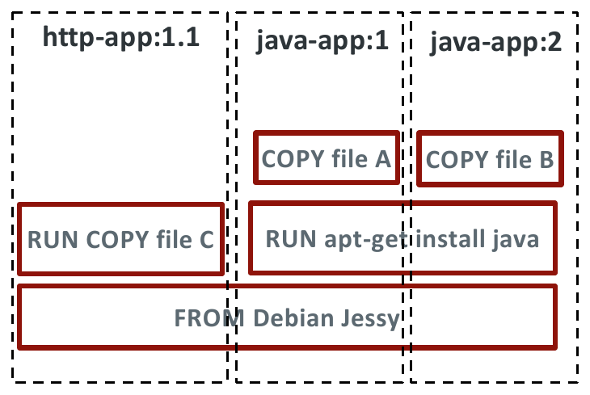
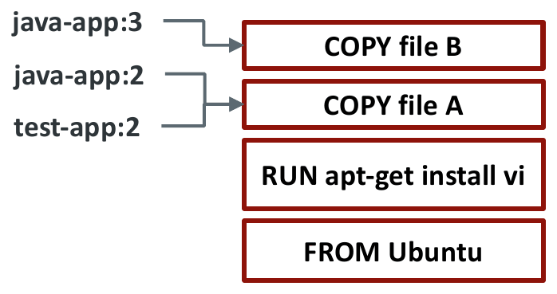

# 2. Docker Image

Docker Image beziehen und selbst bauen

## Status Quo: Fehlerursachen beim Livegang

Welche Fehlerursachen beim Livegang einer Anwendung in der produktiven Umgebung haben Sie erlebt?

- Unterschiede in Applikationsversionen (OS, DB, Laufzeit, Webserver, etc.).
- Unterschiede in der Konfiguration (Umgebungsvariablen, Skripte, Dateien, Rechte, Zertifikate, etc.).
- Unterschiede in der Herangehensweise zur Einspielung des Updates.
- Vage Dokumentation zum Vorgehen oder kein Vorwissen zu wichtigen Konventionen.
- Fehlerhafte Übertragung der Dateien und Konfigurationen auf die Prod-Umgebung.

### Notizen

- Das sind häufige Ursachen für ein fehlerhaftes Deployment.
- Unterschiedliche Konfigurationen meint: zwischen den Maschinen, die für den Test und den produktiven Einsatz verwendet werden.

## Überblick: Aufbau in Schichten

- Ein Docker Image hat einen Namen (Tag) und besteht aus den notwendigen Abhängigkeiten und Konfigurationen zur Ausführung einer Anwendung.
- Strukturierter Aufbau: Jede Änderung und Konfiguration wird in einer eigenen Schicht samt Prüfsumme erfasst.
- Prinzip der immutable infrastructure: Jede Schicht ist unveränderbar, d.h. sie wird nicht verändert, sondern stets neu gebaut.
- Die Schichten eines Images lassen sich via `docker image history` anzeigen.

| Tag | `cloud-comp:1.1` |
| --- | --- |
| Schichten | `ENV stage prod` |
|  | `RUN apt-get install vi` |
|  | `FROM Ubuntu` |

- Jede Schicht wird nur einmal gespeichert. Dadurch wird keine Änderung an einem Docker Image redundant gespeichert.
- Beim Bau eines Docker Image werden die Prüfsummen jeder Schicht in aufsteigender Weise auf Änderungen überprüft.
- Docker Images, die sich bis auf eine Änderung am Ende der Konfiguration gleichen, belegen dadurch nur einmal Speicher.
- Optimierter Down- und Upload: Es werden nur die Schichten geladen, die nicht bereits auf der Zielmaschine existieren.
- Bei Änderungen einer Schicht wird diese und alle darauf basierenden Schichten neu gebaut.



### Notizen

- Im Gegensatz zum Image einer virtuellen Maschine, das als eine große Binärdatei gespeichert wird, hat ein Docker Image einen strukturierten Aufbau in Schichten.
- Ändert sich eine Schicht, wird die alte Schicht verworfen und eine neue Schicht erstellt.
- `docker image history` wird gefolgt vom konkreten Imagenamen aufgerufen.
- Ob Schichten identisch sind, wird über ihre Prüfsumme verglichen. Die Prüfsumme bezieht sich auf den Ausgangszustand sowie die durchgeführten Änderungen.
- Build-Cache: die Ablage der bereits gebauten Schichten im Rahmen des Bauprozesses. Neu gebaut werden nur die Schichten, deren Prüfsummen sich verändert haben.

## Tags

- Der Name (Tag) eines Docker Images ist in 4 Abschnitte gegliedert:
  1. Registry (optional)
  2. User/Organisation (Pflichtfeld)
  3. Imagename (Pflichtfeld)
  4. Version (optional)
- Wird kein Versionstag gesetzt, wird automatisch die Version ‚latest‘ verwendet.
- Tags sind Verweise auf ein konkretes Docker Image. Unterschiedliche Tags auf das gleiche Image verbrauchen keinen zusätzlichen Speicherplatz.

```text
https://hub.docker.com/plexinc/pms-docker:latest
Registry                  User     Image      Version
```



### Notizen

- Registry: Adresse der Docker Registry, zu der das Docker Image hochgeladen werden soll. Wird sie nicht gesetzt, wird die Docker Registry verwendet, die als Standard gesetzt ist.
- User/Organisation: der registrierte Account bei der Docker Registry, unter dem das Image abgelegt werden soll.
- Imagename: der tatsächliche Name des Docker Images. Version: die Versionierung des Docker Images.
- ‚latest‘ steht nicht für die aktuelle Version, sondern nur als Standardwert. Auch ein alter Versionsstand kann den Zusatz ‚latest‘ besitzen; der Name hat nichts mit der Aktualität des Images zu tun.
- Der Versionsstand eines Docker Images kann auch mehrere Tags tragen.

## Registry

- Die Docker-Registry ist ein zentraler Ort zum Speichern und Verteilen von Docker Images.
- Ermöglicht die Umsetzung eines „image from the shelf“ Paradigma.
- Eine Docker Registry kann öffentlich (public) oder für einen geschlossenen Teilnehmerkreis (private) zugänglich sein.
- Die bekannteste public Registry ist https://hub.docker.com
  - Ist als Standard nach einer Installation gesetzt
  - Docker unterstützt mit einem eigenen Team die Aktualisierung der offiziellen Docker Images.
  - Offizielle Images tragen keine Usernamen im Tag.

### Notizen

- „image from the shelf“: Ein Unternehmen, das ein Docker Image für eine bestimmte Funktionalität sucht, soll ohne größere Hürden im Stande sein, das gewünschte Image direkt einzusetzen.
- Der Datentransfer zwischen dem Docker Deamon und der Docker Registry basiert auf der Schichtenarchitektur, sodass nur die fehlenden Schichten übertragen werden.
- Private registry: beispielsweise in Unternehmen.
- Docker Hub ist frei im Internet zugänglich und bietet offizielle Images für bekannte Applikationen wie bspw. MySQL, PostgreSQL, Spring. Das Docker-Team arbeitet dafür eng mit den Projekten zusammen und aktualisiert die Images regelmäßig.

## Hands-On: Recherche von Images

1. Suche auf Docker Hub nach einem geeigneten Basisimages für eine Spring Anwendung
   - Offizielle Docker Images tragen haben keinen User im Tag.
   - Tags informieren über spezifische Konfigurationen.
   - Dokumentation über Startkonfiguration.

   https://hub.docker.com

2. Herunterladen des spezifischen Docker Images

   ```sh
   docker image pull openjdk:16-jdk-slim
   ```

3. Inspektion der einzelnen Schichten des Images

   ```sh
   docker image history openjdk:16-jdk-slim
   ```

## Dockerfile

| Base-image | `FROM openjdk:8-jdk-alpine` |
| --- | --- |
| Anpassen von Abhängigkeiten & Konfiguration | `ENV demo.version=0.9` |
|  | `RUN mkdir app` |
|  | `WORKDIR app/` |
|  | `COPY target/*.jar app.jar` |
|  | `EXPOSE 8080` |
| Einstiegskommando | `CMD ["java","-jar","app.jar"]` |

- Ein Dockerfile ist eine einfache Textdatei mit dem Namen ‚Dockerfile‘, ohne Dateiendung.
- Der Bau eines neuen Docker Image wird gestartet via:

  ```sh
  docker image build -t imagetag .
  ```

- Jede Zeile ist eine eigene Instruktion, die eine Schicht erstellt.
- Der Aufbau eines Dockerfile ist dreigeteilt in: Baseimage, Konfigurationsanpassungen und dem Einstiegspunkt.
- Der Einstiegspunkt definiert jenen Befehl, der beim Starten eines Docker Containers ausgeführt wird.

### Notizen

- Ein eigenes Dockerfile zu verfassen ist eine andere Möglichkeit, ein Docker Image zu erstellen: Damit wird eine individuelle Ausführungsumgebung zum Betreiben einer Anwendung konfiguriert.
- Baseimage: In der Regel schlanke Linux Distributionen wie „apline linux“ (ca. 5 MB), um den digitalen Fußabdruck des Docker Images so gering wie möglich zu halten.
- Anpassungen: individuelle Anpassungen und die Übertragung des auszuführenden Codes. So oft wie möglich wird der Paketmanager der Linux Distribution eingesetzt, um Abhängigkeiten automatisch vom System handhaben zu lassen.

## Dockerfile: Instruktionen

```dockerfile
FROM openjdk:8-jdk-alpine
ENV demo.version=0.9
RUN mkdir app
WORKDIR app/
COPY target/*.jar app.jar
EXPOSE 8080
CMD ["java","-jar","/app.jar"]
```

FROM

- Referenziert das Baseimage, das im Folgenden angepasst wird.
- Kein automatisches Update von Bibliotheken.

ENV

- Setzt Startwerte relevanter Umgebungsvariablen.
- Anpassung des Laufzeitverhaltens einer Anwendung.
- Kann zur Laufzeit überschrieben werden.

RUN

- Führt ein Kommando zur Bauzeit aus.
- Kommandos müssen vom Baseimage unterstützt werden.
- Anwendungen werden oft unter Nutzung des Paketmanagers installiert.

WORKDIR

- Setzt im Container das Ausgangsverzeichnis für alle folgenden Kommandos.
- Es entfällt die Wiederholung gleiche Verzeichnispräfix für das Ziel.

COPY

- Kopiert Dateien vom lokalen Verzeichnis in das Image.
- Unterstützung von Wildcards.

EXPOSE

- Zugriff zur Laufzeit kann nur über die aufgelisteten Ports erfolgen.
- Unabhängig von der Erreichbarkeit vom Host, die im Rahmen der publish Konfiguration definiert wird.

CMD

- Startet den Applikationsprozess
- CMD kann zur Laufzeit überschrieben werden
- Zwei Formen:
  - Exec form: `["java","-jar","app.jar"]`
  - Shell form: `java -jar app.jar` Vorsicht!

### Notizen

- **FROM:** Beginn jedes Dockerfiles, gefolgt vom konkreten Tag des eingesetzten Docker Image. Sehr detaillierte Tags sind empfehlenswert, damit einem Außenstehenden sofort klar ist, auf welcher konkreten Version eines Images das Dockerfile basiert. Docker Images werden nicht automatisch aktualisiert; die Aktualisierung erfolgt manuell über den Austausch des verwendeten Tags.
- **ENV:** Definiert Umgebungsvariablen in der Ausführungsumgebung. Sie sind ein zentraler Mechanismus, um das Laufzeitverhalten anzupassen, da sie von jedem Betriebssystem unterstützt werden; z. B. lassen sich Programmlogik oder Versionsinformationen beeinflussen. Sie sind nicht statisch.
- **RUN:** Kommandos werden ausgeführt, wie wenn man direkt das Betriebssystem verwenden würde. So kann man nötige Programme installieren oder Systemkonfigurationen vornehmen, wie bspw. weitere Benutzer hinzufügen.
- **WORKDIR:** Besonders hilfreich, wenn Dateien in das gleiche Verzeichnis im Container kopiert werden: Es setzt ein Stammverzeichnis, auf das sich fortan alle Kommandos beziehen. Das vermeidet Flüchtigkeitsfehler durch Copy-Paste von Verzeichnispfaden; übereinstimmende Zielpfade müssen nicht mehrfach wiederholt werden.
- **COPY:** Kopiert lokale Ressourcen in das Docker Image; bietet sich insbesondere für statische Binärdateien oder auszuführenden Programmcode an.
- **EXPOSE:** Definiert eingehende Portverbindungen für das spätere Laufzeitverhalten. Aus Sicherheitsgründen sind im Grundzustand eingehende Netzwerkverbindungen auf einen Docker Container untersagt; EXPOSE gibt die Ports frei, für die eingehende Verbindungen erlaubt sind. Das ist unabhängig von der publish Option des `docker container run` Befehls: publish definiert das Mapping von Container Ports auf eingehende Portverbindungen des Hosts, EXPOSE gibt Ports für den Container frei, sodass überhaupt eingehender Verkehr bei dem Container zugelassen wird.
- **CMD:** Bildet den Abschluss eines Dockerfile. Wird nicht während der Bauzeit des Images ausgeführt, sondern ist der erste Befehl, der nach dem Start eines Docker Containers ausgeführt wird.
  - „shell form“: Der Befehl wird, ähnlich zum RUN Befehl, in genau dem Format spezifiziert, wie er in die Kommandozeile eingegeben wird. Er ist ein Unterprozess der Shell.
  - „exec form“: Jedes Befehlsargument wird in einem Arrayformat spezifiziert. Der Befehl wird als eigenständiger Prozess ausgeführt.
  - Die beiden Formen sind nicht gleichbedeutend: Würde ein Angreifer aus dem Anwendungsprozess ausbrechen, hätte er bei der exec Notation keine weiteren Hilfsmittel, bei der Shell Notation alle von der Shell angebotenen Werkzeuge.

## Überblick wichtiger Befehle

|  |  |
| --- | --- |
| `docker image list` | Listet alle lokal vorhandenen Docker Images auf. |
| `docker image history hello-world` | Zeigt die einzelnen Schichten des hello-world Docker Images |
| `docker image tag alpine v1` | Erstellt den neuen Tag ‚v1‘ für das Docker Image, das den Tag ‚alpine‘ trägt |
| `docker image pull alpine` | Lädt das Image ‚alpine‘ von der Docker Registry herunter |
| `docker image build -t test .` | Erstellt ein neues Docker Image mit dem Tag ‚test‘ auf Grundlage des Dockerfiles im gleichen Verzeichnis |
| `docker image rm test` | Löscht das Docker Image ‚test‘ |

### Notizen

- `docker image tag`: Es wird ein neuer Tag erstellt, der alte Tag wird aber nicht gelöscht.
- `docker image pull` lädt von der konfigurierten Docker Registry.
- `docker image build -t <ImageName> .`: Das Dockerfile muss im gleichen Verzeichnis liegen; es wird ausgewertet und ausgeführt, um das neue Docker Image zu erstellen.

## Spring Boot & Docker

- Spring unterstützt die Nutzung von Umgebungsvariablen zur:
  - Nutzung unterschiedlicher Ressourcen und Endpunkte
  - Vermeidung sensibler Daten
  - Beschränkung des Funktionsumfangs
- Profile steuern die Sichtbarkeit ganzer Klassen sowie deren Konfiguration. Ferner wird die Properties Datei application-{profile}.properties gemäß des aktuellen Profiles gewählt.
- Die Umgebungsvariable Spring.profiles.active definiert das aktive Profil.
- Mit dem Befehl „mvn clean install“ wird ein self-contained (fat) Jar erzeugt, dass Abhängigkeiten minimiert.

Zugriff auf Umgebungsvariable

Standardwert

```java
@Value("${demo.version:0.0.1}")
private String version;
```

```java
@Value("${nameservers:1.1.1.1,8.8.8.8}")
private String[] nameservers;
```

Bean existiert nur für ‚dev‘ Profil

```java
@Service
@Profile("dev")
public class GreetingServic
```

### Notizen

- Umgebungsvariablen: Spring kann leicht auf sie zugreifen und mit ihnen tief in das Verhalten der Anwendung eingreifen.
  - Haupteinsatzzweck: Definition von Ressourcen und Web-Endpunkten entsprechend der aktuellen Laufzeit. Oft werden in der Entwicklung andere Endpunkte von Webservices verwendet als im produktiven Betrieb.
  - Sensitive Daten (bspw. Passwörter) werden erst gar nicht generiert; sehr nützlich, wenn Logdateien dauerhaft gespeichert werden.
  - Einschränkung des Funktionsumfangs: unterschiedliche Implementierungen für die Entwicklungsumgebung und die produktive Umgebung.
- Profile: Es ist möglich, vollkommen andere Klassen für die Implementierung eines Interfaces im produktiven Betrieb und in der Entwicklung einzusetzen.
- Fat-Jar: Alle internen und externen Abhängigkeiten sind integriert. Die Jar Datei kann anschließend ohne weitere Abhängigkeiten ausgeführt werden.

## Hands-On

|  |  |
| --- | --- |
| `cd Spring2Docker` | Wechselt in das Projektverzeichnis auf dem Host |
| `mvn clean install` | Veranlasst Spring Boot eine Jar Datei zu bauen |
| `docker image build -t test .` | Baut ein neues Docker Image mit dem Tag ‚test‘ basierend auf dem Dockerfile |
| `docker container run -d -p 80:8080 test` | Erstellt einen neuen Docker Container und führt diesen aus. Port 80 des Host wird auf Port 8080 im Container weitergeleitet |
| Browser: http://localhost:80 | Führt eine HTTP-Anfrage auf dem Host unter Port 80 aus. Als Antwort kommt „ Herzlich Willkommen zur Veranstaltung Cloud Computing“ zurück. |
| `docker container list` | Gibt eine Liste mit allen laufenden Containern aus. |
| `docker container logs ce5` | Zeigt die Logs für die ContainerId, welche im letzten Schritt ermittelt wurde, bspw. ce5 |

```text
$ docker container list
CONTAINER ID   IMAGE   COMMAND               CREATED          STATUS          PORTS                  NAMES
ce5ecae6ccb7   test    "java -jar app.jar"   23 minutes ago   Up 23 minutes   0.0.0.0:80->8080/tcp   reverent_turing
```

Quelle: cloud-computing/origin/WDS125 - Cloud Computing (SCA)/05 Docker/3-Docker/3-Docker.pdf, Seiten 18–31
