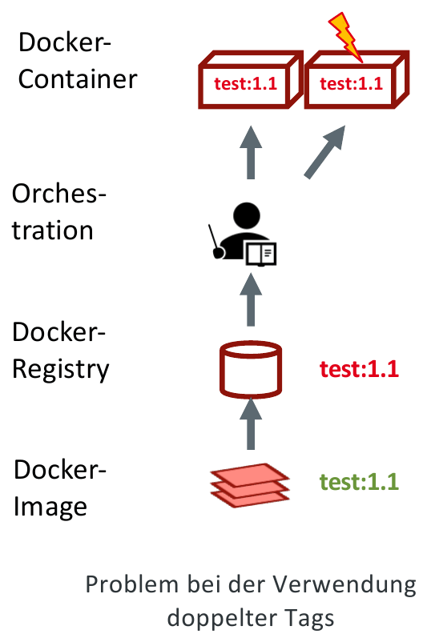

# 3. Best Practices

Wichtige Konventionen zur Konfiguration von Docker Containern und Images

## Baseimage (Seite 35)

- Das Baseimage sollte so ausgewählt werden, dass es nur die wirklich benötigte Funktionalität besitzt. Ein geringerer Funktionsumfang, reduziert die Downloaddauer, den Speicherbedarf und die Angriffsfläche:
  - ubuntu ~ 188 MB,
  - opensuse:latest ~ 82 MB
  - alpine ~ 5MB
- Es sollten offizielle Images für Baseimages bevorzugt werden, da bei diesen die Aktualisierungen und die Authentizität von Docker sichergestellt wird.
- Das Baseimage sollte mit einem Tag referenziert werden, niemals mit ‚latest‘.
- Images sollten stets bei Aktualisierungen des Baseimage neu gebaut werden. Nur so kann sichergestellt werden, dass die Container dauerhaft gepatcht sind.

### Notizen

Bei der Auswahl des Baseimage ist zu beachten, dass dieses nur den wirklich
notwendigsten Funktionsbedarf abdeckt und über so wenig wie möglich
ungenutzte Funktionalität verfügt. Mit einem geringen Funktionsumfang
reduziert sich nicht nur der notwendige Speicherbedarf, sondern auch die
Angriffsfläche. Wie groß der Funktionsumfang der Linux Distributionen variieren
kann, lässt sich an der Speichergröße sehen. Während opensuse weniger als die
Hälfte des Speichers von ubuntu benötigt, entfällt für die Linux Distribution
‚alpine‘ rund 35-mal weniger als für ubuntu.

Bei der Auswahl des Baseimage ist ferner darauf zu achten, dass ein offizielles
Image als Baseimage verwendet werden sollte. Offizielle Images haben den
Vorteil, dass Docker für deren Aktualisierung ein eigenes Team unterhält.

Ferner ist darauf zu achten, dass das Baseimage mit einem passenden Tag
referenziert wird. Dadurch ist es möglich, dass das Baseimage Aktualisierungen
empfangen kann.

Abschließend ist es wichtig, dass abgeleitete Images bei der Aktualisierung des
Baseimage neu gebaut werden. Es muss beachtet werden, dass alle
Aktualisierungen und Patches der Container zur Laufzeit nichtig werden, sobald
diese neu gestartet werden. Somit können dauerhafte Veränderungen der
Container nur über Anpassungen der Docker Images erreicht werden.

## Tagging (Seite 36)

- Das Weglassen einer expliziten Version, sodass ‚latest‘ gesetzt wird, ist strikt zu vermeiden da damit:
  - verschiedene Versionen in der Registry und auf dem Client referenziert werden.
  - nicht die ‚aktuelle‘, sondern die ‚unbekannte‘ Version gemeint ist.
  - keine Charakterisierung des Images erfolgt.
  - kein Rücksprung auf vorherige Versionen möglich ist.
- Für Abhängigkeiten sollten stable Tags (bspw. ‚1‘, ‚1.2‘, ‚1.2.1‘) eingesetzt werden um die neusten Änderungen zu bekommen.
- Nutzung von unique Tags für eigen erstellte Docker Images, um ungewolltes Caching zu vermeiden und Updatebedarf anzumelden
- Integration der BuildId oder Datum in unique Tags ist sinnvoll. Vorsicht bei GitTags, da sie keine Aktualisierungen der Baseimages abbilden.



### Notizen

Bei der Verwendung von Tags ist die Nutzung von Versionsinformationen zentral.
Andernfalls wird ‚latest‘ gesetzt doch dies hat entscheidende Nachteile. Ein wichtiger
Nachteil ist, dass dadurch unterschiedliche Versionsstände auf dem Client und der
Docker Registry referenziert werden können. Entgegen der wörtlichen Übersetzung steht
‚latest‘ auch nicht für die aktuelle Version, sondern für die ‚unbekannte‘ Version. Ferner
erfolgt keine Charakterisierung der vorgenommenen Änderungen und es ist kein
Rücksprung auf die vorherige Version möglich.

Für die Nutzung in Baseimages sollten stets ‚stable Tags‘ zum Einsatz kommen, da hier
über das verwendete Schema eingestellt werden kann ob nur
Sicherheitsaktualisierungen oder auch Featureupdates berücksichtigt werden sollen.

Einzigartige Tags (unique Tags) sollten dagegen bei den erstellten Docker Images zum
Einsatz kommen, da diese vermeiden, dass durch Caching veraltete Versionsstände
ausgeliefert werden. Zur Generierung der einzigartigen Tags sollte die Id des
Bauvorgangs (BuildId) oder das aktuelle Datum eingesetzt werden. Es sollte jedoch
vermieden werden Git-Tags in die Tags einzuarbeiten, da diese Aktualisierungen der
Baseimages nicht berücksichtigen.

## Umgebungsvariablen (Seite 37)

- Umgebungsvariablen dürfen im Dockerfile nicht für sensible Daten wie Passwörter verwendet werden, da diese durch den ‘docker image history’ Befehl ausgelesen werden können.
- Stattdessen sollten sensible Daten zur Laufzeit via ‘--env’ Option eingebunden werden (vgl. MySQL image). Besser verschlüsselte Varianten nutzen.
- Bei vielen Umgebungsvariablen, die zur Laufzeit gesetzt werden, empfiehlt sich die Auslagerung in eine separate Datei, die zur Laufzeit via “--env-file” eingebunden wird.
- Lesereihenfolge: Dockerfile -> env-file -> Laufzeitargument
- Bei Umgebungsvariablen die nur zum Bau des Images verwendet werden, sollte ARG statt ENV verwendet werden.

### Notizen

Wie bereits ausgeführt bieten Umgebungsvariablen einen universellen Mechanismus um
das Verhalten einer Anwendung zur Laufzeit anzupassen. Große Vorsicht ist jedoch
geboten bei der Verwendung von Umgebungsvariablen zum Setzen von sensiblen Daten
wie Passwörtern. Der Grund hierfür liegt darin, dass die Umgebungsvariablen eines
Docker Images mit dem Befehle ‚docker image history‘ ausgelesen werden können. Lässt
es sich nicht vermeiden, dass sensible Daten als Umgebungsvariable in die Anwendung
integriert werden, sollten diese unbedingt erst zur Laufzeit gesetzt werden. Generell ist
es empfehlenswert statt Umgebungsvariablen, verschlüsselte Mechanismen zum
Transport von sensiblen Daten zu wählen.

Sollten viele Umgebungsvariablen erst zur Laufzeit gesetzt werden kann der Docker-
Befehl in der Eingabeaufforderung schnell übersichtlich werden. Um dies zu vermeiden,
können die konkreten Werte in eine separate Datei ausgelagert werden die zur Laufzeit
via ‚--env-file‘ eingebunden wird. Die Reihenfolge in der die Umgebungsvariablen
ausgewertet werden beginnt mit dem Dockerfile. Danach wird die Datei ausgewertet die
via env-file angesprochen wird und abschließend werden die Laufzeitargumente
ausgewertet. Die Werte der Umgebungsvariablen können dabei gemäß der
Lesereihenfolge überschrieben werden.

Sollten Umgebungsvariablen nur zur Erstellung der Anwendung benötigt werden und
keinen Einfluss auf das Laufzeitverhalten der Anwendung ausüben, sollten sie mit dem
Kommando ARG statt ENV im Dockerfile verwendet werden.

## Schichtenarchitektur (Seite 38)

| Änderungsfrequenz |  |
| --- | --- |
| gering | `FROM openjdk:8-jdk-alpine` |
|  | `COPY *.jar app/app.jar` |
|  | `ENV stage=prod` |
|  | `RUN mkdir app` |
|  | `WORKDIR target/` |
| hoch | `CMD ["java","-jar","/app.jar"]` |

- Die Schichtenarchitektur von Docker impliziert, dass je weiter oben ein Befehl steht, desto seltener sich dieser ändert.
  - Bei Abweichungen der Prüfsummen, wird die entsprechende Schicht und alle darunter liegenden neu gebaut
  - Schichten können nur dann wiederverwendet werden, wenn sie die gleiche Prüfsumme aufweisen
- Um unnötige Schichten zu vermeiden, empfiehlt es sich zusammengehörige RUN Befehle mit ‚&&‘ zu kombinieren.
- Die Befehle sollten stets so präzise wie möglich sein, ansonsten werden Schichten auch bei nicht relevanten Änderungen neu gebaut (insb. bei Wildcards).

### Notizen

Wie wir bereits im Vorfeld gesehen haben ist die Schichtenarchitektur ein grundlegendes
Merkmal der Docker Images. Damit die Vorteile der Schichtenarchitektur realisiert
werden können, ist es wichtig die Befehle in einem Dockerfile gemäß ihrer
Änderungsfrequenz anzuordnen. Je seltener sich ein Befehl oder dessen referenzierten
Dateien ändern, desto höher im Dockerfile ist der Befehl anzuordnen. Im Gegensatz
hierzu sollte ein Befehl je häufiger er sich ändert weiter unten im Dockerfile angeordnet
sein. Das Schaubild zeigt ein fehlerhaft angeordneten COPY Befehl, der die gesamten
Vorteile der Schichtenbildung zunichtemacht. Hier wird das jar, das sich im Rahmen
jedes Compiliervorgangs ändert, bereits in der zweiten Zeile in das Dockerfile kopiert.
Infolgedessen werden im Rahmen jedes Compiliervorgangs Änderungen in dieser Schicht
erkannt und es müssen diese, sowie alle darunter liegenden Schichten neu gebaut
werden. Eine Wiederverwendung der anderen Schichten kann somit nicht umgesetzt
werden.

Eine weitere Empfehlung ist, unnötige Schichten zu vermeiden. Dies kann erreicht
werden indem einzelne RUN Befehle via ‚&&‘ kombiniert werden. Infolgedessen werden
weniger Schichten benötigt und die Bauzeit eines Images wird verkürzt.

Abschließend empfiehlt es sich die einzelnen Befehle im Dockerfile so präzise wie
möglich zu formulieren, sodass wirklich nur die notwendigen Dateien in das Docker
Image kopiert werden. Bei der Verwendung von Wildcards ist genaustens zu überprüfen
ob wirklich nur die notwendigsten Dateien kopiert werden. Der Grund hierfür liegt darin,
dass Änderungen an unnötigen Dateien, die dennoch kopiert werden ein Neubau der
entsprechenden Schicht und aller darunterliegenden anstößt.

## Non-Root Ausführung (Seite 39)

```dockerfile
FROM openjdk:8-jdk-alpine
ENV stage=prod
RUN addgroup -S spring && adduser -S springuser -G spring
USER springuser
RUN mkdir app
WORKDIR target/
COPY *.jar app/app.jar
EXPOSE 8080
CMD ["java","-jar","/app.jar"]
```

- In der Standardkonfiguration werden alle Prozesse im Container unter dem root (Admin) Account ausgeführt.
- Ein Ausbruch aus einem Containerprozess der mit root Rechten ausgeführt wird kann kritische Auswirkungen haben. Da ein Containerprozess gleichberechtigt zu einem nativen Prozess ist.
- Mit dem Kommando ‚USER‘ können Befehle des Dockerfile unter einem unprivilegierten User ausgeführt werden.
- In der Standardkonfiguration gehören neue Benutzer der Gruppe root (Admin) an, sodass manuell eine andere Gruppe angelegt werden muss.

### Notizen

Standardmäßig werden alle Befehle im Dockerfile unter dem Administratoraccout ‚root‘
ausgeführt. Dies birgt jedoch kritische Sicherheitsrisiken, da ein Ausbruch aus einem
Container folgenreiche Konsequenzen haben kann, da Containerprozesse
gleichberechtigt zu nativen Prozessen sind. Zur Vermeidung dieser Sicherheitsrisiken und
um die Nutzung von nicht-root Benutzern zu vereinfachen gibt es das Kommando USER
gefolgt von der konkreten UserId. Nach diesem Kommando werden alle folgenden
Befehle unter mit dem spezifizierten Useraccount durchgeführt. Hierbei muss beachtet
dass erst der User erstellt und dann einer neuen Benutzergruppe zugewiesen werden
muss, da neu angelegte Benutzer standardmäßig der Administratoren Gruppe
zugeordnet werden.

## Hands-On (Seite 40)

```dockerfile
FROM ubuntu
RUN apt-get update
RUN apt-get install openjdk-8-jdk –y
RUN apt-get install curl -y
RUN mkdir app
COPY target/* app/
CMD java -jar app.jar
```

- Nutzung eines kleineren Images samt präzisem Tag
- Bündelung der Anweisungen um Layer zu sparen
- Ausführung als non-root
- Explizites Copy-Statement
- Exec Notation für Sicherheit

```dockerfile
FROM openjdk:8-jre-alpine3.9
RUN apk update && apk add curl
RUN mkdir app
RUN addgroup -S spring && adduser -S springuser -G spring
USER springuser
WORKDIR app
COPY target/app.jar .
CMD ["java","-jar","app.jar"]
```

### Notizen

Abschließend wenden wir die gelernten Best-Practices, sowie unser bisheriges Wissen in
dieser praktischen Hands-On Übung an. Ausgangspunkt ist ein Dockerfile, das die neuste
Version des Ubuntu Betriebssystem als Baseimage hat, darauf aufbauend die Java
Laufzeitumgebung und Curl installiert und anschließend das Verzeichnis app erzeugt in
das es den Inhalt des Host-Verzeichnisses „target“ kopiert und die sich darin befindende
Jar Datei ausführt.

Die erste Verbesserung ist der Austausch eines umfassenden und nicht versionierten
Basisimage in ein zweckdienliches und versioniertes Basisimage. Als nächstes können die
Befehle zur Installation von curl zusammengefasst werden um unnötige Schichten
einzusparen. Java ist durch das Baseimage bereits installiert. Darüber hinaus sollte die
weitere Ausführung unter einem non-root Account stattfinden für den als nächstes der
Account samt Gruppe angelegt wird. Der Copy Befehl wird überführt sodass es nur noch
die Jar Datei kopiert und nicht mehr das gesamte Verzeichnis. Abschließend wird die
gewählte Shell-Notation für den Laufzeitbefehl in die Exec-Notation überführt um die
Sicherheit weiter zu härten.

Quelle: cloud-computing/origin/WDS125 - Cloud Computing (SCA)/05 Docker/3-Docker/3-Docker.pdf, Seiten 35–40
