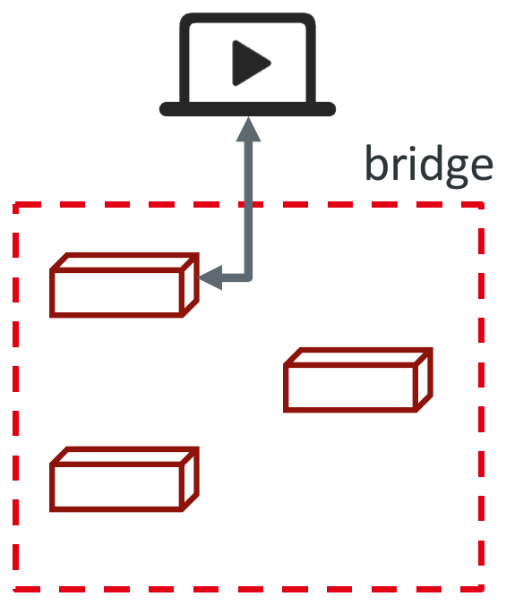
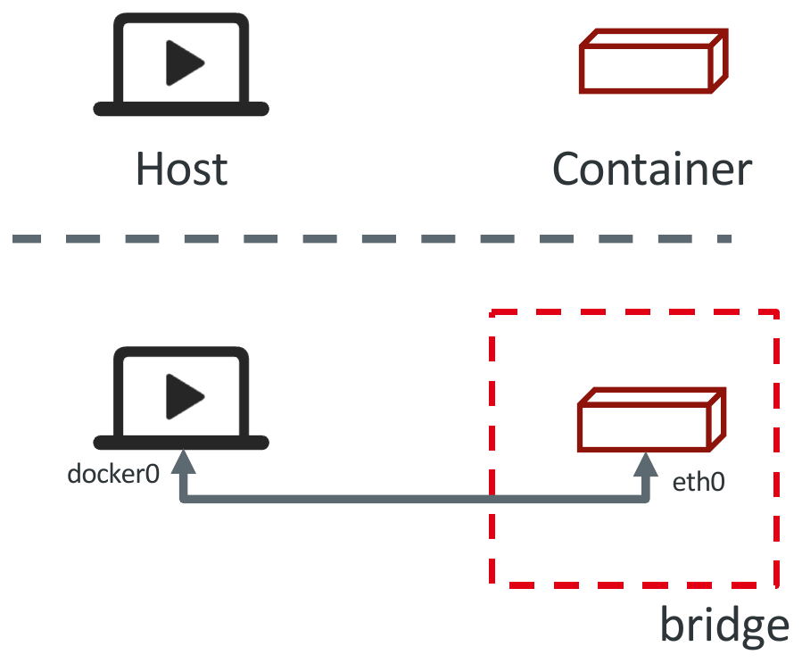
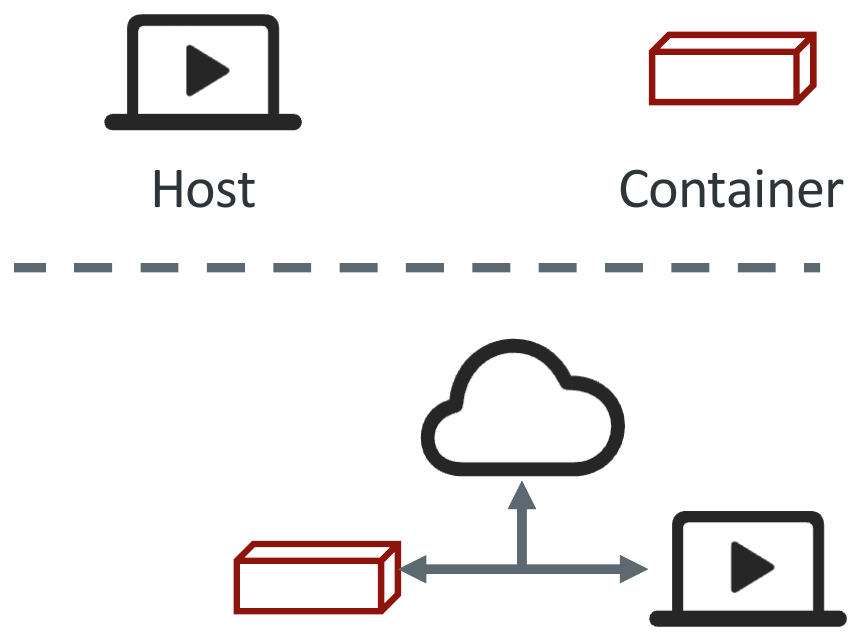
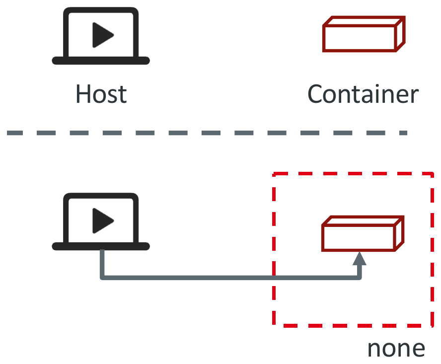

# 5. Docker Networking

Netzwerkgrundlagen von Docker

## Motivation

- Ein entscheidender Mehrwert entsteht durch die Kommunikation zwischen Containern und der Außenwelt
- Docker Networking erlaubt pro Use Case gezielt Tradeoffs zwischen Einfachheit und Isolation zu machen.
- Netzwerkmodi (Treiber) für Docker Container
  - bridge: isoliertes Hostnetz mit Portfreigabe
  - host: max. Performance, min. Isolation
  - none: max. Isolation, Airgap

### Notizen

- Die Kommunikation zwischen Containern sowie zwischen Containern und der Außenwelt ist ein zentraler Bestandteil moderner Containerarchitekturen. Erst durch das Zusammenspiel mehrerer spezialisierter Container – etwa eines Backends (Django), eines Frontends (NodeJS) und einer Datenbank (Postgres) – entsteht der eigentliche Mehrwert verteilter Anwendungen.
- Docker Networking liefert hierfür die technischen Grundlagen und sorgt dafür, dass Container flexibel und kontrolliert miteinander interagieren können.
- Designprinzip „Batteries included, but removable“: Standardmäßig stehen gebrauchsfertige Netzwerkfunktionen zur Verfügung, die den Einstieg erleichtern. Gleichzeitig bleibt die Architektur offen und erweiterbar, sodass Entwickler alternative Netzwerk-Setups, benutzerdefinierte Treiber oder externe Lösungen einsetzen können.
- Über die Wahl des Netzwerkmodus (oder Treibers) lässt sich gezielt steuern, wie stark Container voneinander und vom Host isoliert sind:
  - bridge: Container laufen in einem isolierten virtuellen Hostnetz und kommunizieren über interne IP-Adressen. Über Portfreigaben kann der Zugriff von außen gesteuert werden. Dieser Modus ist Standard und bietet ein gutes Gleichgewicht zwischen Sicherheit und Einfachheit.
  - host: Der Container teilt sich den Netzwerkstack des Hosts, wodurch die Kommunikation besonders performant, aber kaum isoliert ist. Eignet sich für Performance-kritische Anwendungen.
  - none: Der Container wird vollständig vom Netzwerk getrennt (Airgap). Maximale Sicherheit, schränkt aber die Funktionalität stark ein.
- Die Abbildung verdeutlicht das Zusammenspiel: Mehrere Container sollen untereinander kommunizieren und gleichzeitig über den Host oder das externe Netzwerk erreichbar sein. Docker Networking ermöglicht, diese Balance zwischen Einfachheit, Flexibilität und Isolation gezielt zu gestalten.

## Network: Bridge (Standard)

- Alle Docker Container sind in einem eigenen Netzwerk, das über den Host zur Außenwelt verbunden ist.
- Innerhalb des ‘bridge‘ Netzwerk können die Container ohne Beschränkung aufeinander zugreifen.
- Namensauflösung innerhalb des Netzwerks über Docker-DNS (nur bei ‚user-defined network‘).
- Jeder Zugriff von außen muss explizit über die Publish-Option (-p) freigegen werden.



```sh
docker container run -p 80:80 nginx
```

1. Einbindung des Containers in ‚bridge‘ Netzwerk
2. Außerhalb des ‘bridge‘ Netzwerks kann nur der Host via der virtuellen NIC ‘docker0‘ auf den Container zugreifen.
3. Alle Container innerhalb des ‘bridge‘ Netzwerk können uneingeschränkt miteinander kommunizieren.



### Notizen

- Das bridge-Netzwerk bildet den Standardmodus im Docker-Networking und die Basis für die Kommunikation zwischen Containern auf demselben Host. Jeder neu gestartete Container wird automatisch in ein virtuelles bridge-Netz eingebunden. Damit schafft Docker ein in sich geschlossenes, isoliertes Netzwerk, das dennoch gezielt für den externen Zugriff geöffnet werden kann.
- Das Standardnetzwerk bridge ist ein virtuelles Netzwerk. Es ist unabhängig vom physischen Hostnetz und isoliert Container standardmäßig voneinander und vom Host.
- Innerhalb eines ‚user-defined bridge network‘ können Container ohne zusätzliche Konfiguration miteinander kommunizieren. Sie greifen über interne IP-Adressen oder Container-Namen aufeinander zu, was die Zusammenarbeit von Komponenten wie Webserver, Backend und Datenbank erleichtert. Diese interne Kommunikation erfolgt vollständig innerhalb des isolierten bridge-Netzwerks und bleibt damit vom Hostsystem und anderen Netzwerken abgeschirmt.
- Container, die sich im gleichen bridge-Netz befinden, können sich gegenseitig über ihre IP-Adressen erreichen. Die automatische Namensauflösung über Containernamen steht dagegen bei benutzerdefinierten Bridge-Netzwerken zur Verfügung; sie existiert nicht für das ‚default bridge network‘.
- Der Zugriff von außen – etwa vom Hostsystem oder von externen Clients – erfolgt nicht automatisch. Er erfolgt über die virtuelle Netzwerkkarte docker0, die Docker auf dem Host anlegt.
- Der Portparameter -p im Befehl sorgt dafür, dass eingehende Verbindungen an Port 80 des Hosts an Port 80 des Containers weitergeleitet werden.
- Dieser Modus eignet sich besonders für Anwendungen, die aus mehreren interagierenden Komponenten bestehen (z. B. Webserver, API, Datenbank).

## Network: Host

- Bei Verwendung des ‘host‘ Treibers, ist der Docker Container direkt mit dem Host-Netzwerk verbunden.
- Konkret bekommt der Container keine virtuelle Netzwerkschnittstelle sondern greift auf die „echte“ eth0 Schnittstelle des Hosts zu.
- Eine explizite Portweiterleitung entfällt
- Der Container kann von Teilnehmern des Host-Netzwerks uneingeschränkt erreicht werden (Sicherheitsrisiko !).

```sh
docker container run -p 80:80 --net=host nginx
```

1. Einbindung des Containers in das ‚host‘ Netzwerk
2. Container verwendet den Netzwerkstack des Hosts
3. Vorsicht vor Zuweisung des gleichen Ports für eine Anwendung auf dem Host sowie dem Container



### Notizen

- Im Gegensatz zum bridge-Modus entfällt die Zwischenschicht aus virtuellen Netzwerkinterfaces und NAT: Der Container nutzt die reale Netzwerkschnittstelle (z. B. eth0) des Hosts, anstatt über eine virtuelle Bridge (docker0) kommunizieren zu müssen.
- Maximale Netzwerkperformance, da keine zusätzliche Paketverarbeitung über virtuelle Interfaces oder Adressübersetzungen erfolgt. Der Datenverkehr läuft praktisch nativ über den Host.
- Der Container verliert dadurch einen wesentlichen Teil seiner Isolation: Er ist vollständig im Hostnetz sichtbar und von allen Teilnehmern desselben Netzwerks direkt erreichbar – genau wie ein regulärer Dienst auf dem Host. Dies kann ein erhebliches Sicherheitsrisiko darstellen, insbesondere wenn der Container Dienste ohne Zugriffsbeschränkung anbietet.
- Der host-Modus eignet sich sehr gut für Szenarien, in denen ein Container bewusst Netzwerkdienste für andere Teilnehmer des Hostnetzwerks bereitstellen soll – etwa Webserver, Monitoring- oder Proxydienste. Es ist keine Portweiterleitung über -p erforderlich; Dienste sind automatisch über die IP-Adresse und Ports des Hosts erreichbar.
- Spannungsfeld zwischen Performance und Sicherheit: maximale Geschwindigkeit bei minimaler Isolation. Die Entscheidung für den host-Modus sollte deshalb stets bewusst getroffen und durch zusätzliche Sicherheitsmaßnahmen (z. B. Firewalls oder Zugriffskontrolle) abgesichert werden.
- Der Befehl „docker container run --net=host nginx“ zeigt, wie ein Container direkt in das Hostnetz integriert wird:
  - Der Container wird ohne virtuelle Bridge oder Subnetz gestartet und nutzt unmittelbar das bestehende Hostnetz.
  - IP-Adressierung: Der Container erhält keine eigene IP aus einem isolierten Docker-Subnetz.
  - Portkonflikte: Da Container und Host denselben Netzwerkstack nutzen, können Portüberschneidungen auftreten. Wird beispielsweise Port 80 sowohl vom Container als auch vom Host belegt, führt dies zu einem Konflikt. Daher ist besondere Sorgfalt bei der Portwahl geboten.

## Network: None

- Wird der „none“-Treibers verwendet, erhält der Container keine Netzwerkschnittstelle und ist damit von der Außenwelt isoliert.
- Der Host kann den Container nur über die Docker Engine (bspw. via „docker container exec“) erreichen.
- Ermöglicht Airgap-Umgebungen für sicherheitskritische Anwendungen, sowie Sandboxing und isolierte Tests.

```sh
docker container run --net=none nginx
```

1. Einbindung des Containers in ‚none‘ Netzwerk
2. Container besitzt keine virtuelle Netzwerkkarte
3. Container kann nicht nach außen kommunizieren und nur vom Host aus zugegriffen werden.



### Notizen

- Es wird keine virtuelle Bridge, keine IP-Adresse und kein Routing eingerichtet. Docker erstellt keine virtuelle Netzwerkschnittstelle – weder eine Bridge noch ein virtuelles Interface wie eth0. Somit wird keine Portweiterleitung definiert.
- Der Container ist von der Außenwelt – einschließlich des Hosts und anderer Container – abgetrennt. Diese vollständige Netzwerkisolation schafft eine Umgebung mit maximaler Sicherheit und minimaler Angriffsfläche.
- Der Zugriff auf den Container ist ausschließlich über die Docker Engine selbst möglich, zum Beispiel über den Befehl: `docker container exec -it <container> /bin/bash`
- Der Container kann zwar intern Prozesse ausführen (wie den NGINX-Webserver), jedoch keine Verbindungen nach außen initiieren oder empfangen. Diese starke Isolation macht den none-Modus besonders geeignet für sicherheitskritische Szenarien, in denen bewusst kein Datenaustausch stattfinden soll.
- Airgap-Umgebungen: Systeme müssen aus Sicherheits- oder Compliance-Gründen vollständig vom Netzwerk getrennt betrieben werden.
- Sandboxing und isolierte Tests: Beispielsweise kann eine Anwendung in einem none-Container unter realen Laufzeitbedingungen getestet werden, ohne dass unbeabsichtigte Netzwerkkommunikation möglich ist.
- Entgegengesetztes Ende des Spektrums zu host: maximale Isolation statt maximaler Performance.

## Überblick wichtiger Befehle

|  |  |
| --- | --- |
| `docker network ls` | Listet alle Netzwerke samt ihrem Treiber auf. |
| `docker network inspect bridge` | Gibt Details zum Netzwerk „bridge“ aus. |
| `docker network create my_net --driver=bridge` | Erstellt ein neues Netzwerk mit dem Namen my_net und dem Treiber „bridge“ |
| `docker network connect my_net my_cont` | Verbindet ein Container mit einem Netzwerk |
| `docker network disconnect my_net my_cont` | Trennt ein Container von einem Netzwerk |

### Notizen

- `docker network ls`: Netzwerke des Docker-Hosts; Treiber sind bridge, host, none oder benutzerdefiniert. Der Befehl gibt einen schnellen Überblick über die aktuelle Netzwerkstruktur und ist häufig der erste Schritt bei der Diagnose oder Planung von Containerverbindungen.
- `docker network inspect bridge`: Detailinformationen sind beispielsweise Subnetz, IP-Bereich, verbundene Container und Treibertyp. Besonders hilfreich, um zu verstehen, welche Container aktuell einem Netzwerk zugeordnet sind und wie deren interne IP-Adressen lauten.
- `docker network create my_net --driver=bridge` erstellt ein benutzerdefiniertes Netzwerk auf Basis des angegebenen Treibers.
- `docker network connect my_net my_cont` verbindet einen bestehenden Container nachträglich mit einem bestimmten Netzwerk. So können Container flexibel mehreren Netzwerken gleichzeitig angehören, etwa um Dienste in verschiedenen logischen Umgebungen bereitzustellen.
- `docker network disconnect my_net my_cont` wird insbesondere genutzt, um Zugriffspfade temporär zu deaktivieren oder Container gezielt zu isolieren, ohne sie zu stoppen oder zu löschen.

Quelle: cloud-computing/origin/WDS125 - Cloud Computing (SCA)/05 Docker/3-Docker/3-Docker.pdf, Seiten 53–61
