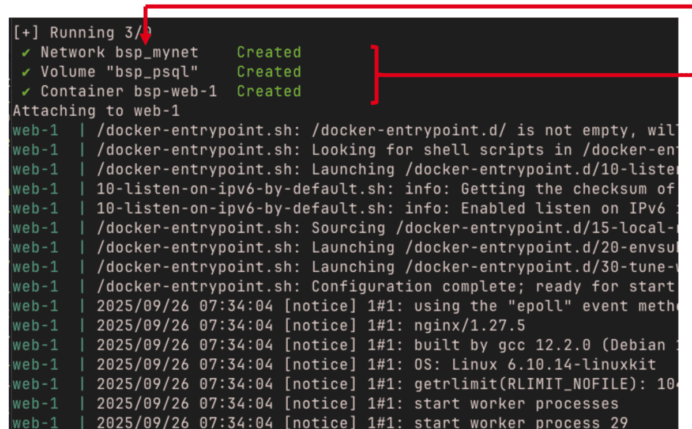

# 6. Docker Compose

Starten von „Container-Gruppen“

## Motivation

- Die bisherige Konfiguration von Volumes und Networks erfordert viel manuellen Aufwand und das Setzen von Optionen.
- Des weiteren müssen die Container einzeln von Hand gestartet werden, was die Automatisierbarkeit erschwert.
- Docker Compose verwendet eine deklarative Konfigurationsdatei, mit der komplexe Umgebungen einfach beschrieben und gestartet werden können.

### Notizen

- Jede Komponente – etwa Anwendung, Datenbank und Backend – muss in der Standard-Docker-CLI einzeln gestartet, verknüpft und mit den passenden Volumes und Netzwerken konfiguriert werden. Dieses Vorgehen ist fehleranfällig, schwer reproduzierbar und erschwert die Automatisierung, insbesondere in Entwicklungs- und Testumgebungen.
- Deklarativer Ansatz: Statt Container, Netzwerke und Volumes über einzelne Befehle (`docker run`, `docker network create`, `docker volume create`) zu definieren, werden alle Komponenten in einer zentralen Datei (compose.yaml) beschrieben. Diese Datei legt fest, welche Services existieren, wie sie miteinander verbunden sind und welche Ressourcen sie nutzen.
- Der große Vorteil: Eine vollständige, mehrschichtige Umgebung kann mit einem einzigen Befehl (`docker compose up`) gestartet werden. Damit wird aus einer Sammlung einzelner Container eine orchestrierte Anwendung mit klar definierten Abhängigkeiten.

## YAML

- YAML (YAML Ain‘t another Markup Language) ein menschenlesbares Datenserialisierungsformat.
- Struktur wird über Leerzeichen abgebildet
- Zuweisungen erfolgen durch Schlüssel-Wert Notation (vgl. JSON)
- Zeilenkommentare werden mit einem # gekennzeichnet
- YAML unterstützt die primitiven Datentypen: String, Int, Double und Boolean.
- Die Datentypen werden implizit abgeleitet, basierend auf dem Format des Wertes.
- Strings können auch mit Anführungszeichen oder Hochkommas deklariert werden.
- YAML respektiert die Groß-Kleinschreibung (Case-Sensitive)

```yaml
Stunden: 55
Programmierung: true
Raum: Labor
```

- Als erweiterte Datentypen unterscheidet YAML Objekte, Dictionaries und Listen.
- Die Zuordnung von Attributen zu Objekten geschieht über die Einrückung.
- Die Einträge in einem Dictionary werden nicht geordnet abgelegt und können über ihren Namen angesprochen werden (bspw. DHBW[Heidenheim])
- Bei Listen werden die Werte in geordneter Reihenfolge gespeichert.

```yaml
DHBW:
  Ravensburg:
    Studierende: 2223
    Mitarbeiter: 190
  Heidenheim:
    Studierende: 2413
    Mitarbeiter: 176
```

„DHBW“ ist hier ein Dictionary bestehend aus den zwei Einträgen „Ravensburg“ und „Heidenheim“

```yaml
Studiengänge:
  - Wirtschaftsinformatik
  - Data Science
  - Elektrotechnik
```

### Notizen

- Das YAML-Format bildet die Grundlage für die Konfigurationsdateien von Docker Compose. Es ist darauf ausgelegt, komplexe Strukturen übersichtlich und einfach editierbar darzustellen.
- Der Name betont, dass es – anders als XML oder HTML – kein Auszeichnungs-, sondern ein reines Datenbeschreibungsformat ist.
- Die Struktur basiert auf Einrückungen mittels Leerzeichen statt Klammern oder Kommata. Diese Formatierung spiegelt hierarchische Beziehungen zwischen Elementen wider: Jede zusätzliche Ebene der Einrückung repräsentiert eine weitere logische Verschachtelung.
- Damit ist YAML besonders geeignet für Konfigurationsdateien, in denen verschachtelte Objekte oder abhängige Strukturen – wie Services, Volumes und Netzwerke – übersichtlich dargestellt werden müssen.
- Durch diese klare, leicht lesbare Syntax können Konfigurationen auch ohne Programmierkenntnisse verstanden und angepasst werden.
- Kommentare dienen zur Dokumentation oder zum temporären Deaktivieren von Einträgen.
- YAML unterscheidet sich von klassischen Programmiersprachen oder Datenformaten wie JSON dadurch, dass Datentypen implizit abgeleitet werden: Der Typ eines Wertes wird automatisch anhand seines Formats erkannt – ohne dass eine explizite Typdeklaration erforderlich ist.
- Beispiele für primitive Datentypen: String (z. B. "Labor“), Int (z. B. „55“), Double (z. B. „3.14“) und Boolean (z. B. „true“).
- Strings können optional in Anführungszeichen gesetzt werden – das ist nur notwendig, wenn Sonderzeichen, Leerzeichen oder spezielle Schlüsselwörter enthalten sind (z. B. "true" als Text statt als boolescher Wert).
- Die erweiterten Datentypen erlauben die Modellierung komplexer Datenstrukturen, die in Docker Compose zur Beschreibung verschachtelter Konfigurationen (z. B. Services, Netzwerke und Volumes) notwendig sind.
- Dictionaries (Schlüssel-Wert-Zuordnungen; vergleichbar mit Maps oder JSON-Objekten) speichern Schlüssel-Wert-Paare. Die Einträge können über ihre Schlüssel angesprochen werden.
- Listen (geordnete Sequenzen) werden durch Bindestriche eingeleitet.

## Überblick

```yaml
services:
 web:
  image: nginx
  ports:
   - "8080:80"
  environment:
   Log_Level: Info
  networks:
   - mynet

volumes:
 psql:

networks:
 mynet:
```

- Das docker-compose File ist eine YAML-Textdatei mit dem Namen ‚compose.yaml‘.
- Die darin beschriebene Konfiguration wird mit dem Befehl `docker compose up` hergestellt.
- Seit 2020 ist in der obersten Zeile keine Versionsinformation mehr nötig.
- Die docker-compose Datei ist in drei Abschnitte gegliedert: services, volumes, networks
- Ein Service steht bei Docker-Compose für die Startkonfiguration eines Docker-Containers (bspw. Name, Image, Ports, Volumes, etc.)
- Unter Services werden alle Startkonfigurationen definiert, die zusammen eine Anwendung bilden.
- Der servicename kann als Hostname für die Intra-Container Kommunikation verwendet werden.
- Die Umgebungsvariablen werden im Dictionary environment aufgelistet.
- Die benötigten Volumes werden im Abschnitt volumes, die verwendeten Netzwerke im Abschnitt networks definiert.
- Bei YAML kann ein Schlüssel auch ohne Wert stehen, hierbei werden dann die Standardwerte verwendet.
- Standard-Volume mit Namen „psql“
- Standard-Konfiguration (bridge) für Netzwerk „mynet“.

### Notizen

- compose.yaml ist der Standardname. Die Datei beschreibt die Struktur und Konfiguration einer mehrcontainerbasierten Docker-Anwendung und dient als zentrale Steuerdatei, um mehrere Container gemeinsam und konsistent zu starten.
- In aktuellen Compose-Dateien ist keine version:-Angabe mehr erforderlich. Docker erkennt automatisch die Syntax basierend auf den verwendeten Features, was die Datei übersichtlicher macht und Fehlerquellen reduziert.
- services: bildet das Herzstück jeder compose.yaml-Datei, da hier die eigentliche Laufzeitlogik der Anwendung festgelegt wird: welche Container gestartet werden, wie sie konfiguriert sind und wie sie miteinander interagieren.
  - Jeder Service steht für eine klar abgegrenzte Anwendungskomponente, etwa eine Web-App, eine Datenbank oder einen Cache.
  - Jeder Service beschreibt neben Image, Portfreigaben, Umgebungsvariablen und Netzwerken gegebenenfalls Abhängigkeiten zu anderen Containern.
- Zentrale Laufzeitparameter des zugehörigen Containers in jedem Service-Eintrag:
  - image: legt das zu verwendende Container-Image fest (z. B. nginx oder postgres).
  - ports: definiert die Portzuordnungen zwischen Host und Container, um externe Zugriffe zu ermöglichen.
  - environment: enthält Umgebungsvariablen, die innerhalb des Containers gesetzt werden (z. B. Log_Level: Info).
  - networks: ordnet den Service einem oder mehreren Netzwerken zu, um die Kommunikation zwischen Containern zu ermöglichen.
  - volumes (optional): ermöglicht die Einbindung persistenter Datenspeicher.
- Der Servicename fungiert innerhalb des Compose-Netzwerks automatisch als Hostname. Dadurch können Container über einfache Namensauflösung miteinander kommunizieren – z. B. kann ein web-Service eine Datenbank über postgres:5432 ansprechen, ohne IP-Adressen kennen zu müssen.
- volumes und networks stehen auf oberster YAML-Ebene und bilden die Grundlage für eine saubere Trennung von Code, Daten und Infrastruktur.
- volumes: beschreibt persistente Speicherbereiche, die unabhängig vom Lebenszyklus eines Containers existieren und über Containerneustarts hinweg bestehen bleiben. So können Datenbanken, Logs oder Benutzerdateien dauerhaft erhalten werden.
  - Diese Volumes können gleichzeitig von mehreren Containern genutzt werden – ein zentrales Konzept in Docker, um Daten gemeinsam verfügbar zu machen, etwa bei gemeinsam genutzten Datenbanken, Logverzeichnissen oder Konfigurationsdateien.
- networks: legt fest, über welche logischen Netzwerke die Container miteinander kommunizieren können. Netzwerke ermöglichen es, Services voneinander zu isolieren oder gezielt miteinander zu verbinden, ohne dass sie direkt von außen erreichbar sind.
  - Für das Netzwerk mynet bedeutet die Standardkonfiguration, dass ein lokales Bridge-Netzwerk erstellt wird. Innerhalb dieses Netzwerks können Container miteinander kommunizieren, ohne dass sie von außen erreichbar sind.

## Hands On

- Der aktuelle Ordner wird als Projektname verwendet
- Erst wird das Netzwerk, dann das Volume und zuletzt der Container erstellt.
- Der Befehl `docker compose down` löscht den Container und das Netzwerk, aber nicht das Volume.
- Jeder Service bekommt eine eigene Farbe zugewiesen



### Notizen

- Der Befehl `docker compose up` startet die in der compose.yaml-Datei definierte Anwendung und erzeugt dabei alle abhängigen Ressourcen in der richtigen Reihenfolge.
- Projektname: Compose verwendet standardmäßig den aktuellen Ordnernamen, wodurch die erzeugten Ressourcen eindeutig gruppiert werden. So entsteht eine logische Zuordnung von Netzwerk, Volume und Container zu einem Projekt, ohne dass Namenskonflikte mit anderen Compose-Projekten auftreten.
- Der Terminalauszug zeigt, dass Docker Compose die einzelnen Schritte transparent protokolliert. Jede Ressource (Netzwerk, Volume, Container) erhält den Status Created, bevor der Container gestartet und die Logausgabe sichtbar wird.
- Durch diese Automatisierung werden komplexe Multi-Container-Umgebungen mit einem einzigen Befehl reproduzierbar bereitgestellt.
- `docker compose down` entfernt die Volumes bewusst nicht, da Volumes persistente Daten enthalten, die über Neustarts hinweg erhalten bleiben sollen – beispielsweise Datenbanken.
- Die Farbe wird jedem Service zur besseren Lesbarkeit in der Logausgabe zugewiesen. Dadurch lassen sich parallele Logs verschiedener Container visuell unterscheiden, was die Fehlersuche und Nachvollziehbarkeit deutlich erleichtert.

## Image Building

```yaml
services:
 proxy:
  build:
   context: .
   dockerfile: ngix.Dockerfile
  ports:
   - "80:80"
 web:
  image: httpd
  volumes:
   - ./html:/usr/local/apache2/htdocs/
```

- Beim Image Building werden neue Docker Images im Rahmen von „docker compose up“ gebaut.
- Hierzu wird das Dockerfile und der Ordner für den Bauprozess spezifiziert. Das gebaute Image bekommt den Tag `{foldername}_{servicename}_{nr}`
- Mittels `--build` werden die Images vor dem Start neu gebaut, ansonsten wird das vorhandene Image verwendet.
- Neu gebaute Images werden mit dem Zusatz `--rmi=local` beim `docker compose down` Befehl gelöscht.

### Notizen

- Beim Start einer Anwendung mit `docker compose up` können nicht nur Container aus bestehenden Images erzeugt, sondern auch eigene Images automatisch gebaut werden. Docker Compose integriert damit den gesamten Build-Prozess direkt in den Anwendungsstart und unterstützt sowohl vorgefertigte Images (`image: …`) als auch selbst definierte Builds (`build: …`).
- Im Abschnitt build: wird das Verzeichnis angegeben, in dem sich das Dockerfile befindet, sowie optional der Name des Dockerfiles selbst. Im gezeigten Beispiel wird für den Service proxy im aktuellen Ordner (`context: .`) das Dockerfile ngix.Dockerfile verwendet.
- Docker Compose erstellt daraus ein neues Image, das nach dem Schema `{foldername}{servicename}{nr}` benannt wird – eine automatische, projektbezogene Namenskonvention, die Kollisionen zwischen unterschiedlichen Projekten vermeidet.
- Images werden nur dann neu gebaut, wenn sie nicht im lokalen Cache vorhanden sind. Um den Build explizit zu erzwingen, kann die Option `--build` verwendet werden (`docker compose up --build`) – nützlich, wenn sich die Build-Umgebung oder das Basisimages geändert haben.
- Über den Befehl `docker compose down --rmi local` lassen sich alle im aktuellen Projektkontext erstellten Images wieder entfernen. Diese Option ist hilfreich, um Entwicklungsumgebungen aufzuräumen und Speicherplatz freizugeben, ohne Volumes oder Netzwerke zu löschen.

## Überblick wichtiger Befehle

|  |  |
| --- | --- |
| `docker compose up` | Startet die in compose.yaml definierten Container, Netzwerke und Volumes. Nutzt bereits vorhandene Images, falls verfügbar. |
| `docker compose up --build` | Gleich wie oben, nur dass Neubauen der Images erzwungen wird auch wenn die Images bereits existieren. |
| `docker compose down` | Beendet alle laufenden Container und entfernt zugehörige Netzwerke, Volumes werden beibehalten. |
| `docker compose down --rmi=local` | Gleich wie oben, nur dass zusätzlich lokal gebaute Images gelöscht werden. |

### Notizen

- Die Befehle bilden den zentralen Arbeitszyklus in Docker Compose ab.
- `docker compose up`: Alle Services, Netzwerke und Volumes werden erstellt und die Container in der richtigen Reihenfolge gestartet. Die Wiederverwendung bereits existierender Images beschleunigt den Startprozess.
- `docker compose down` fährt die gesamte Umgebung kontrolliert herunter. Dabei werden Container, Netzwerke und temporäre Ressourcen entfernt; Volumes bleiben standardmäßig bestehen, um persistente Daten zu bewahren.
- `docker compose down --rmi local` ist insbesondere in Entwicklungs- oder Testumgebungen nützlich, um Speicherplatz freizugeben und saubere Neuaufbauten zu erzwingen.

Quelle: cloud-computing/origin/WDS125 - Cloud Computing (SCA)/05 Docker/3-Docker/3-Docker.pdf, Seiten 64–73
