# 3. Docker

Cloud Computing — Prof. Dr. Andreas Schilling

Quelle: cloud-computing/origin/WDS125 - Cloud Computing (SCA)/05 Docker/3-Docker/3-Docker.pdf, Seiten 1–75

## Agenda (Seite 43)

| Docker Container | Docker Image | Best Practices |
| --- | --- | --- |
| Starten und Kontrollieren von Container | Docker Image beziehen und selbst bauen | Wichtige Konventionen zur Konfiguration |

| Docker Storage | Docker Networking | Docker-Compose |
| --- | --- | --- |
| Speichern von Daten in Docker | Netzwerkgrundlagen von Docker | Starten von „Container-Gruppen“ |

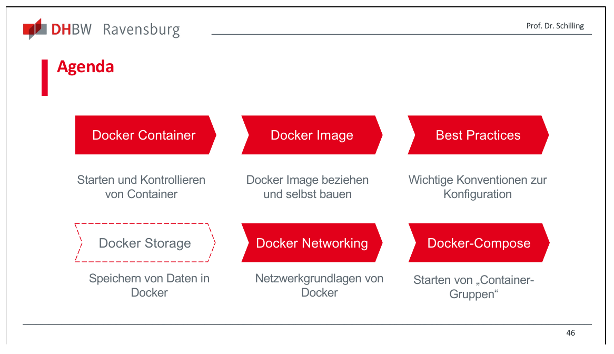

## Grundlagen

### Paradigma (Seite 3)

- Manueller Aufwand: Hafenarbeiter betreten Schiff und entladen die Fracht.
- Gefahr: Kein sicheres Arbeitsumfeld.
- Performance: Hafenbrücken werden zum Flaschenhals.
- Unsichere Dauer: Keine Planung da abhängig von Verfügbarkeit der Arbeiter.

- Standardisierung: 90% aller Frachtcontainer sind Standardcontainer.
- Sicherheit: Massive Reduktion der Frachtschäden und Diebstähle.
- Performance: Sehr kurze Dauer für Ladung und Endladung, durch Infrastruktur.
- Planung: Standardisierte Intrastruktur gibt Planungssicherheit für Dauer und Kosten.

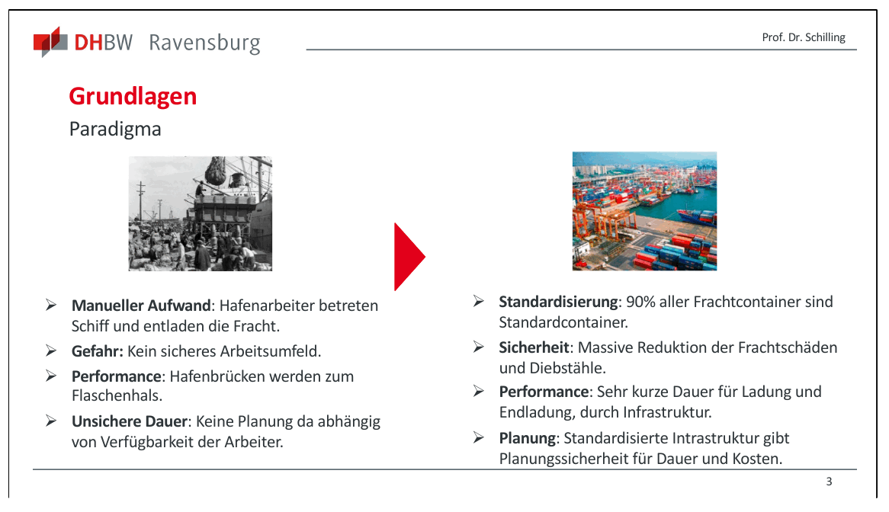

Das Grundparadigma von Docker ist der Standardcontainer in der Frachtschifffahrt. Vor
der Einführung bestand für die Ladung und die Entladung von Schiffen ein sehr hoher
manueller Aufwand, da die Arbeiter das Schiff betreten mussten und die Fracht händisch
aufnehmen mussten. Dies resultierte in Transportschäden und gefährdete zum Teil die
Sicherheit der Arbeiter, da die Hafenbrücken oft zum Flaschenhals wurden. Ferner
entstand durch die unklare Verfügbarkeit von Arbeitern am Hafen, sowie den
Behinderungen beim Entladen und der Verfügbarkeit von Lagerplatz eine unklare
Planungsgrundlage. Frachtschäden und Frachtdiebstähle waren keine Seltenheit.

Die Einführung der Standardcontainer löste einen regelrechten Paradigmenwechsel aus,
der die Frachtschifffahrt massiv veränderte. Angesichts dessen, dass heute ca. 90% aller
Frachtcontainer Standardcontainer sind ist die gesamte Infrastruktur an den Häfen und
den Schiffen auf die Standardcontainer optimiert. Die Einführung der Frachtcontainer
reduzierte maßgeblich die Vorfälle an Transportschäden und Diebstählen. Ferner
konnten die Zeiten für die Ladung und Entladung enorm verkürzt werden. Ein Vergleich
der ersten Jahre zeigt das insbesondere: So benötigte eine 18-köpfige Crew vor
Einführung der Standardcontainer eine 8 Stunden Schicht um 80 Tonnen zu entladen.
Nach der Einführung der Standardcontainer konnte eine 9-köpfige Crew in der gleichen
Zeit 2000 Tonnen entladen.

### Was ist Docker (Seite 4)

- Docker ist ein Werkzeug mit dem Anwendungen gebaut, verteilt und betrieben werden können.
- Es ist der de-facto Standard zur Prozessvirtualisierung unter Nutzung der Kernelfunktionen cgroups und namespaces.
- Docker ist kostenlos und der Code der Ausführungsumgebung, sowie dem Speicherformat wurden teilweise offengelegt, wodurch die Technologie große Verbreitung fand.
- Ähnlich zum Container in der Schifffahrt legte Docker den Grundstein für weitere Werkzeuge und Umsetzungen des Cloud Computing.
- Docker besteht aus einem Client der Befehle absetzt und einem Deamon (Server), der die Befehle entgegennimmt und ausführt.

Analog zum Standardcontainer, ist Docker eine Software, die dazu dient ausführbare
Anwendungen zu bauen, zu verteilen und zu betreiben. Hierzu ist Docker egal welche
Programmiersprache verwendet wird, es wird ein standardisiertes und portables Abbild
(Image) der Anwendung und der notwendigen Systemkonfiguration erzeugt. Der
Empfänger des Abbildes (Images) kann nach Erhalt, das Abbild direkt ausführen. Um
diesen einfachen Workflow umzusetzen, nutzt Docker die Prozessvirtualisierung, die auf
den Linux-Kernfunktionen cgroups und namespaces basiert. Aufgrund der intuitiven
Handhabung und der freien Nutzung gewann Docker massive Popularität und ist heute
der de-facto Standard zur Prozessvirtualisierung. Ohne zu übertreiben kann man
festhalten, dass ähnlich zur Frachtschifffahrt, Docker den Grundstein für eine nachhaltige
Veränderungen des Anwendungsbetriebs gelegt hat und so das Entstehen weiterer
Werkezuge für den optimierten Betrieb von Cloud Computing ermöglichte.

Docker besteht aus zwei wichtigen Bestandteilen:

1. Dem Docker-Client, dies ist ein Kommandozeilen-Programm, das die eigegebenen Befehle übersetzt und via einer Rest-Schnittstelle an den Docker-Deamon überträgt.
2. Dem Docker-Deamon, der verantwortlich ist für die Erstellung und Parametrisierung der Linux-Container und die Überführung der portablen Abbilder in ausführbare Einheiten vornimmt.

### Docker — Überblick (Seite 5)

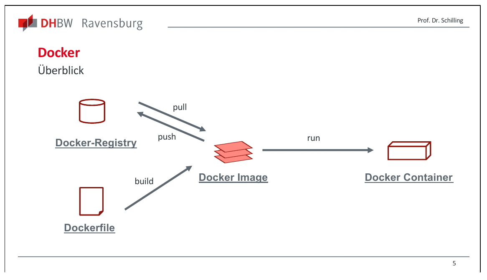

Das folgende Schaubild gibt einen grundlegenden Überblick über die wichtigen
Grundpfeiler von Docker. Zentral bei der Verwendung von Docker ist das Docker Image.
Das Docker Image ist eine Beschreibung der Laufzeitumgebung samt aller notwendigen
Konfigurationen. Ein Docker Image selbst ist nicht ausführbar. Eine
Laufzeitrepräsentation eines Docker Images ist der Docker Container. Docker Images
werden über eine Docker Registry verteilt. Das heißt Images können dort abgelegt und
bezogen werden. Darüber hinaus können Docker Images über die Verwendung eines
Dockerfiles selbst erstellt werden.

Eine Hilfe zur Verinnerlichung dieses Workflows kann sein sich ein Docker Image als ein
Kuchenrezept vorzustellen. Anhand des Rezepts lassen sich ein oder mehrere Kuchen
dieser Art parallel oder nacheinander erstellen. Das Rezept kann über eine
Internetplattform (vgl. Docker Registry) verteilt und bezogen werden. Darüber hinaus
lässt sich das Rezept in eigener kreativer Arbeit verfassen (vgl. Dockerfile).

## 1. Docker Container

Starten und Kontrollieren von Docker Container

### Überblick (Seite 7)

Docker Image

- Read-Only
- Beschreibung der Laufzeit-Umgebung und des auszuführenden Prozesses
- Portabel

Docker Container

- Laufzeit Repräsentation
- Leichte Replikation
- Keine Hardwarebindung

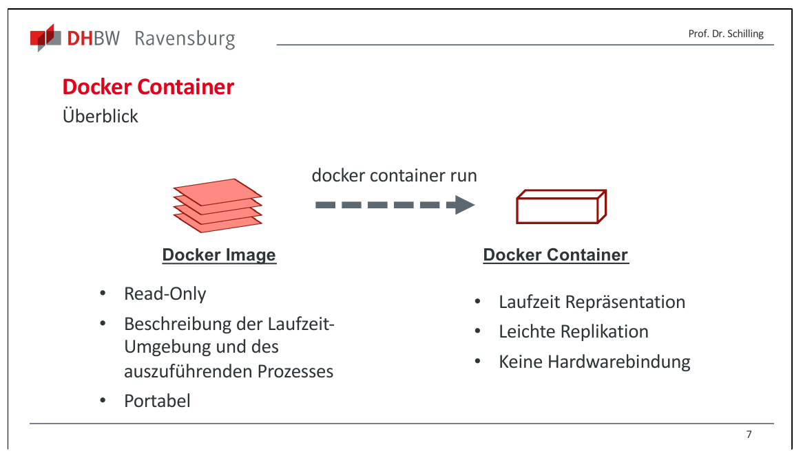

Wie bereits ausgeführt stellen Docker Images einen zentralen Grundstein von Docker
dar. Im Folgenden grenzen wir diese von Docker Containern (den Ausführungseinheiten)
ab. Docker Images sind nur lesbar (read-only) und lasen sich nicht verändern. Ferner
werden Docker Images nicht direkt ausgeführt. Stattdessen wird eine Kopie des Images
gemacht und diese ausgeführt (der sogenannte Docker Container). Hierdurch ist es
möglich, dass mehrere Container zeitgleich basierend auf dem gleichen Image
ausgeführt werden. Dies vereinfacht die Umsetzung einer horizontalen Skalierung
elementar. Was immer in einem Container passiert, beeinflusst nicht das Docker Image
oder andere Container. Das heißt alle Änderungen im Container sind nicht permanent.

Dieses Handling von Images und Containern, steht im starken Kontrast zur Umsetzung
von virtuellen Maschinen, bei denen die Abbilddatei auch ausgeführt wird, sodass alle
Änderungen zur Laufzeit auch dauerhaft im Image gespeichert werden.

### Container (Seite 8)

- Bei der Ausführung eines Docker-Images werden alle Instruktion darin zu einem read-only Dateisystem überführt.
- Jeder Docker-Container besitzt eine beschreibbare Schicht in der Änderungen gemäß dem Copy-On-Write Prinzip vorgenommen werden.
- Nach Beenden des Docker Containers wird die beschreibbare Schicht gelöscht.

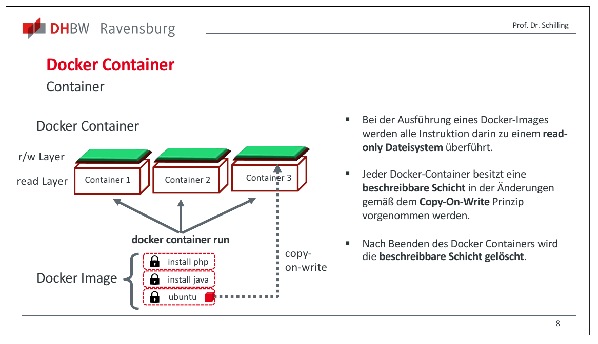

Schauen wir uns im Folgenden das Zusammenspiel zwischen Docker Image und Docker
Container genauer an. Sobald ein Docker Image ausgeführt wird, werden alle
Instruktionen darin in ein read-only Dateisystem überführt und im Rahmen eines
Containers ausführbar gemacht. Zusätzlich zu dem read-only Dateisystem bekommt
jeder Container eine temporäre, schreibbare Dateiablage, die nach Beenden des
Containers gelöscht wird. Diese Schicht bildet die Grundlage zur Umsetzung des copy-on-
write Prinzips. Dieses Prinzip beschreibt die Vorgehensweise zur Veränderung einer Datei
innerhalb eines Containers. Da das gesamte Dateisystem des Containers nur lesbar ist,
können keine Änderungen vorgenommen werden. Damit man dennoch im Rahmen
eines Containers Dateiänderungen vornehmen kann, werden diese zur Veränderung in
die temporär beschreibbare Schicht kopiert und dort wird dann die Kopie der
entsprechenden Datei verändert, daher der Name copy-on-write. Die temporäre Schicht
wird nach Beenden des Containers gelöscht.

### Befehlssyntax (Seite 9)

```sh
docker container run -d hello-world
```

- Docker Client
- Objektklasse (opt.)
- Befehl
- Optionale Parameter
- Objektinstanz von Image oder Container

- `run`
- `stop`
- `rm`

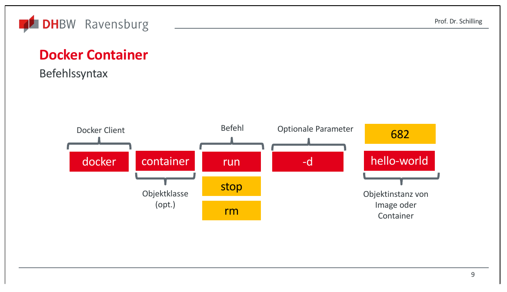

Alle Docker Befehle bezüglich der Verwaltung von Containern haben den gleichen
syntaktischen Aufbau. Das erste Befehlsargument bezieht sich auf den Docker Client, der
im System installiert sein muss. Das zweite Befehlsargument referenziert die
Objektklasse auf die sich das Kommando auswirkt. Im Folgenden ist dies der Container,
im nächsten Kapitel verwenden wir auch die Objektklasse Image. Als nächstes wird der
tatsächliche Befehl spezifiziert, der ausgeführt werden soll (bspw. ‚run‘ -> Startet einen
Container, ‚stop‘ -> Stoppt einen Container, ‚rm‘ -> Löscht einen Container). Nach der
Spezifikation des Befehls werden optionale Parameter eingesetzt, welche den
entsprechenden Befehl erweitern oder modifizieren. Abschließend wird die
Objektinstanz, auf die der Befehl ausgeführt werden soll, benannt. Bei der Verwendung
der ContainerIds ist zu beachten, dass es in der Regel ausreicht die ersten drei Zeichen zu
verwenden, da der Docker Deamon automatisch auf dieser Grundlage den Rest der Id
auflöst.

### Überblick wichtiger Befehle (Seite 10)

|  |  |
| --- | --- |
| `docker container run hello-world` | Erstellt einen neuen Container für das Docker Image ‚hello-world‘ und führt diesen aus. |
| `docker container stop 684` | Stoppt den Container mit der Id, die mit ‚684‘ beginnt. |
| `docker container rm 684` | Löscht den Container mit der Id, die mit ‚684‘ beginnt |
| `docker container list` | Listet alle Container samt ihres Status auf. |
| `docker container stats 684` | Gibt Statistiken zur Ressourcennutzung der Container aus. |
| `docker container logs 684` | Gibt den Kommandozeilenoutput des Containers ‚684‘ aus. |

Die folgende Übersicht gibt einen Überblick über die wichtigsten Befehle zum Verwalten
von Docker Containern. Der Befehl ‚docker container run‘ nimmt ein Imagenamen
entgegen und erstellt hierzu einen neuen Docker Container, der auch gleich gestartet
wird. Um einen laufenden Docker Container anzuhalten wird der Befehl ‚docker
container stop‘ mit der konkreten ContainerId verwendet. Anschließend können
gestoppte Container mit dem Befehl ‚docker container rm‘ gelöscht werden. Mit dem
Befehl ‚docker container list‘ werden alle laufenden Container ausgegeben. Details zum
Laufzeitverhalten, sowie der Ressourcennutzung der einzelnen Container gibt der Befehl
‚docker container stats‘ zurück. Abschließend ermöglicht es der Befehl ‚docker
container logs‘ gefolgt von der konkreten ContainerId die Logausgaben des Containers
einzusehen.

### Hands-On (Seite 11)

https://killercoda.com/playgrounds/scenario/kubernetes

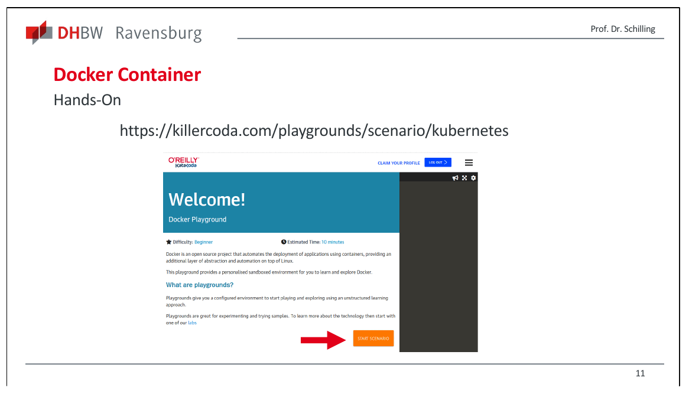

### Hands-On - Die „Hello-World“ Anwendung (Seite 12)

```sh
docker container run hello-world
```

1. Docker Client ruft Docker Deamon auf
2. Docker Deamon schaut ob das benötigte Image lokal vorliegt.
3. Docker Deamon kontaktiert die Docker Registry und sucht dort nach dem Image
4. Docker Deamon lädt das Image von der Registry
5. Docker Deamon erstellt einen Docker Container basierend auf dem Image.
6. Docker Deamon gibt den Output des Containers auf der Befehlszeile aus
7. Docker Deamon stoppt den Container

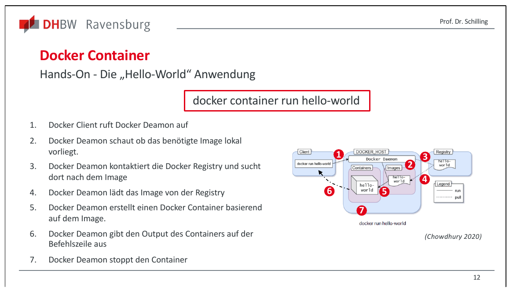

Starten wir mit dem ersten praktischen Hands-On zum Docker Container. Bitte führen Sie
hierzu den Befehl ‚docker container run hello-world‘ aus. Nach einer kurzen Ladephase
sehen Sie die offizielle Begrüßung “Hello from Docker!“. Diese unscheinbare Nachricht
erforderte jedoch, dass im Hintergrund wichtige Schritte durchgeführt wurden. Wir
schauen uns nun genauer diese Schritte an, um ein fundiertes Verständnis zur Nutzung
der Docker Container aufzubauen. Als erstes wurde der Kommandozeilenbefehl an der
Docker Deamon zur Ausführung übergeben. Als nächstes schaute der Docker Deamon ob
sich das Image (‚hello-world‘) in seinem lokalen Zugriff befindet. Da dies nicht der Fall ist,
schaut er bei der Registry „Docker Hub“ nach diesem Image. Von dort aus lädt er das
Image runter und erstellt im nächsten Schritt daraus einen Docker Container und führt
diesen aus. Abschließend wird die Ausgabe des Docker Containers beim Benutzer
ausgegeben und der Docker Container wird im letzten Schritt gestoppt.

### Optionen zur Ausführung (Seite 13)

|  |  |
| --- | --- |
| `docker container run –p 80:80 nginx` | Die Option „-p“ steht für „publish“ und ermöglicht es Netzwerkverkehr der auf den Host geht zu einem Container umzuleiten. Hierbei wird zuerst der eingehende Port und dann der Containerport spezifiziert. |
| `docker container run –d –p 80:80 nginx` | Ohne Anpassungen läuft der Container im attached Mode (nur solange, wie er auf der Befehlseingabe aktiv ist. Die Option „-d“ für „detach“ ermöglicht es Container im Hintergrund weiterlaufen zu lassen, hierbei wird die Id des Containers zurückgegeben |
| `docker container run –it nginx bash` | Die Kombination „-it“ steht für „interactive“ und „tty“ und ermöglicht es Startkommandos eines Containers gegen den mitgegebenen Befehl zu ersetzen. |

Aufbauend auf dem einfachen Verhalten der ‚hello-world‘ Ausführung schauen wir uns
im Folgenden Optionen an mit deren Hilfe wir das Laufzeitverhalten eines Containers
beeinflussen können. Das Erste, was wir uns hierzu anschauen, ist die publish Option.
Diese Option ermöglicht es, dass eingehende Netzwerkports des Host-OS an einen
konkreten Port des Containers weitergeleitet werden. Die verwendete Notation hierzu
ist ‚–p <HostPort>:<ContainerPort>‘.

Als Nächstes schauen wir uns an, wie wir Container im Hintergrund laufen lassen
können. Im Standardverhalten ist die Ausführung des Containers im Vordergrund und die
Kommandozeile ist für die Ausgabe des Containers geblockt. Dieser Zustand ist auch
unter dem Begriff ‚attached mode‘ bekannt. Mit der Option ‚-d‘ (kurz für ‚detached‘) ist
es möglich den Container im Hintergrund laufen zu lassen, sodass die Kommandozeile
für andere Befehle genutzt werden kann.

Zuletzt nutzen wir noch eine Option, mit der es möglich ist interaktiv in einem Container
zu arbeiten. Im Standardverhalten werden nur die Logausgaben auf der Kommandozeile
ausgegeben. Um nun auch Befehle in einem Container auszuführen wird die Option –it
verwendet (kurz für ‚interactive‘ und ‚tty‘) wodurch der Benutzer eine interaktive
Befehlseingabe innerhalt des Containers bekommt.

### Hands-On – Starten & Stoppen von Containern (Seite 14)

|  |  |
| --- | --- |
| `docker container run -d -p 80:80 nginx` | Start eines nginx Webservers im Hintergrund (siehe letzte Folie). |
| `docker container list` | Der Befehl „list“ gibt alle aktuell laufenden Container aus. Mit der Option „-a“ für „all“ werden auch gestoppte Container gelistet. |
| `docker container stop ac1` | Da die Ids der Container in der Regel stark variieren, reichen die ersten drei Zeichen der Id aus um den Container zu stoppen |
| `docker container start ac1` | Starten des einst gestoppten Containers. |

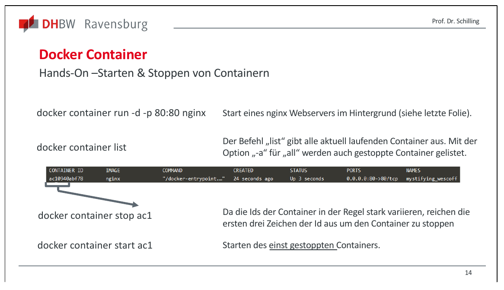

Kommen wir zum nächsten Hands-On. Als nächstes führen wir gemäß der soeben
gelernten Syntax ein nginx Webserver im Hintergrund aus, der auf Port 80 des Hosts
horcht. Mit dem Befehl ‚docker container list‘ können wir uns eine Liste aller laufenden
Container ausgeben. Mit der Option ‚-a‘ werden zudem auch alle gestoppten Container
aufgelistet. Durch den Befehl ‚docker container stop‘ und der ContainerId des
entsprechenden Containers (oder einer Abkürzung hiervon) wird dieser gestoppt. Mit
dem Befehl ‚docker container start‘ kann ein gestoppter Container wieder gestartet
werden. Der Befehl kann jedoch nicht dazu verwendet werden um einen neuen Docker
Container zu starten.

### Hands-On Überwachung von Containern (Seite 15)

|  |  |
| --- | --- |
| `docker container run –d –p 80:80 nginx` | Das folgende Hand-On basiert wieder auf der Ausführung eines nginx Webservers, der im Hintergrund auf Port 80 hört. |
| `docker container list` | Wir geben eine Liste aller laufenden Container aus, um die konkrete ContainerId zu identifizieren. |
| `docker container stats ac1` | Wir kontrollieren die Ressourcennutzung des Containers mit dem Befehl stats. |
| `docker container logs ac1` | Mit dem Befehl logs wird der Inhalt der Logdatei des Containers ausgegeben. |

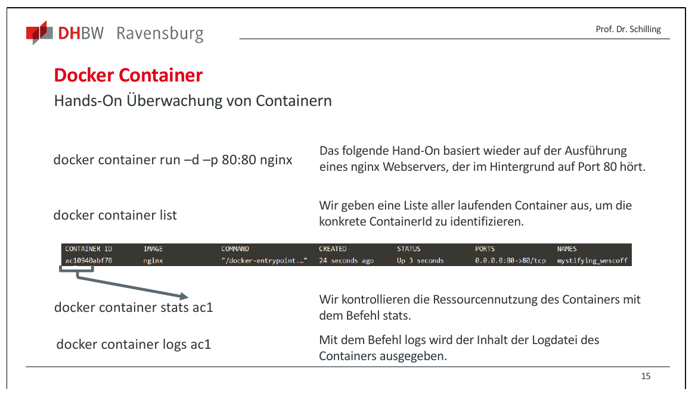

Das nächste Hands-On startet wieder mit der Ausführung eines nginx Webservers im
Hintergrund, der auf Port 80 hört. Als nächstes nutzen wir den Befehl ‚docker container
list‘ um uns einen Überblick über die laufenden Container zu verschaffen. Nachdem wir
die ContainerId des betreffenden Containers identifiziert haben, nutzen wir diese um die
Ressourcennutzung des Containers mit ‚docker container stats‘ und der ContainerId zu
überwachen. Abschließend schauen wir uns den Inhalt der Logdatei mit dem Befehl
„docker container logs“ gefolgt von der konkreten ContainerId an.

## 2. Docker Image

Docker Image beziehen und selbst bauen

### Status Quo (Seite 18)

Welche Fehlerursachen beim Livegang einer Anwendung in der produktiven Umgebung haben Sie erlebt?

- Unterschiede in Applikationsversionen (OS, DB, Laufzeit, Webserver, etc.).
- Unterschiede in der Konfiguration (Umgebungsvariablen, Skripte, Dateien, Rechte, Zertifikate, etc.).
- Unterschiede in der Herangehensweise zur Einspielung des Updates.
- Vage Dokumentation zum Vorgehen oder kein Vorwissen zu wichtigen Konventionen.
- Fehlerhafte Übertragung der Dateien und Konfigurationen auf die Prod-Umgebung.

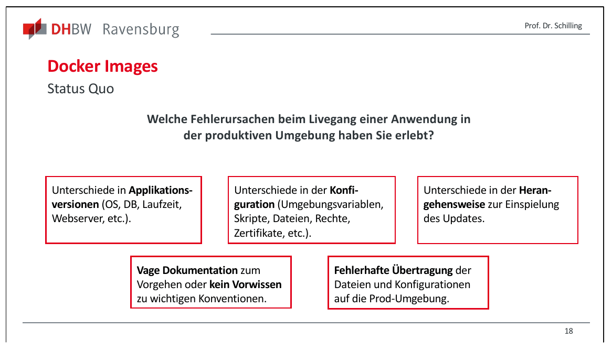

Bevor wir uns näher mit Docker Images beschäftigen, blicken wir auf häufige Ursachen
für ein fehlerhaftes Deployment. So scheitern Deployments oft, wenn unterschiedliche
Versionen von Applikationen eingesetzt werden. Ein weiterer Grund für fehlerhafte
Deployments sind unterschiedliche Konfigurationen zwischen den Maschinen, die für
den Test und den produktiven Einsatz verwendet werden. Weitere Fehlerursachen für
fehlgeschlagene Deployments sind ein unterschiedliches Vorgehen beim
Deploymentvorgang und die fehlerhafte Übertragung von Daten auf die produktive
Maschine.

### Überblick (Seite 19)

- Ein Docker Image hat einen Namen (Tag) und besteht aus den notwendigen Abhängigkeiten und Konfigurationen zur Ausführung einer Anwendung.
- Das Docker Image hat einen strukturierten Aufbau wobei jede Änderung und Konfiguration in einer eigenen Schicht samt Prüfsumme erfasst wird.
- Gemäß dem Prinzip der immutable infrastructure ist jede Schicht unveränderbar, d.h. sie wird nicht verändert sondern stets neu gebaut.
- Die Schichten eines Images lassen sich via docker image history anzeigen.

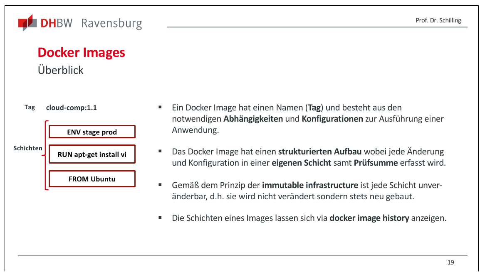

Ein Docker Image trägt einen Tag (was dem Namen entspricht) und besteht aus den
Abhängigkeiten und Konfigurationen, die zur Ausführung einer Anwendung erforderlich
sind. Im Gegensatz zu dem Image einer virtuellen Maschine das als eine große Binärdatei
gespeichert wird, besitzt ein Docker Image einen strukturierten Aufbau in Schichten.
Jede Änderung am Docker Image wird in einer eigenen Schicht samt eigener Checksum
abgebildet. Durch dieses Prinzip wird gemäß dem Grundsatz von ‚immutable
infrastructure‘ sichergestellt, dass Änderungen an einer Schicht zur Folge haben, dass die
alte Schicht verworfen wird und eine neue Schicht erstellt wird. Die einzelnen Schichten
eines Docker Images lassen sich mit dem Befehl ‚docker image history‘ gefolgt vom
konkreten Imagenamen anzeigen.

### Überblick (Seite 20)

- Jede Schicht wird nur einmal gespeichert. Dadurch wird keine Änderung an einem Docker Image redundant gespeichert.
- Wenn ein Docker Image gebaut wird, werden die Prüfsummen jeder Schicht in aufsteigender Weise auf Änderungen überprüft.
- Docker Images die sich bis auf eine Änderung am Ende der Konfiguration gleichen belegen dadurch nur einmal Speicher.
- Optimierter Down- und Upload, da nur die Schichten geladen werden, die nicht bereits auf der Zielmaschine existieren.
- Bei Änderungen einer Schicht wird diese und alle darauf basierenden Schichten neu gebaut.

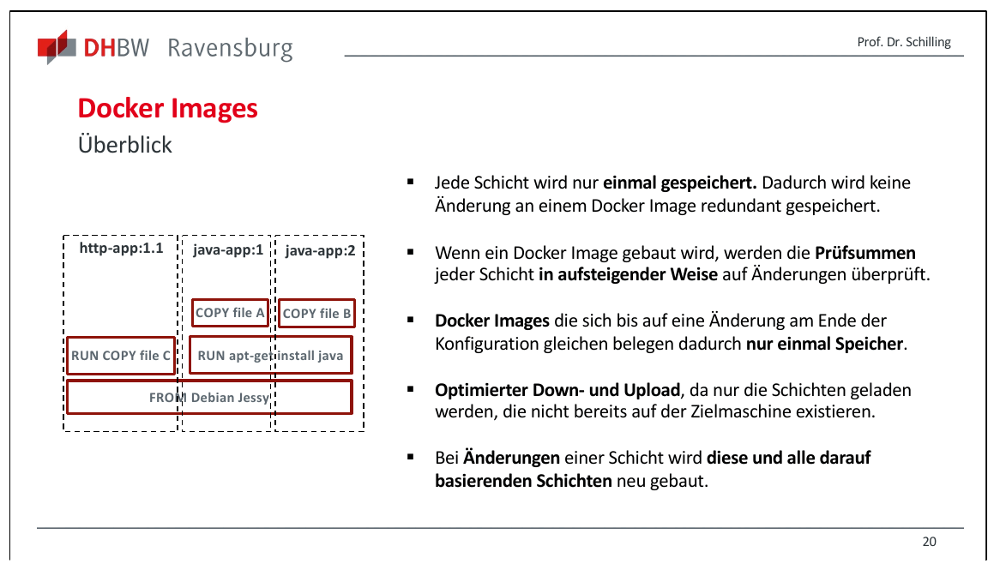

Der schichtenweise Aufbau resultiert in wichtigen Vorteilen zur Erstellung und zum
Bezug neuer Docker Images. Ein großer Vorteil ist, dass jede Schicht nur einmal
gespeichert wird. Das heißt, dass wenn sich Docker Images vom Aufbau her gleichen,
ihre Schichten nur einmal abgelegt werden. Zur Überprüfung ob die Schichten identisch
sind wird deren Prüfsumme verglichen. Die Prüfsumme bezieht sich hierbei auf den
Ausgangszustand, sowie die durchgeführten Änderungen. Zudem wird der Bauprozess
durch die Schichtenbildung optimiert da nur jene Schichten neu gebaut werden, deren
Prüfsummen sich verändert haben. Die Ablage der bereits gebauten Schichten wird im
Rahmen des Bauprozesses auch als Build-Cache bezeichnet. Ein weiterer Vorteil, der aus
dem geschichteten Aufbau entsteht ist, dass nicht das gesamte Docker Image hoch- oder
heruntergeladen werden muss, sondern nur jene Schichten, die nicht auf dem
Zielrechner existieren.

### Tags (Seite 21)

- Der Name (Tag) eines Docker Images ist in 4 Abschnitte gegliedert:
  1. Registry (optional)
  2. User/Organisation (Pflichtfeld)
  3. Imagename (Pflichtfeld)
  4. Version (optional)
- Wird kein Versionstag gesetzt, wird automatisch die Version ‚latest‘ verwendet.
- Tags sind Verweise auf ein konkretes Docker Image. Unterschiedliche Tags auf das gleiche Image verbrauchen keinen zusätzlichen Speicherplatz.

```text
https://hub.docker.com/plexinc/pms-docker:latest
Registry                  User     Image      Version
```

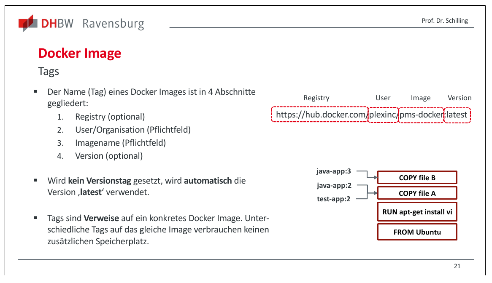

Ein Docker Image wird mit seinem Tag referenziert. Das Tag eines Docker Images besteht
aus vier Abschnitten. Der erste Abschnitt trägt die Adresse der Docker Registry zu der
das Docker Image hochgeladen werden soll. Dieser Abschnitt ist optional, wird er nicht
gesetzt, wird die Docker Registry verwendet, die als Standard gesetzt ist. Der zweite
Abschnitt des Tags referenziert den registrierten Account des Users oder der
Organisation bei der Docker Registry unter dem das Image abgelegt werden soll. Der
dritte Abschnitt ist der tatsächliche Name des Docker Images. Der letzte Bestandteil des
Tags ist die Versionierung des Docker Images.

Die Versionsinformation ist optional, wird sie nicht gesetzt wird automatisch die Version
‚latest‘ gesetzt. Entgegen der wörtlichen Übersetzung steht ‚latest‘ hierbei nicht für die
aktuelle Version, sondern nur als Standardwert. Das heißt es ist auch möglich, dass ein
alter Versionsstand den Zusatz ‚latest‘ besitzt, da der Name ‚latest‘ nichts mit der
Aktualität des Images zu tun hat.

Bei Tags handelt es sich um Verweise auf den konkreten Versionsstand eines Docker
Images. Der Versionsstand eines Docker Images kann jedoch auch mehrere Tags tragen.

### Registry (Seite 22)

- Die Docker-Registry ist ein zentraler Ort zum Speichern und Verteilen von Docker Images.
- Ermöglicht die Umsetzung eines „image from the shelf“ Paradigma.
- Eine Docker Registry kann öffentlich (public), oder für einen geschlossenen Teilnehmerkreis (private), zugänglich sein.
- Die bekannteste public Registry ist https://hub.docker.com
  - Ist als Standard nach einer Installation gesetzt
  - Docker unterstützt mit einem eigenen Team die Aktualisierung der offiziellen Docker Images.
  - Offizielle Images tragen keine Usernamen im Tag.

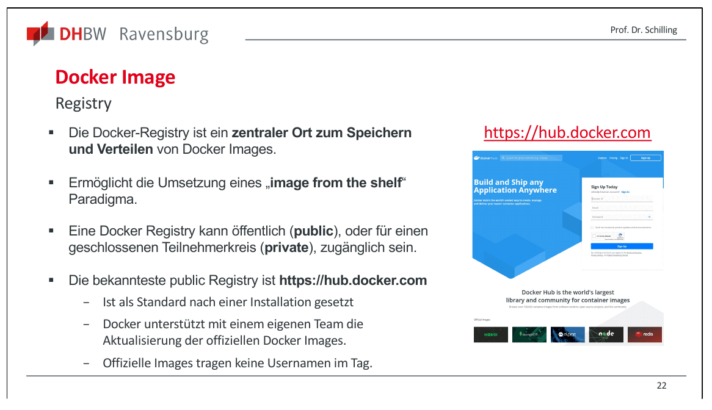

Die Docker Registry ist ein zentraler Ablageort, der zum Speichern und Verteilen von
Docker Images dient. Hierdurch soll für Unternehmen das Paradigma eines „image from
the shelf“ umgesetzt werden. Das heißt ein Unternehmen, das ein Docker Image für eine
bestimmte Funktionalität sucht, soll ohne größere Hürden im Stande sein das
gewünschte Image direkt einzusetzen. Der Datentransfer zwischen dem Docker Deamon
und der Docker Registry basiert auf der Schichtenarchitektur, sodass nur die fehlende
Schichten übertragen werden. Bei der Docker Registry wird unterschieden ob diese
öffentlich zugänglich ist (public registry) oder nur für einen geschlossenen
Teilnehmerkreis (private registry), wie beispielsweise in Unternehmen.

Die bekannteste öffentliche Docker Registry ist Docker Hub. Diese Registry ist frei im
Internet zugänglich und als Standard nach der Installation von Docker gesetzt. Über
Docker Hub werden offizielle Images für bekannte Applikationen wie bspw. MySQL,
PostgreSQL, Spring, etc. angeboten. Hierzu unterhält Docker ein eigenes Team, das eng
mit den Projekten zusammenarbeitet und die Docker Images regelmäßig aktualisiert.
Offizielle Images zeichnen sich dadurch aus, dass sie keinen Namen des Users oder der
Organisation im Tag tragen.

### Hands-On: Recherche von Images (Seite 23)

1. Suche auf Docker Hub nach einem geeigneten Basisimages für eine Spring Anwendung
   - Offizielle Docker Images tragen haben keinen User im Tag.
   - Tags informieren über spezifische Konfigurationen.
   - Dokumentation über Startkonfiguration.
2. Herunterladen des spezifischen Docker Images

   ```sh
   docker image pull openjdk:16-jdk-slim
   ```

3. Inspektion der einzelnen Schichten des Images

   ```sh
   docker image history openjdk:16-jdk-slim
   ```

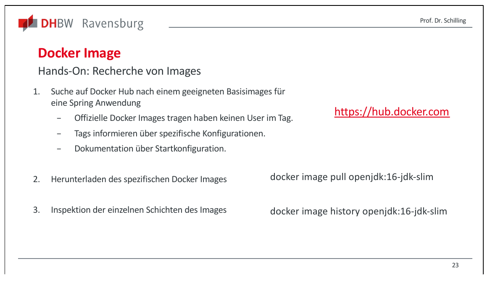

### Dockerfile (Seite 24)

```dockerfile
FROM openjdk:8-jdk-alpine
ENV demo.version=0.9
RUN mkdir app
WORKDIR app/
COPY target/*.jar app.jar
EXPOSE 8080
CMD ["java","-jar","app.jar"]
```

- Baseimage
- Anpassen von Abhängigkeiten & Konfiguration
- Einstiegskommando

- Ein Dockerfile ist eine einfache Textdatei mit dem Namen ‚Dockerfile‘, ohne Dateiendung.
- Der Bau eines neuen Docker Image wird gestartet via:

  ```sh
  docker image build -t imagetag .
  ```

- Jede Zeile ist eine eigene Instruktion, die eine Schicht erstellt.
- Der Aufbau eines Dockerfile ist dreigeteilt in: Baseimage, Konfigurationsanpassungen und dem Einstiegspunkt.
- Der Einstiegspunkt definiert, jenen Befehl, der beim Starten eines Docker Containers ausgeführt wird.

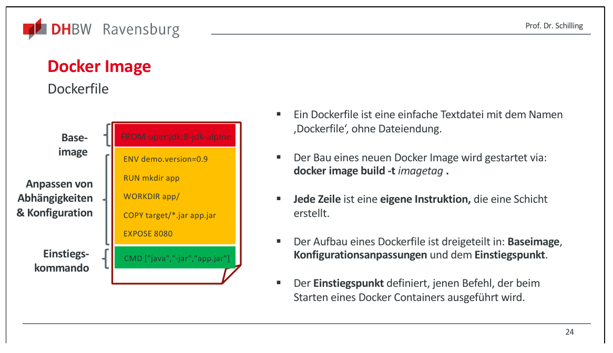

Eine andere Möglichkeit ein Docker Image zu erstellen ist das eigene Verfassen eines
eigenen Dockerfiles. Hierüber kann eine individuelle Ausführungsumgebung zum
Betreiben einer Anwendung konfiguriert werden. Das Dockerfile ist eine einfache
Textdatei, die den Namen ‚Dockerfile‘ ohne jegliche Dateiendung trägt. Ein Dockerfile
besteht generell aus drei zentralen Blöcken. Der erste Block benennt das Basisimage, auf
dessen Grundlage die Einrichtung durchgeführt wird. In der Regel werden hier schlanke
Linux Distributionen wie „apline linux“ (ca. 5 MB) eingesetzt um den digitalen
Fußabdruck des Docker Images so gering wie möglich zu halten. Der nächste Block
besteht aus den individuellen Anpassungen und der Übertragung des auszuführenden
Codes. Hierbei wird so oft wie möglich der Paketmanager der Linux Distribution
eingesetzt um Abhängigkeiten automatisch vom System handhaben zu lassen. Der letzte
Block eines Docker Images besteht aus dem Kommando, das beim Starten eines Docker
Containers ausgeführt wird.

### Dockerfile — FROM, ENV, RUN (Seite 25)

```dockerfile
FROM openjdk:8-jdk-alpine
ENV demo.version=0.9
RUN mkdir app
WORKDIR app/
COPY target/*.jar app.jar
EXPOSE 8080
CMD ["java","-jar","/app.jar"]
```

FROM

- Referenziert das Baseimage, das im Folgenden angepasst wird.
- Kein automatisches Update von Bibliotheken.

ENV

- Setzt Startwerte relevanter Umgebungsvariablen.
- Anpassung des Laufzeitverhaltens einer Anwendung.
- Kann zur Laufzeit überschrieben werden.

RUN

- Führt ein Kommando zur Bauzeit aus.
- Kommandos müssen vom Baseimage unterstützt werden.
- Anwendungen werden oft unter Nutzung des Paketmanagers installiert.

Nachdem wir uns zuvor den generellen Aufbau eines Docker Images angeschaut haben,
gehen wir im Folgenden detailliert auf die zu verwendende Befehlsstruktur ein. Der
Beginn jedes Dockerfiles bildet die Definition des Basisimages. Hierzu wird der Befehl
FROM eingesetzt, gefolgt vom konkreten Tag des eingesetzten Docker Image. Hierbei ist
es empfehlenswert, sehr detaillierte Tags zu verwenden, damit einem Außenstehenden
sofort klar ist auf welcher konkreten Version eines Images das Dockerfile basiert. Ferner
ist zu berücksichtigen, dass es keine automatische Aktualisierung der Docker Images
gibt, sondern die Aktualisierung manuell über den Austausch des verwendeten Tags
erfolgt.

Der Befehl ENV wird dazu eingesetzt, um Umgebungsvariablen in der
Ausführungsumgebung zu definieren. Umgebungsvariablen sind ein zentraler
Mechanismus um das Laufzeitverhalten einer Anwendung anzupassen, da sie von jedem
Betriebssystem unterstützt werden. So ist es beispielsweise möglich, Programmlogik
oder Versionsinformationen über Umgebungsvariablen zu beeinflussen. Ferner sind die
definierten Umgebungsvariablen nicht statisch, sondern können zur Laufzeit
überschrieben werden.

Mit dem Befehl RUN können Kommandos ausgeführt werden, wie wenn man direkt das
Betriebssystem verwenden würde. Unter Nutzung der RUN Befehle kann man somit
nötige Programme installieren oder Systemkonfigurationen, wie bspw. weitere Benutzer
hinzufügen.

### Dockerfile — WORKDIR, COPY, EXPOSE (Seite 26)

WORKDIR

- Setzt im Container das Ausgangsverzeichnis für alle folgenden Kommandos.
- Es entfällt die Wiederholung gleiche Verzeichnispräfix für das Ziel.

COPY

- Kopiert Dateien vom lokalen Verzeichnis in das Image.
- Unterstützung von Wildcards.

EXPOSE

- Zugriff zur Laufzeit kann nur über die aufgelisteten Ports erfolgen.
- Unabhängig von der Erreichbarkeit vom Host, die im Rahmen der publish Konfiguration definiert wird.

Das WORKDIR Kommando ist besonders hilfreich wenn es darum geht Dateien in das
gleiche Verzeichnis im Docker Container zu kopieren. Um Flüchtigkeitsfehler zu
vermeiden, die aus dem Copy-Paste von Verzeichnispfaden resultieren, kann man mit
dem WORKDIR Befehl ein Stammverzeichnis innerhalb des Containers setzten auf das
sich fortan alle Kommandos beziehen. Dadurch ist es nicht mehr nötig
übereinstimmende Verzeichnispfade für den Zielpfad bei den Kommandos mehrfach zu
wiederholen.

Der COPY Befehl dient dazu lokale Ressourcen in das Docker Image zu kopieren. Dies
bietet sich insbesondere für statische Binärdateien oder auszuführenden Programmcode
an. Hierbei ist zu beachten, dass der Befehl die Nutzung von Wildcards unterstützt.

Mit dem Befehl EXPOSE werden eingehende Portverbindungen für das spätere
Laufzeitverhalten definiert. Aus Sicherheitsgründen sind im Grundzustand
eingehende Netzwerkverbindungen auf einen Docker Container untersagt. Über
EXPOSE können nun jene Ports freigegeben werden für die eingehende
Verbindungen erlaubt sind. Wichtig hervorzuheben ist, dass dieses Kommando
unabhängig von der publish Option im Rahmen des docker container run Befehls
ist. Die publish Option definiert das Mapping von Container Ports auf eingehende
Portverbindungen des Hosts. Das EXPOSE Kommando gibt dagegen Ports für den
Container frei, sodass überhaupt eingehender Verkehr bei dem Container
zugelassen wird.

### Dockerfile — CMD (Seite 27)

CMD

- Startet den Applikationsprozess
- CMD kann zur Laufzeit überschrieben werden
- Zwei Formen:
  - Exec form: `["java","-jar","app.jar"]`
  - Shell form: `java –jar app.jar` Vorsicht!

Den Abschluss eines Dockerfile bildet der Befehl CMD. Dieser Befehl wird nicht
während der Bauzeit eines Docker Images ausgeführt, sondern es ist der erste
Befehl der nach dem Start eines Docker Containers ausgeführt wird. Der CMD
Befehl kann auf zweierlei Weise definiert werden. Bei der intuitiven „shell form“
wird der auszuführende Befehl, ähnlich zum RUN Befehl, in genau dem Format
spezifiziert wie er in die Kommandozeile eingegeben wird. Die abgewandelte
Form hierzu ist die „exec form“ Notation, bei der jedes Befehlsargument in einem
Arrayformat spezifiziert wird. Die beiden Notationsformen sind nicht
gleichbedeutend. Während bei der Exec Notation, der spezifizierte Befehl als
eigenständiger Prozess ausgeführt wird, ist der Befehl bei der shell Notation ein
Unterprozess der Shell. Das heißt wenn ein Angreifer aus dem
Anwendungsprozess ausbrechen würde, hätte er bei der exec Notation keine
weiteren Hilfsmittel, während er bei Verwendung der Shell Notation alle von der
Shell angebotenen Werkzeuge zur Verfügung hat.

### Überblick wichtiger Befehle (Seite 28)

|  |  |
| --- | --- |
| `docker image list` | Listet alle lokal vorhandenen Docker Images auf. |
| `docker image history hello-world` | Zeigt die einzelnen Schichten des hello-world Docker Images |
| `docker image tag alpine v1` | Erstellt den neuen Tag ‚v1‘ für das Docker Image, das den Tag ‚alpine‘ trägt |
| `docker image pull alpine` | Lädt das Image ‚alpine‘ von der Docker Registry herunter |
| `docker image build -t test .` | Erstellt ein neues Docker Image mit dem Tag ‚test‘ auf Grundlage des Dockerfiles im gleichen Verzeichnis |
| `docker image rm test` | Löscht das Docker Image ‚test‘ |

Die folgende Folie gibt einen Überblick über die wichtigsten Docker Befehle zum
Verwalten von Docker Images. Der erste Befehl ‚docker image list‘, gibt alle Docker
Images zurück die sich lokal auf dem Rechner befinden. Mit dem Befehl ‚docker image
history‘ gefolgt von dem Tag des entsprechenden Docker Images werden alle Schichten
des Images ausgegeben. Die Erstellung eines neuen Tags erfolgt mit dem Kommando
‚docker image tag‘. Hierbei ist zu beachten, dass ein neuer Tag erstellt wird, es wird aber
nicht der alte Tag gelöscht. Docker Images können mit dem Befehl ‚docker image pull‘
von der konfigurierten Docker Registry geladen werden. Um ein neues Docker Image auf
Grundlage eines Dockerfile zu erstellen wird der Befehl ‚docker image build -t
<ImageName> . ‘ ausgeführt. Dieser Befehl führt dazu, dass das Dockerfile, das im
gleichen Verzeichnis liegen muss, ausgewertet und ausgeführt wird um das neue Docker
Image zu erstellen. Bestehende Docker Images lassen sich mit dem Befehl ‚docker image
rm‘ gefolgt vom Imagenamen löschen.

### Spring Boot & Docker (Seite 29)

- Spring unterstützt die Nutzung von Umgebungsvariablen zur:
  - Nutzung unterschiedlicher Ressourcen und Endpunkte
  - Vermeidung sensibler Daten
  - Beschränkung des Funktionsumfangs
- Profile steuern die Sichtbarkeit ganzer Klassen sowie deren Konfiguration. Ferner wird die Properties Datei application-{profile}.properties gemäß des aktuellen Profiles gewählt.
- Die Umgebungsvariable Spring.profiles.active definiert das aktive Profil.
- Mit dem Befehl „mvn clean install“ wird ein self-contained (fat) Jar erzeugt, dass Abhängigkeiten minimiert.

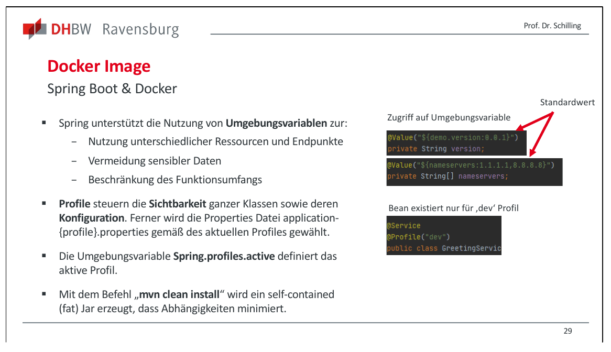

Spring bietet für die Nutzung in Docker Container verschiedene Vorteile. Eine sehr
wichtige Eigenschaft ist die Möglichkeit auf Umgebungsvariablen leicht zuzugreifen und
mit ihnen tief in das Verhalten der Anwendung einzugreifen. Der Haupteinsatzzweck für
Umgebungsvariablen ist die Definition von Ressourcen und Web-Endpunkten
entsprechend der aktuellen Laufzeit. Oft werden beispielsweise in der Entwicklung
andere Endpunkte von Webservices verwendet als jene im produktiven Betrieb. Darüber
hinaus können Umgebungsvariablen dazu eingesetzt werden, dass sensitive Daten
(bspw. Passwörter) erst gar nicht generiert werden. Dies kann insbesondere sehr nützlich
sein, wenn Logdateien dauerhaft gespeichert werden. Abschließend können
Umgebungsvariablen in Spring auch zur Einschränkung des Funktionsumfangs eingesetzt
werden, sodass unterschiedliche Implementierungen für die Entwicklungsumgebung und
produktive Umgebung verwendet werden.

Darüber hinaus zeichnet sich Spring durch die Nutzung von Profilen aus. Profile steuern
die Sichtbarkeit und Konfiguration ganzer Java Klassen, sodass es möglich ist vollkommen
andere Klassen für die Implementierung eines Interfaces im produktiven Betrieb und in
der Entwicklung einzusetzen. Ferner wird automatisch gemäß dem aktuell gewählten
Profil die entsprechende Properties Datei gemäß dem Schema application-
{profile}.properties ausgewählt. Das aktuelle Profil wird durch die Umgebungsvariable
Spring.profiles.active gesetzt.

Der Befehl ‚mvn clean install‘ kann dazu eingesetzt werden, dass mit Spring ein
sogenanntes Fat-Jar erzeugt wird, in das alle internen und externen Abhängigkeiten
integriert sind. Anschließend kann diese Jar Datei ohne weitere Abhängigkeiten
ausgeführt werden.

### Hands-On (Seite 30)

|  |  |
| --- | --- |
| `cd Spring2Docker` | Wechselt in das Projektverzeichnis auf dem Host |
| `mvn clean install` | Veranlasst Spring Boot eine Jar Datei zu bauen |
| `docker image build -t test .` | Baut ein neues Docker Image mit dem Tag ‚test‘ basierend auf dem Dockerfile |
| `docker container run -d -p 80:8080 test` | Erstellt einen neuen Docker Container und führt diesen aus. Port 80 des Host wird auf Port 8080 im Container weitergeleitet |

### Hands-On (Seite 31)

|  |  |
| --- | --- |
| Browser: http://localhost:80 | Führt eine HTTP-Anfrage auf dem Host unter Port 80 aus. Als Antwort kommt „ Herzlich Willkommen zur Veranstaltung Cloud Computing“ zurück. |
| `docker container list` | Gibt eine Liste mit allen laufenden Containern aus. |
| `docker container logs ce5` | Zeigt die Logs für die ContainerId, welche im letzten Schritt ermittelt wurde, bspw. ce5 |

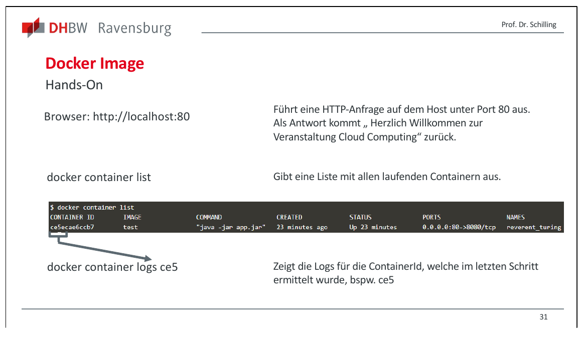

## 3. Best Practices

Wichtige Konventionen zur Konfiguration von Docker Containern und Images

### Baseimage (Seite 35)

- Das Baseimage sollte so ausgewählt werden, dass es nur die wirklich benötigte Funktionalität besitzt. Ein geringerer Funktionsumfang, reduziert die Downloaddauer, den Speicherbedarf und die Angriffsfläche:
  - ubuntu ~ 188 MB,
  - opensuse:latest ~ 82 MB
  - alpine ~ 5MB
- Es sollten offizielle Images für Baseimages bevorzugt werden, da bei diesen die Aktualisierungen und die Authentizität von Docker sichergestellt wird.
- Das Baseimage sollte mit einem Tag referenziert werden, niemals mit ‚latest‘.
- Images sollten stets bei Aktualisierungen des Baseimage neu gebaut werden. Nur so kann sichergestellt werden, dass die Container dauerhaft gepatcht sind.

Bei der Auswahl des Baseimage ist zu beachten, dass dieses nur den wirklich
notwendigsten Funktionsbedarf abdeckt und über so wenig wie möglich
ungenutzte Funktionalität verfügt. Mit einem geringen Funktionsumfang
reduziert sich nicht nur der notwendige Speicherbedarf, sondern auch die
Angriffsfläche. Wie groß der Funktionsumfang der Linux Distributionen variieren
kann, lässt sich an der Speichergröße sehen. Während opensuse weniger als die
Hälfte des Speichers von ubuntu benötigt, entfällt für die Linux Distribution
‚alpine‘ rund 35-mal weniger als für ubuntu.

Bei der Auswahl des Baseimage ist ferner darauf zu achten, dass ein offizielles
Image als Baseimage verwendet werden sollte. Offizielle Images haben den
Vorteil, dass Docker für deren Aktualisierung ein eigenes Team unterhält.

Ferner ist darauf zu achten, dass das Baseimage mit einem passenden Tag
referenziert wird. Dadurch ist es möglich, dass das Baseimage Aktualisierungen
empfangen kann.

Abschließend ist es wichtig, dass abgeleitete Images bei der Aktualisierung des
Baseimage neu gebaut werden. Es muss beachtet werden, dass alle
Aktualisierungen und Patches der Container zur Laufzeit nichtig werden, sobald
diese neu gestartet werden. Somit können dauerhafte Veränderungen der
Container nur über Anpassungen der Docker Images erreicht werden.

### Tagging (Seite 36)

- Das Weglassen einer expliziten Version, sodass ‚latest‘ gesetzt wird, ist strikt zu vermeiden da damit:
  - verschiedene Versionen in der Registry und auf dem Client referenziert werden.
  - nicht die ‚aktuelle‘, sondern die ‚unbekannte‘ Version gemeint ist.
  - keine Charakterisierung des Images erfolgt.
  - kein Rücksprung auf vorherige Versionen möglich ist.
- Für Abhängigkeiten sollten stable Tags (bspw. ‚1‘, ‚1.2‘, ‚1.2.1‘) eingesetzt werden um die neusten Änderungen zu bekommen.
- Nutzung von unique Tags für eigen erstellte Docker Images, um ungewolltes Caching zu vermeiden und Updatebedarf anzumelden
- Integration der BuildId oder Datum in unique Tags ist sinnvoll. Vorsicht bei GitTags, da sie keine Aktualisierungen der Baseimages abbilden.

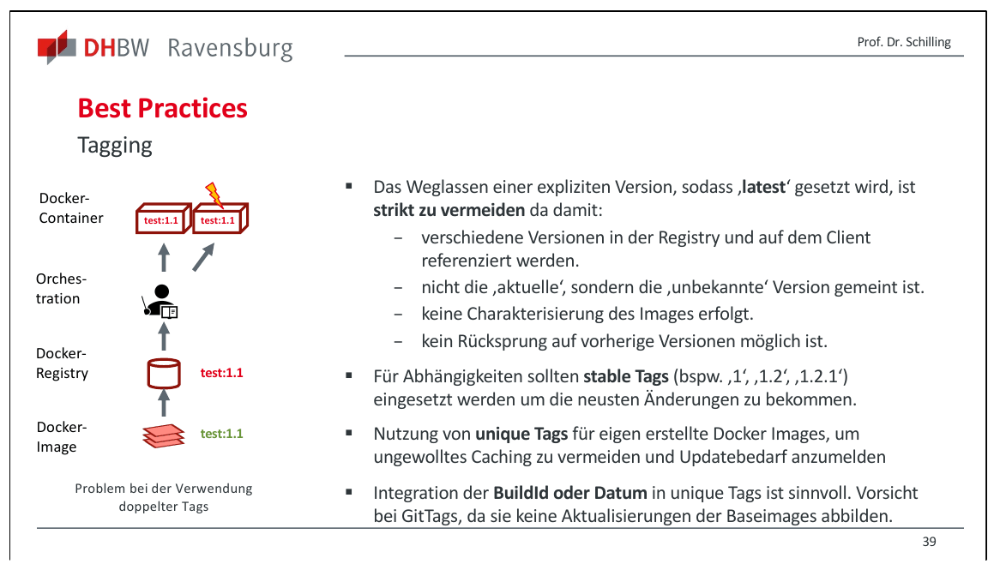

Bei der Verwendung von Tags ist die Nutzung von Versionsinformationen zentral.
Andernfalls wird ‚latest‘ gesetzt doch dies hat entscheidende Nachteile. Ein wichtiger
Nachteil ist, dass dadurch unterschiedliche Versionsstände auf dem Client und der
Docker Registry referenziert werden können. Entgegen der wörtlichen Übersetzung steht
‚latest‘ auch nicht für die aktuelle Version, sondern für die ‚unbekannte‘ Version. Ferner
erfolgt keine Charakterisierung der vorgenommenen Änderungen und es ist kein
Rücksprung auf die vorherige Version möglich.

Für die Nutzung in Baseimages sollten stets ‚stable Tags‘ zum Einsatz kommen, da hier
über das verwendete Schema eingestellt werden kann ob nur
Sicherheitsaktualisierungen oder auch Featureupdates berücksichtigt werden sollen.

Einzigartige Tags (unique Tags) sollten dagegen bei den erstellten Docker Images zum
Einsatz kommen, da diese vermeiden, dass durch Caching veraltete Versionsstände
ausgeliefert werden. Zur Generierung der einzigartigen Tags sollte die Id des
Bauvorgangs (BuildId) oder das aktuelle Datum eingesetzt werden. Es sollte jedoch
vermieden werden Git-Tags in die Tags einzuarbeiten, da diese Aktualisierungen der
Baseimages nicht berücksichtigen.

### Umgebungsvariablen (Seite 37)

- Umgebungsvariablen dürfen im Dockerfile nicht für sensible Daten wie Passwörter verwendet werden, da diese durch den ‘docker image history’ Befehl ausgelesen werden können.
- Stattdessen sollten sensible Daten zur Laufzeit via ‘--env’ Option eingebunden werden (vgl. MySQL image). Besser verschlüsselte Varianten nutzen.
- Bei vielen Umgebungsvariablen, die zur Laufzeit gesetzt werden, empfiehlt sich die Auslagerung in eine separate Datei, die zur Laufzeit via “--env-file” eingebunden wird.
- Lesereihenfolge: Dockerfile -> env-file -> Laufzeitargument
- Bei Umgebungsvariablen die nur zum Bau des Images verwendet werden, sollte ARG statt ENV verwendet werden.

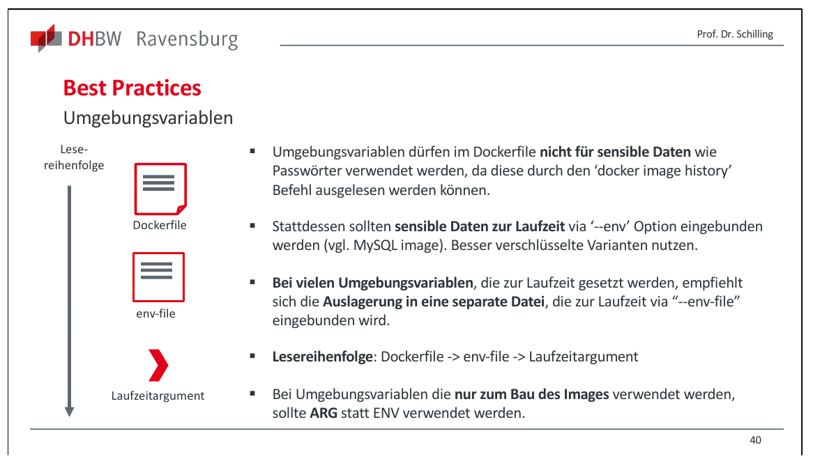

Wie bereits ausgeführt bieten Umgebungsvariablen einen universellen Mechanismus um
das Verhalten einer Anwendung zur Laufzeit anzupassen. Große Vorsicht ist jedoch
geboten bei der Verwendung von Umgebungsvariablen zum Setzen von sensiblen Daten
wie Passwörtern. Der Grund hierfür liegt darin, dass die Umgebungsvariablen eines
Docker Images mit dem Befehle ‚docker image history‘ ausgelesen werden können. Lässt
es sich nicht vermeiden, dass sensible Daten als Umgebungsvariable in die Anwendung
integriert werden, sollten diese unbedingt erst zur Laufzeit gesetzt werden. Generell ist
es empfehlenswert statt Umgebungsvariablen, verschlüsselte Mechanismen zum
Transport von sensiblen Daten zu wählen.

Sollten viele Umgebungsvariablen erst zur Laufzeit gesetzt werden kann der Docker-
Befehl in der Eingabeaufforderung schnell übersichtlich werden. Um dies zu vermeiden,
können die konkreten Werte in eine separate Datei ausgelagert werden die zur Laufzeit
via ‚--env-file‘ eingebunden wird. Die Reihenfolge in der die Umgebungsvariablen
ausgewertet werden beginnt mit dem Dockerfile. Danach wird die Datei ausgewertet die
via env-file angesprochen wird und abschließend werden die Laufzeitargumente
ausgewertet. Die Werte der Umgebungsvariablen können dabei gemäß der
Lesereihenfolge überschrieben werden.

Sollten Umgebungsvariablen nur zur Erstellung der Anwendung benötigt werden und
keinen Einfluss auf das Laufzeitverhalten der Anwendung ausüben, sollten sie mit dem
Kommando ARG statt ENV im Dockerfile verwendet werden.

### Schichtenarchitektur (Seite 38)

```dockerfile
FROM openjdk:8-jdk-alpine
COPY *.jar app/app.jar
ENV stage=prod
RUN mkdir app
WORKDIR target/
CMD ["java","-jar","/app.jar"]
```

- Die Schichtenarchitektur von Docker impliziert, dass je weiter oben ein Befehl steht, desto seltener sich dieser ändert.
  - Bei Abweichungen der Prüfsummen, wird die entsprechende Schicht und alle darunter liegenden neu gebaut
  - Schichten können nur dann wiederverwendet werden, wenn sie die gleiche Prüfsumme aufweisen
- Um unnötige Schichten zu vermeiden, empfiehlt es sich zusammengehörige RUN Befehle mit ‚&&‘ zu kombinieren.
- Die Befehle sollten stets so präzise wie möglich sein, ansonsten werden Schichten auch bei nicht relevanten Änderungen neu gebaut (insb. bei Wildcards).

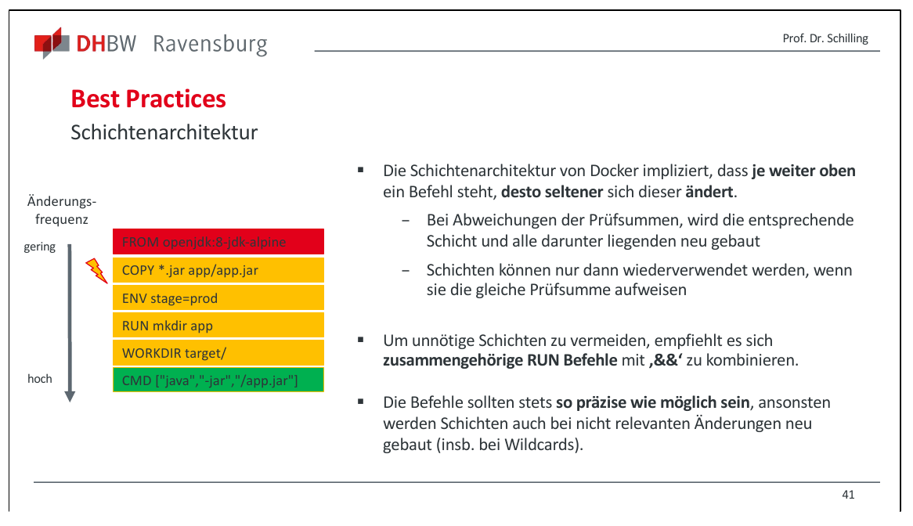

Wie wir bereits im Vorfeld gesehen haben ist die Schichtenarchitektur ein grundlegendes
Merkmal der Docker Images. Damit die Vorteile der Schichtenarchitektur realisiert
werden können, ist es wichtig die Befehle in einem Dockerfile gemäß ihrer
Änderungsfrequenz anzuordnen. Je seltener sich ein Befehl oder dessen referenzierten
Dateien ändern, desto höher im Dockerfile ist der Befehl anzuordnen. Im Gegensatz
hierzu sollte ein Befehl je häufiger er sich ändert weiter unten im Dockerfile angeordnet
sein. Das Schaubild zeigt ein fehlerhaft angeordneten COPY Befehl, der die gesamten
Vorteile der Schichtenbildung zunichtemacht. Hier wird das jar, das sich im Rahmen
jedes Compiliervorgangs ändert, bereits in der zweiten Zeile in das Dockerfile kopiert.
Infolgedessen werden im Rahmen jedes Compiliervorgangs Änderungen in dieser Schicht
erkannt und es müssen diese, sowie alle darunter liegenden Schichten neu gebaut
werden. Eine Wiederverwendung der anderen Schichten kann somit nicht umgesetzt
werden.

Eine weitere Empfehlung ist, unnötige Schichten zu vermeiden. Dies kann erreicht
werden indem einzelne RUN Befehle via ‚&&‘ kombiniert werden. Infolgedessen werden
weniger Schichten benötigt und die Bauzeit eines Images wird verkürzt.

Abschließend empfiehlt es sich die einzelnen Befehle im Dockerfile so präzise wie
möglich zu formulieren, sodass wirklich nur die notwendigen Dateien in das Docker
Image kopiert werden. Bei der Verwendung von Wildcards ist genaustens zu überprüfen
ob wirklich nur die notwendigsten Dateien kopiert werden. Der Grund hierfür liegt darin,
dass Änderungen an unnötigen Dateien, die dennoch kopiert werden ein Neubau der
entsprechenden Schicht und aller darunterliegenden anstößt.

### Non-Root Ausführung (Seite 39)

```dockerfile
FROM openjdk:8-jdk-alpine
ENV stage=prod
RUN addgroup -S spring && adduser -S springuser -G spring
USER springuser
RUN mkdir app
WORKDIR target/
COPY *.jar app/app.jar
EXPOSE 8080
CMD ["java","-jar","/app.jar"]
```

- In der Standardkonfiguration werden alle Prozesse im Container unter dem root (Admin) Account ausgeführt.
- Ein Ausbruch aus einem Containerprozess der mit root Rechten ausgeführt wird kann kritische Auswirkungen haben. Da ein Containerprozess gleichberechtigt zu einem nativen Prozess ist.
- Mit dem Kommando ‚USER‘ können Befehle des Dockerfile unter einem unprivilegierten User ausgeführt werden.
- In der Standardkonfiguration gehören neue Benutzer der Gruppe root (Admin) an, sodass manuell eine andere Gruppe angelegt werden muss.

Standardmäßig werden alle Befehle im Dockerfile unter dem Administratoraccout ‚root‘
ausgeführt. Dies birgt jedoch kritische Sicherheitsrisiken, da ein Ausbruch aus einem
Container folgenreiche Konsequenzen haben kann, da Containerprozesse
gleichberechtigt zu nativen Prozessen sind. Zur Vermeidung dieser Sicherheitsrisiken und
um die Nutzung von nicht-root Benutzern zu vereinfachen gibt es das Kommando USER
gefolgt von der konkreten UserId. Nach diesem Kommando werden alle folgenden
Befehle unter mit dem spezifizierten Useraccount durchgeführt. Hierbei muss beachtet
dass erst der User erstellt und dann einer neuen Benutzergruppe zugewiesen werden
muss, da neu angelegte Benutzer standardmäßig der Administratoren Gruppe
zugeordnet werden.

### Hands-On (Seite 40)

```dockerfile
FROM ubuntu
RUN apt-get update
RUN apt-get install openjdk-8-jdk –y
RUN apt-get install curl -y
RUN mkdir app
COPY target/* app/
CMD java -jar app.jar
```

- Nutzung eines kleineren Images samt präzisem Tag
- Bündelung der Anweisungen um Layer zu sparen
- Ausführung als non-root
- Explizites Copy-Statement
- Exec Notation für Sicherheit

```dockerfile
FROM openjdk:8-jre-alpine3.9
RUN apk update && apk add curl
RUN mkdir app
RUN addgroup -S spring && adduser -S springuser -G spring
USER springuser
WORKDIR app
COPY target/app.jar .
CMD ["java","-jar","app.jar"]
```

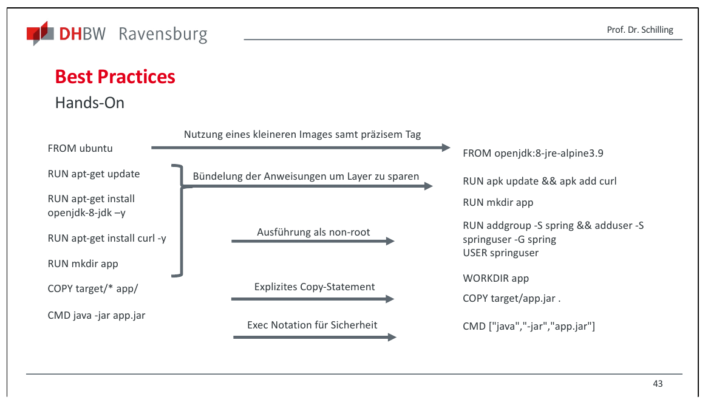

Abschließend wenden wir die gelernten Best-Practices, sowie unser bisheriges Wissen in
dieser praktischen Hands-On Übung an. Ausgangspunkt ist ein Dockerfile, das die neuste
Version des Ubuntu Betriebssystem als Baseimage hat, darauf aufbauend die Java
Laufzeitumgebung und Curl installiert und anschließend das Verzeichnis app erzeugt in
das es den Inhalt des Host-Verzeichnisses „target“ kopiert und die sich darin befindende
Jar Datei ausführt.

Die erste Verbesserung ist der Austausch eines umfassenden und nicht versionierten
Basisimage in ein zweckdienliches und versioniertes Basisimage. Als nächstes können die
Befehle zur Installation von curl zusammengefasst werden um unnötige Schichten
einzusparen. Java ist durch das Baseimage bereits installiert. Darüber hinaus sollte die
weitere Ausführung unter einem non-root Account stattfinden für den als nächstes der
Account samt Gruppe angelegt wird. Der Copy Befehl wird überführt sodass es nur noch
die Jar Datei kopiert und nicht mehr das gesamte Verzeichnis. Abschließend wird die
gewählte Shell-Notation für den Laufzeitbefehl in die Exec-Notation überführt um die
Sicherheit weiter zu härten.

## 4. Docker Storage

Speichern von Daten in Docker

### Motivation (Seite 44)

Docker Container

- Änderungen am Container sind flüchtig (vgl. r/w Layer)
- Immutable Infrastruktur

Datenbank

- Daten müssen nach Neustart der Serverinfrastruktur da sein.
- „Persistent Data“

Separation of Concerns (Trennung von Code und Daten)

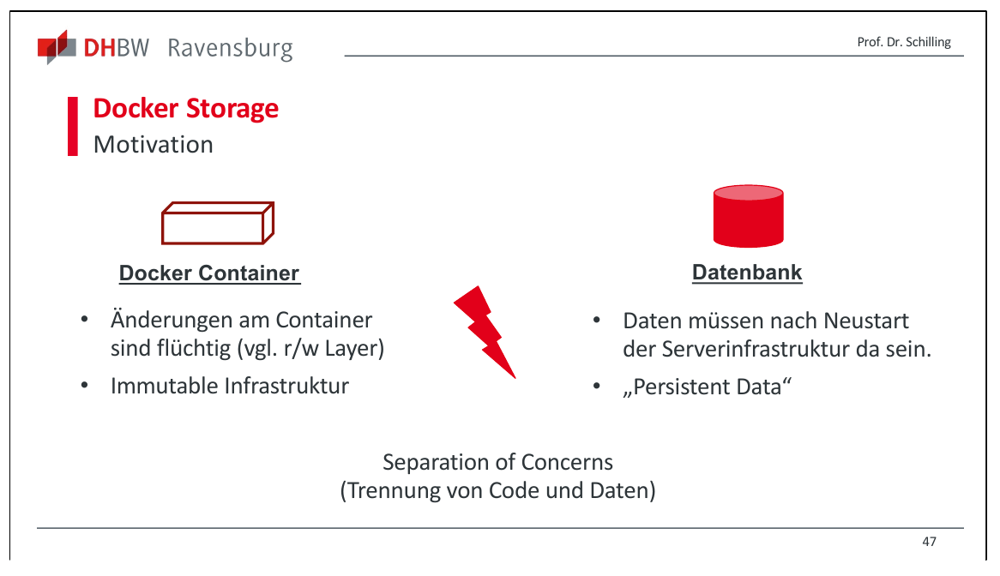

Docker Container unterscheiden sich grundlegend zu persistenten Datenspeichern wie
Datenbanken:

Container folgen dem Paradigma der immutable infrastructure – sie sind also
unveränderlich in dem Sinne, dass jede Änderung innerhalb eines Containers (z. B. durch
Schreiboperationen) nur in einer temporären, sogenannten r/w Layer abgelegt wird.
Diese Schicht ist ephemeral (flüchtig), d. h. sie geht nach dem Löschen des Containers
verloren.

Im Gegensatz dazu benötigen Datenbanken persistente Datenhaltung. Daten müssen
auch nach einem Neustart oder nach dem Austausch der Serverinfrastruktur weiterhin
verfügbar sein. Sie sind somit ein klassisches Beispiel für persistent data.

Docker Storage ermöglichen genau diese Trennung, indem sie Daten außerhalb der
ephemeral Container-Schicht ablegen. Damit bleibt die Anwendung immutable, während
ihre Daten dauerhaft und unabhängig vom Lebenszyklus des Containers gespeichert
werden können.

### Docker Volumes (Seite 45)

- Ein Docker Volume ist ein persistenter Speicher außerhalb des flüchtigen Docker Containers.
- Alle Veränderungen in einem spezifizierten Verzeichnis des Containers werden in das Volume geschrieben.
- Das Verzeichnis, das in ein Volume gespeichert wird kann im Dockerfile spezifiziert werden Bspw. VOLUME /var/lib/mysql
- Im Rahmen des docker container run Befehls wird ein Volume mit dem Container verknüpft.

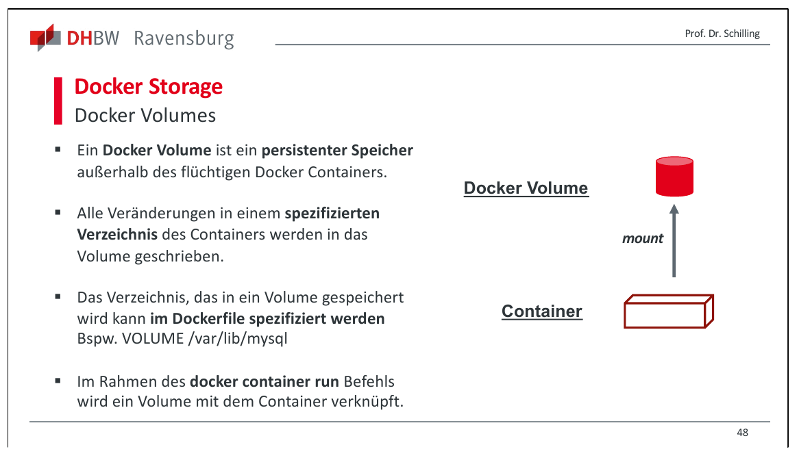

Ein Docker Volume stellt einen externen Speicherbereich dar, der außerhalb des
Lebenszyklus eines Containers liegt. Dadurch wird die Trennung zwischen Code
(Container) und Daten (Volume) technisch umgesetzt. Wenn ein Container gelöscht oder
neu erstellt wird, bleiben die in einem Volume gespeicherten Daten bestehen.

Wird ein Verzeichnis innerhalb des Dockerfiles als Volume deklariert, so werden alle
Änderungen in diesem Verzeichnis nicht mehr in den flüchtigen r/w Layer geschrieben,
sondern in das Volume. Dieses Volume kann dabei lokal auf dem Hostsystem oder auf
einem entfernten Speicher liegen.

Im Dockerfile wird dies bspw. mit dem Befehl VOLUME /var/lib/mysql definiert.
Beim Start eines Containers wird das Volume eingebunden (gemountet). Somit bleibt die
Anwendungslogik immutable, während die Daten persistent gespeichert werden.

### Überblick Docker Volumes (Seite 46)

Docker Volume

`myDB`

Dockerfile

```dockerfile
…
VOLUME /var/lib/mysql
…
```

Docker Container

```sh
docker container run –v myDB:/var/lib/mysql mysql:8
```

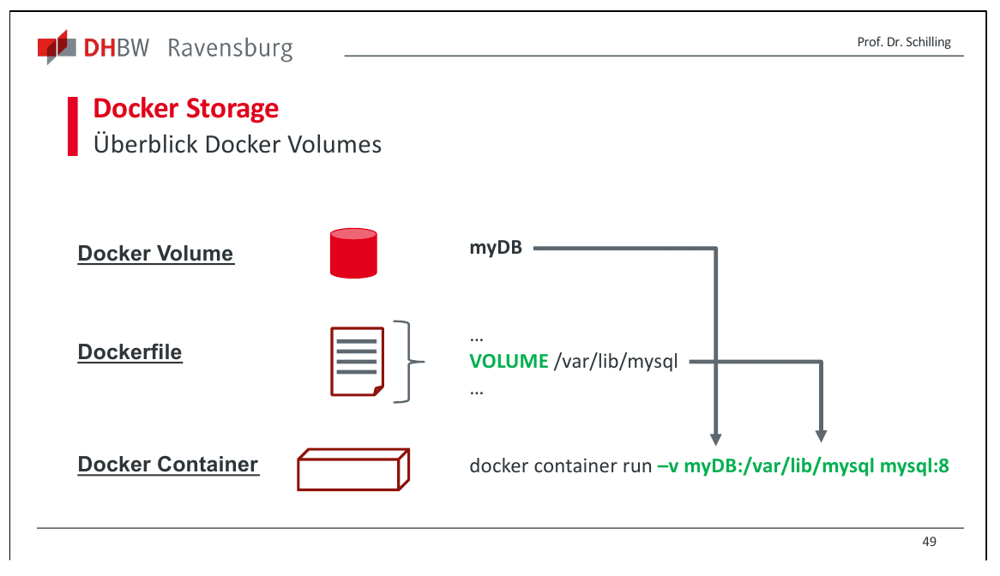

Die folgende Folie gibt einen Überblick über das Zusammenspiel von Dockerfile, Docker
Container und Data Volume:

Das Volume mit dem Namen myDB repräsentiert einen persistenten Speicherbereich,
der außerhalb der flüchtigen Containerstruktur liegt.

Im Dockerfile wird bereits beim Bau eines Images festgelegt, welche Verzeichnisse als
Volume behandelt werden sollen. Dies geschieht über den Befehl „Volume“ gefolgt vom
Verzeichnispfad, der in das Data Volume geschrieben werden soll.

Bei der Ausführung des Containers erfolgt die Verknüpfung des logischen Volumes mit
dem Containerverzeichnis über den Parameter -v. Der Befehl: docker container run -v
myDB:/var/lib/mysql mysql:8 bindet das Volume myDB an den Container an.
Änderungen innerhalb des Verzeichnisses /var/lib/mysql werden fortan im Volume
gespeichert und bleiben somit persistent.

### Überblick wichtiger Befehle zu Docker Volumes (Seite 47)

|  |  |
| --- | --- |
| `docker volume create myDB` | Erstellt ein neues Volume auf dem Host |
| `docker volume ls` | Listet alle auf einem Host gespeicherten Volumes auf |
| `docker volume inspect myDB` | Gibt Details zum Volume „myDB“ aus. Beachte: Auf Windows und MacOS kann auf die Volume Verzeichnisse nicht einfach zugegriffen werden, da Docker mittels VM ausgeführt wird. |
| `docker volume rm myDB` | Löscht das Volume mit dem Namen ‚myDB‘. |
| `docker volume prune` | Löscht alle nicht verwendeten Volumes. |

Die folgende Übersicht gibt einen Überblick über die wichtigsten Befehle zum Verwalten
von Docker Volumes:

Der Befehl docker volume ls listet alle auf dem Docker-Host gespeicherten Volumes auf.
Er ist insbesondere hilfreich, um einen Überblick über vorhandene Volumes zu erhalten
und ungenutzte Volumes zu identifizieren.

Mit dem Befehl docker volume inspect myDB lassen sich detaillierte Informationen zu
einem spezifischen Volume abrufen, etwa Speicherort, Mount-Pfade und Nutzung durch
Container.

Der Befehl docker volume rm myDB wird das Volume myDB vom Hostsystem entfernt.

Der Befehl docker volume prune löscht alle nicht verwendeten Volumes auf dem Host.

### Bind Mounts (Seite 48)

- Bind Mounts sind eine Verknüpfung zwischen einer Datei oder einem Verzeichnis des Hosts und dem Container.
- Bind Mounts werden nicht im Dockerfile sondern ausschließlich im docker container run Befehl spezifiziert.
- Hierbei wird erst der Pfad auf dem Host zum zu verknüpfenden Verzeichnis und dann der korrespondierende Endpunkt im Container spezifiziert.

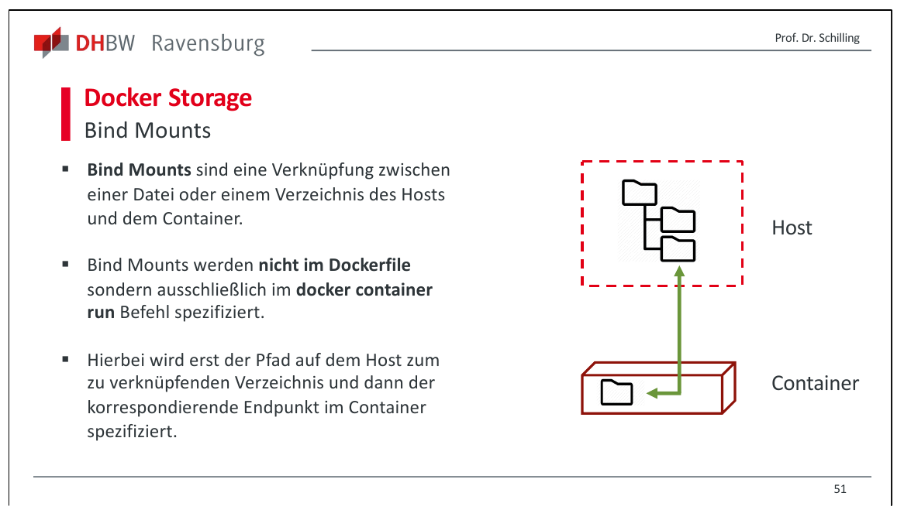

Während Docker Volumes von Docker verwaltet werden, ermöglichen Bind Mounts eine
direkte Kopplung an das Dateisystem des Hosts, was sie flexibler, aber auch
fehleranfälliger macht. Bind Mounts verknüpfen ein Verzeichnis oder eine Datei des
Hostsystems mit einem Pfad innerhalb des Containers. Dadurch können Daten in
Echtzeit zwischen Host und Container synchronisiert werden. Änderungen am Host
spiegeln sich sofort im Container wider und umgekehrt. Dies ist insbesondere in der
Entwicklungsphase von Vorteil, da Quellcode, Konfigurationsdateien oder Logfiles
während der Laufzeit editiert und sofort sichtbar werden. Im Gegensatz zu Volumes
werden Bind Mounts nicht im Dockerfile definiert, sondern ausschließlich beim Starten
des Containers

### Bind Mounts (Seite 49)

Data Volume

`/home/student/myproject`

Docker Container

```sh
docker container run –v /home/student/myproject:/app/myproject mytest
```

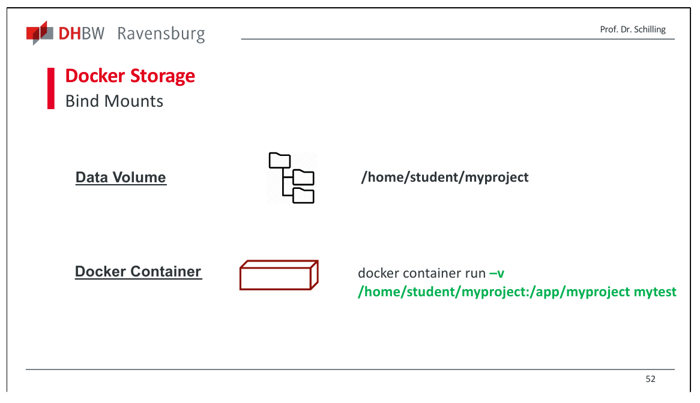

Diese Folie verdeutlicht die konkrete Umsetzung von Bind Mounts anhand eines
praktischen Beispiels. Konkret wird hier ein lokales Verzeichnis des Hosts
(/home/student/myproject) mit einem Verzeichnis im Container (/app/myproject)
verknüpft. Dadurch entsteht eine direkte Kopplung zwischen Host-Dateisystem und
Container, bei der Änderungen auf einer Seite unmittelbar auf die andere übertragen
werden.

Diese Vorgehensweise ist besonders in Entwicklungsumgebungen nützlich, z. B. wenn
Quellcode oder Konfigurationsdateien auf dem Host bearbeitet und sofort im Container
sichtbar werden sollen.

Die Verknüpfung erfolgt über den Befehl: docker container run -v
/home/student/myproject:/app/myproject

Die Option -v steht für volume und definiert hier ein Bind Mount, bestehend aus zwei
Pfadangaben:

Host-Pfad: /home/student/myproject → verweist auf das lokale Verzeichnis auf dem
Hostsystem.

Container-Pfad: /app/myproject → definiert den Mount-Punkt im Container.

## 5. Docker Networking

Netzwerkgrundlagen von Docker

### Motivation (Seiten 53–54)

- Ein entscheidender Mehrwert entsteht durch die Kommunikation zwischen Containern und der Außenwelt
- Docker Networking erlaubt pro Use Case gezielt Tradeoffs zwischen Einfachheit und Isolation zu machen.
- Netzwerkmodi (Treiber) für Docker Container
  - bridge: isoliertes Hostnetz mit Portfreigabe
  - host: max. Performance, min. Isolation
  - none: max. Isolation, Airgap

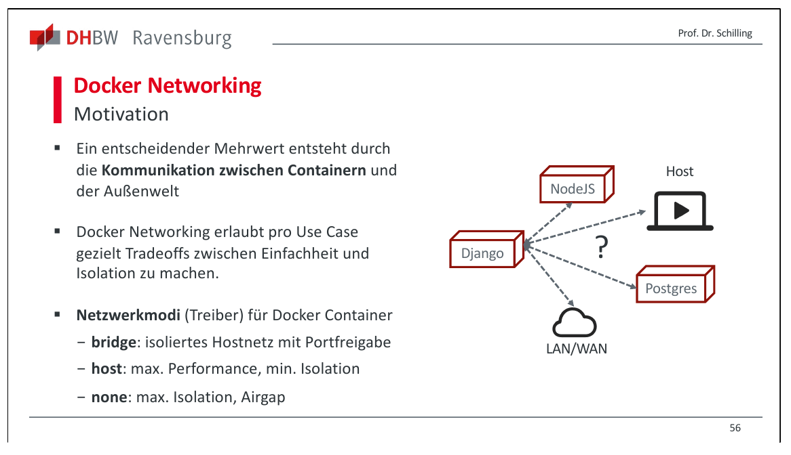

Die Kommunikation zwischen Containern sowie zwischen Containern und der Außenwelt
ist ein zentraler Bestandteil moderner Containerarchitekturen. Erst durch das
Zusammenspiel mehrerer spezialisierter Container – etwa eines Backends (Django),
eines Frontends (NodeJS) und einer Datenbank (Postgres) – entsteht der eigentliche
Mehrwert verteilter Anwendungen. Docker Networking liefert hierfür die technischen
Grundlagen und sorgt dafür, dass Container flexibel und kontrolliert miteinander
interagieren können.

Docker folgt dabei dem Designprinzip „Batteries included, but removable“:
Standardmäßig stehen gebrauchsfertige Netzwerkfunktionen zur Verfügung, die den
Einstieg erleichtern. Gleichzeitig bleibt die Architektur offen und erweiterbar, sodass
Entwickler alternative Netzwerk-Setups, benutzerdefinierte Treiber oder externe
Lösungen einsetzen können.

Über die Wahl des Netzwerkmodus (oder Treibers) lässt sich gezielt steuern, wie stark
Container voneinander und vom Host isoliert sind:

bridge: Container laufen in einem isolierten virtuellen Hostnetz und kommunizieren über
interne IP-Adressen. Über Portfreigaben kann der Zugriff von außen gesteuert werden.
Dieser Modus ist Standard und bietet ein gutes Gleichgewicht zwischen Sicherheit und
Einfachheit.

host: Der Container teilt sich den Netzwerkstack des Hosts, wodurch die Kommunikation
besonders performant, aber kaum isoliert ist. Diese Variante eignet sich für
Performance-kritische Anwendungen.

none: Der Container wird vollständig vom Netzwerk getrennt (Airgap). Dies sorgt für
maximale Sicherheit, schränkt aber die Funktionalität stark ein.

Die Abbildung verdeutlicht das Zusammenspiel: Mehrere Container sollen untereinander
kommunizieren und gleichzeitig über den Host oder das externe Netzwerk erreichbar
sein. Docker Networking ermöglicht, diese Balance zwischen Einfachheit, Flexibilität und
Isolation gezielt zu gestalten.

### Network: Bridge (Standard) (Seite 55)

- Alle Docker Container sind in einem eigenen Netzwerk, das über den Host zur Außenwelt verbunden ist.
- Innerhalb des ‘bridge‘ Netzwerk können die Container ohne Beschränkung aufeinander zugreifen.
- Namensauflösung innerhalb des Netzwerks über Docker-DNS (nur bei ‚user-defined network‘).
- Jeder Zugriff von außen muss explizit über die Publish-Option (-p) freigegen werden.

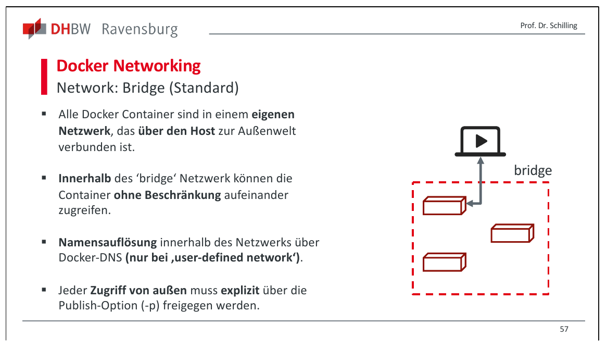

Das bridge-Netzwerk bildet den Standardmodus im Docker-Networking und stellt die
Basis für die Kommunikation zwischen Containern auf demselben Host dar. Jeder neu
gestartete Container wird automatisch in ein virtuelles bridge-Netz eingebunden, das
über den Host mit der Außenwelt verbunden ist. Damit schafft Docker ein in sich
geschlossenes, isoliertes Netzwerk, das dennoch gezielt für den externen Zugriff
geöffnet werden kann.

Innerhalb eines ‚user-defined bridge network‘ können Container ohne zusätzliche
Konfiguration miteinander kommunizieren. Sie greifen über interne IP-Adressen oder
Container-Namen aufeinander zu, was die Zusammenarbeit von Komponenten wie
Webserver, Backend und Datenbank erleichtert. Diese interne Kommunikation erfolgt
vollständig innerhalb des isolierten bridge-Netzwerks und bleibt damit vom Hostsystem
und anderen Netzwerken abgeschirmt. Die automatische Namensauflösung existiert
nicht für das ‚default bridge network‘.

Der Zugriff von außen – etwa vom Hostsystem oder von externen Clients – erfolgt nicht
automatisch. Damit ein Container von außerhalb erreichbar ist, muss der gewünschte
Port explizit über die -p-Option freigegeben werden

### Network: Bridge (Standard) (Seite 56)

```sh
docker container run –p 80:80 nginx
```

1. Einbindung des Containers in ‚bridge‘ Netzwerk
2. Außerhalb des ‘bridge‘ Netzwerks kann nur der Host via der virtuellen NIC ‘docker0‘ auf den Container zugreifen.
3. Alle Container innerhalb des ‘bridge‘ Netzwerk können uneingeschränkt miteinander kommunizieren.

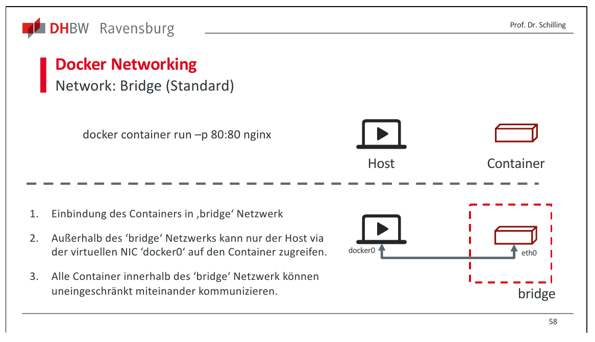

Der Befehl „docker container run -p 80:80 nginx“veranschaulicht den typischen
Kommunikationsverlauf:

Einbindung in das Bridge-Netzwerk: Der Container wird in das Standardnetzwerk bridge
integriert. Dieses virtuelle Netzwerk ist unabhängig vom physischen Hostnetz und isoliert
Container standardmäßig voneinander und vom Host.

Verbindung über die Bridge-Schnittstelle: Der Zugriff von außen erfolgt über die
virtuelle Netzwerkkarte docker0, die Docker auf dem Host anlegt. Nur der Host selbst
kann über diese Schnittstelle direkt mit dem Container kommunizieren. Der
Portparameter -p im Befehl sorgt dafür, dass eingehende Verbindungen an Port 80 des
Hosts an Port 80 des Containers weitergeleitet werden.

Interne Containerkommunikation: Container, die sich im gleichen bridge-Netz befinden,
können sich gegenseitig über ihre IP-Adressen erreichen. Eine automatische
Namensauflösung über Containernamen steht dagegen bei benutzerdefinierten Bridge-
Netzwerken zur Verfügung. Dieser Modus eignet sich besonders für Anwendungen, die
aus mehreren interagierenden Komponenten bestehen (z. B. Webserver, API,
Datenbank).

### Network: Host (Seite 57)

- Bei Verwendung des ‘host‘ Treibers, ist der Docker Container direkt mit dem Host-Netzwerk verbunden.
- Konkret bekommt der Container keine virtuelle Netzwerkschnittstelle sondern greift auf die „echte“ eth0 Schnittstelle des Hosts zu.
- Eine explizite Portweiterleitung entfällt
- Der Container kann von Teilnehmern des Host-Netzwerks uneingeschränkt erreicht werden (Sicherheitsrisiko !).

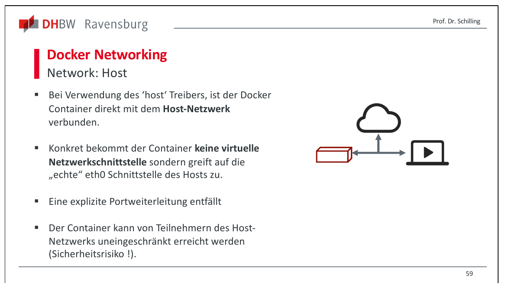

Die Verwendung des host-Netzwerktreibers verbindet den Container direkt mit dem
Netzwerk des Hosts. Im Gegensatz zum bridge-Modus entfällt hier die Zwischenschicht
aus virtuellen Netzwerkinterfaces und NAT. Der Container teilt sich denselben
Netzwerkstack wie das Hostsystem – er nutzt also die reale Netzwerkschnittstelle (z. B.
eth0) des Hosts, anstatt über eine virtuelle Bridge (docker0) kommunizieren zu müssen.

Durch diese Architektur erreicht der Container maximale Netzwerkperformance, da
keine zusätzliche Paketverarbeitung über virtuelle Interfaces oder Adressübersetzungen
erfolgt. Der Datenverkehr läuft praktisch nativ über den Host. Allerdings verliert der
Container dadurch auch einen wesentlichen Teil seiner Isolation: Er ist vollständig im
Hostnetz sichtbar und von allen Teilnehmern desselben Netzwerks direkt erreichbar. Dies
kann ein erhebliches Sicherheitsrisiko darstellen, insbesondere wenn der Container
Dienste ohne Zugriffsbeschränkung anbietet.

Gleichzeitig eignet sich der host-Modus sehr gut für Szenarien, in denen ein Container
bewusst Netzwerkdienste für andere Teilnehmer des Hostnetzwerks bereitstellen soll –
etwa Webserver, Monitoring- oder Proxydienste. Da der Container im Hostnetz arbeitet,
ist keine Portweiterleitung über -p erforderlich; Dienste sind automatisch über die IP-
Adresse und Ports des Hosts erreichbar.

Diese Netzwerkoption steht im Spannungsfeld zwischen Performance und Sicherheit:
maximale Geschwindigkeit bei minimaler Isolation. Die Entscheidung für den host-
Modus sollte deshalb stets bewusst getroffen und durch zusätzliche
Sicherheitsmaßnahmen (z. B. Firewalls oder Zugriffskontrolle) abgesichert werden.

### Network: Host (Seite 58)

```sh
docker container run –p 80:80 --net=host nginx
```

1. Einbindung des Containers in das ‚host‘ Netzwerk
2. Container verwendet den Netzwerkstack des Hosts
3. Vorsicht vor Zuweisung des gleichen Ports für eine Anwendung auf dem Host sowie dem Container

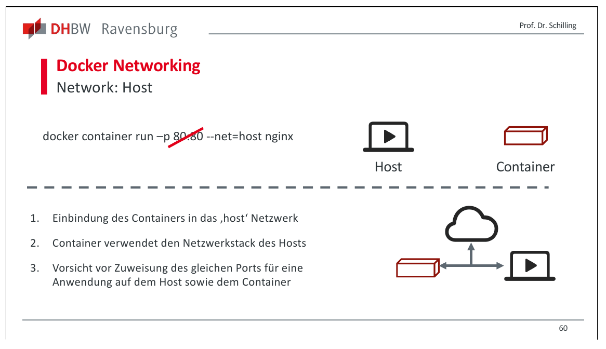

Der angegebene Befehl „docker container run --net=host nginx“ zeigt, wie ein Container
direkt in das Hostnetz integriert wird. Dabei sind folgende Punkte zentral:

Einbindung in das Hostnetzwerk: Der Container wird ohne virtuelle Bridge oder Subnetz
gestartet und nutzt unmittelbar das bestehende Hostnetz.

IP-Adressierung: Der Container erhält keine eigene IP aus einem isolierten Docker-
Subnetz, sondern teilt sich den gesamten Netzwerkstack mit dem Host. Damit ist er für
alle Teilnehmer des Netzwerks direkt erreichbar – genau wie ein regulärer Dienst auf
dem Host.

Portkonflikte: Da Container und Host denselben Netzwerkstack nutzen, können
Portüberschneidungen auftreten. Wird beispielsweise Port 80 sowohl vom Container als
auch vom Host belegt, führt dies zu einem Konflikt. Daher ist beim Einsatz des host-
Modus besondere Sorgfalt bei der Portwahl geboten.

### Network: None (Seite 59)

- Wird der „none“-Treibers verwendet, erhält der Container keine Netzwerkschnittstelle und ist damit von der Außenwelt isoliert.
- Der Host kann den Container nur über die Docker Engine (bspw. via „docker container exec“) erreichen.
- Ermöglicht Airgap-Umgebungen für sicherheitskritische Anwendungen, sowie Sandboxing und isolierte Tests.

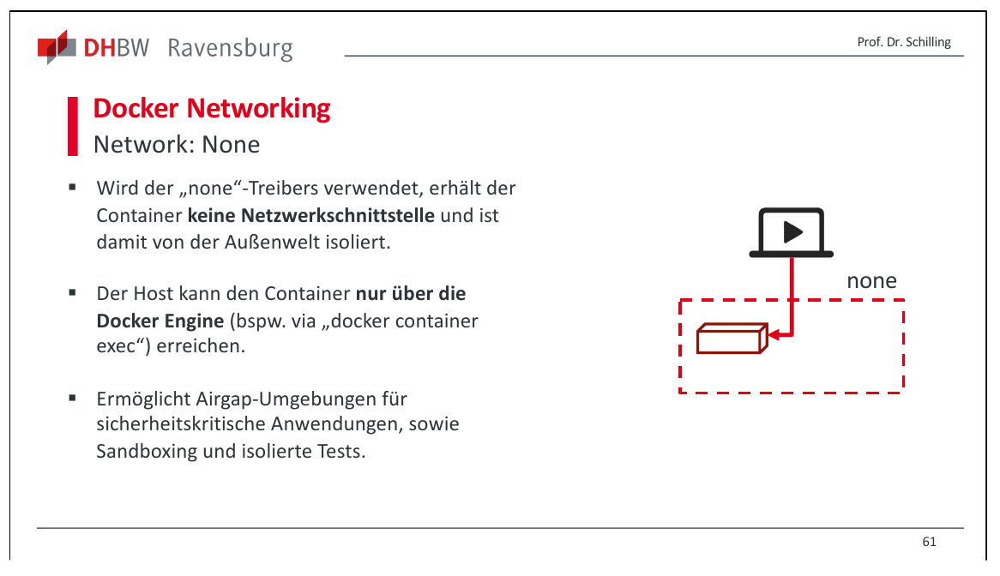

Die Verwendung des none-Netzwerktreibers führt dazu, dass der Container keine
Netzwerkschnittstelle erhält und vollständig von externen Kommunikationspfaden
isoliert ist. Es wird keine virtuelle Bridge, keine IP-Adresse und kein Routing eingerichtet.
Damit ist der Container von der Außenwelt – einschließlich des Hosts und anderer
Container – abgetrennt. Diese vollständige Netzwerkisolation schafft eine Umgebung mit
maximaler Sicherheit und minimaler Angriffsfläche.

Der Zugriff auf den Container ist in diesem Modus ausschließlich über die Docker Engine
selbst möglich, zum Beispiel über den Befehl: docker container exec -it <container>
/bin/bash

Der Container kann somit zwar intern Prozesse ausführen, jedoch keine Verbindungen
nach außen initiieren oder empfangen. Diese starke Isolation macht den none-Modus
besonders geeignet für sicherheitskritische Szenarien, in denen bewusst kein
Datenaustausch stattfinden soll.

Typische Einsatzgebiete sind Airgap-Umgebungen, in denen Systeme aus Sicherheits-
oder Compliance-Gründen vollständig vom Netzwerk getrennt betrieben werden
müssen, sowie Sandboxing und isolierte Tests. Beispielsweise kann eine Anwendung in
einem none-Container unter realen Laufzeitbedingungen getestet werden, ohne dass
unbeabsichtigte Netzwerkkommunikation möglich ist.

Dieser Netzwerkmodus steht somit am entgegengesetzten Ende des Spektrums zu host:
maximale Isolation statt maximaler Performance.

### None Network (Seite 60)

```sh
docker container run --net=none nginx
```

1. Einbindung des Containers in ‚none‘ Netzwerk
2. Container besitzt keine virtuelle Netzwerkkarte
3. Container kann nicht nach außen kommunizieren und nur vom Host aus zugegriffen werden.

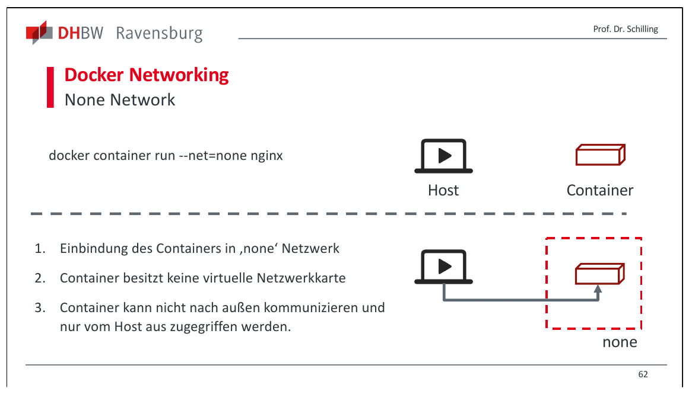

Der in der Folie gezeigte Befehl „docker container run --net=none nginx“ zeigt die
vollständige Isolation des Containers – er kann zwar Prozesse ausführen (wie den NGINX-
Webserver), jedoch keine eingehenden oder ausgehenden Verbindungen herstellen.
Somit wird keine Portweiterleitung definiert. Docker erstellt in diesem Fall keine virtuelle
Netzwerkschnittstelle – weder eine Bridge noch ein virtuelles Interface wie eth0.
Dadurch ist der Container vollständig isoliert und kann weder nach außen
kommunizieren noch von anderen Containern oder externen Systemen erreicht werden.
Die Kommunikation mit dem Container ist ausschließlich über die Docker Engine
möglich, beispielsweise über: docker container exec -it <container> /bin/bash

### Überblick wichtiger Befehle (Seite 61)

|  |  |
| --- | --- |
| `docker network ls` | Listet alle Netzwerke samt ihrem Treiber auf. |
| `docker network inspect bridge` | Gibt Details zum Netzwerk „bridge“ aus. |
| `docker network create my_net --driver=bridge` | Erstellt ein neues Netzwerk mit dem Namen my_net und dem Treiber „bridge“ |
| `docker network connect my_net my_cont` | Verbindet ein Container mit einem Netzwerk |
| `docker network disconnect my_net my_cont` | Trennt ein Container von einem Netzwerk |

Die dargestellte Übersicht fasst die zentralen Kommandos für das Management von
Netzwerken in Docker zusammen:

docker network ls -> Listet alle vorhandenen Netzwerke des Docker-Hosts auf,
einschließlich ihrer Treiber (bridge, host, none oder benutzerdefiniert). Der Befehl gibt
einen schnellen Überblick über die aktuelle Netzwerkstruktur und ist häufig der erste
Schritt bei der Diagnose oder Planung von Containerverbindungen.

docker network inspect bridge -> Liefert Detailinformationen zum angegebenen
Netzwerk, beispielsweise Subnetz, IP-Bereich, verbundene Container und Treibertyp.
Besonders hilfreich ist dieser Befehl, um zu verstehen, welche Container aktuell einem
Netzwerk zugeordnet sind und wie deren interne IP-Adressen lauten.

docker network create my_net --driver=bridge -> Erstellt ein benutzerdefiniertes
Netzwerk mit dem Namen my_net auf Basis des angegebenen Treibers.

docker network connect my_net my_cont -> Verbindet einen bestehenden Container
nachträglich mit einem bestimmten Netzwerk. So können Container flexibel mehreren
Netzwerken gleichzeitig angehören, etwa um Dienste in verschiedenen logischen
Umgebungen bereitzustellen.

docker network disconnect my_net my_cont -> Trennt einen Container von einem
Netzwerk. Dies wird insbesondere genutzt, um Zugriffspfade temporär zu deaktivieren
oder Container gezielt zu isolieren, ohne sie zu stoppen oder zu löschen.

## 6. Docker Compose

Starten von „Container-Gruppen“

### Motivation (Seite 64)

- Die bisherige Konfiguration von Volumes und Networks erfordert viel manuellen Aufwand und das Setzen von Optionen.
- Des weiteren müssen die Container einzeln von Hand gestartet werden, was die Automatisierbarkeit erschwert.
- Docker Compose verwendet eine deklarative Konfigurationsdatei, mit der komplexe Umgebungen einfach beschrieben und gestartet werden können.

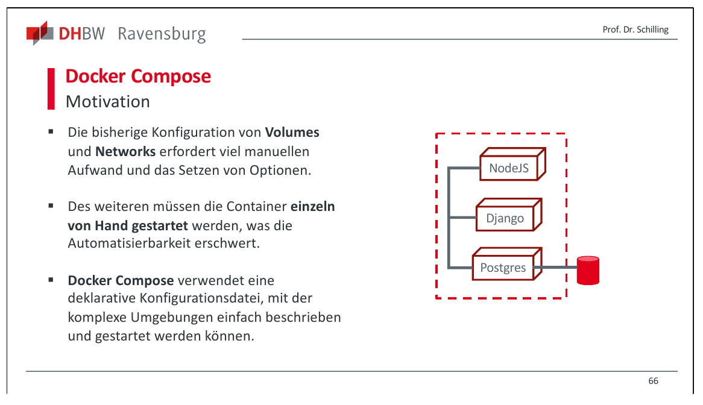

Die Verwaltung komplexer Containerumgebungen mit mehreren Services erfordert in
der Standard-Docker-CLI viele manuelle Schritte. Jede Komponente – etwa Anwendung,
Datenbank und Backend – muss einzeln gestartet, verknüpft und mit den passenden
Volumes und Netzwerken konfiguriert werden. Dieses Vorgehen ist fehleranfällig, schwer
reproduzierbar und erschwert die Automatisierung, insbesondere in Entwicklungs- und
Testumgebungen.

Docker Compose adressiert genau dieses Problem. Es führt einen deklarativen Ansatz für
Containerkonfigurationen ein: Statt Container, Netzwerke und Volumes über einzelne
Befehle (docker run, docker network create, docker volume create) zu definieren,
werden alle Komponenten in einer zentralen Datei (compose.yaml) beschrieben. Diese
Datei legt fest, welche Services existieren, wie sie miteinander verbunden sind und
welche Ressourcen sie nutzen.

Der große Vorteil besteht darin, dass eine vollständige, mehrschichtige Umgebung mit
einem einzigen Befehl („docker compose up “) gestartet werden kann. Damit wird aus
einer Sammlung einzelner Container eine orchestrierte Anwendung mit klar definierten
Abhängigkeiten.

### YAML (Seite 65)

- YAML (YAML Ain‘t another Markup Language) ein menschenlesbares Datenserialisierungsformat.
- Struktur wird über Leerzeichen abgebildet
- Zuweisungen erfolgen durch Schlüssel-Wert Notation (vgl. JSON)
- Zeilenkommentare werden mit einem # gekennzeichnet

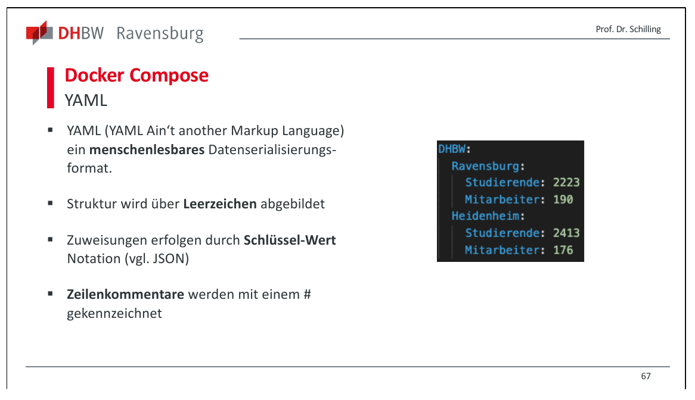

Das YAML-Format bildet die Grundlage für die Konfigurationsdateien von Docker
Compose. Es handelt sich um ein menschenlesbares Datenserialisierungsformat, das
darauf ausgelegt ist, komplexe Strukturen übersichtlich und einfach editierbar
darzustellen. Der Name YAML steht für “YAML Ain’t Another Markup Language” und
betont damit, dass es – anders als XML oder HTML – kein Auszeichnungs-, sondern ein
reines Datenbeschreibungsformat ist.

Die Struktur einer YAML-Datei basiert auf Einrückungen mittels Leerzeichen statt
Klammern oder Kommata. Diese Formatierung spiegelt hierarchische Beziehungen
zwischen Elementen wider. Damit ist YAML besonders geeignet für
Konfigurationsdateien, in denen verschachtelte Objekte oder abhängige Strukturen – wie
Services, Volumes und Netzwerke – übersichtlich dargestellt werden müssen.

Durch diese klare, leicht lesbare Syntax können Konfigurationen auch ohne
Programmierkenntnisse verstanden und angepasst werden. Kommentare beginnen mit
dem Zeichen # und dienen zur Dokumentation oder zum temporären Deaktivieren von
Einträgen.

### YAML (Seite 66)

- YAML unterstützt die primitiven Datentypen: String, Int, Double und Boolean.
- Die Datentypen werden implizit abgeleitet, basierend auf dem Format des Wertes.
- Strings können auch mit Anführungszeichen oder Hochkommas deklariert werden.
- YAML respektiert die Groß-Kleinschreibung (Case-Sensitive)

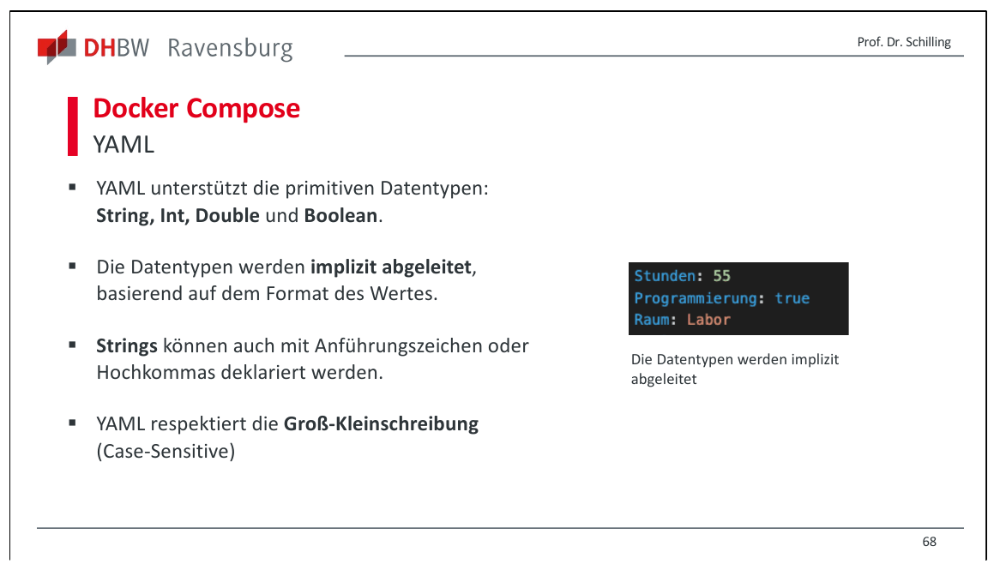

YAML unterscheidet sich von klassischen Programmiersprachen oder Datenformaten wie
JSON dadurch, dass Datentypen implizit abgeleitet werden. Das bedeutet, dass der Typ
eines Wertes automatisch anhand seines Formats erkannt wird – ohne dass eine
explizite Typdeklaration erforderlich ist. Hierbei werden primitive Datentypen wie String
(z. B. "Labor“), Int (z. B. „55“), Double (z. B. „3.14“) und Boolean (z. B. „true“).

Wichtig ist außerdem, dass Strings optional in Anführungszeichen gesetzt werden
können – das ist nur notwendig, wenn Sonderzeichen, Leerzeichen oder spezielle
Schlüsselwörter enthalten sind (z. B. "true" als Text statt als boolescher Wert). YAML
unterscheidet außerdem strikt zwischen Groß- und Kleinschreibung (case-sensitive).

### YAML (Seite 67)

- Als erweiterte Datentypen unterscheidet YAML Objekte, Dictionaries und Listen.
- Die Zuordnung von Attributen zu Objekten geschieht über die Einrückung.
- Die Einträge in einem Dictionary werden nicht geordnet abgelegt und können über ihren Namen angesprochen werden (bspw. DHBW[Heidenheim])
- Bei Listen werden die Werte in geordneter Reihenfolge gespeichert.

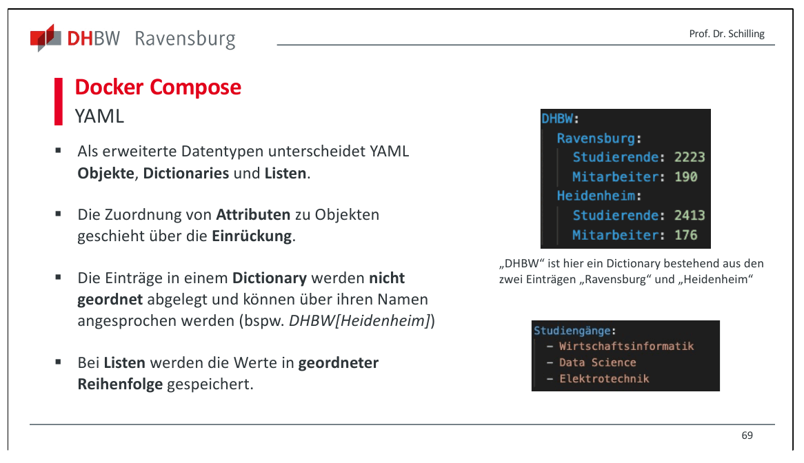

Über die primitiven Datentypen hinaus erlaubt YAML die Modellierung komplexer
Datenstrukturen, die in Docker Compose zur Beschreibung verschachtelter
Konfigurationen (z. B. Services, Netzwerke und Volumes) notwendig sind.

Hierzu werden die folgenden drei Strukturtypen unterschieden: Objekte, Dictionaries
(Schlüssel-Wert-Zuordnungen) und Listen (geordnete Sequenzen).

Bei YAML erfolgt die Strukturierung der Objekte durch Einrückung. Jede zusätzliche
Ebene der Einrückung repräsentiert eine weitere logische Verschachtelung.

Dictionaries (vergleichbar mit Maps oder JSON-Objekten) speichern Schlüssel-Wert-
Paare. Die Einträge sind nicht geordnet und können über ihre Schlüssel angesprochen
werden.

Listen (eingeleitet durch Bindestriche) speichern Werte in einer geordneten
Reihenfolge.

### Überblick (Seite 68)

```yaml
services:
 web:
  image: nginx
  ports:
   - "8080:80"
  networks:
   - mynet

volumes:
 psql:

networks:
 mynet:
```

- Das docker-compose File ist eine YAML-Textdatei mit dem Namen ‚compose.yaml‘.
- Die darin beschriebene Konfiguration wird mit dem Befehl docker compose up hergestellt.
- Seit 2020 ist in der obersten Zeile keine Versionsinformation mehr nötig.
- Die docker-compose Datei ist in drei Abschnitte gegliedert: services, volumes, networks

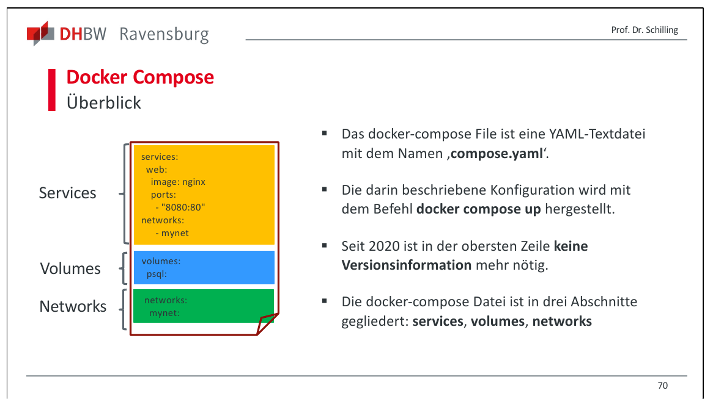

Eine compose.yaml-Datei beschreibt die Struktur und Konfiguration einer
mehrcontainerbasierten Docker-Anwendung in Form von Services, Volumes und
Networks. Sie ist eine YAML-Textdatei mit dem Standardnamen compose.yaml und dient
als zentrale Steuerdatei, um mehrere Container gemeinsam und konsistent zu starten.

In aktuellen Compose-Dateien ist keine version:-Angabe mehr erforderlich. Docker
erkennt automatisch die Syntax basierend auf den verwendeten Features, was die Datei
übersichtlicher macht und Fehlerquellen reduziert.

Die Datei ist in drei Hauptabschnitte gegliedert:

services: Hier werden die einzelnen Container definiert. Jeder Service beschreibt ein
Image (z. B. nginx), Portfreigaben, Umgebungsvariablen, Netzwerke und gegebenenfalls
Abhängigkeiten zu anderen Containern. Der Abschnitt ist der zentrale Bestandteil der
Compose-Datei, da hier die eigentliche Laufzeitlogik der Anwendung festgelegt wird.

volumes: Hier werden persistente Datenspeicher beschrieben, die über
Containerneustarts hinweg bestehen bleiben. So können Datenbanken, Logs oder
Benutzerdateien dauerhaft erhalten werden.

networks: Hier wird festgelegt, wie die Container untereinander kommunizieren können.
Netzwerke ermöglichen es, Services voneinander zu isolieren oder gezielt miteinander
zu verbinden, ohne dass sie direkt von außen erreichbar sind.

### Überblick (Seite 69)

```yaml
services:
 web:
  image: nginx
  ports:
   - "8080:80"
  environment:
   Log_Level: Info
  networks:
   - mynet

volumes:
 psql:

networks:
 mynet:
```

- Ein Service steht bei Docker-Compose für die Startkonfiguration eines Docker-Containers (bspw. Name, Image, Ports, Volumes, etc.)
- Unter Services werden alle Startkonfigurationen definiert, die zusammen eine Anwendung bilden.
- Der servicename kann als Hostname für die Intra-Container Kommunikation verwendet werden.
- Die Umgebungsvariablen werden im Dictionary environment aufgelistet.

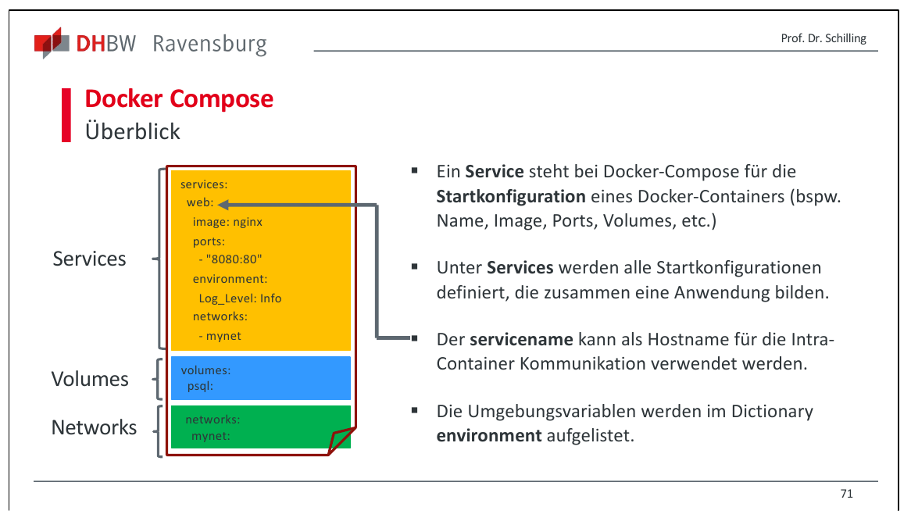

Der Abschnitt services: bildet das Herzstück jeder compose.yaml-Datei. Hier wird
definiert, welche Container gestartet werden, wie sie konfiguriert sind und wie sie
miteinander interagieren Ein Service beschreibt hierbei die Startkonfiguration eines
Containers. Jeder Service steht dabei für eine klar abgegrenzte
Anwendungskomponente, etwa eine Web-App, eine Datenbank oder einen Cache. In der
Compose-Datei werden alle Services gemeinsam definiert, die zusammen ein
Gesamtsystem bilden.

Jeder Service-Eintrag enthält die zentralen Laufzeitparameter des zugehörigen
Containers:

image: legt das zu verwendende Container-Image fest (z. B. nginx oder postgres).

ports: definiert die Portzuordnungen zwischen Host und Container, um externe Zugriffe
zu ermöglichen.

environment: enthält Umgebungsvariablen, die innerhalb des Containers gesetzt
werden (z. B. Log_Level: Info).

networks: ordnet den Service einem oder mehreren Netzwerken zu, um die
Kommunikation zwischen Containern zu ermöglichen.

volumes (optional): ermöglicht die Einbindung persistenter Datenspeicher.

Der Servicename fungiert innerhalb des Compose-Netzwerks automatisch als
Hostname. Dadurch können Container über einfache Namensauflösung miteinander
kommunizieren – z. B. kann ein web-Service eine Datenbank über postgres:5432
ansprechen, ohne IP-Adressen kennen zu müssen.

### Überblick (Seite 70)

- Die benötigten Volumes werden im Abschnitt volumes, die verwendeten Netzwerke im Abschnitt networks definiert.
- Bei YAML kann ein Schlüssel auch ohne Wert stehen, hierbei werden dann die Standardwerte verwendet.
- Standard-Volume mit Namen „psql“
- Standard-Konfiguration (bridge) für Netzwerk „mynet“.

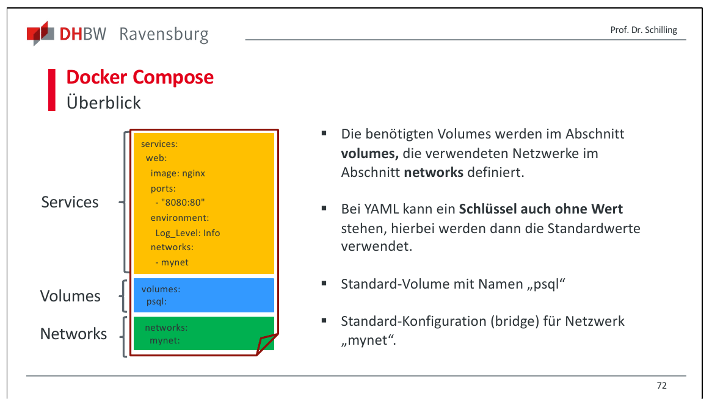

In einer compose.yaml-Datei werden neben den eigentlichen Containern (services) auch
die zugehörige Datenhaltung (volumes) und die Kommunikationsstruktur (networks)
definiert. Beide Abschnitte stehen auf oberster YAML-Ebene und bilden die Grundlage
für eine saubere Trennung von Code, Daten und Infrastruktur.

Der Abschnitt volumes: beschreibt persistente Speicherbereiche, die unabhängig vom
Lebenszyklus eines Containers existieren. Diese Volumes können gleichzeitig von
mehreren Containern genutzt werden – ein zentrales Konzept in Docker, um Daten
gemeinsam verfügbar zu machen, etwa bei gemeinsam genutzten Datenbanken,
Logverzeichnissen oder Konfigurationsdateien. Im Beispiel wird ein Volume mit dem
Namen psql definiert.

Der Abschnitt networks: legt fest, über welche logischen Netzwerke die Container
miteinander kommunizieren können. Das hier definierte Netzwerk mynet nutzt ebenfalls
die Standardkonfiguration, was bedeutet, dass ein lokales Bridge-Netzwerk erstellt wird.
Innerhalb dieses Netzwerks können Container miteinander kommunizieren, ohne dass
sie von außen erreichbar sind.

### Hands On (Seite 71)

- Der aktuelle Ordner wird als Projektname verwendet
- Erst wird das Netzwerk, dann das Volume und zuletzt der Container erstellt.
- Der Befehl docker compose down löscht den Container und das Netzwerk, aber nicht das Volume.
- Jeder Service bekommt eine eigene Farbe zugewiesen

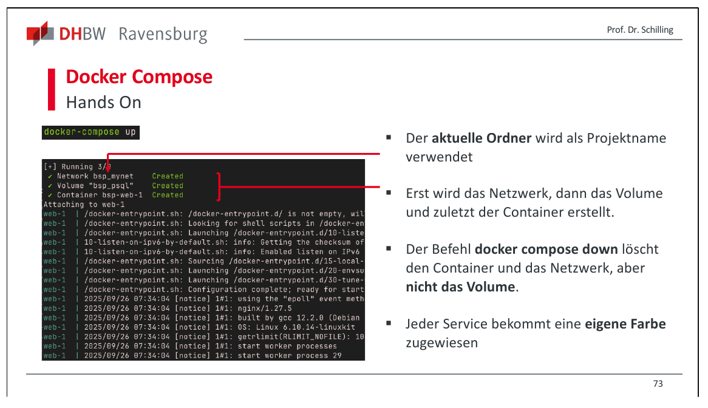

Der Befehl docker compose up startet die in der compose.yaml-Datei definierte
Anwendung. Dabei werden alle abhängigen Ressourcen in der richtigen Reihenfolge
erzeugt: zuerst das Netzwerk, anschließend die Volumes und schließlich die Container.
Als Projektname verwendet Compose standardmäßig den aktuellen Ordnernamen,
wodurch die erzeugten Ressourcen eindeutig gruppiert werden. So entsteht eine
logische Zuordnung von Netzwerk, Volume und Container zu einem Projekt, ohne dass
Namenskonflikte mit anderen Compose-Projekten auftreten.

Der Terminalauszug zeigt, dass Docker Compose die einzelnen Schritte transparent
protokolliert. Jede Ressource (Netzwerk, Volume, Container) erhält den Status Created,
bevor der Container gestartet und die Logausgabe sichtbar wird. Durch diese
Automatisierung werden komplexe Multi-Container-Umgebungen mit einem einzigen
Befehl reproduzierbar bereitgestellt.

Der zugehörige Befehl docker compose down entfernt anschließend Container und
Netzwerke, nicht jedoch die Volumes. Dieses Verhalten ist bewusst so gewählt, da
Volumes persistente Daten enthalten, die über Neustarts hinweg erhalten bleiben sollen
– beispielsweise Datenbanken.

Zur besseren Lesbarkeit weist Docker Compose jedem Service eine eigene Farbe in der
Logausgabe zu. Dadurch lassen sich parallele Logs verschiedener Container visuell
unterscheiden, was die Fehlersuche und Nachvollziehbarkeit deutlich erleichtert.

### Image Building (Seite 72)

```yaml
services:
 proxy:
  build:
   context: .
   dockerfile: ngix.Dockerfile
  ports:
   - "80:80"
 web:
  image: httpd
  volumes:
   - ./html:/usr/local/apache2/htdocs/
```

- Beim Image Building werden neue Docker Images im Rahmen von „docker compose up“ gebaut.
- Hierzu wird das Dockerfile und der Ordner für den Bauprozess spezifiziert. Das gebaute Image bekommt den Tag {foldername}_{servicename}_{nr}
- Mittels --build werden die Images vor dem Start neu gebaut, ansonsten wird das vorhandene Image verwendet.
- Neu gebaute Images werden mit dem Zusatz --rmi=local beim docker compose down Befehl gelöscht.

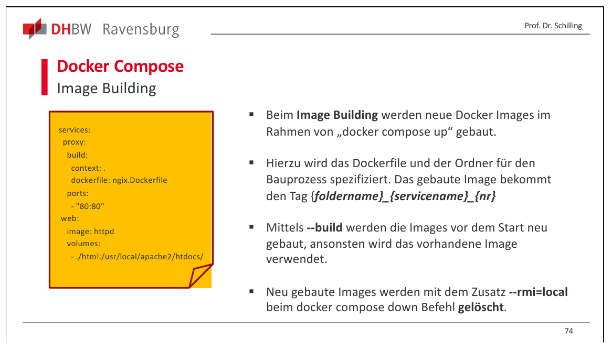

Beim Start einer Anwendung mit docker compose up können nicht nur Container aus
bestehenden Images erzeugt, sondern auch eigene Images automatisch gebaut werden.
Docker Compose integriert damit den gesamten Build-Prozess direkt in den
Anwendungsstart und unterstützt sowohl vorgefertigte Images (image: …) als auch selbst
definierte Builds (build: …).

Im Abschnitt build: wird das Verzeichnis angegeben, in dem sich das Dockerfile befindet,
sowie optional der Name des Dockerfiles selbst. Im gezeigten Beispiel wird für den
Service proxy im aktuellen Ordner (context: .) das Dockerfile ngix.Dockerfile verwendet.
Docker Compose erstellt daraus ein neues Image, das nach dem Schema
{foldername}{servicename}{nr} benannt wird – eine automatische, projektbezogene
Namenskonvention, die Kollisionen zwischen unterschiedlichen Projekten vermeidet.

Images werden nur dann neu gebaut, wenn sie nicht im lokalen Cache vorhanden sind.
Um den Build explizit zu erzwingen, kann die Option --build verwendet werden (docker
compose up --build). Dadurch wird der Build vor dem Start erneut ausgeführt – nützlich,
wenn sich die Build-Umgebung oder das Basisimages geändert haben.

Über den Befehl docker compose down --rmi local lassen sich alle im aktuellen
Projektkontext erstellten Images wieder entfernen. Diese Option ist hilfreich, um
Entwicklungsumgebungen aufzuräumen und Speicherplatz freizugeben, ohne Volumes
oder Netzwerke zu löschen.

### Überblick wichtiger Befehle (Seite 73)

|  |  |
| --- | --- |
| `docker compose up` | Startet die in compose.yaml definierten Container, Netzwerke und Volumes. Nutzt bereits vorhandene Images, falls verfügbar. |
| `docker compose up --build` | Gleich wie oben, nur dass Neubauen der Images erzwungen wird auch wenn die Images bereits existieren. |
| `docker compose down` | Beendet alle laufenden Container und entfernt zugehörige Netzwerke, Volumes werden beibehalten. |
| `docker compose down --rmi=local` | Gleich wie oben, nur dass zusätzlich lokal gebaute Images gelöscht werden. |

Die dargestellten Befehle bilden den zentralen Arbeitszyklus in Docker Compose ab:

Mit docker compose up wird die im YAML-File definierte Umgebung gestartet. Dabei
werden alle Services, Netzwerke und Volumes erstellt und die Container in der richtigen
Reihenfolge gestartet. Existieren zugehörige Images bereits, werden diese
wiederverwendet, was den Startprozess beschleunigt.

Die Variante docker compose up --build erzwingt einen Neuaufbau der Images selbst
wenn die Images bereits existieren.

Mit docker compose down wird die gesamte Umgebung kontrolliert heruntergefahren.
Dabei werden Container, Netzwerke und temporäre Ressourcen entfernt, während
Volumes standardmäßig bestehen bleiben, um persistente Daten zu bewahren.

Der Befehl docker compose down --rmi local erweitert diesen Prozess, indem zusätzlich
alle lokal gebauten Images gelöscht werden. Das ist insbesondere in Entwicklungs- oder
Testumgebungen nützlich, um Speicherplatz freizugeben und saubere Neuaufbauten zu
erzwingen.

## Hinweis zu den Aufgaben

Die Aufgabenfolien des Foliensatzes liegen in `cloud-computing/origin-tasks/`:

| Aufgabe | Seite(n) in 3-Docker.pdf | Ordner |
| --- | --- | --- |
| Aufgabe 5 | 16 | `origin-tasks/task-5/` |
| Aufgabe 6 | 32–33 | `origin-tasks/task-6/` |
| Aufgabe 7 | 41 | `origin-tasks/task-7/` |
| Aufgabe 8 | 42 | `origin-tasks/task-8/` |
| Aufgabe 9 | 50–51 | `origin-tasks/task-9/` |
| Aufgabe 10 | 62 | `origin-tasks/task-10/` |
| Aufgabe 11 | 74–75 | `origin-tasks/task-11/` |
