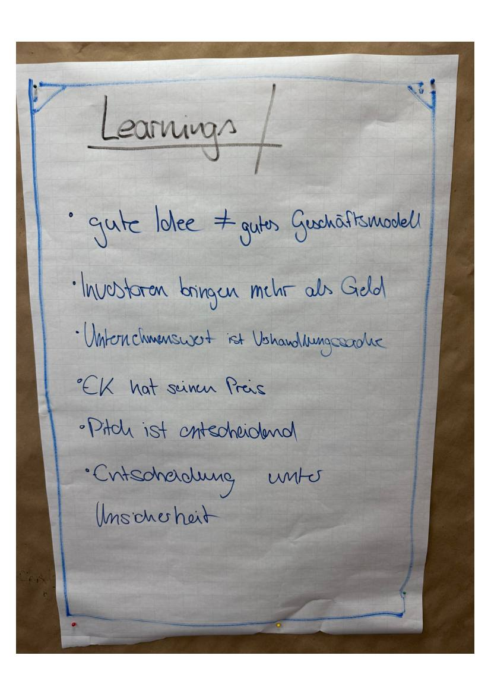
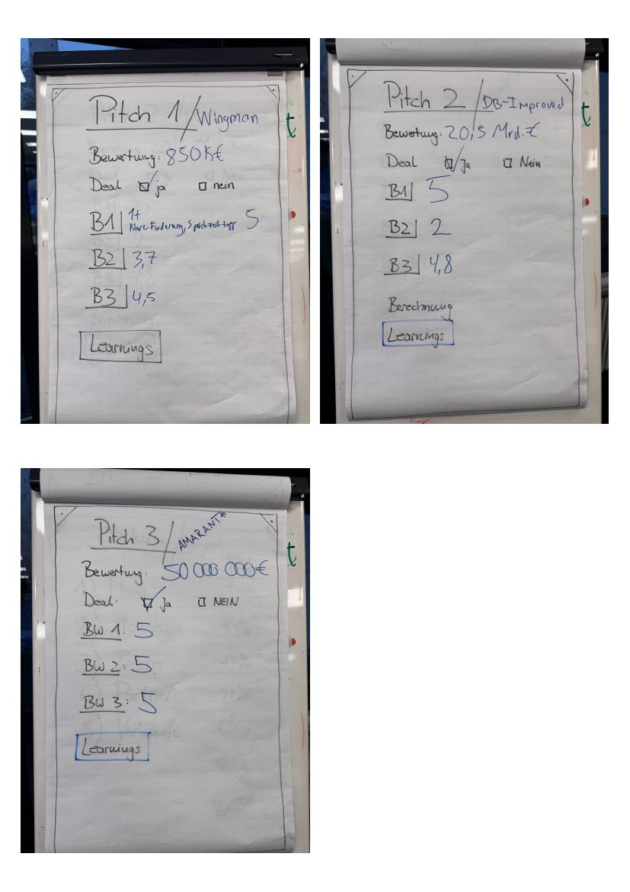
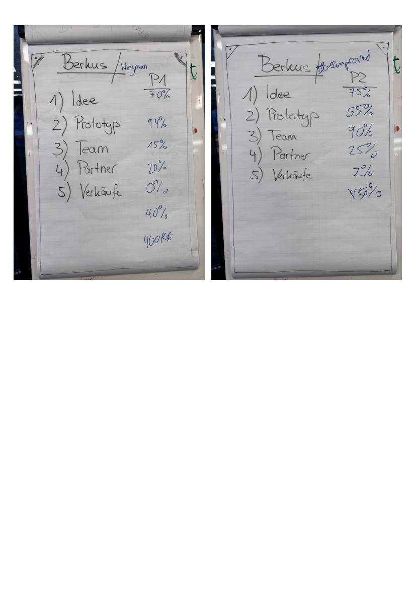

# Die Höhle (der) Business Wölfe

Pitch-Übung aus der Vorlesung (Exkurs „Höhle der Löwen", Folie 102). Das Original ist keine Aufgabenstellung, sondern die Fotodokumentation der Flipcharts aus der Veranstaltung: die Learnings, drei bewertete Pitches und zwei Bewertungen nach der Berkus-Methode.

Vorgehen in der Übung: je Pitch wird eine Unternehmensbewertung aufgerufen, über den Deal entschieden (ja/nein) und von drei Bewertern (B1, B2, B3) eine Note vergeben. Für zwei Pitches wurde die Bewertung zusätzlich mit der Berkus-Methode über fünf Kriterien hergeleitet.

## Learnings

- gute Idee ≠ gutes Geschäftsmodell
- Investoren bringen mehr als Geld
- Unternehmenswert ist Verhandlungssache
- EK hat seinen Preis
- Pitch ist entscheidend
- Entscheidung unter Unsicherheit

## Die drei Pitches

| | Pitch 1 — Wingman | Pitch 2 — DB-Improved | Pitch 3 — AMARANT |
|---|---|---|---|
| Bewertung | 850 K€ | 20,5 Mrd. € | 50.000.000 € |
| Deal | ja | ja | ja |
| B1 | 5 (Nebennotiz: „1+", „mehr Forderung", Rest unleserlich) | 5 | 5 |
| B2 | 3,7 | 2 | 5 |
| B3 | 4,5 | 4,8 | 5 |

Bei Pitch 2 steht zusätzlich „Berechnung" auf dem Flipchart, bei allen drei Pitches ein eingerahmtes „Learnings".

## Berkus-Methode

Fünf Kriterien, je Kriterium ein Prozentwert.

| Kriterium | P1 — Wingman | P2 — DB-Improved |
|---|---|---|
| 1) Idee | 70 % | 75 % |
| 2) Prototyp | [unleserlich, 4 % oder 44 %] | 55 % |
| 3) Team | 15 % | 90 % |
| 4) Partner | 20 % | 25 % |
| 5) Verkäufe | 0 % | 2 % |
| Ergebnis | 40 %, darunter [unleserlich, 400 K€ oder 460 K€] | [unleserlich, 50 % oder 80 %] |

## Hinweise zur Vorlage

- Das Original ist ein reines Bild-PDF (4 Seiten, ohne Text-Layer). Die Seiten 2–4 liegen hier als Bilder vor, Seite 1 ist nur das Titelbild.
- Die handschriftlichen Werte sind teilweise schwer lesbar. Wo die Lesung unsicher ist, steht `[unleserlich]` mit den in Frage kommenden Varianten — bitte am Bild prüfen.
- Das vollständige Original-PDF (6,9 MB) liegt nur in `origin/` und wurde nicht in diesen Ordner kopiert.

Quelle: `investition/origin/WDS25 - Finanzierung und Investition (SCS)/04 Übungsblätter/Die Höhle der Business Löwen/Hoehle_der_Business_Woelfe.pdf`
