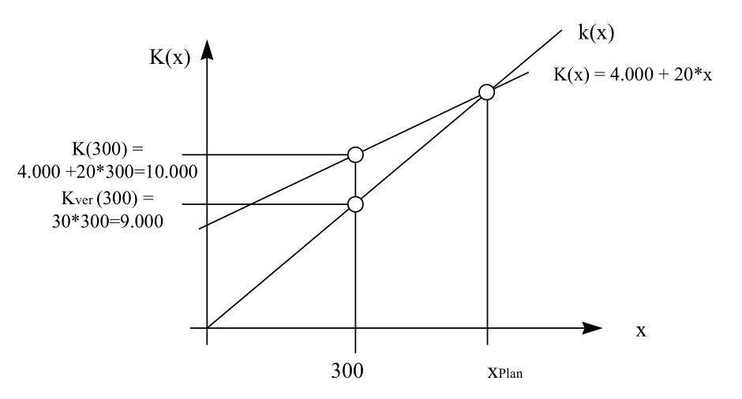

# Lösung: Einfache Aufgaben zur Beschäftigungsabweichung

- K_Soll (x_Ist) = K_F + k_v * x_Ist
- K_Soll(x_Plan) = 4.000 + 20 * x_Plan
- K(400) = 4.000 + 20 * 400 = 12.000
- k(x) = K(x) / x = 12.000 / 400 = 30 €/Std.

Beschriftung der Grafik:

- Achsen: K(x) über x
- Geraden: k(x) (aus dem Ursprung) und `K(x) = 4.000 + 20*x`, Schnittpunkt bei x_Plan
- Bei 300, Punkt auf K(x): `K(300) = 4.000 +20*300=10.000`
- Bei 300, Punkt auf k(x): `K_ver (300) = 30*300=9.000`
- Auf der x-Achse: 300, x_Plan

Beschäftigungsabweichung

= K_Verr. – K_SOLL = 9.000 – 10.000 = - 1.000

Beschäftigungsabweichung

= k_F * ( x_IST – x_PLAN) = 10 * (300 – 400) = - 1.000

Quelle: kostenrechnung/origin/mitschriebt_3_von_5_aktuell.pdf, Folie 182
