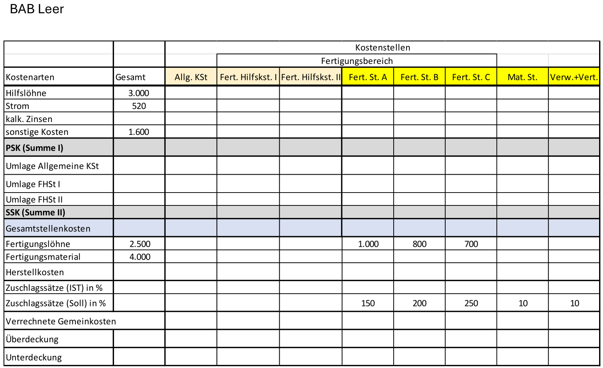
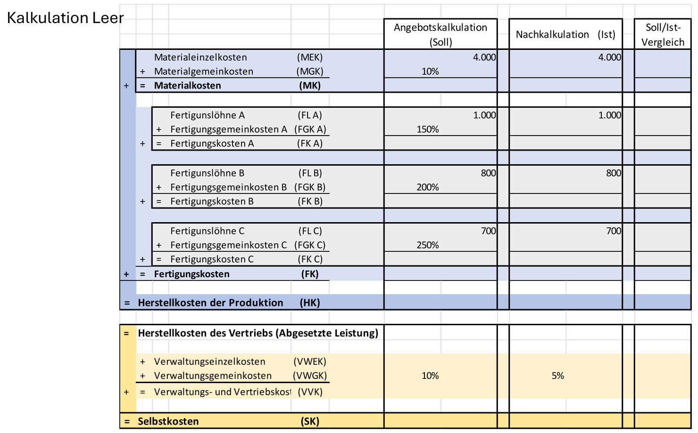

# Aufgabe A2 35 Betriebsabrechnungsbogen (BAB) – Eine Übersicht

Das folgende Beispiel zum Betriebsabrechnungsbogen ist sowohl als Zusammenfassung und als Übung zu verstehen. Nach dieser Übung können Sie:

- die primären Kosten auf Kostenstellen verteilen,
- eine innerbetriebliche Leistungsverrechnung vornehmen,
- Zuschlagssätze ermitteln,
- einen Soll-/Istvergleich mit Über-/Unterdeckung durchführen.

Bitte vervollständigen Sie den beigefügten Betriebsabrechnungsbogen aufgrund der folgenden Angaben:

1. Die Verteilung der Hilfslöhne erfolgt nach dem Schlüssel: 2 : 1 : 1 : 3 : 4 : 5 : 3 : 1

2. Die Verrechnung der Stromkosten erfolgt auf die Hilfskostenstellen jeweils einfach, auf die Hauptkostenstellen jeweils doppelt.

3. Die kalkulatorischen Zinsen betragen derzeit 12 % im Jahr. Sie sind hier anteilig auf den *Monat* und das gebundene Vermögen in den einzelnen Kostenstellen zu beziehen:

   - Allgemeine KST € 6.000,
   - Fertigungshilfsstelle I € 12.000,
   - Fertigungshilfsstelle II € 8.000,
   - Fertigungsstelle A € 28.000,
   - Fertigungsstelle B € 21.000,
   - Fertigungsstelle C € 14.000,
   - Materialstelle € 2.000,
   - Verwaltung und Vertrieb € 7.000.

4. Die Verteilung der sonstigen Kosten erfolgt auf alle Kostenstellen gleichmäßig.

5. Die Allgemeine Kostenstelle ist nachfolgendem Schlüssel zu verteilen: 1:2:2:3:1:1:2.

6. Fertigungshilfsstelle I ist in folgendem Verhältnis zu verteilen: 1 : 2 : 1 : 3

7. Die Fertigungshilfsstelle II wurde von der Fertigungsstelle A 6 mal, von der Fertigungsstelle B 4 mal und von der Fertigungsstelle C 3 mal in Anspruch genommen.

8. Ermittlung der Gemeinkostenzuschlagsätze

9. Ermittlung der verrechneten Gemeinkosten

10. Ermittlung der Abweichungen.

## BAB Leer

Kopf des Bogens: Die acht Spalten Allg. KSt bis Verw.+Vert. stehen unter "Kostenstellen", die Spalten Fert. Hilfskst. I bis Fert. St. C unter "Fertigungsbereich".

| Kostenarten | Gesamt | Allg. KSt | Fert. Hilfskst. I | Fert. Hilfskst. II | Fert. St. A | Fert. St. B | Fert. St. C | Mat. St. | Verw.+Vert. |
|---|---|---|---|---|---|---|---|---|---|
| Hilfslöhne | 3.000 | | | | | | | | |
| Strom | 520 | | | | | | | | |
| kalk. Zinsen | | | | | | | | | |
| sonstige Kosten | 1.600 | | | | | | | | |
| **PSK (Summe I)** | | | | | | | | | |
| Umlage Allgemeine KSt | | | | | | | | | |
| Umlage FHSt I | | | | | | | | | |
| Umlage FHSt II | | | | | | | | | |
| **SSK (Summe II)** | | | | | | | | | |
| Gesamtstellenkosten | | | | | | | | | |
| Fertigungslöhne | 2.500 | | | | 1.000 | 800 | 700 | | |
| Fertigungsmaterial | 4.000 | | | | | | | | |
| Herstellkosten | | | | | | | | | |
| Zuschlagssätze (IST) in % | | | | | | | | | |
| Zuschlagssätze (Soll) in % | | | | | 150 | 200 | 250 | 10 | 10 |
| Verrechnete Gemeinkosten | | | | | | | | | |
| Überdeckung | | | | | | | | | |
| Unterdeckung | | | | | | | | | |

## Kalkulation Leer

Die Zeichen + und = in der ersten Spalte stehen so wie im Formular (von außen nach innen).

| | Position | Kürzel | Angebotskalkulation (Soll): Satz | Angebotskalkulation (Soll): Betrag | Nachkalkulation (Ist): Satz | Nachkalkulation (Ist): Betrag | Soll/Ist-Vergleich |
|---|---|---|---|---|---|---|---|
| | Materialeinzelkosten | (MEK) | | 4.000 | | 4.000 | |
| + | Materialgemeinkosten | (MGK) | 10% | | | | |
| + = | **Materialkosten** | **(MK)** | | | | | |
| | Fertigunslöhne A | (FL A) | | 1.000 | | 1.000 | |
| + | Fertigungsgemeinkosten A | (FGK A) | 150% | | | | |
| + = | Fertigungskosten A | (FK A) | | | | | |
| | Fertigunslöhne B | (FL B) | | 800 | | 800 | |
| + | Fertigungsgemeinkosten B | (FGK B) | 200% | | | | |
| + = | Fertigungskosten B | (FK B) | | | | | |
| | Fertigunslöhne C | (FL C) | | 700 | | 700 | |
| + | Fertigungsgemeinkosten C | (FGK C) | 250% | | | | |
| + = | Fertigungskosten C | (FK C) | | | | | |
| + = | **Fertigungskosten** | **(FK)** | | | | | |
| = | **Herstellkosten der Produktion** | **(HK)** | | | | | |
| = | **Herstellkosten des Vertriebs (Abgesetzte Leistung)** | | | | | | |
| + | Verwaltungseinzelkosten | (VWEK) | | | | | |
| + | Verwaltungsgemeinkosten | (VWGK) | 10% | | 5% | | |
| + = | Verwaltungs- und Vertriebskosten | (VVK) | | | | | |
| = | **Selbstkosten** | **(SK)** | | | | | |

## Dateien in diesem Ordner

- `SOLUTION.md` — BAB Lösung, Verteilungsschlüssel und Kalkulation Lösung von den Folien, dazu die handschriftlichen Rechenhinweise aus dem Vorjahr
- `images/folie-073.png` — BAB Leer als Bild
- `images/folie-075.png` — Kalkulation Leer als Bild

Hinweis zur Quelle: Im Textlayer der Folie "Kalkulation Leer" liegt hinter der Zeile Verwaltungsgemeinkosten zusätzlich eine nicht sichtbare Zeile "Vertriebseinzelkosten (VTEK)". Sichtbar ist nur, was oben steht. Die Beschriftung "Verwaltungs- und Vertriebskosten" ist auf der Folie abgeschnitten ("Vertriebskost").

Quelle: kostenrechnung/origin/mitschriebt_3_von_5_aktuell.pdf, Folien 72, 73, 75

Vorjahr: kostenrechnung/origin/mitschrieb_letzte_jahr.pdf, Folien 75, 76, 78
