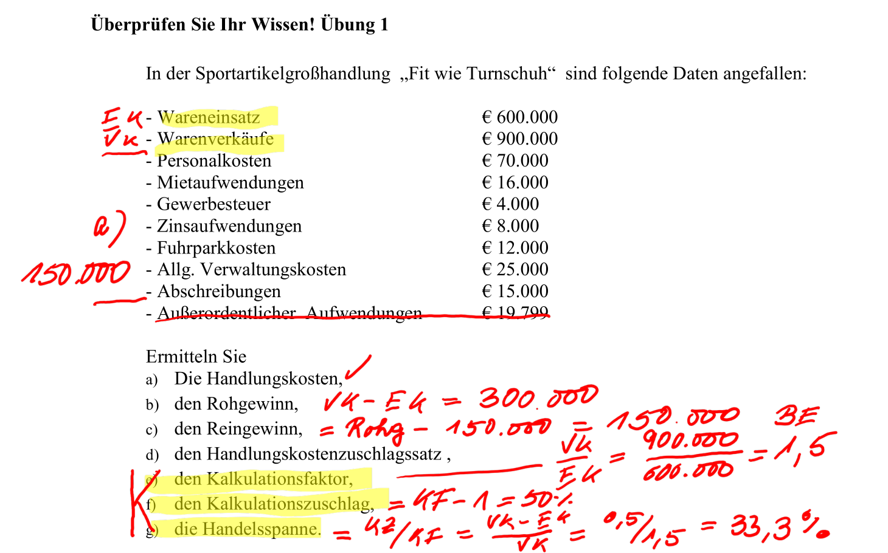

# Lösung: Kalkulation im Handel - Übung 1

Auf den Folien steht keine gedruckte Lösung. Alles hier ist die Handschrift des Profs aus dem Vorjahr.

## Notizen an den Daten

- Wareneinsatz (gelb markiert): „EK“
- Warenverkäufe (gelb markiert): „VK“
- Links neben den Kostenzeilen: „a)“ und „150.000“, Strich unter Abschreibungen
- Die Zeile „Außerordentlicher Aufwendungen € 19.799“ ist durchgestrichen

## Lösung

- a) Handlungskosten: 150.000 (links neben den Daten notiert, a) ist abgehakt)
- b) Rohgewinn: VK - EK = 300.000
- c) Reingewinn: = Rohg - 150.000 = 150.000 BE
- d) Handlungskostenzuschlagssatz: keine Rechnung notiert
- e) Kalkulationsfaktor: VK / EK = 900.000 / 600.000 = 1,5
- f) Kalkulationszuschlag: = KF - 1 = 50 %
- g) Handelsspanne: = KZ / KF = (VK - EK) / VK = 0,5 / 1,5 = 33,3 %

Die Rechnung VK / EK = 1,5 steht rechts oben neben c) und d). Ein langer Strich läuft zwischen d) und e) dorthin. Sie ist hier e) zugeordnet, weil f) mit KF weiterrechnet.

Vor e), f) und g) steht ein rotes „K“, die drei Zeilen sind gelb markiert.

Quelle: kostenrechnung/origin/mitschrieb_letzte_jahr.pdf, Folie 126
