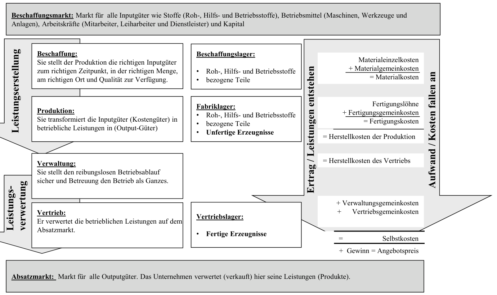

# Einführung: Einordnung der Kosten- und Leistungsrechnung im Rechnungswesen

## Programm Einführung

- Wie lässt sich die Kosten- und Leistungsrechnung im System Betriebswirtschaft einordnen?
- Was heißt finanzielle Führung? Worüber müssen Sie als Geschäftsführer Bescheid wissen?
- Welche Ziele, Aufgaben, Einteilung und Inhalte hat das traditionelle Rechnungswesen?
- Auf welche Strukturen treffen wir? Wie ist der Informationsfluss im Rechnungswesen?
- Auf welche Denkansätze und Systeme stoßen wir?
- die wichtigsten Begriffe

## Betr. Leistungserstellung und -Verwertung

Beschaffungsmarkt: Markt für alle Inputgüter wie Stoffe (Roh-, Hilfs- und Betriebsstoffe), Betriebsmittel (Maschinen, Werkzeuge und Anlagen), Arbeitskräfte (Mitarbeiter, Leiharbeiter und Dienstleister) und Kapital.

Linker Pfeil oben: Leistungserstellung (neben Beschaffung und Produktion). Linker Pfeil unten: Leistungsverwertung (neben Verwaltung und Vertrieb).

| Bereich | Aufgabe | Lager |
|---|---|---|
| Beschaffung | Sie stellt der Produktion die richtigen Inputgüter zum richtigen Zeitpunkt, in der richtigen Menge, am richtigen Ort und Qualität zur Verfügung. | Beschaffungslager: Roh-, Hilfs- und Betriebsstoffe; bezogene Teile |
| Produktion | Sie transformiert die Inputgüter (Kostengüter) in betriebliche Leistungen (Output-Güter). | Fabriklager: Roh-, Hilfs- und Betriebsstoffe; bezogene Teile; Unfertige Erzeugnisse |
| Verwaltung | Sie stellt den reibungslosen Betriebsablauf sicher und betreut den Betrieb als Ganzes. | |
| Vertrieb | Er verwertet die betrieblichen Leistungen auf dem Absatzmarkt. | Vertriebslager: Fertige Erzeugnisse |

Rechter Pfeil (von oben nach unten), beschriftet mit „Ertrag / Leistungen entstehen“ und „Aufwand / Kosten fallen an“:

| | |
|---|---|
| | Materialeinzelkosten |
| + | Materialgemeinkosten |
| = | **Materialkosten** |
| | Fertigungslöhne |
| + | Fertigungsgemeinkosten |
| = | **Fertigungskosten** |
| = | **Herstellkosten der Produktion** |
| = | Herstellkosten des Vertriebs |
| + | Verwaltungsgemeinkosten |
| + | Vertriebsgemeinkosten |
| = | Selbstkosten |
| + | Gewinn = Angebotspreis |

Absatzmarkt: Markt für alle Outputgüter. Das Unternehmen verwertet (verkauft) hier seine Leistungen (Produkte).

## Traditionelle Einteilung des Rechnungswesens

| | **Finanzbuchhaltung und Bilanz** | **Kosten- und Leistungsrechnung** | Statistik und Vergleichsrechnung | Planungsrechnung |
|---|---|---|---|---|
| **Ziel** **[K]** | **Darstellung der Vermögens-, Ertrags- und Liquiditätslage** | Ermittlung des Stückerfolgs (Kalkulation) und der Leistung Periodenerfolg des operativen Geschäfts | Sammlung und Darstellung aller betrieblichen Daten | Bereitstellen von Daten für Planung, Steuerung und Kontrolle des Unternehmens |
| Aufgaben **[K]** | Dokumentation aller Geschäftsvorfälle, Information zur Vermögens-, Ertrags- und Liquiditätslage | Planung, Istermittlung, Kontrolle und Analyse der Wirtschaftlichkeit **aller betrieblichen Prozesse** | Auswertung der gesammelten Daten, Ermittlung von Kennzahlen - Kennzahlenanalyse und Benchmarking | Bereitstellung von Plandaten (Sollvorgaben) - Budget für einzelne Kostenarten, Kostenstellen und Leistungen (Kostenträger) |
| Adressaten | Shareholder und Stakeholder (extern und intern) | Mitarbeiter aller Hierarchien (intern) | Mitarbeiter aller Hierarchien (intern) | Mitarbeiter aller Hierarchien (intern) |
| Inhalte | Geschäftsvorfälle, Inventar, Geschäftsbericht (Bilanz und GuV) | **betriebliche Wertströme, Betriebsergebnis** | betriebliche Daten für Zeit- und Betriebsvergleich (internes Benchmarking) | betriebliche Planzahlen |
| Rechnungsgrößen **[K]** | Ein- und Auszahlungen, Einnahmen und Ausgaben, Ertrag und Aufwand | Leistungen und Kosten | Leistungen und Kosten sowie Kennzahlen | Leistungen und Kosten sowie Plangrößen |
| **Vorschriften** **[K]** | **Handels- und Steuerrecht, Verordnungen,** International **Financial Reporting Standards** | keine gesetzliche Vorschriften - bestimmt durch die **kaufmännische Vernunft (Usanz)** | keine gesetzliche Vorschriften - bestimmt durch die kaufmännische Vernunft (Usanz) | keine gesetzliche Vorschriften - bestimmt durch die kaufmännische Vernunft (Usanz) |

## Notizen

Fett gesetzte Wörter im Folientext sind vom Prof mit dem Marker markiert.

### Programm Einführung

- Blauer Haken hinter dem Titel „Programm Einführung“.

### Betr. Leistungserstellung und -Verwertung

- „xp“ links neben „= Herstellkosten der Produktion“, „xa“ rechts neben dem rechten Pfeil auf gleicher Höhe.
- Waagrechte Linie quer durch das Schaubild zwischen „= Herstellkosten der Produktion“ und „= Herstellkosten des Vertriebs“ (zwischen Produktion und Verwaltung). (Vorjahr)
- Rechts neben „= Herstellkosten der Produktion“ (Pfeil darauf): K_HP / xp = kh; unter der Linie: xa. (Vorjahr)
- Unter „= Herstellkosten des Vertriebs“: kh * xa. (Vorjahr)
- Am Vertriebslager: „xp“ mit Pfeil nach unten (links, in das Lager hinein) und „xa“ mit Pfeil nach oben (rechts). (Vorjahr)
- „+ Gewinn“ ist eingekreist. (Vorjahr)

### Traditionelle Einteilung des Rechnungswesens

- Rotes K jeweils links neben den Zeilen Ziel, Aufgaben, Rechnungsgrößen und Vorschriften (im Vorjahr an denselben vier Zeilen).
- Spaltenkopf „Kosten- und Leistungsrechnung“ ist mit dickem rotem Marker eingekreist; die Spaltenköpfe „Statistik und Vergleichsrechnung“ und „Planungsrechnung“ sind zusammen mit rotem Stift umrandet.
- „IST“ in der Zelle Ziel / Finanzbuchhaltung und Bilanz.
- Markiert: „Darstellung“, „Vermögens-, Ertrags- und Liquiditätslage“ (Ziel, Finanzbuchhaltung), „Stückerfolgs“, „Periodenerfolg des operativen Geschäfts“ (Ziel, Kosten- und Leistungsrechnung), „Dokumentation“, „Information zur“ (Aufgaben, Finanzbuchhaltung), „Handels- und Steuerrecht,“ und „(Usanz)“ (Vorschriften). (Vorjahr)

Quelle: kostenrechnung/origin/mitschriebt_3_von_5_aktuell.pdf, Folien 1-2, 4
Vorjahr: kostenrechnung/origin/mitschrieb_letzte_jahr.pdf, Folien 1-3
