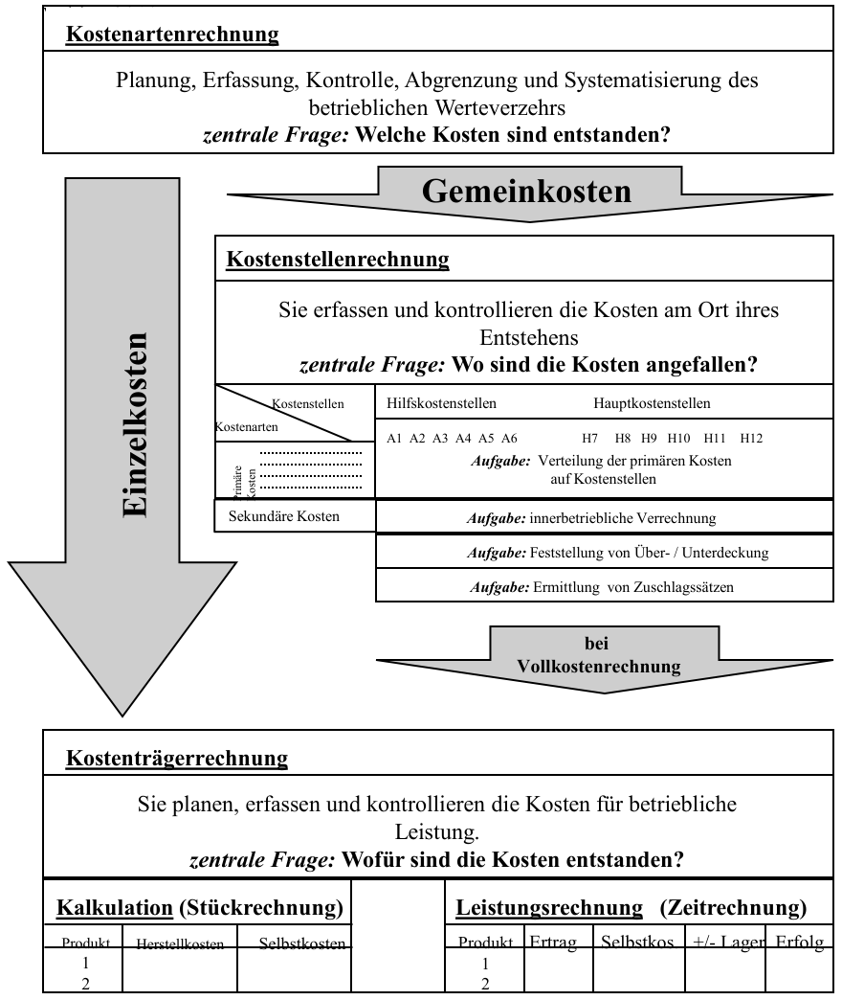
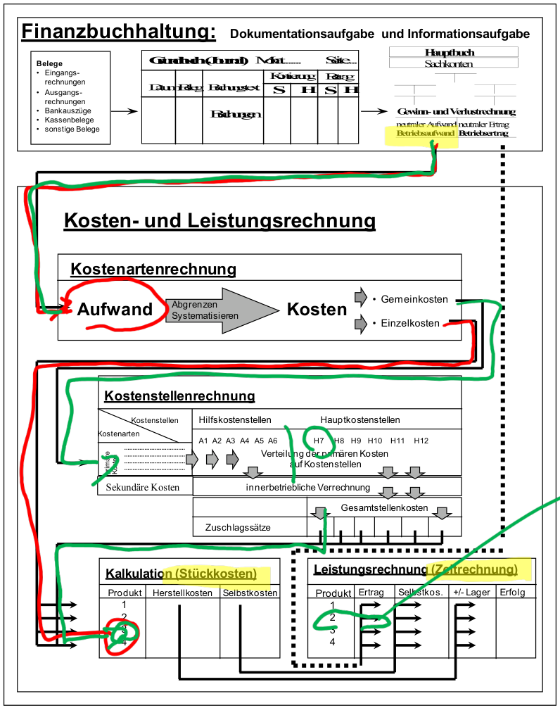
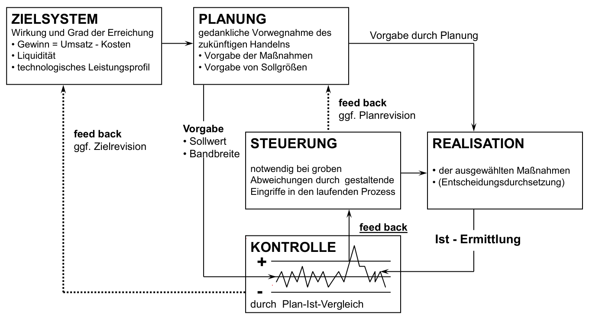

# Elemente und Aufgaben der Kosten- und Leistungsrechnung

## Elemente der Kosten- und Leistungsrechnung **[K]**

- Kostenartenrechnung: **Planung, Erfassung, Kontrolle**, **Abgrenzung und Systematisierung** des betrieblichen Werteverzehrs. Zentrale Frage: **Welche Kosten sind entstanden?**
- Pfeil „Gemeinkosten“: von der Kostenartenrechnung in die Kostenstellenrechnung.
- Pfeil „Einzelkosten“: von der Kostenartenrechnung direkt in die Kostenträgerrechnung (an der Kostenstellenrechnung vorbei).
- Kostenstellenrechnung: Sie **erfassen und kontrollieren** die Kosten am Ort ihres Entstehens. Zentrale Frage: Wo sind die Kosten angefallen?
  - Tabelle Kostenarten (Zeilen) / Kostenstellen (Spalten): Hilfskostenstellen A1 A2 A3 A4 A5 A6, Hauptkostenstellen H7 H8 H9 H10 H11 H12
  - Primäre Kosten - Aufgabe: Verteilung der primären Kosten auf Kostenstellen
  - Sekundäre Kosten - Aufgabe: innerbetriebliche Verrechnung
  - Aufgabe: Feststellung von Über- / Unterdeckung
  - Aufgabe: Ermittlung von Zuschlagssätzen
- Pfeil „bei Vollkostenrechnung“: von der Kostenstellenrechnung in die Kostenträgerrechnung.
- **Kostenträgerrechnung**: Sie **planen, erfassen und kontrollieren** die Kosten für betriebliche Leistung. Zentrale Frage: Wofür sind die Kosten entstanden?
  - **Kalkulation (Stückrechnung)**: Spalten Produkt, Herstellkosten, Selbstkosten (Zeilen 1, 2)
  - **Leistungsrechnung (Zeitrechnung)**: Spalten Produkt, Ertrag, Selbstkos., +/- Lager, Erfolg (Zeilen 1, 2)

## Schematische Darstellung der Belegwege in der Betriebsabrechnung (nur Vorjahr)

Das Bild stammt aus dem Vorjahr, die farbigen Linien und Markierungen darin sind Handschrift des Profs (siehe Notizen).

- Finanzbuchhaltung: Dokumentationsaufgabe und Informationsaufgabe
  - Belege: Eingangsrechnungen, Ausgangsrechnungen, Bankauszüge, Kassenbelege, sonstige Belege
  - Grundbuch (Journal), Monat ..., Seite ...: Spalten Datum, Beleg, Buchungstext, Kontierung (S, H), Betrag (S, H); Inhalt: Buchungen
  - Hauptbuch: Sachkonten; Gewinn- und Verlustrechnung mit neutraler Aufwand, neutraler Ertrag, Betriebsaufwand, Betriebsertrag
  - Reihenfolge der Pfeile: Belege, Grundbuch, Hauptbuch
- Kosten- und Leistungsrechnung
  - Kostenartenrechnung: Aufwand, dann Abgrenzen und Systematisieren, ergibt Kosten, aufgeteilt in Gemeinkosten und Einzelkosten
  - Kostenstellenrechnung: Tabelle Kostenarten / Kostenstellen (Hilfskostenstellen A1 bis A6, Hauptkostenstellen H7 bis H12); primäre Kosten: Verteilung der primären Kosten auf Kostenstellen; Sekundäre Kosten: innerbetriebliche Verrechnung; Gesamtstellenkosten; Zuschlagssätze
  - Kalkulation (Stückkosten): Spalten Produkt, Herstellkosten, Selbstkosten (Zeilen 1 bis 4)
  - Leistungsrechnung (Zeitrechnung): Spalten Produkt, Ertrag, Selbstkos., +/- Lager, Erfolg (Zeilen 1 bis 4)
- Linien im Schaubild:
  - vom Betriebsaufwand der Gewinn- und Verlustrechnung zum Aufwand der Kostenartenrechnung
  - von den Gemeinkosten zu den primären Kosten der Kostenstellenrechnung
  - von den Einzelkosten zur Kalkulation
  - von den Hauptkostenstellen (Gesamtstellenkosten / Zuschlagssätze) zur Kalkulation
  - von Herstellkosten und Selbstkosten der Kalkulation zur Leistungsrechnung
  - gepunktete Linie von der Gewinn- und Verlustrechnung (Seite Betriebsertrag) zur Leistungsrechnung (Ertrag)

## Aufgaben der Kosten- und Leistungsrechnung?

Die Folie dieses Jahres besteht nur aus dieser Frage.

## Aufgaben der Kosten- und Leistungsrechnung (nur Vorjahr)

- Aufgaben der Dokumentation
- Aufgaben der Unternehmensplanung (Soll)
- Aufgabe der Ist - Ermittlung (IST)
- Kontrollaufgabe (Soll-, Istvergleich)
- Analyse des Soll-, Istvergleich

## Kybernetischer Kreis und Kosten- und Leistungsrechnung

- ZIELSYSTEM: Wirkung und Grad der Erreichung
  - Gewinn = Umsatz - Kosten
  - Liquidität
  - technologisches Leistungsprofil
- PLANUNG (Pfeil vom ZIELSYSTEM): gedankliche Vorwegnahme des zukünftigen Handelns
  - Vorgabe der Maßnahmen
  - Vorgabe von Sollgrößen
- REALISATION (Pfeil von der PLANUNG: „**Vorgabe durch Planung**“): der ausgewählten Maßnahmen (Entscheidungsdurchsetzung)
- KONTROLLE: durch Plan-Ist-Vergleich
  - von der PLANUNG kommt die Vorgabe: Sollwert, Bandbreite
  - von der REALISATION kommt die Ist - Ermittlung
  - Schaubild in der KONTROLLE: Kurve, die um eine Mittellinie zwischen einer „+“-Linie und einer „-“-Linie schwankt und an einer Stelle über die „+“-Linie ausschlägt
- STEUERUNG (Pfeil „feed back“ von der KONTROLLE, er beginnt am Ausschlag der Kurve): notwendig bei groben Abweichungen durch gestaltende Eingriffe in den laufenden Prozess; Pfeil von der STEUERUNG zur REALISATION
- gepunkteter Pfeil von der STEUERUNG zur PLANUNG: feed back, ggf. Planrevision
- gepunkteter Pfeil von der KONTROLLE zum ZIELSYSTEM: feed back, ggf. Zielrevision

## Notizen

Fett gesetzte Wörter im Folientext sind vom Prof mit dem Marker markiert.

### Elemente der Kosten- und Leistungsrechnung

- Dickes rotes K links neben dem Schaubild (zwischen Folientitel und Pfeil „Einzelkosten“).
- Rotes K am rechten Rand der Folie. (Vorjahr)
- Textfeld oben rechts: „Daten der FiBu“.
- Textfeld links: „Einzelkosten sind => sie kennen den Verursacher“.
- Textfeld „100 %“ links neben der Kostenartenrechnung und „100 %“ links neben der Kostenträgerrechnung.
- Über „Planung, Erfassung, Kontrolle“ steht: Soll, Ist, Soll-Ist-Vergleich.
- „KT“ am Pfeil „Gemeinkosten“ und „KT“ auf dem Pfeil „Einzelkosten“.
- In der Kostenstellenrechnung sind die Aufgaben durchnummeriert: 1 bei „Sie erfassen und kontrollieren ...“ und bei „Verteilung der primären Kosten auf Kostenstellen“, 2 bei „innerbetriebliche Verrechnung“, 3 bei „Feststellung von Über- / Unterdeckung“, 4 bei „Ermittlung von Zuschlagssätzen“.
- Neben „Kostenträgerrechnung“: „= Leistungen“.
- Über der Kostenartenrechnung: „Aufw. / Kosten“ mit Strich zu „Abgrenzung“. (Vorjahr)
- Rechts neben der Kostenartenrechnung (mit Strich dorthin): K(x) = KF + k * x und K = GK + EK. (Vorjahr)
- „100 %“ links neben der Kostenartenrechnung, „80 %“ links am Pfeil „Einzelkosten“, „20 %“ in der Kostenstellenrechnung, „20 %“ und „100 %“ am eingekreisten Pfeil „bei Vollkostenrechnung“, „100 %“ links neben der Kostenträgerrechnung. (Vorjahr)
- „Kostenträger“ entlang des Pfeils „Einzelkosten“ geschrieben, „Einzelkosten“ unterstrichen; „KT“ am Pfeil „Gemeinkosten“. (Vorjahr)
- Neben „Kostenträgerrechnung“: „= Leistung“. (Vorjahr)
- Über „planen, erfassen und kontrollieren“ (Kostenträgerrechnung) in Blau: „Soll IST“. (Vorjahr)
- Markiert: die Überschriften Kostenartenrechnung, Kostenstellenrechnung, Kostenträgerrechnung, die Fragen „Welche Kosten sind entstanden?“, „Wo sind“, „Wofür“ sowie „Planung, Erfassung, Kontrolle“, „erfassen und kontrollieren“, „planen, erfassen und kontrollieren“. (Vorjahr)

### Schematische Darstellung der Belegwege in der Betriebsabrechnung (nur Vorjahr)

- Rechts neben der Finanzbuchhaltung: „1 Fahrrad“; weiter unten „Fahrrad“ mit Strich zur Leistungsrechnung (Spalte Produkt). (Vorjahr)
- Rote Linie nachgezeichnet: Betriebsaufwand, Aufwand (rot eingekreist), Einzelkosten, Kalkulation (ein Produkt in der Spalte Produkt eingekreist). (Vorjahr)
- Grüne Linie nachgezeichnet: Betriebsaufwand, Aufwand, Gemeinkosten, primäre Kosten der Kostenstellenrechnung (H7 eingekreist), Zuschlagssätze, Kalkulation (dasselbe eingekreiste Produkt). (Vorjahr)
- Markiert: „Betriebsaufwand“, „(Stückkosten)“, „(Zeitrechnung)“. (Vorjahr)

### Aufgaben der Kosten- und Leistungsrechnung (nur Vorjahr)

- Markiert: „Dokumentation“, „(Soll)“, „(IST)“, „Soll-, Istvergleich)“, „Analyse“. (Vorjahr)

### Kybernetischer Kreis und Kosten- und Leistungsrechnung

- Links neben dem ZIELSYSTEM: „Standort“.
- Über der PLANUNG: „Soll“.
- Links an der KONTROLLE, dort wo die Vorgabe-Linie ankommt: „Soll“; die Mittellinie des Schaubilds ist rot nachgezogen.
- „+“ und „-“ im Schaubild der KONTROLLE sind rot eingekreist.
- Der Ausschlag der Kurve über die „+“-Linie ist blau eingekreist; mit blauem Stift sind Bögen zwischen KONTROLLE, PLANUNG, REALISATION und dem eingekreisten Ausschlag gezogen.
- Links an der KONTROLLE in Gelb: „Soll“; Mittellinie rot nachgezogen. (Vorjahr)
- Unter dem Schaubild der KONTROLLE senkrechte Striche mit den Beschriftungen 1.1, 1Q, 2Q, 3Q, 31.12. (Vorjahr)
- Die Kurve ist bis zum Ausschlag grün nachgezeichnet, der Ausschlag grün eingekreist. (Vorjahr)
- Rote Bögen zwischen KONTROLLE, PLANUNG, REALISATION und Ist - Ermittlung. (Vorjahr)
- Markiert: ZIELSYSTEM, PLANUNG, STEUERUNG, REALISATION, KONTROLLE, „Sollwert“, „Bandbreite“, „Ist - Ermittlung“. (Vorjahr)

Quelle: kostenrechnung/origin/mitschriebt_3_von_5_aktuell.pdf, Folien 3, 5, 11
Vorjahr: kostenrechnung/origin/mitschrieb_letzte_jahr.pdf, Folien 4-7
