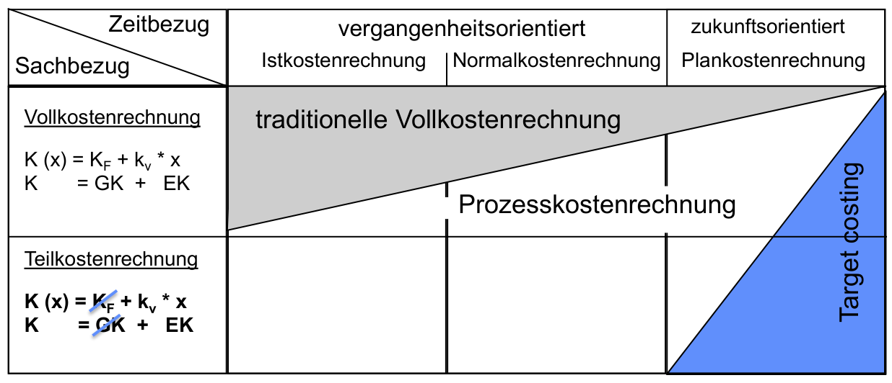

# Systeme der Kostenrechnung

## Traditionelle Systeme der Kostenrechnung

Zwei Achsen:

- **zeitlicher Bezug** (Pfeil nach rechts): vergangenheitsorientiert (Ist-Kostenrechnung, Normal-Kostenrechnung), zukunftsorientiert (Plan-Kostenrechnung)
- Sachbezug (Pfeil nach unten): Vollkostenrechnung, Teilkostenrechnung

| Sachbezug | vergangenheitsorientiert: Ist-Kostenrechnung | vergangenheitsorientiert: Normal-Kostenrechnung | zukunftsorientiert: Plan-Kostenrechnung |
|---|---|---|---|
| Vollkostenrechnung | Ist-Kostenrechnung auf Vollkostenbasis | Normal-Kostenrechnung auf Vollkostenbasis | Plan-Kostenrechnung auf Vollkostenbasis |
| Teilkostenrechnung | Ist-Kostenrechnung auf Teilkostenbasis | Normal-Kostenrechnung auf Teilkostenbasis | Plan-Kostenrechnung auf Teilkostenbasis |

Formeln in der Spalte Sachbezug:

- Vollkostenrechnung: K(x) = KF + kv * x und K = GK + EK
- Teilkostenrechnung: K(x) = ~~KF~~ + kv * x und K = ~~GK~~ + EK (KF und GK sind auf der Folie durchgestrichen)

## Neue Systematik der Kostenrechnung

- Achsen wie bei den traditionellen Systemen:
  - Zeitbezug: vergangenheitsorientiert (Istkostenrechnung, Normalkostenrechnung), zukunftsorientiert (Plankostenrechnung)
  - Sachbezug: Vollkostenrechnung (K(x) = KF + kv * x, K = GK + EK), Teilkostenrechnung (K(x) = ~~KF~~ + kv * x, K = ~~GK~~ + EK)
- Flächen im Schaubild:
  - traditionelle Vollkostenrechnung: graue Dreiecksfläche in der Zeile Vollkostenrechnung, über Ist-, Normal- und Plankostenrechnung, nach rechts schmaler werdend
  - **Prozesskostenrechnung**: Schriftzug in der freien Fläche unter der grauen Fläche, im unteren Teil der Zeile Vollkostenrechnung, bei Normal- und Plankostenrechnung
  - Target costing: blaue Dreiecksfläche in der Spalte Plankostenrechnung, über Teil- und Vollkostenrechnung, nach oben schmaler werdend

## Notizen

Fett gesetzte Wörter im Folientext sind vom Prof mit dem Marker markiert.

### Traditionelle Systeme der Kostenrechnung

- Textfeld links oben: „Methoden der deskriptiven Statistik“.
- Zahlenreihen über der Tabelle (Spaltenköpfe von Hand, t1 in Rot, zwischen t0 und t1 ein senkrechter Strich):

  | t-2 | t-1 | t0 | t1 | |
  |---|---|---|---|---|
  | 10 | 10 | 10 | 10 | |
  | 10 | 11 | 12 | 13 | linearen Trend |
  | 10 | 12 | 10 | 12 | Zyklus |
  | 10 | 35 (rot durchgekreuzt) | 10 | | |

- „IST“ neben „vergangenheitsorientiert“; blauer Strich von den Zahlenreihen zur Normal-Kostenrechnung; roter Strich von rechts oben auf „zukunftsorientiert“ / Plan-Kostenrechnung.
- Textfeld „100 %“ bei Vollkostenrechnung.
- Textfeld „DeckungsbeitragsR“ bei Teilkostenrechnung.
- Über dem Titel: „deskriptive Statistik“. (Vorjahr)
- Links oben: „IST“ (unterstrichen), daneben „Soll“; darunter „t0 -> t1“ und „20 -> 20“. (Vorjahr)
- Zahlenreihen (über t1 steht „Soll“, die Spalte t1 und die Wörter rechts sind in Blau geschrieben):

  | t-3 | t-2 | t-1 | t0 | t1 | |
  |---|---|---|---|---|---|
  | 100 | 100 | 100 | 100 | 100 | |
  | 97 | 98 | 99 | 100 | 101 | linearer Trend |
  | 98 | 100 | 98 | 100 | 98 | Zyklus |
  | 97 | 98 | [unleserlich] (blau eingekreist und durchgestrichen) | 100 | 101 | |

  (Vorjahr)
- Roter Strich von den Zahlenreihen zur Normal-Kostenrechnung; roter senkrechter Strich zwischen „vergangenheitsorientiert“ und „zukunftsorientiert“. (Vorjahr)
- „100 %“ bei Vollkostenrechnung. (Vorjahr)
- „Beschäftigung“ mit Pfeil auf K(x), das x ist eingekreist; „Verursacher“ mit Pfeil auf K = GK + EK. (Vorjahr)
- Markiert: „vergangenhe(itsorientiert)“, „Ist-K(ostenrechnung)“. (Vorjahr)

### Neue Systematik der Kostenrechnung

- Markiert: „Neue“ im Titel und „Prozesskostenrechnung“.
- Links oben, mit Strich zur Prozesskostenrechnung:

  | | Gold | Silber |
  |---|---|---|
  | 1 kg | 60.000 | 1.000 |
  | 10 % GK | 6.000 | 1000 |
  | unter dem Strich | 66.000 | 11.000 |

  Die Zahlen der Spalte Silber sind so von der Folie abgelesen. (Vorjahr)
- Rechts oben, mit Pfeil zu Target costing: „Kunde“, darunter „Marktpreis - Plan Gewinn“, unter dem Strich „Erlaubter Preis“. (Vorjahr)
- Daneben in Blau, mit Pfeil nach oben: „Geht? Was kostet die Herstellung“. (Vorjahr)

Quelle: kostenrechnung/origin/mitschriebt_3_von_5_aktuell.pdf, Folien 6-7
Vorjahr: kostenrechnung/origin/mitschrieb_letzte_jahr.pdf, Folien 8-9
