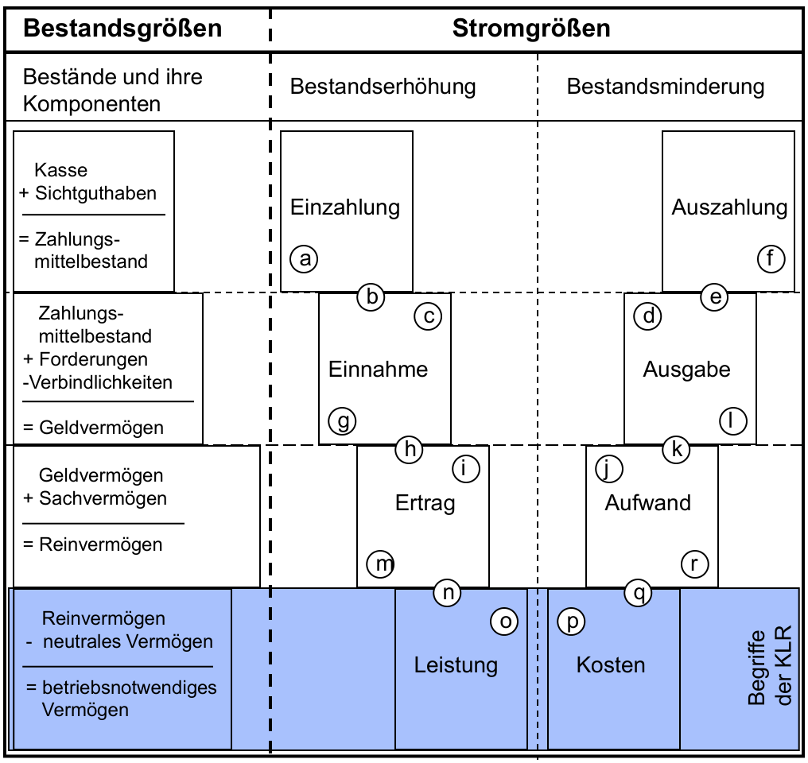
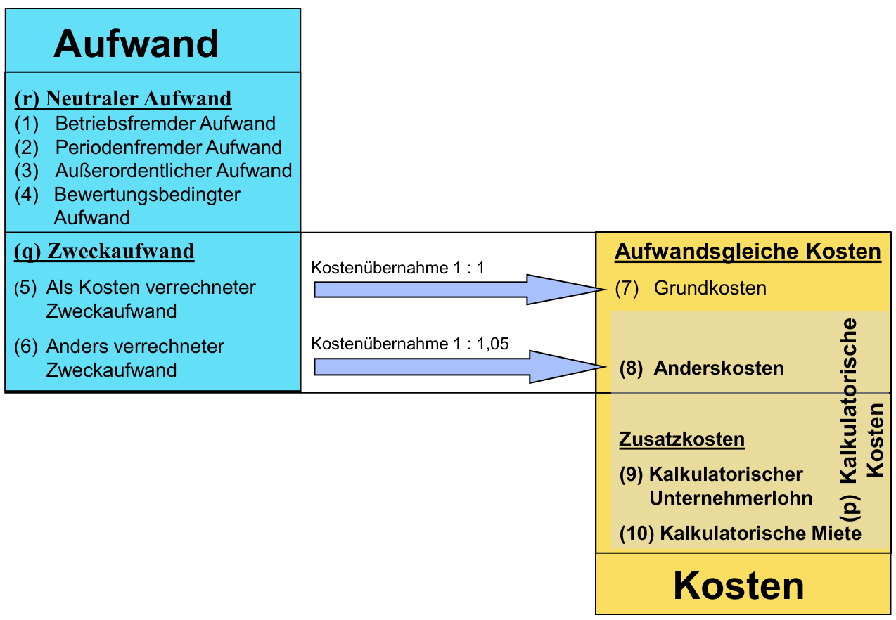

# Grundbegriffe und Abgrenzung

## Begriffspaare des Rechnungswesens und ihre Bestandsgrößen

Zu jeder Bestandsgröße stehen im Schaubild zwei Stromgrößen (Bestandserhöhung / Bestandsminderung):

| Bestandsgrößen: Bestände und ihre Komponenten | Stromgröße Bestandserhöhung | Stromgröße Bestandsminderung |
|---|---|---|
| **Kasse** + **Sichtguthaben** = Zahlungsmittelbestand | Einzahlung | Auszahlung |
| Zahlungsmittelbestand + Forderungen - Verbindlichkeiten = Geldvermögen | Einnahme | Ausgabe |
| Geldvermögen + Sachvermögen = Reinvermögen | Ertrag | Aufwand |
| Reinvermögen - neutrales Vermögen = betriebsnotwendiges Vermögen | Leistung | Kosten |

Die letzte Zeile (Leistung, Kosten) ist blau hinterlegt und beschriftet mit „Begriffe der KLR“.

Die Kästen der Stromgrößen sind im Schaubild treppenförmig gegeneinander versetzt. Die Felder a bis r zeigen, wo sich zwei benachbarte Begriffe decken und wo nicht:

| Begriffspaar | Feld nur im oberen Begriff | Feld auf der gemeinsamen Kante (in beiden) | Feld nur im unteren Begriff |
|---|---|---|---|
| Einzahlung / Einnahme **[K]** | a (nur Einzahlung) | b | c (nur Einnahme) |
| Einnahme / Ertrag | g (nur Einnahme) | h | i (nur Ertrag) |
| Ertrag / Leistung | m (nur Ertrag) | n | o (nur Leistung) |
| Auszahlung / Ausgabe | f (nur Auszahlung) | e | d (nur Ausgabe) |
| Ausgabe / Aufwand | l (nur Ausgabe) | k | j (nur Aufwand) |
| Aufwand / Kosten **[K Vorjahr]** | r (nur Aufwand) | q | p (nur Kosten) |

## Aufwand und Kosten

Aufwand:

- (r) Neutraler Aufwand **[K]**
  - (1) Betriebsfremder Aufwand
  - (2) Periodenfremder Aufwand
  - (3) Außerordentlicher Aufwand
  - (4) Bewertungsbedingter Aufwand
- (q) Zweckaufwand
  - (5) Als Kosten verrechneter Zweckaufwand
  - (6) Anders verrechneter Zweckaufwand

Kosten (Reihenfolge im Kasten von oben nach unten):

- Überschrift „Aufwandsgleiche Kosten“, darunter (7) Grundkosten
- (8) Anderskosten
- Überschrift „Zusatzkosten“, darunter (9) Kalkulatorischer Unternehmerlohn und (10) Kalkulatorische Miete
- (p) Kalkulatorische Kosten: beige hinterlegte Fläche mit senkrechter Beschriftung, sie umfasst (8) Anderskosten und die Zusatzkosten (9), (10)

Pfeile vom Aufwand zu den Kosten:

- (5) Als Kosten verrechneter Zweckaufwand wird zu (7) Grundkosten: Kostenübernahme 1 : 1
- (6) Anders verrechneter Zweckaufwand wird zu (8) Anderskosten: Kostenübernahme 1 : 1,05

Zum neutralen Aufwand (r) gibt es im Schaubild kein Gegenstück bei den Kosten, zu den Zusatzkosten kein Gegenstück beim Aufwand.

## Abgrenzung: Filtern + Bewerten + Ergänzen **[K]**

Aufbau der Tabelle:

- Rechnungskreis I, Finanzbuchhaltung: Spalten Aufwand, Ertrag
- neutrales Ergebnis / Abgrenzungsergebnis
  - unternehmensbezogene Abgrenzung: Spalten Aufwand, Ertrag
  - kostenrechnerische Korrekturen: Spalten Aufwand lt. FiBu, verr. Kosten
- Rechnungskreis II, Kosten- und Leistungsrechnung: Spalten Kosten, Leistung

In der Tabelle der Folie sind die Felder dunkel gefüllt, die hier mit „blau“ oder „orange“ beschriftet sind:

| Bezeichnung | RK I: Aufwand | RK I: Ertrag | unternehmensbez. Abgrenzung: Aufwand | unternehmensbez. Abgrenzung: Ertrag | kostenrechn. Korrekturen: Aufwand lt. FiBu | kostenrechn. Korrekturen: verr. Kosten | RK II: Kosten | RK II: Leistung |
|---|---|---|---|---|---|---|---|---|
| neutraler Aufwand | blau | | blau | | | | | |
| Zweckaufwand / Grundkosten | blau | | | | | | orange | |
| Zweckaufwand / Anderskosten | blau | | | | blau | orange | orange | |
| Zusatzkosten | | | | | | orange | orange | |

Beispiel unter der Tabelle:

Die Finanzbuchhaltung aktivierte die **Anschaffungskosten** einer Maschine mit **20.000 €**. In der Kosten- und Leistungsrechnung werden **30.000 € Wiederbeschaffungskosten** angesetzt. Bei einer Abschreibung über **fünf Jahre** setzt die Anlagenbuchhaltung eine Abschreibung **(AfA)** in Höhe von **4.000** € an. In der KLR hingegen sind **kalkulatorisch 6.000 €** anzusetzen. Tragen Sie bitte in die Tabelle die anfallenden Tätigkeiten Filtern, Übernehmen, Bewerten und ergänzen ein.

Die Eintragungen des Profs dazu stehen in den Notizen.

## Programm Kostenartenrechnung **[K Vorjahr]**

- Wir klären, welche zentralen Fragen die Kostenartenrechnung beantwortet.
- Sie können mit Leistung und Kosten, Ertrag und Aufwand umgehen.
- Sie können einen Kostenartenplan erstellen. Nach welchen Kriterien entstehen Kostenartenpläne?
- Kosten systematisieren
- **Zwischen fixen und variablen Kosten einerseits und Einzel- und Gemeinkosten andererseits unterscheiden.** **[K]**
- Material- und Personalkosten planen und erfassen.
- Sie kennen kalkulatorischen Kosten und können mit diesen arbeiten.
- Wie unterstützt die Kostenartenrechnung die statische Investitionsrechnung?

## Notizen

Fett gesetzte Wörter im Folientext sind vom Prof mit dem Marker markiert.

### Begriffspaare des Rechnungswesens und ihre Bestandsgrößen

- Dickes rotes K links neben dem Schaubild, auf Höhe der Zeilen Zahlungsmittelbestand / Geldvermögen. Mit demselben roten Marker markiert: „Einzahlung“, a, b, c, „Einnahme“. Die Felder a, b, c sind zusätzlich blau eingekreist.
- Zu a (grün): „Kunde bezahlt Rechnung“.
- Zu b (blau): „Barverk. 20“.
- Zu c (blau): „Verkauf auf Ziel“, daneben in Rot „30“.
- Neben der Rechnung zum Geldvermögen stehen drei Zahlenspalten in den Farben der drei Beispiele:

  | | grün | blau | rot |
  |---|---|---|---|
  | Zahlungsmittelbestand | 30 | 20 | Strich |
  | + Forderungen | -30 | Strich | 30 |
  | - Verbindlichkeiten | | Strich | Strich |
  | = Geldvermögen | 0 | 20 | 30 |

- Rotes K zwischen dem Kasten „Kasse + Sichtguthaben = Zahlungsmittelbestand“ und dem Kasten Einzahlung, direkt an den rot eingekreisten Feldern a, b, c. (Vorjahr)
- Rotes K rechts neben den rot eingekreisten Feldern r, q, p (Aufwand / Kosten). (Vorjahr)
- In Blau: „Kasse Bank“ links neben „Kasse + Sichtguthaben“; „Soll“ im Kasten Einzahlung, „Haben“ am Kasten Auszahlung; „Bar“ bei b, „Ziel“ bei c. (Vorjahr)

### Aufwand und Kosten

- Rotes K links neben der Liste (1) bis (4) unter „(r) Neutraler Aufwand“.
- An derselben Stelle: „K“ und darunter „1 Beispiel“. (Vorjahr)
- Textfeld links neben dem Aufwand: „Wertverzehr, welcher von der Finanzbehörde anerkannt wird“.
- Textfeld oben, mit grünem Strich zu „(r) Neutraler Aufwand“: „keine betriebliche Leistungserstellung“.
- Textfeld neben (1) Betriebsfremder Aufwand: „Spende ans Rote Kreuz“ („Spende“ markiert).
- Textfeld neben (3) Außerordentlicher Aufwand: „Katastrophe (Feuer, Sturm)“.
- Textfeld links neben „(q) Zweckaufwand“: „Aufwand für betriebliche Leistungserstellung“.
- Textfeld über „Kostenübernahme 1 : 1“: „FiBu : KLR“.
- Textfeld rechts neben den Kosten: „Wertverzehr für betriebliche Leistungserstellung“.
- Rotes Kreuz in der leeren Fläche über den Kosten (gegenüber dem neutralen Aufwand) und rotes Kreuz in der leeren Fläche unter dem Aufwand (gegenüber den Zusatzkosten).
- Markiert: „(r) Neutraler Aufwand“, „(1)“, „(3)“, „(q) Zweckaufwand“.
- Oben in der Mitte: „Filtern“; rechts oben (gegenüber dem neutralen Aufwand): „weg gefiltert“. (Vorjahr)
- Beispiele neben dem neutralen Aufwand: (1) Spende, (2) Gewerbesteuernachzahlung, (3) Katastrophe, (4) Sonderabschreibung. (Vorjahr)
- Links neben „(q) Zweckaufwand“: „betriebl. Wertverzehr“. (Vorjahr)
- „1 : 1“ eingekreist, „Grundkosten“ unterstrichen. (Vorjahr)
- An (6) Anders verrechneter Zweckaufwand: „AfA“, mit Strich zu „Anschaffungskosten abschreiben“. (Vorjahr)
- Bei „Kostenübernahme 1 : 1,05“: „mehr“; darunter „1 : 0,8 weniger“. (Vorjahr)
- Unter den Pfeilen: „Abgrenzen“. (Vorjahr)
- Rechts neben (7) / (8): „Wiederbeschaffung“, „kalk. Abschr.“; rechts neben den Zusatzkosten: „Ergänzen“. (Vorjahr)

### Abgrenzung: Filtern + Bewerten + Ergänzen

- Am linken Rand neben der Tabelle: rotes K, daneben eine „2“.
- Eintragungen in der Zeile Zweckaufwand / Anderskosten (im Vorjahr dieselben Zahlen):
  - RK I Aufwand: 4000
  - kostenrechnerische Korrekturen, Aufwand lt. FiBu: 4000
  - kostenrechnerische Korrekturen, verr. Kosten: 6000
  - RK II Kosten: 6000
- Textfeld rechts oben, mit Strich zu „kostenrechnerische Korrekturen“: „Saldo 2.000“.
- Farben der Markierungen im Beispieltext: blau „Anschaffungskosten“, „20.000 €“, „fünf Jahre“, „(AfA)“, „4.000“; rosa „Kos(ten- und Leistungsrechnung)“, „30.000 € Wiederbeschaffungskosten“, „kalkulatorisch 6.000 €“.
- Am rechten Rand: 20000 / 5 = 4'. (Vorjahr)
- Markiert in Gelb: „Finanzbuchhaltung“, „Anschaffungskosten“, „20.000 €“, „fünf Jahre“, „(AfA) in Höhe von 4.000“; in Grün: „Kosten- und Leistungsrechnung“, „30.000 € Wiederbeschaffungskosten“, „kalkulatorisch 6.000 €“. Die 4000 sind gelb, die 6000 grün eingetragen. (Vorjahr)

### Programm Kostenartenrechnung

- Dickes rotes K links neben dem Punkt „Zwischen fixen und variablen Kosten einerseits und Einzel- und Gemeinkosten andererseits unterscheiden.“; der Punkt ist rosa markiert.
- Rotes K rechts oben auf der Folie. (Vorjahr)
- Markiert: „zentralen Fragen die Kosten(artenrechnung)“, „fixen und variablen Kosten“, „Einzel- und Gemeinkosten“, „Material-“, „kalkulatorischen Kosten“. (Vorjahr)

Quelle: kostenrechnung/origin/mitschriebt_3_von_5_aktuell.pdf, Folien 8-10, 13
Vorjahr: kostenrechnung/origin/mitschrieb_letzte_jahr.pdf, Folien 10-12, 14
