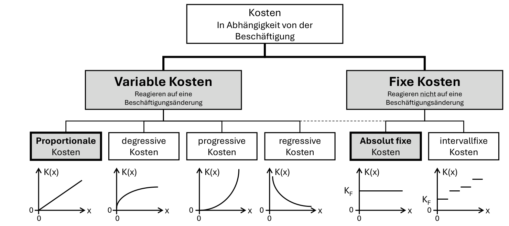
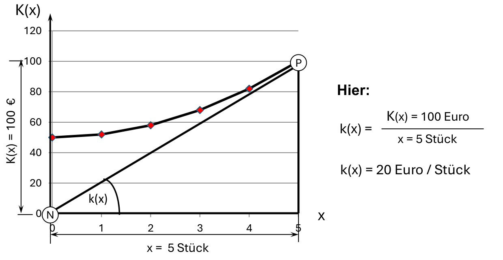
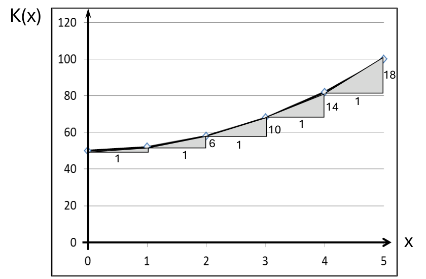

# Kosten in Abhängigkeit von der Beschäftigung

## Variable und fixe Kosten

Kosten in Abhängigkeit von der **Beschäftigung**:

- **Variable Kosten**: Reagieren auf eine Beschäftigungsänderung
  - **Proportionale** Kosten **[K]**
  - degressive Kosten
  - progressive Kosten
  - regressive Kosten
- **Fixe Kosten**: Reagieren _nicht_ auf eine Beschäftigungsänderung
  - **Absolut fixe** Kosten **[K]**
  - intervallfixe Kosten

Unter jeder Kostenart zeigt das Bild den Verlauf K(x) über x. Bei den absolut fixen und den intervallfixen Kosten ist KF auf der K(x)-Achse eingetragen.

## Ermittlung von Durchschnittskosten

Durchschnittskosten k (x) = Gesamtkosten K (x) / Menge x **[K]**

- Im Bild: Kurve K(x), Punkt N im Ursprung, Punkt P bei x = 5 Stück und K(x) = 100 €; k(x) ist der Winkel der Geraden von N nach P.
- Hier: k(x) = (K(x) = 100 Euro) / (x = 5 Stück)
- k(x) = 20 Euro / Stück

## Ermittlung von Grenzkosten **[K]**

Grenzkosten der Praxis beantwortet die Frage: Was hat das letzte Stück gekostet?

Im Bild sind unter der Kurve K(x) Stufen der Breite 1 eingezeichnet, beschriftet mit den Höhen 6, 10, 14 und 18.

| x | 0 | 1 | 2 | 3 | 4 | 5 |
|---|---|---|---|---|---|---|
| K(x) = 50 + 2 * x² | 50 | 52 | 58 | 68 | 82 | 100 |
| Δ K | | 2 | 6 | 10 | 14 | 18 |

## Kostenfunktion K(x) = 50 + 2 * x²

- Grenzkosten in der Theorie!
- Grenzkosten in der Praxis!

Die Tabelle ist auf der Folie leer. Der Prof hat sie handschriftlich bis x = 3 ausgefüllt:

| x | Gesamtkosten: K(x) = KF + Kv(x) | Stückkosten: k(x) = kF + kv(x) |
|---|---|---|
| 0 | 50 = 50 + 0 | Strich (kein Wert) |
| 1 | 52 = 50 + 2 | 50 = 50 + 2 |
| 2 | 58 = 50 + 8 | 29 = 24 + 4 |
| 3 | 68 = 50 + 18 | 22 2/3 = 16 2/3 + 6 |
| 4 | | |
| 5 | | |

Hinweis zur Vorlage: Die Handschrift weicht bei den Stückkosten in zwei Zeilen von der gedruckten Tabelle des Vorjahres ab (dort x = 1: 52 = 50 + 2, x = 2: 29 = 25 + 4). Beides ist so übernommen.

### Kostenfunktion K(x) = 50 + 2 * x², ausgefüllte Tabelle (nur Vorjahr)

Im Vorjahr war die Tabelle gedruckt ausgefüllt:

| x | K(x) | = KF | + Kv(x) | k(x) | = kF | + kv(x) |
|---|---|---|---|---|---|---|
| 0 | 50 | 50 | 0 | | | |
| 1 | 52 | 50 | 2 | 52 | 50 | 2 |
| 2 | 58 | 50 | 8 | 29 | 25 | 4 |
| 3 | 68 | 50 | 18 | 22,67 | 16,67 | 6 |
| 4 | 82 | 50 | 32 | 20,5 | 12,5 | 8 |
| 5 | 100 | 50 | 50 | 20 | 10 | 10 |

K(x), KF und Kv(x) sind die Gesamtkosten, k(x), kF und kv(x) die Stückkosten. Bei x = 0 ist das Feld der Stückkosten grau und leer.

## Beschäftigungsabhängige Kosten der Gießerei Diabolus

Mephisto Beelzebub, der Leiter der Gießerei Diabolus, fertigt ausschließlich Motivplatten für Kaminöfen. Zusammen mit seinem Buchhalter Anton Mammon erhebt er die Gesamtkosten in Abhängigkeit von der hergestellten Menge. Sie erhalten:

| Produktions- und Absatzmenge x | Gesamtkosten K (x) | = KF | + Kv | K(x)/x = k | kF | kv | Grenz Praxis |
|---|---|---|---|---|---|---|---|
| 0 | 100 | 100 | 0 | Strich (kein Wert) | | | |
| 1 | 130 | 100 | 30 | 130 | 100 | 30 | 30 |
| 2 | 150 | 100 | 50 | 75 | 50 | 25 | 20 |
| 3 | 165 | | | | | | |
| 4 | 175 | | | | | | |
| 5 | 183 | | | | | | |
| 6 | 190 | | | | | | |
| 7 | 195 | 100 | 95 | 195/7 | 100/7 | 95/7 | |

Sie beauftragen den Praktikanten Christian Engel, eine Kostenanalyse durchzuführen.

Gedruckt sind nur die Spalten x und K (x). Daneben stehen sechs leere Spalten (zwei blau, drei grün, eine weiß). In der aktuellen Folie ist nichts eingetragen. Die Überschriften und Werte der sechs Spalten sind die Handschrift des Profs (Vorjahr), ausgefüllt sind nur die Zeilen 0, 1, 2 und 7:

- Blaue Spalten: K(x) = KF + Kv
- Grüne Spalten, überschrieben mit "Stückkosten": K(x)/x = k = kF + kv
- Weiße Spalte: "Grenz Praxis"

## Zusammenfassung der beschäftigungsabhängigen Kosten

| Verlauf | Gesamtkosten | Stückkosten | Grenzkosten | Reagibilität R | Beispiel |
|---|---|---|---|---|---|
| proportional | K(x) = a * x mit a > 0 | k(x) = a | K´(x) = a | R = 1 | Akkordlohn, normaler linearer Materialverbrauch |
| degressiv | K(x) = a * x^b mit a > 0 und 0 < b < 1 | k(x) = a * x^(b-1) | K´(x) = a*b*x^(b-1) | 0 < R < 1 | Lernvorgänge, der Nachfolger kostet weniger als der Vorgänger |
| progressiv | K(x) = a * x^b mit a > 0, b > 1 | k(x) = a * x^(b-1) | K´(x) = a*b*x^(b-1) | R > 1 | Beschleunigungsvorgänge, der Nachfolger kostet mehr als der Vorgänger |
| regressiv | K(x) = a * x^b mit a > 0, b < 0 | k(x) = a * x^(b-1) | K´(x) = a*b*x^(b-1) | R < 0 | absolut fallende Kosten, wie Heizkosten im Kino |
| fix | K(x) = a * x^b mit a > 0, b = 0 | k(x) = a / x | 0 | R = 0 | Rüstkosten oder zeitproportionale Kosten, wie Mieten, Kfz-Steuer |

## Notizen

### Variable und fixe Kosten

- Mit Marker hervorgehoben: "Beschäftigung" (im Titel), "Variable Kosten", "Fixe Kosten", "Proportionale", "Absolut fixe"
- Unter dem Titel (blau): K(x) = a + b · x^c
- Textfeld rechts über "Fixe Kosten": "Zeitproportional: Miete bezahle ich mtl."
- Proportionale Kosten: im Diagramm ist der Ursprung (0 / 0) eingekreist
- Regressive Kosten: im Diagramm sind zwei Punkte der Kurve eingetragen, 100 bei x = 1 und 80 bei x = 2
- Über dem Titel: K(x) = a · x^b, hinter "Beschäftigung" im Titel: x (Vorjahr)
- Rechts über "Fixe Kosten", mit Strich zum Kasten: "zeitproportional" (Vorjahr)
- Über "Proportionale Kosten": b = 1, über "degressive Kosten": 0 < b < 1, über "progressive Kosten": b > 1 (Vorjahr)
- Proportionale Kosten: im Diagramm Punkt bei x = 7 und K = 14, am Steigungswinkel "2", darunter Kv(x) = 2 · x (Vorjahr)
- Regressive Kosten: im Diagramm zwei Punkte der Kurve, 80 bei x = 1 und `[unleserlich]` bei x = 2 (Vorjahr)

### Ermittlung von Grenzkosten

- Rechts neben dem Diagramm: Δ K = (K_n - K_(n-1)) / (x_n - x_(n-1))
- Textfeld in der Tabelle hinter "Δ K": "Praxis"

### Kostenfunktion K(x) = 50 + 2 * x²

- Über "Grenzkosten in der Theorie!": K' = 4 * x
- Rechts oben, mit Strich zur Spalte "Stückkosten": K(x) / x
- In der Spalte x ist die 1 eingekreist
- Links über dem Titel: "100% können" (Vorjahr)
- Rechts neben der Tabelle zwei Spalten unter der Überschrift "Grenzk", links K', rechts Δ K (Vorjahr):
  - x = 0: K' = 0
  - x = 1: K' = 4, Δ K = 2
  - x = 2: K' = 8, Δ K = 6
  - x = 5: K' = 20, Δ K = 18

### Beschäftigungsabhängige Kosten der Gießerei Diabolus

- Links über dem Titel: "100% können" (Vorjahr)
- In der Zeile x = 0 sind die 0 und die 100 eingekreist (Vorjahr)

### Zusammenfassung der beschäftigungsabhängigen Kosten

- Zeile "proportional": hinter "K(x) = a * x" steht an der Stelle des Exponenten ein kleines rotes Zeichen: `[unleserlich]`
- Mit Marker hervorgehoben: "proportional" und "fix" (Vorjahr)

Quelle: kostenrechnung/origin/mitschriebt_3_von_5_aktuell.pdf, Folien 16-20 und 25
Vorjahr: kostenrechnung/origin/mitschrieb_letzte_jahr.pdf, Folien 17-21 und 25
