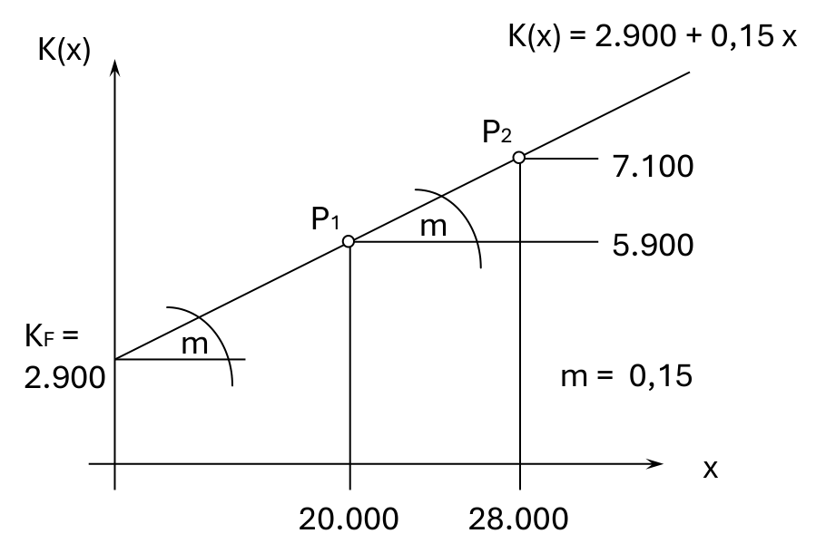
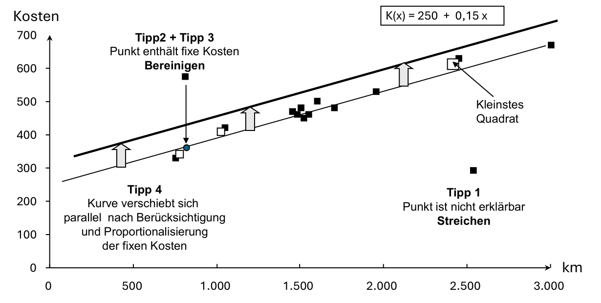

# Buchhalterische Methode, Zwei-Punkte-Form und Methode der kleinsten Quadrate

## Buchhalterische Methode

Die Spalte "Euro" ist auf der Folie leer. In der ersten Spalte steht das Vorzeichen der Hauptposition, in der zweiten das Vorzeichen der eingerückten Teilposition. Die Teilpositionen ergeben die Zwischensumme der folgenden Zeile ("= ...").

| | | Fixe Kosten | Euro |
|---|---|---|---|
| | + | Kfz-Haftpflichtversicherung | |
| | + | Kfz-Vollkaskoversicherung | |
| | + | Kfz-Teilkaskoversicherung | |
| | - | Prämienrückerstattung | |
| + | | = Versicherung | |
| + | | Kfz-Steuer | |
| + | | Garagenkosten und Einstellplatzkosten | |
| | + | Anteil Disagio | |
| | + | laufende Zinsen für Darlehen | |
| + | | = Zinsen | |
| | + | Anteilige Leasingsonderzahlung | |
| | + | laufende Leasingraten | |
| + | | = Leasing | |
| + | | Abschreibung | |
| + | | Fahrzeugreinigung und Pflege | |
| | | **Summe fixe Kosten** | |

| | | variable Kosten | Euro |
|---|---|---|---|
| + | | Treibstoffkosten laut Beleg | |
| + | | Öle und Schmierstoffe laut Beleg | |
| | + | Inspektionen | |
| | + | laufende Reparaturen | |
| | + | sonstige laufende Wartung | |
| + | | = Wartung | |
| | + | Reifen | |
| | + | Lampen, Scheibenwischer und sonstiges | |
| + | | = Ersatz- und Verschleißteile | |
| | | **Summe variable Kosten** | |

Letzte Zeile, doppelt unterstrichen: **Gesamtkosten**

## Mathematische Methode nach der Zwei-Punkte-Form

- K(x) = 2.900 + 0,15 x
- P1: x = 20.000, K(x) = 5.900
- P2: x = 28.000, K(x) = 7.100
- m = 0,15 (als Steigungswinkel der Geraden bei KF und bei P1 eingezeichnet)
- KF = 2.900 (Schnittpunkt der Geraden mit der K(x)-Achse)

## Methode der kleinsten Quadrate

- K(x) = 250 + 0,15 x
- Achsen: Kosten (0 bis 700) über km (0 bis 3.000)
- **Tipp 1**: Punkt ist nicht erklärbar, **Streichen**
- **Tipp2 + Tipp 3**: Punkt enthält fixe Kosten, **Bereinigen**
- **Tipp 4**: Kurve verschiebt sich parallel nach Berücksichtigung und Proportionalisierung der fixen Kosten
- Beschriftung mit Pfeil auf ein kleines Quadrat an einem Punkt: Kleinstes Quadrat

## Notizen

### Buchhalterische Methode

- Links neben der Tabelle: "alle Belege" mit Pfeil in ein gezeichnetes Gefäß, dahinter "="
- Rechts neben der Tabelle: zwei gezeichnete Gefäße mit "+" dazwischen, beschriftet mit "KF" und "KV"
- Rechts oben:
  - X_1.1 = 62.000
  - X_31.12 = 72.000
  - Δ = 10.000

Quelle: kostenrechnung/origin/mitschriebt_3_von_5_aktuell.pdf, Folien 22-24
