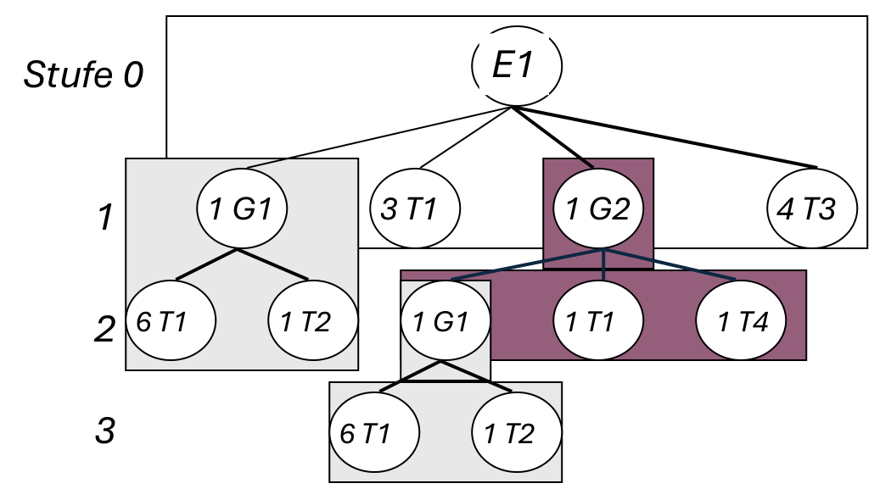

# Materialkosten

## Materialkosten nach Gewerbe als Anteil vom Umsatz

| Gewerbe | Anteil am Umsatz |
|---|---|
| **Großhandel** | **80 %** |
| **Einzelhandel** | **70 %** |
| **Ernährungswirtschaft** | **62 %** |
| Straßenfahrzeugbau | 60 % |
| Bekleidungsgewerbe | 60 % |
| Eisenschaffende Industrie | 58 % |
| Holzbearbeitung und Texilgewerbe | 55 % |
| Elektrotechnik | 54 % |
| Stahl und Leichtmetallbau | 52 % |
| Chemische Industrie | 47 % |
| Maschinenbau | 46 % |

Großhandel, Einzelhandel und Ernährungswirtschaft sind auf der Folie gelb hinterlegt.

## Methoden zur Ermittlung des Materialverbrauchs

- Inventurmethode (Befundrechnung, Bestandsdifferenzrechnung)
- Skontrationsmethode (Bestandsfortschreibung)
- retrograde Methode (Rückrechnung)
- Behelfsmethode (Zugang gleich Abgang)

## Inventurmethode

### Inventurmethode im T-Kontensystem

| Soll — Rohstoff 4711 Periode t-1 | Haben |
|---|---|
| Anfangsbestand t-1 | Endbestand lt. Inventur |
| + Zugang 1 | Saldo = Verbrauch an Rohstoff 4711 der Periode t-1 |
| + Zugang 2 | |
| + Zugang 3 | |
| + Zugang 4 | |
| + Zugang 5 | |
| Summe Soll | Summe Haben |

Endbestand lt. Inventur (Periode t-1) = Anfangsbestand t (Periode t)

| Soll — Rohstoff 4711 Periode t | Haben |
|---|---|
| Anfangsbestand t | Endbestand lt. Inventur |
| + Zugang 1 | Saldo = Verbrauch an Rohstoff 4711 der Periode t |
| + Zugang 2 | |
| + Zugang 3 | |
| Summe Soll | Summe Haben |

Verbrauch in t = Anfangsbestand t + Zugänge t - Endbestand t

### Vor- und Nachteile der Inventurmethode

| Vorteile | Nachteile |
|---|---|
| Man benötigt keine Materialbuchhaltung. | Körperliche Inventur ist notwendig. |
| Methode mit geringen Kosten. | Diebstahl, Schwund und Verderb lassen sich nicht ermitteln. |
| Bei sorgfältiger Inventur ist der exakte Verbrauch gegeben. | Soll-Ist-Abweichungen können nicht analysiert werden. |
| | Eine Kostenverrechnung auf Kostenträger oder Kostenstellen ist nicht möglich, daher keine verursachungsgerechte Materialabrechnung. |
| | Laufende Angaben über die Entwicklung des Lagerbestands sind nicht möglich. |

## Skontrationsmethode

### Materialentnahmeschein

Formular "Materialentnahmeschein Pussy Cat Spielzeugwaren GmbH" mit den Feldern:

- belastende Kostenstelle
- entlastende Kostenstelle
- Tabelle mit den Spalten:

| Artikelnummer | Bezeichnung | Menge | Einheit | Preis pro Einheit | Preis gesamt |
|---|---|---|---|---|---|
| | | | | | |

- Bemerkung
- Summe
- Datum:
- genehmigt
- erhalten
- gebucht

### Skontrationsmethode im T-Kontensystem

| Soll — Rohstoff 4711 Periode t-1 | Haben | | Soll — Rohstoffeinsatz 4711 Periode t | Haben |
|---|---|---|---|---|
| Anfangsbestand t | gebuchter Abgang 1 | ↔ | gebuchter Abgang 1 | Saldo: Verbrauch lt. Buch (regulärer Verbruch) |
| + Zugang 1 | gebuchter Abgang 2 | ↔ | gebuchter Abgang 2 | |
| + Zugang 2 | gebuchter Abgang 3 | ↔ | gebuchter Abgang 3 | |
| + Zugang 3 | gebuchter Abgang 4 | ↔ | gebuchter Abgang 4 | |
| + Zugang 4 | gebuchter Abgang 5 | ↔ | gebuchter Abgang 5 | |
| + Zugang 5 | Saldo: Endbestand | | | |
| Summe Soll | Summe Haben | | Summe Soll | Summe Haben |

Die Pfeile (↔) verbinden jeden gebuchten Abgang im Haben des Kontos Rohstoff 4711 mit demselben gebuchten Abgang im Soll des Kontos Rohstoffeinsatz 4711.

### Vor- und Nachteile der Skontrationsmethode

| Vorteile | Nachteile |
|---|---|
| Der Materialverbrauch ist pro Kostenstelle oder pro Kostenträger verursachungsgerecht zu erfassen. | Aufwendige Methode, da eine Lagerbuchhaltung und ein Belegsystem notwendig sind. |
| Irreguläre Abgänge wie Diebstahl sind ermittelbar. | Die Methode muss konsequent angewendet werden: keine Materialentnahme ohne Beleg. |
| Permanente Inventur ist durch Abschluss der Bücher möglich. | |
| Der Lagerbestand ist laufend feststellbar. | |
| Die Koppelung an ein Bestell- und Ordersystem ist möglich. | |

## Retrograde Methode

### Baukastenstückliste für retrograde Bedarfsermittlung

Inhalt der Stückliste:

- Stufe 0: E1
- Stufe 1 (unter E1): 1 G1, 3 T1, 1 G2, 4 T3
- Stufe 2:
  - unter 1 G1 (Stufe 1): 6 T1, 1 T2
  - unter 1 G2 (Stufe 1): 1 G1, 1 T1, 1 T4
- Stufe 3 (unter 1 G1 aus Stufe 2): 6 T1, 1 T2

### Vor- und Nachteile der retrograden Methode

| Vorteile | Nachteile |
|---|---|
| schnelle Ermittlung von Sollverbrauchsmengen | die Stücklisten müssen gepflegt werden |
| Analysen erst durch diese Methode möglich | es werden lediglich Soll - Verbrauchsmengen ermittelt |

## Wertansätze zur Bewertung des Materialverbrauchs

- **Verrechnungspreis**
- Opportunitätspreis
- Wiederbeschaffungspreis
- Anschaffungspreis
- Tagespreis

## Analyse des Materialverbrauchs (Beispiel)

Anton Gsundi, Reformhausbesitzer in Bad Waldsee, stellt für die Studenten der Internationalen Business School Studentenfutter her. Für 250 Gramm Studentenfutter benötigt er **200 Gramm** ungeschwefelte Rosinen, 20 Gramm Haselnüsse, 15 Gramm blanchierte Mandelkerne, 5 Gramm Paranusskerne, 5 Gramm Pekannusskerne und 5 Gramm Cashewkerne.

Anton Gsundi möchte zuerst den Materialverbrauch für Rosinen ermitteln. Er beauftragt den Lehrbub Penibel, alle Daten zur Ermittlung des Rosinenverbrauchs zusammenzutragen.

Der Lehrbub erfasst folgende Daten:

| Tag | Vorgang | Menge |
|---|---|---|
| 01.09. | Anfangsbestand | 20 kg |
| 02.09. | Verbrauch lt. Materialentnahmeschein | 15 kg |
| 20.09. | Zugang lt. Eingangsrechnung | 50 kg |
| 01.10. | Verbrauch lt. Materialentnahmeschein | 30 kg |
| 15.10. | Verbrauch lt. Materialentnahmeschein | 20 kg |
| 01.11. | Zugang lt. Eingangsrechnung | 50 kg |
| 20.11. | Verbrauch lt. Materialentnahmeschein | 12 kg |
| 05.12. | Verbrauch lt. Materialentnahmeschein | 20 kg |

Die **Inventur** am 31.12. ergab einen Bestand von **21 Kilogramm** Rosinen. Hergestellt wurden insgesamt **480 Packungen** Studentenfutter.

Gemeinsam ermitteln Anton Gsundi und Lehrbub Penibel den Materialverbrauch nach der **Inventurmethode**, der **Skontrationsmethode**, der **retrograden Methode** und der **Behelfsrechnung**. **[K Vorjahr]**

## Notizen

### Materialkosten nach Gewerbe als Anteil vom Umsatz

- Textfeld unter dem Titel: "Bezogene externe Leistung"
- "Materialkosten" im Titel gelb markiert
- K(x) = P * X

### Methoden zur Ermittlung des Materialverbrauchs

- K = P · X (Vorjahr)

### Analyse des Materialverbrauchs (Beispiel)

- Farbmarkierung der Angaben je Methode:
  - gelb = Inventurmethode: "Inventur", Anfangsbestand 20 kg, die beiden Zugänge 50 kg und 50 kg, Bestand 21 Kilogramm
  - grün = Skontrationsmethode: "Materialentnahmeschein", die Verbräuche 15 kg, 30 kg, 20 kg, 12 kg, 20 kg
  - pink = retrograde Methode: 200 Gramm, 480 Packungen
  - blau = Behelfsrechnung: Striche neben den beiden Zugängen (50 kg, 50 kg)
- Inventurmethode: Soll 120 - Inv 21 = verb. 99 IST
- Inventur = AB + Zugänge - EB: 20 + 100 - 21 = 99 (Vorjahr)
- Skontrationsmethode: verb 97 Buch
- Skont. = Σ Abgänge = 97 (Vorjahr)
- retrograde Methode: verb Soll 96
- retrogr = 480 x 200 = 96 (Vorjahr)
- Behelfsrechnung: 100 kg
- Behelfsrechnung: 100 (Vorjahr)
- Farbmarkierung im Vorjahr: gelb = Inventurmethode (20 kg, 50 kg, 50 kg, 21 Kilogramm), grün = Skontrationsmethode (15 kg, 30 kg, 20 kg, 12 kg, 20 kg), blau = retrograde Methode (200 Gramm, 480 Packungen), rot = Behelfsrechnung (Striche neben den beiden Zugängen 50 kg) (Vorjahr)
- Das rote K steht am linken Rand neben den letzten beiden Absätzen (Inventur am 31.12. / Ermittlung nach den vier Methoden) (Vorjahr)
- Links oben neben dem Titel: schwarzes "A" mit kleinem "K", gelb eingekreist (Vorjahr)

Quelle: kostenrechnung/origin/mitschriebt_3_von_5_aktuell.pdf, Folien 31-41

Vorjahr: kostenrechnung/origin/mitschrieb_letzte_jahr.pdf, Folien 31-41
