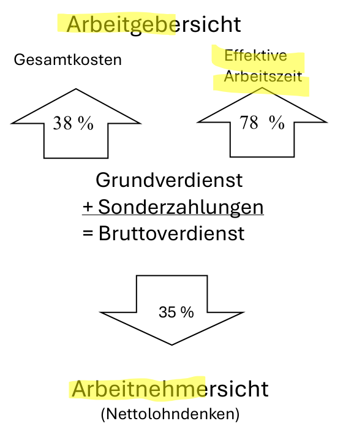

# Personalkosten, Funktionskosten und Sachkostenplanung

## Personalkosten nach Gewerbe

| Personalkosten nach Gewerbe | Anteil am Umsatz | Anteil am Rohertrag |
|---|---|---|
| Eisenschaffende Industrie | 30% | 70% |
| Elektrotechnik | 33% | 69% |
| Straßenfahrzeugbau | 26% | 66% |
| Baugewerbe | 34% | 65% |
| Maschinenbau | 35% | 65% |
| Stahl und Leichtmetallbau | 29% | 60% |
| Holzbearbeitung | 30% | 58% |
| Bekleidungsgewerbe | 21% | 51% |
| Chemische Industrie | 27% | 51% |
| **Einzelhandel** | **13%** | **41%** |
| **Großhandel** | **8%** | **36%** |
| **Ernährungswirtschaft** | **13%** | **34%** |

Einzelhandel, Großhandel und Ernährungswirtschaft sind auf der Folie gelb hinterlegt.

## Lohnkosten aus Arbeitgeber- und Arbeitnehmersicht

Inhalt der Grafik:

- **Arbeitgeber**sicht: Gesamtkosten (Pfeil nach oben, 38 %), **Effektive Arbeitszeit** (Pfeil nach oben, 78 %)
- Grundverdienst + Sonderzahlungen = Bruttoverdienst
- **Arbeitnehmer**sicht (Nettolohndenken): Pfeil nach unten, 35 %

| Arbeitgeber | Jahr | Monat | in % |
|---|---|---|---|
| **Gesamtkosten** | **54.596** | **4.549,65** | **126,9%** |
| + freiwillige Leistungen | 551 | 45,93 | 1,3% |
| + gesetzliche + tarifliche leistungen | 10.821 | 901,72 | 25,2% |
| + Sonderzahlungen | 3.645 | 303,75 | 8,5% |
| Grundverdienst | 39.579 | 3.298,25 | 92,0% |
| + Sonderzahlungen | 3.439 | 286,55 | 8,0% |
| Brutto-Arbeitslohn: | 43.017,64 | 3.584,80 | 100% |
| Lohnsteuer: | 2544 | 212,00 | 5,9% |
| Kirchensteuer: | | 0,00 | 0,0% |
| Krankenversicherung: | 3434,4 | 286,20 | 8,0% |
| Pflegeversicherung: | 795 | 66,25 | 1,8% |
| Rentenversicherung: | 3943,2 | 328,60 | 9,2% |
| Arbeitslosenversicherung: | 508,8 | 42,40 | 1,2% |
| **Netto-Arbeitslohn:** | **31.792,24** | **2.649,35** | **73,9%** |
| **Arbeitnehmer** | | | |

Gesamtkosten und Netto-Arbeitslohn sind in der Tabelle der Folie fett gedruckt.

## Gliederung der Personalkosten

- Personalkosten
  - Löhne
    - Fertigungslöhne für Aufträge
    - Hilfslöhne
  - Gehälter
    - Gehälter für Aufträge
    - Gehälter nicht produktiv
  - Personalnebenkosten
    - gesetzliche PNK
    - tarifliche PNK
    - betriebliche PNK

## Personalkosten im Kostenartenplan

An welche PNKs sollten Sie denken?

- 43 Personalnebenkosten (PNK)
  - 431 gesetzliche PNK
    - 43110 Rentenversicherung
    - 43120 Krankenversicherung
    - 43130 Arbeitslosenversicherung
    - 43140 Unfallversicherung
    - 43150 Pflegeversicherung
    - 43160 Entgeltfortzahlung im Krankenfall (80 %)
    - 43170 Bezahlte Feiertage
  - 432 tarifliche PNK
    - 43210 Urlaubsentgelt
    - 43220 Urlaubsgeld
    - 43230 tarifliche Altersversorgung
    - 43240 tarifliche Vermögensbildung
  - 433 betriebliche PNK
    - 43310 Fahrgeldzuschuß
    - 43320 Essensgeld
  - 434 sonstige PNK
    - 43410 Abfindungen
    - 43420 Sonderkosten bei Einstellung

## Ermittlung effektiver Arbeitszeit und tatsächlicher Personalkosten

Ist jährlich zu aktualisieren.

| Stand 1.04.2020 | Zeile | Tage | Stunden | Euro | % von eff. Arbeitszeit | % von Grundverdienst | Berechnungsbasis |
|---|---|---|---|---|---|---|---|
| Nominale Arbeitszeit | 1 | 261 | 2.088 | 37.166 | | 100,00% | |
| Feiertage | 2 | 12 | 96 | 2.208 | 5,94% | 4,60% | |
| Krankheitstage | 3 | 14 | 112 | 2.576 | 6,93% | 5,36% | |
| Urlaub | 4 | 30 | 240 | 5.520 | 14,85% | 11,49% | |
| sonstige Freistellungen | 5 | 3 | 24 | 552 | 1,49% | 1,15% | |
| Summe Ausfallzeiten | 6 | 59 | 472 | 10.856 | 29,21% | 22,61% | |
| Effektive Arbeitszeit | 7 | 202 | 1.616 | 26.311 | 100,00% | 77,39% | 23,00 |
| Grundverdienst | 8 | 261 | 2.088 | 37.166 | 129,21% | 100,00% | 17,80 |
| Sonderzahlungen | | | | | | | |
| Vermögenswirksame Leistung | 9 | Euro/Person | | 319 | 1,21% | 0,86% | |
| Urlaubsgeld | 10 | 50 % von Z.4 | | 1.549 | 5,89% | 4,17% | |
| Weihnachtgratifikation | 11 | 50 % von Z.8/12 | | 1.549 | 5,89% | 4,17% | |
| Summe (9 - 11) | 12 | | | 3.244 | 12,98% | 8,73% | 2,01 |
| Brutto Jahresverdienst | 13 | | | 40.583 | 142,19% | 109,19% | 25,01 |
| Gesetzliche Sozialversicherung | | | | | | | max. Basis |
| Rentenversicherung | 14 | 9,30% | von Basis | 3.774 | 14,34% | 10,15% | 77.400 |
| Krankenversicherung | 15 | 7,30% | von Basis | 2.963 | 11,26% | 7,97% | 56.450 |
| Arbeitslosenversicherung | 16 | 1,20% | von Basis | 487 | 1,85% | 1,31% | 77.400 |
| U1 Aufwendungsausgleichsgesetz | | | | | | | 56.450 |
| U2 Mutterschaftsgeld | | | | | | | 48.600 |
| U3 Insolvenzgeld | | 0,60% | | 243 | 0,93% | 0,66% | 56.450 |
| Unfallversicherung | 17 | 1,20% | von Basis | 738 | 2,80% | 1,99% | 56.450 |
| betriebliche Altersvorsorge | 18 | 4,50% | von Basis | 1.384 | 5,26% | 3,72% | 77.400 |
| Pflegeversicherung | 19 | 1,525% | von Basis | 619 | 2,35% | 1,67% | 56.450 |
| Summe (14 - 19) | 20 | | | 10.208 | 38,80% | 27,47% | 6,32 |
| betriebliche und freiwillige Leistungen | | | | | | | |
| Fahrgeldzuschuss | 21 | | | 120 | 0,46% | 0,32% | |
| Kantine | 22 | | | 400 | 1,52% | 1,08% | |
| Betriebsrat | 23 | | | | | | |
| Summe (21 - 23) | 24 | | | 520 | 1,98% | 1,40% | 0,32 |
| Gesamtkosten | 25 | | | 51.311 | 182,97% | 138,06% | 31,75 |

Auf der Folie gelb hinterlegt: die Zeilen 1 bis 5 (Bezeichnung, Zeile, Tage).

## Funktionskosten im Industrie-Kontenrahmen

- Funktionskosten im Kontenrahmen
  - 61 Aufwendungen für bezogene Leistungen
    - 6160 Fremdinstandhaltung
    - 6170 Sonstige Aufwendungen für bezogene Leistungen
  - 67 Aufwendungen für die Inanspruchnahme von Rechten und Diensten
    - 6700 Mieten und Pachten
    - 6710 Leasing
    - 6720 Lizenzen und Konzessionen
    - 6730 Gebühren
    - 6750 Kosten des Geldverkehrs
    - 6760 Aufwendungen für Provisionen
    - 6770 Rechts- und Beratungskosten
  - 68 Aufwendungen für Kommunikation (Dokumentation, Information, Reisen und Werbung)
    - 6800 Büromaterial
    - 6810 Zeitungen und Fachliteratur
    - 6820 Post- und Telekommunikationsgebühren
    - 6850 Reisekosten
    - 6860 Bewirtung und Präsentation
    - 6870 Werbung
  - 69 Aufwendungen für Beiträge, Wertkorrekturen, periodische Abgrenzungen und Sonstiges
    - 6900 Versicherungsbeiträge
    - 6920 Beiträge für Wirtschaftsverbände und Berufsvertretungen
    - 6930 Verluste aus Schadensfällen
    - 6940 Sonstige Aufwendungen
    - 6950 Abschreibungen auf Forderungen
  - 70 Betriebliche Steuern
    - 7000 Gewerbekapitalsteuer
    - 7010 Vermögenssteuer
    - 7020 Grundsteuer
    - 7030 Kraftfahrzeugsteuer
    - 7070 Ausfuhrzölle
    - 7080 Verbrauchssteuern
    - 7090 Sonstige Steuern

## Sachkostenplanung in einer Fertigungskostenstelle nach dem Gemeinschafts-Kontenrahmen der Industrie

Sachkostenplanung für Planjahr t+1

- Kostenstelle 225 NC - Drehen
- Leitung Herr Müller
- Bereich T:

| SIVZ | Kostenart | IST 1-12 t-1 | IST 1-8 t | HR 1-12 t | Planung t+1 | Abw. % |
|---|---|---|---|---|---|---|
| 19 | 44001 Betriebs- und Hilfsstoffe | 1.500 | 900 | 1.350 | 1.400 | 3,7% |
| 20 | 44101 WKZ mit Schnellverschluss | 7.200 | 5.700 | 8.500 | 8.800 | 3,5% |
| 20 | 44110 WKZ Spanabhebend | 1.800 | 1.420 | 2.100 | 2.000 | -4,8% |
| 20 | 44111 Sonstige Werkzeuge | 450 | 300 | 450 | 460 | 2,2% |
| 20 | 44121 Vorrichtungen | 200 | 140 | 210 | 200 | -4,8% |
| 23 | 44401 Material für Reparaturen | 350 | 300 | 450 | 440 | -2,2% |
| 27 | 46070 Literatur | 80 | 0 | 0 | 0 | |
| 33 | 46130 Bürobedarf | 250 | 180 | 270 | 250 | -7,4% |
| 37 | 46140 Weiterbildung | 900 | 750 | 1.100 | 1.200 | 9,1% |
| | **Summe** | **12.730** | **9.690** | **14.430** | **14.750** | **2,2%** |

## Notizen

### Personalkosten nach Gewerbe

- Textfeld neben der Spalte "Anteil am Rohertrag": "= Umsatz - Materialverbrauch"
- Über der Spalte "Anteil am Rohertrag": "= Umsatz - Material" (Vorjahr)

### Lohnkosten aus Arbeitgeber- und Arbeitnehmersicht

- Gelb markiert: "Arbeitgeber" (in Arbeitgebersicht), "Effektive Arbeitszeit", "Arbeitnehmer" (in Arbeitnehmersicht)

### Gliederung der Personalkosten

- Auf "Fertigungslöhne für Aufträge": EK
- Auf "Gehälter für Aufträge": EK
- Auf "Hilfslöhne": GK
- Auf "Gehälter nicht produktiv": GK
- Links neben "Fertigungslöhne für Aufträge": "KT Einzelk." (Vorjahr)
- "Aufträge" in "Fertigungslöhne für Aufträge" und "Gehälter für Aufträge" rot markiert (Vorjahr)

### Sachkostenplanung in einer Fertigungskostenstelle nach dem Gemeinschafts-Kontenrahmen der Industrie

- Über den Spalten "IST 1-12 t-1" und "IST 1-8 t": IST
- Über den Spalten "HR 1-12 t" und "Planung t+1": Plan (links und rechts mit je einem senkrechten roten Strich von den anderen Spalten abgetrennt)

Quelle: kostenrechnung/origin/mitschriebt_3_von_5_aktuell.pdf, Folien 42-48

Vorjahr: kostenrechnung/origin/mitschrieb_letzte_jahr.pdf, Folien 42-47
