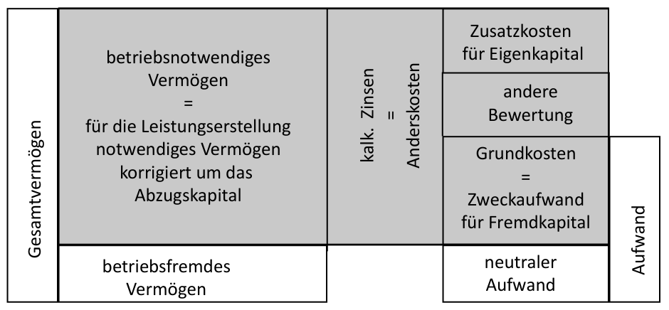
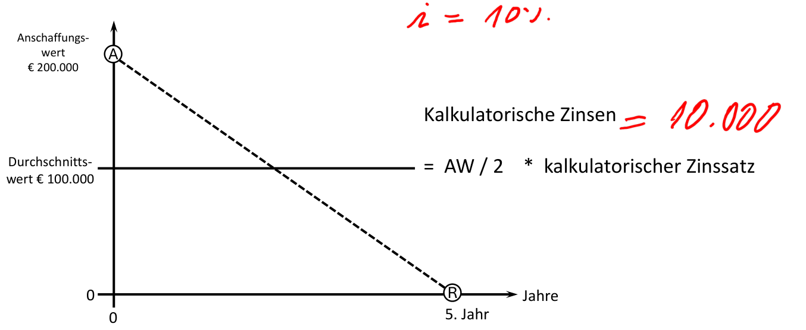
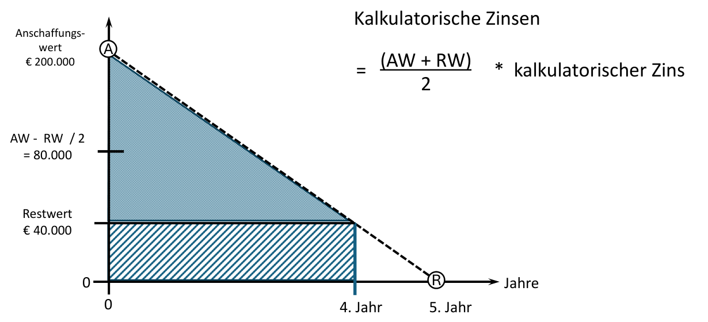
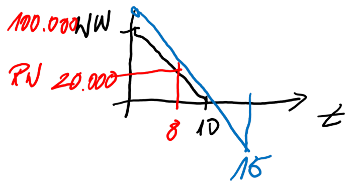

# Kalkulatorische Kosten

## Kalkulatorische Kostenarten **[K Vorjahr]**

- Kalkulatorische Kostenarten
  - Zusatzkosten **(kein Aufwand)**
    - kalkulatorischer **Unternehmerlohn**
    - kalkulatorische Miete
  - Anderskosten (anderer Aufwand)
    - kalkulatorische Abschreibung
    - kalkulatorische Zinsen
    - kalkulatorische Wagnisse

## Tipp kalkulatorische Miete

- Die Höhe der kalkulatorischen Miete orientiert sich am örtlichen Mietspiegel.
- Der Mietspiegel kann erfragt werden bei Ihrer IHK, den örtlichen Maklern, den Banken, den Verbraucherschutzverbänden, den Bauverwaltungsämtern der Gemeinden und im Internet über Mietspiegelportale.

## Anderskosten

| Aufwand in der Finanzbuchhaltung | Kalkulatorische Kosten in der Kosten- und Leistungsrechnung |
|---|---|
| **bilanzielle** Abschreibung | **kalkulatorische** Abschreibung |
| Fremdkapitalzinsen | kalkulatorische Zinsen |
| eingetretene Einzelwagnisse | kalkulatorische Wagnisse |
| Anschaffungspreise für Materialverbrauch | Verrechnungspreise für Materialverbrauch |

## Kalkulatorische Abschreibung

### Abschreibungsarten (nur Vorjahr)

- Abschreibungsarten
  - handelsrechtliche Abschreibung
    - planmäßige Abschreibung, HGB § 253 Abs.2 S. 1u.2
    - außerplanmäßige Abschreibung, HGB § 253 Abs.2 S.3
  - steuerrechtliche Abschreibung
    - Absetzung für Abnutzung (AfA), EStG § 7 Abs.1 S. 1-3
    - Absetzung für Substanzverringerung (AfS), EStG § 7 Abs.6
    - Absetzung für außergewöhnliche technische u. wirtschaftliche Abnutzung (AfaA), EStG § 7 Abs.1 S.5
    - Teilwertabschreibung, EStG § 6 Abs.1
    - Sonderabschreibungen, z.B. EStG § 7g oder EStDV §§ 76-82d
  - kalkulatorische Abschreibung

Auf der Folie stehen dazu zwei leere Tabellen "Bilanziell" und "Kalkulatorisch" (je drei Zeilen). Die Einträge sind handschriftlich:

| | Bilanziell | Kalkulatorisch |
|---|---|---|
| Wertansatz | Anschaffungsk. | Wiederbeschaffung |
| Dauer | AfA-Tabelle | Nutzungsdauer gepl. |
| bis | 0 | auch unter Null |

### Welche Abschreibungen gibt es? KLR Kalkulatorisch: Ansatz linearer Abschreibung

- Abschreibung = (**WBW** - RW) / n **[K]**
- WBW = AW * (1 + Inflationsrate)^n
- oder WBW = AW * Preissteigerungsfaktor
- Angaben auf der Folie:
  - AW = 20.000
  - Inflationsrate = 5 %
  - WBW ?
  - Preissteigerungsfaktor ?
  - n= 5 Jahre
- Welche Probleme haben Sie, einen WBW oder RW festzulegen?
- Bei der statischen Investitionsrechnung gibt es keine WBW - warum?

### Kalkulatorische Abschreibung (nur Vorjahr)

1. Erläutern Sie den Unterschied zwischen bilanzieller und kalkulatorischer Abschreibung.
2. Für eine Maschine liegen folgende Angaben vor:

   | Angabe | Wert |
   |---|---|
   | Anschaffungskosten | 15.000 € |
   | Wiederbeschaffungskosten | 18.000 € |
   | Nutzungsdauer | 4 Jahre |
   | Leistungsvorrat | 60.000 Stück |

   Nach einem Jahr sind mit der Maschine 11.500 Stück gefertigt worden.

   Welchen Abschreibungsbetrag würden Sie in der Kostenrechnung verrechnen? Die Antwort ist zu begründen !

## Kalkulatorische Zinsen

### Globalverfahren: betriebsnotwendigem Vermögen und kalkulatorischen Zinsen

betriebsnotwendiges Vermögen - zinsloses Fremdkapital = betriebsnotwendiges Kapital

Inhalt der Grafik:

- Gesamtvermögen besteht aus:
  - betriebsnotwendiges Vermögen = für die Leistungserstellung notwendiges Vermögen korrigiert um das Abzugskapital (grau)
  - betriebsfremdes Vermögen (weiß)
- neben dem betriebsnotwendigen Vermögen: kalk. Zinsen = Anderskosten (grau)
- rechte Spalte von oben nach unten:
  - Zusatzkosten für Eigenkapital (grau)
  - andere Bewertung (grau)
  - Grundkosten = Zweckaufwand für Fremdkapital (grau)
  - neutraler Aufwand (weiß, neben dem betriebsfremden Vermögen)
- Klammer "Aufwand" rechts: umfasst "Grundkosten = Zweckaufwand für Fremdkapital" und "neutraler Aufwand"

Fragen auf der Folie:

- Wann wenden Sie das Globalverfahren an?
- Was ist betriebsnotwendiges Kapital? = betriebsnotwendiges Vermögen – zinsloses Fremdkapital (Abzugskapital)

### Kalkulatorische Zinsen ohne Restwert (nur Vorjahr)

- Woher bekomme ich den kalkulatorischen Zinssatz?
- Ein Unternehmen kauft eine Maschine zu 200.000 €. Wie hoch sind die kalkulatorischen Zinsen. (ohne Restwert)
- Kalkulatorische Zinsen = AW / 2 * kalkulatorischer Zinssatz

Inhalt der Grafik:

- senkrechte Achse: Anschaffungswert € 200.000 (Punkt A), Durchschnittswert € 100.000 (waagrechte Linie), 0
- waagrechte Achse: Jahre, von 0 bis 5. Jahr (Punkt R)
- gestrichelte Linie von A nach R
- rot im Bild = Handschrift des Profs (siehe Notizen)

### Kalkulatorische Zinsen 5 % mit Restwert 40.000 € **[K]**

- Ein Unternehmen kauft eine Maschine zu 200.000 €. Wie hoch sind die kalkulatorischen Zinsen.
- Kalkulatorische Zinsen = (AW + RW) / 2 * kalkulatorischer Zins

Inhalt der Grafik:

- senkrechte Achse: Anschaffungswert € 200.000 (Punkt A), AW - RW / 2 = 80.000, Restwert € 40.000, 0
- waagrechte Achse: Jahre, 0, 4. Jahr, 5. Jahr (Punkt R)
- gestrichelte Linie von A nach R
- Dreieck zwischen Restwert und Anschaffungswert bis zum 4. Jahr (blau gefüllt), darunter Rechteck in Höhe des Restwerts bis zum 4. Jahr (schraffiert)

Problem: Abschreibung unter Null

## Kalkulatorische Wagnisse

### Wagnisse

| Finanzbuchhaltung | | Kosten- und Leistungsrechnung |
|---|---|---|
| keine Berücksichtigung | Allgemeine Unternehmensrisiko | Berücksichtigung im Gewinnzuschlag |
| Versicherungsprämie Aufwand | versicherbares Risiko: Elementarereignisse Beständewagnisse Transportwagnisse Währungsrisiko Forderungsausfall | Versicherungsprämie Grundkosten Zweckaufwand Aufwandsgleiche Kosten |
| keine Berücksichtigung im Schadensfall Rückstellung a.o.Aufwand | nicht versicherte Risiken | Versicherungsprämie als Opportunitätskosten Zusatzkosten |
| keine Berücksichtigung | nicht versicherbare Risiken | Zusatzkosten |

Die mittlere Spalte hat auf der Folie keine Überschrift.

### Kalkulatorische Wagnisse, ihre Bezugsgrößen und ihre Verrechnung

| Wagnisart | Wagnisbezugsgröße | Wagniszuordnung |
|---|---|---|
| Sachanlagenwagnis | Restbuchwert der Sachanlage | Kostenstelle, der die Sachanlage für die Zuordnung der kalkulatorischen Zinsen zugeordnet ist. |
| Beständewagnis | Buchwert der Vorräte an Material und Erzeugnissen | Kostenstelle, der die Vorräte für die Zurechnung der kalkulatorischen Zinsen zugeordnet ist. |
| Forderungsbestände | Buchwert der Forderungen | Kostenstelle, der die Forderungen für die Zurechnung der kalkulatorischen Zinsen zugeordnet ist. |
| sonstige Finanzwagnisse | je nach Geschäftsvorfall | Planung und Kontrolle |
| Gewährleistungswagnis | Umsatz der betreffenden Erzeugnisgruppe | Vertriebsgruppenkostenstelle |
| sonstige Wagnisse | je nach Geschäftsvorfall | Planung und Kontrolle |

### Kalkulatorisches Wagnis (Delkredere Wagnis)

In den letzten 7 Jahren hat ein Handelsbetrieb bei einem Umsatz von **200 Mio. €**, davon **40 % Verkauf auf Ziel**, insgesamt **800.000 € Forderungsverluste** erlitten. In der nächsten Periode sind Zielverkäufe in Höhe von 10 Mio. € geplant. Wie ist in der Kosten- und Leistungsrechnung zu verfahren?

## Abgrenzungen besprechen **[K]**

Die Folie ist eine Aufgabe aus einer Prüfung (12 Punkte). Sie steht mit der handschriftlichen Lösung des Profs bei den Aufgaben: [origin-tasks/task-3](../../../origin-tasks/task-3/TASKS.md)

## Mindestverzinsung

Die Unternehmensleitung erwartet eine Mindestverzinsung von 10 %. Überprüfen Sie, ob die nachfolgende Investition nach der statischen Beurteilung die geforderte Verzinsung erreicht.

Investitionssumme 200.000 €. Die Nutzungsdauer beträgt 10 Jahre. Es wird vermutet: Restwert 40.000 €.

Jährlich wird ein Umsatz von 60.000 € und Kosten in Höhe von 20.000 € erwartet. Die kalkulatorischen Zinsen und die kalkulatorische Abschreibung sind dabei noch nicht berücksichtigt.

## Notizen

### Kalkulatorische Kostenarten

- Blau markiert: "(kein Aufwand)" und "Unternehmerlohn"
- K mit gelbem Marker links neben dem Titel; "(kein Aufwand)" gelb markiert (Vorjahr)

### Anderskosten

- Über den beiden Spalten: 1 ≠ 1 (links "1" über "Aufwand in der Finanzbuchhaltung", rechts "1" über "Kalkulatorische Kosten in der Kosten- und Leistungsrechnung")
- Gelb markiert: "bilanzielle" und "kalkulatorische" (Zeile Abschreibung)

### Abschreibungsarten (nur Vorjahr)

- Skizze rechts oben auf der Folie (Vorjahr):

  

  - senkrechte Achse: 100.000 (rot), daneben zwei schwarze Buchstaben [unleserlich]; RW 20.000 (rot)
  - waagrechte Achse: t, mit den Marken 8 (rot), 10 (schwarz), 15 (blau)
  - schwarze Linie fällt von der senkrechten Achse bis zur Marke 10 auf der t-Achse
  - rote Linie von RW 20.000 waagrecht bis zur schwarzen Linie und von dort senkrecht zur Marke 8
  - blaue Linie fällt vom oberen Ende der senkrechten Achse durch die t-Achse hindurch bis unter die Achse, dort Marke 15

### Welche Abschreibungen gibt es? KLR Kalkulatorisch: Ansatz linearer Abschreibung

- Textfeld über der Formel: "Substanzerhaltung = Wert + Technik", mit rotem Strich mit "WBW" verbunden
- "WBW" in der Formel gelb markiert
- Rotes K links neben der Formel "Abschreibung = (WBW - RW) / n"
- Über dem Titel "Ansatz linearer Abschreibung": "rechnen K" (rot) (Vorjahr)
- Minuszeichen in "WBW - RW" rot eingekreist (Vorjahr)
- n = 10 (Vorjahr)
- WBW ? = 20000 · 1,05^10 = 32.570 (Vorjahr)
- Hinter "Welche Probleme haben Sie, einen WBW festzulegen?": "- Inflationsrate"; "WBW" unterstrichen (Vorjahr)

### Kalkulatorische Zinsen ohne Restwert (nur Vorjahr)

- i = 10 % (Vorjahr)
- Kalkulatorische Zinsen = 10.000 (Vorjahr)

### Kalkulatorische Zinsen 5 % mit Restwert 40.000 €

- Formel "Kalkulatorische Zinsen = (AW + RW) / 2 * kalkulatorischer Zins" rot eingekreist
- (200 000 + 40 000) / 2 x 0,05 = 6.000
- Rotes K am linken Rand neben der Grafik
- Über dem Titel: "Rechnen K" (rot) (Vorjahr)
- i = 10 % (Vorjahr)
- Kalkulatorische Zinsen = (200.000 + 40.000) / 2 = 120.000 x 10 % = 12.000 (Vorjahr)
- Pluszeichen in "(AW + RW)" rot eingekreist (Vorjahr)
- In der Grafik: im Dreieck "(AW-RW) / 2", im Rechteck darunter "RW" (Vorjahr)

### Wagnisse

- Über der mittleren Spalte: "Risiko"
- Zwei senkrechte rote Striche trennen die drei Spalten (Finanzbuchhaltung, mittlere Spalte, Kosten- und Leistungsrechnung); im Vorjahr ebenso
- "Finanzbuchhaltung" gelb und "Kosten- und Leistungsrechnung" orange markiert (Vorjahr)

### Kalkulatorisches Wagnis (Delkredere Wagnis)

- 800.000 / 80.000.000 = 1 % (Linien von "200 Mio. €" und "40 %" zum Nenner 80.000.000)
- Von "200 Mio." und "40 %": 80. Mio (Vorjahr)
- Risiko = 800.000 / 80.000.000 = 1 % (Vorjahr)
- Von "1 %" und "10 Mio. €": 100.000 (Vorjahr)

### Abgrenzungen besprechen

- Rotes K links zwischen Titel und Tabelle, daneben "30"
- K mit gelbem Marker links neben der Tabelle (Vorjahr)

### Mindestverzinsung

- Rotes "H" links über dem Titel

Quelle: kostenrechnung/origin/mitschriebt_3_von_5_aktuell.pdf, Folien 49-59

Vorjahr: kostenrechnung/origin/mitschrieb_letzte_jahr.pdf, Folien 48-61
