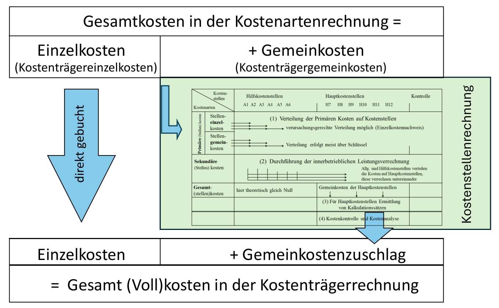

# Aufgaben der Kostenstellenrechnung und Bildung von Kostenstellen

## Programm: Kostenstellenrechnung

- Kostenstellenrechnung als Bindeglied zwischen Kostenarten- und Kostenträgerrechnung
- Fragen und Forderungen an die Kostenstellenrechnung!
- Wie lassen sich Kostenstellen bilden?
- Welches sind die zentralen Aufgaben der Kostenstellenrechnung – des BAB?
- Wie verteilen wir Kosten auf Kostenstellen?
- Welche Verfahren innerbetrieblichen Leistungsverrechnung können Sie anwenden?
- Warum wenden große Unternehmen das Gleichungsverfahren an?

## Kostenstellenrechnung als Bindeglied zwischen Kostenarten- und Kostenträgerrechnung

- Gesamtkosten in der Kostenartenrechnung = Einzelkosten (Kostenträgereinzelkosten) + Gemeinkosten (Kostenträgergemeinkosten)
- Einzelkosten: direkt gebucht (Pfeil direkt in die Kostenträgerrechnung)
- Gemeinkosten: gehen in die Kostenstellenrechnung (im Kasten ist der klassische Betriebsabrechnungsbogen abgebildet, Inhalt siehe [02-betriebsabrechnungsbogen-und-verteilungsschluessel](../02-betriebsabrechnungsbogen-und-verteilungsschluessel/TOPIC.md)) und kommen als Gemeinkostenzuschlag heraus
- Einzelkosten + Gemeinkostenzuschlag = Gesamt (Voll)kosten in der Kostenträgerrechnung

## Fragen an die Kostenstellenrechnung

Nach Haberstock I erfasst die Kostenstellenrechnung die Leistungen und die Kosten am Ort ihrer Entstehung, um folgende Fragen zu beantworten:

- Wo sind die Kosten und Leistungen entstanden?
- Wurden die Leistungen wirtschaftlich erbracht?
- Wer hat die Leistungen und Kosten zu verantworten?
- Können wir durch geeignete Bildung von Kostenstellen die Genauigkeit der Kalkulation erhöhen?
- Wie können die Gemeinkosten verursachungsgerecht auf die Kostenträger verteilt werden?

## Forderungen an KST

- Ist die Unterteilung klar und übersichtlich?
- Kann das Unternehmen mit dieser Organisation gut gesteuert werden?
- Erhalten die Manager die benötigten Informationen zur Steuerung?
- Können Profitcenter abgerechnet werden?
- Dient die Unterteilung einer genauen Kalkulation?
- Dient die Unterteilung einer effektiven Kosten- und Leistungskontrolle?
- Ist die Unterteilung wirtschaftlich oder verursacht sie selbst einen hohen Abrechnungsaufwand?

## Bildung von Kostenstellen

Auf der Folie steht hinter jedem Punkt nur eine leere Zeile:

- Objekt:
- Verrichtungen:
- Rang:
- Phase:
- Zweck:
- Sachmittel:
- Region:
- Person:

## Notizen

### Programm: Kostenstellenrechnung

- Haken hinter "Kostenstellenrechnung als Bindeglied zwischen Kostenarten- und Kostenträgerrechnung" (Vorjahr)
- "BAB" eingekreist (Vorjahr)
- Unterstrichen: "verteilen", "innerbetrieblichen", "Gleichungsverfahren" (Vorjahr)

### Kostenstellenrechnung als Bindeglied zwischen Kostenarten- und Kostenträgerrechnung

- Über der Folie: "100 %. Aufgabe aus KSt" (Vorjahr)
- Neben "Einzelkosten + Gemeinkosten" (Kostenartenrechnung): "Σ 100 %" (Vorjahr)
- Am Pfeil "direkt gebucht": "70 %"; an "Einzelkosten" (Kostenträgerrechnung): "70 %" (Vorjahr)
- Am Pfeil in die Kostenstellenrechnung: "30 %"; an "Gemeinkostenzuschlag": "30 %", rechts daneben "= 100 %" (Vorjahr)
- Im BAB bei Stelleneinzelkosten: "30 %"; "verursachungsgerechte Verteilung" gelb markiert und mit Linie verbunden mit "KST-EK" (Vorjahr)
- Im BAB bei Stellengemeinkosten ("Verteilung erfolgt meist über Schlüssel", unterstrichen): "KST-GK" (Vorjahr)
- Im BAB bei Gesamt(stellen)kosten: "30 %" (Vorjahr)
- Gelb markiert: "Kostenträgereinzelkosten", "Kostenträgergemeinkosten", "innerbetrieblichen Leistungsverrechnung", "Einzelkosten" (Kostenträgerrechnung) (Vorjahr)

### Fragen an die Kostenstellenrechnung

- Gelb markiert: "Haberstock", "Leistungen und die Kosten am Ort ihrer Entstehung"; "Ort" zusätzlich mit rotem Marker unterstrichen (Vorjahr)
- Hinter "Wo sind die Kosten und Leistungen entstanden?": "Ort" (Vorjahr)
- Unterstrichen: "wirtschaftlich", "verantworten", "Gemeinkosten" (Vorjahr)

### Bildung von Kostenstellen

- Haken rechts oben auf der Folie, die Zeilen sind nicht ausgefüllt (Vorjahr)

Quelle: kostenrechnung/origin/mitschriebt_3_von_5_aktuell.pdf, Folien 60-64

Vorjahr: kostenrechnung/origin/mitschrieb_letzte_jahr.pdf, Folien 62-66
