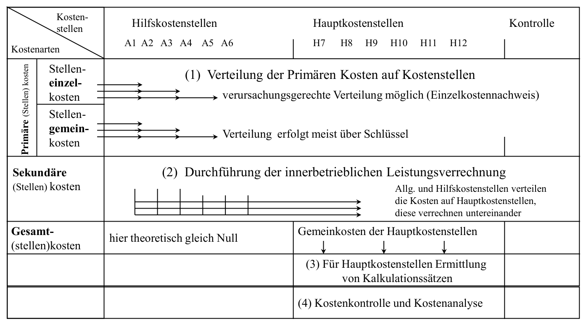
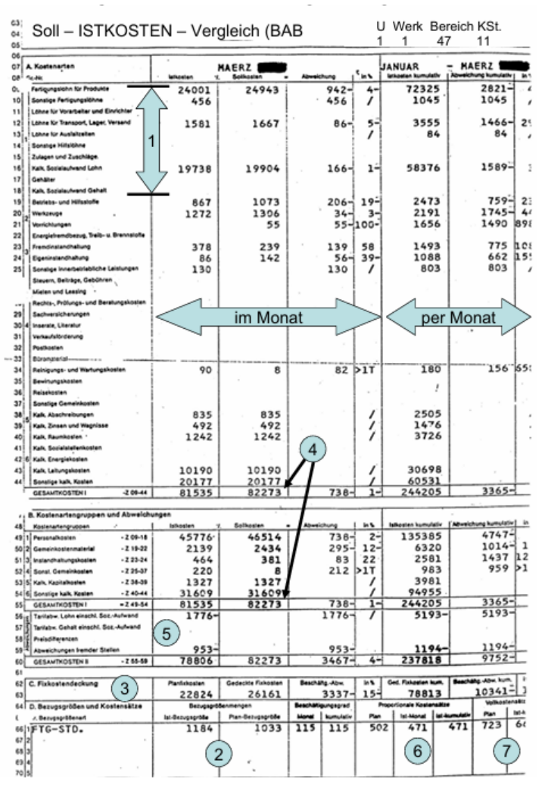
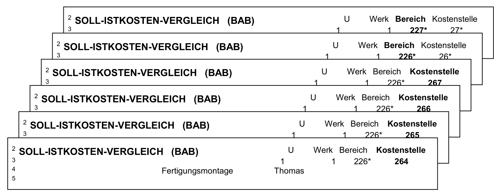

# Betriebsabrechnungsbogen (BAB) und Verteilungsschlüssel

## Klassischer Betriebsabrechnungsbogen **[K Vorjahr]**

- Spalten = Kostenstellen: Hilfskostenstellen (A1 A2 A3 A4 A5 A6), Hauptkostenstellen (H7 H8 H9 H10 H11 H12), Kontrolle
- Zeilen = Kostenarten

| Zeile | Schritt im BAB |
|---|---|
| Primäre (Stellen)kosten: Stelleneinzelkosten | (1) Verteilung der Primären Kosten auf Kostenstellen: verursachungsgerechte Verteilung möglich (Einzelkostennachweis) |
| Primäre (Stellen)kosten: Stellengemeinkosten | (1) Verteilung der Primären Kosten auf Kostenstellen: Verteilung erfolgt meist über Schlüssel |
| Sekundäre (Stellen)kosten | (2) Durchführung der innerbetrieblichen Leistungsverrechnung: Allg. und Hilfskostenstellen verteilen die Kosten auf Hauptkostenstellen, diese verrechnen untereinander |
| Gesamt(stellen)kosten | Hilfskostenstellen: hier theoretisch gleich Null. Hauptkostenstellen: Gemeinkosten der Hauptkostenstellen |
| (darunter, nur Hauptkostenstellen) | (3) Für Hauptkostenstellen Ermittlung von Kalkulationssätzen |
| (darunter, nur Hauptkostenstellen) | (4) Kostenkontrolle und Kostenanalyse |

## Betriebsabrechnungsbogen nach der flexiblen Plankostenrechnung

- Formular "Soll – ISTKOSTEN – Vergleich (BAB", Kopf: U 1, Werk 1, Bereich 47, KSt. 11
- "im Monat": Spalten MAERZ (Istkosten, Sollkosten, Abweichung, in %)
- "per Monat": Spalten JANUAR - MAERZ (Istkosten kumulativ, Abweichung kumulativ, in %)
- Abschnitte im Formular: A. Kostenarten, B. Kostenartengruppen und Abweichungen, C. Fixkostendeckung, D. Bezugsgrößen und Kostensätze
- Rechts neben dem Formular stehen die Nummern 1 bis 7 mit je einer leeren Zeile. Im Formular sitzen die Markierungen hier:
  - 1: Doppelpfeil über die Zeilen Fertigungslohn für Produkte bis Kalk. Sozialaufwand Gehalt (A. Kostenarten)
  - 2: bei D. Bezugsgrößen und Kostensätze, Bezugsgrößenmengen (FTG-STD.: Ist-Bezugsgröße 1184, Plan-Bezugsgröße 1033)
  - 3: bei C. Fixkostendeckung
  - 4: zwei Pfeile in die Spalte Sollkosten, auf die Zeile GESAMTKOSTEN I in A. und in B. (jeweils 82273)
  - 5: bei den Zeilen Abweichungen in B. (Tarifabw. Lohn einschl. Soz.-Aufwand, Tarifabw. Gehalt einschl. Soz.-Aufwand, Preisdifferenzen, Abweichungen fremder Stellen)
  - 6: bei D., Proportionale Kostensätze (Plan 502, Ist-Monat 471, Ist-kumulativ 471)
  - 7: bei D., Vollkostensätze (Plan 723)

## Loseblattsammlung von Betriebsabrechnungsbögen

Sechs hintereinander liegende Blätter "SOLL-ISTKOSTEN-VERGLEICH (BAB)", von hinten nach vorne mit diesen Kopfdaten:

| U | Werk | Bereich | Kostenstelle | fett hervorgehoben |
|---|---|---|---|---|
| 1 | 1 | 227* | 27* | Bereich |
| 1 | 1 | 226* | 26* | Bereich |
| 1 | 1 | 226* | 267 | Kostenstelle |
| 1 | 1 | 226* | 266 | Kostenstelle |
| 1 | 1 | 226* | 265 | Kostenstelle |
| 1 | 1 | 226* | 264 | Kostenstelle |

Auf dem vordersten Blatt (Kostenstelle 264) steht zusätzlich: Fertigungsmontage, Thomas.

## Verteilungsgrundlage für Kostenstelleneinzelkosten

| Kostenart | Verteilungsgrundlage | Ermittlung |
|---|---|---|
| Büromaterial | Entnahmeschein | Menge * Verrechnungspreis |
| Hilfs- und Betriebsstoffe | Entnahmeschein | Menge * Verrechnungspreis |
| Hilfslöhne | Stempelkarten | Stunden * Stundenlohn |
| Zusatzlöhne und Prämien | Zusatzlohnschein | |
| Gehälter | Gehaltsliste | Beschäftigte in Kostenstelle |
| Fremdleistungen | Rechnungen | |
| Strom, Gas, Wasser | Zähler | kWh, m³, m³ lt. Zähler |
| kalkulatorische Abschreibung | Anlagekartei | Verfahren beachten |
| kalkulatorische Zinsen | Anlagekartei | Restbuch- oder Durchschnittswert |
| Fuhrpark (Kfz - Kosten) | Fahrtenbuch | km * Verrechnungspreis |

## Es gibt Mengen- und Werteschlüssel

Frage auf der Folie: Nenne Sie zwei Werteschlüssel.

### Mengenschlüssel

| Kriterium | Beispiel |
|---|---|
| Menge | Beschäftigte, Zahl der eingesetzten hergestellten Stücke, Zahl der Buchungen, Konten, Prozesse |
| Zeit | Arbeits-, Fertigungs-, Maschinen- und Meisterstunden, Kalender-, Schicht-, Putz- und Rüstzeiten |
| Raum | Länge, Fläche, Volumen |
| Gewicht | Einsatz- und Transportgewicht, Produktmengen in Gewichtseinheiten |
| technische Größen | installierte kWh, PS, Kalorien, Heizwerte |

### Wertschlüssel (nur Vorjahr)

| Kriterium | Beispiel |
|---|---|
| Einstand | Einkaufswert, Eingangswert, Lagerwerte |
| Bestandsgrößen | Wert der Stoffe, Zwischen- und Fertigerzeugnisse, Wert der Anlagen |
| Absatzgrößen | Umsätze jeder Art (Bar-, Ziel-, Versandumsatz, Kreditvolumen) |
| Kostengrößen | Lohn, Material, Herstellkosten und Selbstkosten |
| Verrechnungsgrößen | Verrechnungspreise |

## Notizen

### Klassischer Betriebsabrechnungsbogen

- Rotes K am linken Rand neben dem BAB **[K Vorjahr]** (Vorjahr)
- Neben dem Titel: "BAB", Titel gelb markiert (Vorjahr)
- (1), (2), (3) und (4) rot eingekreist (Vorjahr)
- Gelb markiert: "Verteilung der Primären Kosten auf Kostenstellen", "Durchführung der innerbetrieblichen Leistungsverrechnung", "Kalkulationssätzen", "Kostenkontrolle und Kostenanalyse" (Vorjahr)

### Betriebsabrechnungsbogen nach der flexiblen Plankostenrechnung

- Im Formularkopf "49" ergänzt und zusammen mit "U Werk Bereich KSt. 1 1 47 11" eingekreist, Pfeil auf "Bereich" (Vorjahr)
- Zeile "Reisekosten" im Formular eingekreist, links daneben "Reisekosten" (Vorjahr)
- Felder mit den Markierungen 6 und 7 unten rechts im Formular eingekreist (Vorjahr)
- Neben Nummer 1: "Gruppe Personalkosten" (Vorjahr)
- Neben Nummer 2: "Planbeschäftig. 1033, Ist 1184", darunter ein Kürzel, das auf "St" endet (erster Buchstabe [unleserlich]) (Vorjahr)
- Neben Nummer 3: "KF" (Vorjahr)
- Neben Nummer 4: leer (Vorjahr)
- Neben Nummer 5: "Analyse" (Vorjahr)
- Neben Nummer 6: "kv Plan 50,20" (Vorjahr)
- Neben Nummer 7: "Gesamtk. pro Std 72,30" (Vorjahr)

### Loseblattsammlung von Betriebsabrechnungsbögen

- Unter dem Titel: "Boss D 49 ** 6 ***", darunter "49 1 1" und ein Pfeil auf "Bereich" (Vorjahr)
- Rechts neben dem Titel: "6 Vertrieb", darunter "6xxxx" (Vorjahr)
- Kostenstelle "26*" auf dem zweiten Blatt eingekreist (Vorjahr)

### Verteilungsgrundlage für Kostenstelleneinzelkosten

- Unter dem Titel: "Primär"; "einzelkosten" im Titel gelb markiert (Vorjahr)

### Mengenschlüssel

- Neben dem Titel: "Gemeinkosten"; "schlüssel" im Titel gelb markiert (Vorjahr)
- Bei Raum: "Fläche, Volumen" unterstrichen, daneben "/ Hochregallager" (Vorjahr)

### Wertschlüssel (nur Vorjahr)

- Gelb markiert: "Umsätze je[der Art]", "Lohn, Material, Herstellkosten und Selbstkosten", "Verrechnungspreise" (Vorjahr)

Quelle: kostenrechnung/origin/mitschriebt_3_von_5_aktuell.pdf, Folien 65-69

Vorjahr: kostenrechnung/origin/mitschrieb_letzte_jahr.pdf, Folien 67-72
