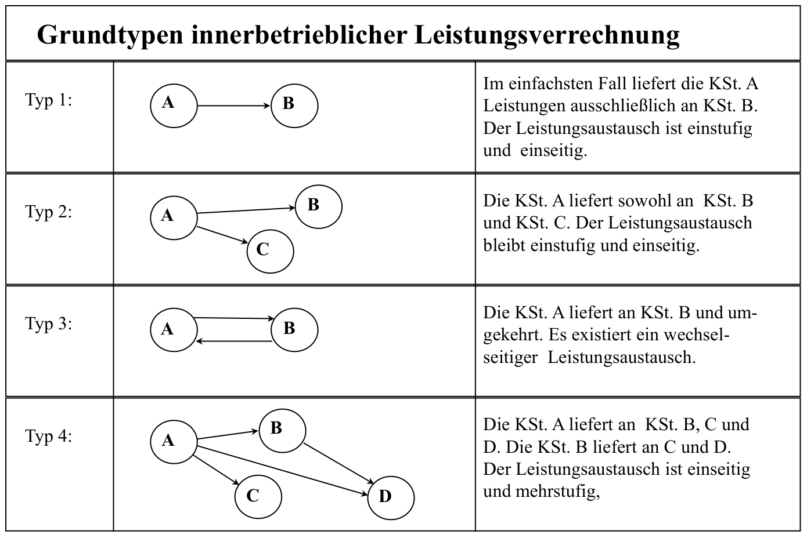

# Innerbetriebliche Leistungsverrechnung

## Grundtypen innerbetrieblicher Leistungsverrechnung



| Typ | Pfeile im Bild | Beschreibung |
|---|---|---|
| Typ 1 | A → B | Im einfachsten Fall liefert die KSt. A Leistungen ausschließlich an KSt. B. Der Leistungsaustausch ist einstufig und einseitig. |
| Typ 2 | A → B, A → C | Die KSt. A liefert sowohl an KSt. B und KSt. C. Der Leistungsaustausch bleibt einstufig und einseitig. |
| Typ 3 | A → B, B → A | Die KSt. A liefert an KSt. B und umgekehrt. Es existiert ein wechselseitiger Leistungsaustausch. |
| Typ 4 | A → B, A → C, A → D, B → D | Die KSt. A liefert an KSt. B, C und D. Die KSt. B liefert an C und D. Der Leistungsaustausch ist einseitig und mehrstufig, |

Fragen auf der Folie: Mit welchem Typ haben Sie Probleme? Warum?

Typ 4, Wortlaut im Vorjahr (nur Vorjahr): "Die KSt. B liefert an D." Das Bild ist in beiden Jahren gleich.

## Verfahren der innerbetrieblichen Leistungsverrechnung

- Hauptkostenstellenverfahren
- Kostenstellenumlage nach dem
  - Anbauverfahren
  - Treppenverfahren
  - Sprungverfahren
- Gleichungsverfahren

## Beispiel zum Gleichungsverfahren: Aufgabenstellung **[K Vorjahr]**

Ein Unternehmen wird abrechnungstechnisch in drei Abteilungen (Hilfs-) Kostenstellen A1, A2 A3 und drei Hauptkostenstellen H4, H5 und H6 gegliedert. Der Betriebsabrechnungsbogen (BAB) weist als Ergebnis der Verteilung der primären Gemeinkosten auf die Kostenstellen folgende primären Stellenkosten (PSK) je Kostenstelle j {1, 2, 3 ......6} aus:

PSK1 = 270 T€, PSK2 = 280 T€, PSK3 = 300 T€, PSK4 = 490 T€, PSK5 = 520 T€, PSK6 = 570 T€

Die folgende Leistungsaustauschmatrix gibt die Leistungsverflechtungen zwischen den Kostenstellen an: **[K Vorjahr]**

| von/nach | A1 | A2 | A3 | H4 | H5 | H6 |
|---|---|---|---|---|---|---|
| A1 | | 0,1 | | 0,2 | 0,3 | 0,4 |
| A2 | | | 0,2 | 0,5 | | 0,3 |
| A3 | 0,1 | 0,3 | | | 0,2 | 0,4 |
| H4 | | | | | 0,1 | 0,05 |
| H5 | | | | | | |
| H6 | | | | | 0,15 | |

Nehmen Sie die innerbetriebliche Leistungsverrechnung nach dem Gleichungsverfahren vor. Ermitteln Sie die Gesamtstellenkosten GSK (Endstellenkosten) der einzelnen Kostenstellen.

## Von der Leistungsaustauschmatrix zum Gleichungsverfahren

- Kosten der Kostenstelle j = Leistung der Kostenstelle j
- PSKj + empfangene Leistungen = Leistung der Kostenstelle j
- Die Spalten unserer Leistungsaustausch-Matrix geben die empfangenen Leistungen an.
- Auf der Folie markiert: Spalte A2 der Matrix (0,1 von A1 und 0,3 von A3) und dazu in der zweiten Gleichung "+ 0,1 L1" und "+ 0,3 L3"

Gleichungen:

```
270                       + 0,1 L3                          = L1
280 + 0,1 L1              + 0,3 L3                          = L2
300            + 0,2 L2                                     = L3
490 + 0,2 L1   + 0,5 L2                                     = L4
520 + 0,3 L1              + 0,2 L3  + 0,1 L4   + 0,15 L6    = L5
570 + 0,4 L1   + 0,3 L2   + 0,4 L3  + 0,05 L4               = L6
```

In Matrixschreibweise:

```
(  1      0     -0,1    0      0     0    )   ( L1 )   ( 270 )
( -0,1    1     -0,3    0      0     0    )   ( L2 )   ( 280 )
(  0     -0,2    1      0      0     0    ) * ( L3 ) = ( 300 )
( -0,2   -0,5    0      1      0     0    )   ( L4 )   ( 490 )
( -0,3    0     -0,2   -0,1    1    -0,15 )   ( L5 )   ( 520 )
( -0,4   -0,3   -0,4   -0,05   0     1    )   ( L6 )   ( 570 )
```

Die Lösung:

- L1 308,53 T€
- L2 426,44 T€
- L3 385,29 T€
- L4 764,93 T€
- L5 918,17 T€
- L6 1.013,71 T€

## Betriebsabrechnungsbogen nach Durchführung des Gleichungsverfahrens

| Kostenart | Kosten | A1 | A2 | A3 | H4 | H5 | H6 | Kontrolle |
|---|---|---|---|---|---|---|---|---|
| PSK | 2.430 | 270 | 280 | 300 | 490 | 520 | 570 | |
| Schlüssel | | | 10% | | 20% | 30% | 40% | 100% |
| Umlage A1 | | (308,53) | 30,85 | | 61,71 | 92,56 | 123,41 | 0 |
| Schlüssel | | | | 20% | 50% | | 30% | 100% |
| Umlage A2 | | | (426,44) | 85,29 | 213,22 | | 127,93 | 0 |
| Schlüssel | | 10% | 30% | | | 20% | 40% | 100% |
| Umlage A3 | | 38,53 | 115,59 | (385,29) | | 77,05 | 154,12 | 0 |
| Schlüssel | | | | | -15% | 10% | 5% | |
| Umlage H4 | | | | | (114,74) | 76,49 | 38,25 | 0 |
| Schlüssel | | | | | | 15% | -15% | |
| Umlage H6 | | | | | | 152,06 | (152,06) | 0 |
| SSK | | (270) | (280) | (300) | 160,19 | 398,16 | 291,65 | |
| GSK | 2.430 | 0 | 0 | 0 | 650,19 | 918,16 | 861,65 | 2.430 |

## Eigenverbrauch einer Kostenstelle **[K Vorjahr]**

Verteilen Sie die Kosten der Allgemeinen Kostenstelle (firmeneigene Stromversorgung) in Höhe von 3.120 € auf die Kostenstellen.

Verbrauch der einzelnen Kostenstellen:

| Kostenstelle | Verbrauch |
|---|---|
| Allgemeine Kostenstelle | 1.000 kWh |
| Fertigung I | 5.000 kWh |
| Fertigung II | 5.000 kWh |
| Materialstelle | 500 kWh |
| Verwaltungsstelle | 1.000 kWh |
| Vertriebsstelle | 500 kWh |

## Notizen

### Grundtypen innerbetrieblicher Leistungsverrechnung

- Neben dem Titel: "sekundär"; "innerbetrieblicher Leistungsverrechnung" im Titel gelb markiert (Vorjahr)
- Bei Typ 3 unter dem Bild: "Problem" (Vorjahr)

### Verfahren der innerbetrieblichen Leistungsverrechnung

- Links neben Hauptkostenstellenverfahren und Kostenstellenumlage (bis zum Strich unter dem Sprungverfahren), senkrecht geschrieben: "Hilfsverfahren" (Vorjahr)
- Bei "Kostenstellenumlage nach dem": zwei Pfeile auf "HKST und HauptKST" (Vorjahr)
- Darunter: "Abgeben" mit Pfeil nach links, Trennstrich, "gr. Erhalter v. Leistung" mit Pfeil nach rechts, dahinter ein Zeichen [unleserlich] (Vorjahr)
- "Gleichungsverfahren" gelb markiert, daneben "exaktes Verf." (Vorjahr)

### Beispiel zum Gleichungsverfahren: Aufgabenstellung

- Rotes K oben links neben der Aufgabenstellung **[K Vorjahr]** (Vorjahr)
- Links neben der Leistungsaustauschmatrix: rotes K mit "Gleichung aufstellen" **[K Vorjahr]** (Vorjahr)
- Rote Linie quer durch die Matrix zwischen den Zeilen A3 und H4 (Vorjahr)
- Rechts neben Zeile A1: "100 %" (Vorjahr)
- Rechts neben Zeile H4: "15 %", "85 % Kunde" (Vorjahr)
- Darunter, auf Höhe von Zeile H5: "100 % Kunde" (Vorjahr)
- Unter der Matrix, gelb markiert: "Input_i = Output_i" (Vorjahr)
- Unter der Aufgabenstellung, gelb markiert: "Kosten_i = Leistung_i" (Vorjahr)
- Ganz unten: "A1  270.000 + 0,1 · L3 = L1" (Vorjahr)

### Von der Leistungsaustauschmatrix zum Gleichungsverfahren

- Über den ersten drei Spalten der Koeffizientenmatrix: "1", "2", "3"; über dem Vektor rechts (270 bis 570): "PSK" (Vorjahr)
- Eingekreist: -0,1 (Zeile 1, Spalte 3), -0,1 (Zeile 2, Spalte 1), -0,3 (Zeile 2, Spalte 3) und 280 (Vorjahr)
- Neben "Die Lösung:": "Erklären" (Vorjahr)
- Neben L1 308,53 T€: "= 270 + 10 % 385" (Vorjahr)
- Neben L2 426,44 T€ (gelb markiert): "= 280 + 30,8 + 115,5" (Vorjahr)

### Eigenverbrauch einer Kostenstelle

- Rotes K am linken Rand neben der Aufgabenstellung **[K Vorjahr]** (Vorjahr)
- "Eigenverbrauch" im Titel gelb markiert (Vorjahr)
- Vor "Allgemeine Kostenstelle": "Hilfskst." (Vorjahr)
- In Rot, mit eingekreister 1 bezeichnet: Summe Verbrauch 13.000; 3.120 / 13.000 = 0,24 €/kWh (Vorjahr)
- In Rot, Beträge neben den Kostenstellen: Allgemeine Kostenstelle 240 (eingekreist), Fertigung I 1200, Fertigung II 1200, Materialstelle 120, Verwaltungsstelle 240, Vertriebsstelle 120, Summe 3.120 (Vorjahr)
- Neben der eingekreisten 240: zwei rote Zeichen [unleserlich] (Vorjahr)
- In Rot, mit eingekreister 2 bezeichnet: "240 / 13.000 =" ohne Ergebnis (Vorjahr)
- In Blau: Zeile "Allgemeine Kostenstelle 1.000 kWh" durchgestrichen, Summe Verbrauch 12.000 (unter die rote 13.000 geschrieben); 3120 / 12000 = 0,26 (Vorjahr)
- In Blau, Beträge neben den Kostenstellen: Allgemeine Kostenstelle 0, Fertigung I 1300, Fertigung II 1300, Materialstelle 130, Verwaltungsstelle 260, Vertriebsstelle 130, Summe 3.120 (Vorjahr)

Quelle: kostenrechnung/origin/mitschriebt_3_von_5_aktuell.pdf, Folien 70-71, 77-80

Vorjahr: kostenrechnung/origin/mitschrieb_letzte_jahr.pdf, Folien 73-74, 80-83
