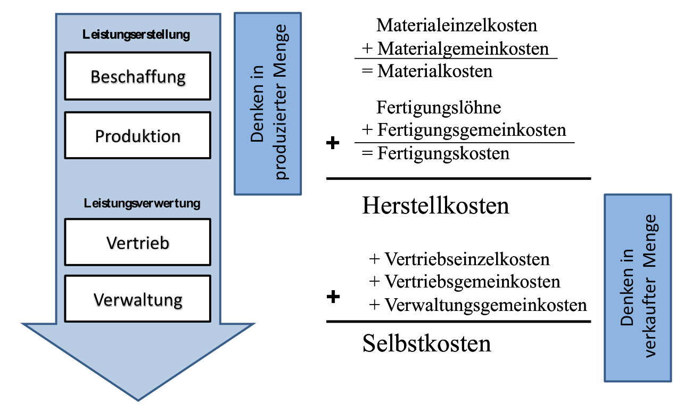
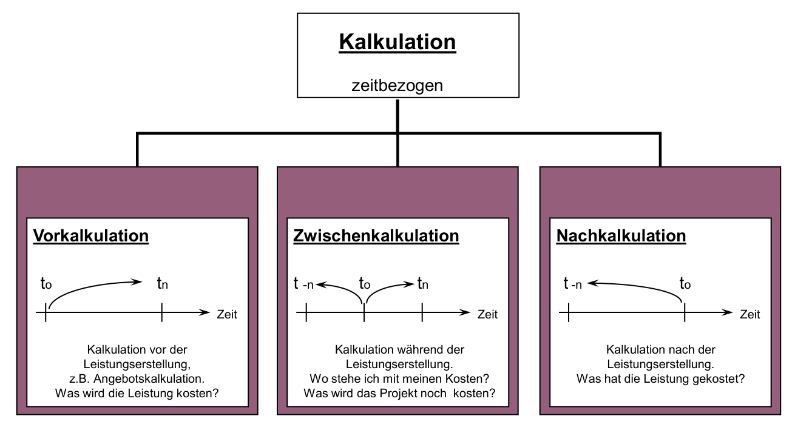
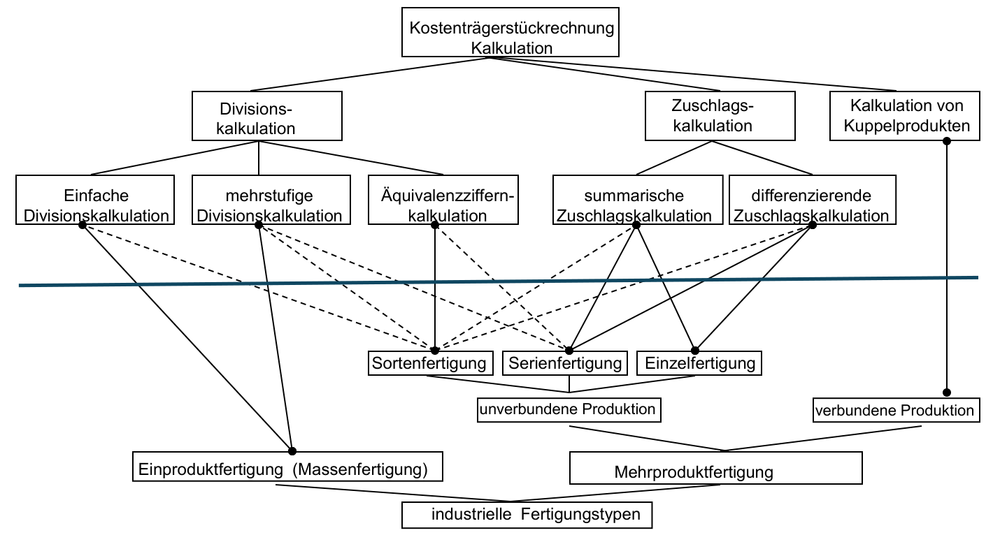

# Kalkulation im Überblick

## Prozess der Leistungserstellung und Leistungsverwertung in der Kalkulation (differenzierender Zuschlagskalkulation)

Inhalt der Abbildung:

| Prozess | Stufe | Kalkulation | Beschriftung daneben |
|---|---|---|---|
| Leistungserstellung | Beschaffung | Materialeinzelkosten + Materialgemeinkosten = Materialkosten | Denken in produzierter Menge |
| Leistungserstellung | Produktion | Fertigungslöhne + Fertigungsgemeinkosten = Fertigungskosten | Denken in produzierter Menge |
| | | Materialkosten + Fertigungskosten = **Herstellkosten** | |
| Leistungsverwertung | Vertrieb | + Vertriebseinzelkosten + Vertriebsgemeinkosten | Denken in verkaufter Menge |
| Leistungsverwertung | Verwaltung | + Verwaltungsgemeinkosten | Denken in verkaufter Menge |
| | | = **Selbstkosten** | |

## Kalkulation - Zeitbezogene

| | Vorkalkulation | Zwischenkalkulation | Nachkalkulation |
|---|---|---|---|
| Zeitstrahl | Pfeil von t0 nach tn | Pfeile von t0 zurück nach t-n und von t0 vor nach tn | Pfeil von t0 zurück nach t-n |
| Text | Kalkulation vor der Leistungserstellung, z.B. Angebotskalkulation. | Kalkulation während der Leistungserstellung. | Kalkulation nach der Leistungserstellung. |
| Frage | Was wird die Leistung kosten? | Wo stehe ich mit meinen Kosten? Was wird das Projekt noch kosten? | Was hat die Leistung gekostet? |

## Marktorientierte Kalkulation

Pfeile wie auf der Folie: von „gegeben“ nach „gesucht“.

| | Progressive Kalkulation | Retrograde Kalkulation | Differenz Kalkulation |
|---|---|---|---|
| Preis auf Beschaffungsmarkt | gegeben | gesucht | gegeben |
| + Bezugskosten | ↓ | ↑ | ↓ |
| = Einstandspreis | ↓ | ↑ | ↓ |
| + Handlungskosten/Herstellkosten | ↓ | ↑ | gesucht |
| = Selbstkosten | ↓ | ↑ | ↑ |
| + Soll-Gewinn | ↓ | ↑ | ↑ |
| = Verkaufspreis | gesucht | gegeben | gegeben |

## Kalkulationsverfahren und ihre Anwendung

Oberer Teil der Abbildung, Kostenträgerstückrechnung / Kalkulation:

- Divisionskalkulation
  - Einfache Divisionskalkulation
  - mehrstufige Divisionskalkulation
  - Äquivalenzziffernkalkulation
- Zuschlagskalkulation
  - summarische Zuschlagskalkulation
  - differenzierende Zuschlagskalkulation
- Kalkulation von Kuppelprodukten **[K Vorjahr]**

Unterer Teil der Abbildung, industrielle Fertigungstypen:

- Einproduktfertigung (Massenfertigung)
- Mehrproduktfertigung
  - unverbundene Produktion
    - Sortenfertigung
    - Serienfertigung
    - Einzelfertigung
  - verbundene Produktion

Verbindungslinien zwischen Verfahren und Fertigungstyp (die Folie nennt keine Legende für durchgezogen und gestrichelt):

| Kalkulationsverfahren | durchgezogene Linie zu | gestrichelte Linie zu |
|---|---|---|
| Einfache Divisionskalkulation | Einproduktfertigung (Massenfertigung) | Sortenfertigung |
| mehrstufige Divisionskalkulation | Einproduktfertigung (Massenfertigung) | Sortenfertigung, Serienfertigung |
| Äquivalenzziffernkalkulation | Sortenfertigung | Serienfertigung |
| summarische Zuschlagskalkulation | Serienfertigung, Einzelfertigung | Sortenfertigung |
| differenzierende Zuschlagskalkulation | Serienfertigung, Einzelfertigung | Sortenfertigung |
| Kalkulation von Kuppelprodukten | verbundene Produktion | |

## Notizen

### Kalkulation - Zeitbezogene

- An „Vorkalkulation“: Soll (Vorjahr)
- An „Zwischenkalkulation“ (über dem Zeitstrahl): Meilenstein (Vorjahr)
- An „Nachkalkulation“: IST (Vorjahr)
- Gelb markiert: „Zeitbezogene“, „Vorkalkulation“, „Angebotskalkulation.“, „Was hat die Leistung gekostet?“ (Vorjahr)

### Marktorientierte Kalkulation

- Über „Progressive Kalkulation“: Monopolist (Vorjahr)
- Unter „Retrograde Kalkulation“: Kundenmacht (Vorjahr)

### Kalkulationsverfahren und ihre Anwendung

- Sprechblase an „Einfache Divisionskalkulation“: k = K / x (Vorjahr)
- Roter Haken an „Divisionskalkulation“ (Vorjahr)
- Sprechblase an „Zuschlagskalkulation“: EK + GK = K, Klammer von EK auf GK mit „40 %“ (Vorjahr)
- Rotes K rechts oben, dahinter: „Wissen was ein … ist!“, dazu ist „Kuppelprodukten“ im Kasten rot unterstrichen **[K Vorjahr]** (Vorjahr)
- Gelb markiert: „Sortenfertigung“ (Vorjahr)

Quelle: kostenrechnung/origin/mitschriebt_3_von_5_aktuell.pdf, Folien 86-89

Vorjahr: kostenrechnung/origin/mitschrieb_letzte_jahr.pdf, Folien 89-92
