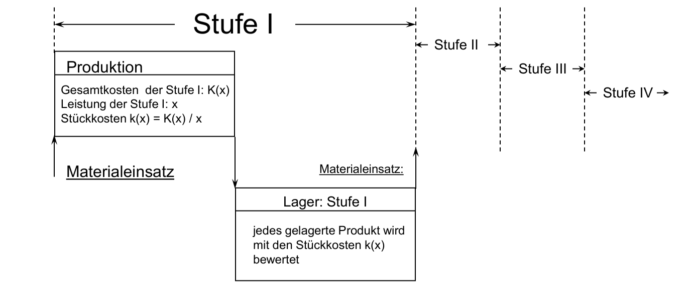

# Divisionskalkulation und Äquivalenzziffernkalkulation

## Divisionskalkulation

Voraussetzung

1. Sie haben eine einheitliche Leistungsmenge
2. Sie kennen die Periodenkosten
3. Sie haben kein Lager (xP = xA)

## Beispiel: Ermittlung der Kfz-Kosten anhand von Belegen

| Kostenart | Betrag |
|---|---|
| Abschreibung | 9.000,00 € |
| Kosten für Öl, Benzin und sonstige Betriebsstoffe | 2.500,00 € |
| Kosten für Reparaturen, Inspektionen | 600,00 € |
| Kosten für Wagenpflege | 100,00 € |
| Kfz-Steuer 600 Euro | 600,00 € |
| Kfz-Versicherung | 500,00 € |
| Zinsen für aufgenommenen Kredit | 2.000,00 € |
| sonstige Kfz-Kosten | 300,00 € |
| Gesamtkosten | (auf der Folie leer, siehe Notizen) |

## Beispiel: Brennholzwerk Waldeslust

Das Brennholzwerk Waldeslust ersteigerte für 801.716 € ein Schlagrecht für 31.256 Festmeter (Festmeter) Buchenholz. Die Kostenartenrechnung lieferte folgendes: Schneiden und Spalten 175.566 €, Abtransport 124.567 €, Gehälter 23.769 €, Personalnebenkosten 20.411 €, Abschreibung 14.954 €, Zinsen 3.938 €, Versicherung 1.277 €, Strom und Wasser 6.241 € und sonstiges Kosten von 30.483 €. Nach Abzug von Abfall konnte die gesamte Leistung von 29.318 Festmeter verkauft werden. Ermitteln Sie die Gesamtkosten und die Stückkosten für einen Festmeter.

Schema auf der Folie (alle Betragsfelder leer):

| Position | Betrag |
|---|---|
| Schlagrecht | |
| Schneiden und Spalten | |
| Abtransport | |
| Gehälter | |
| Personalnebenkosten | |
| Abschreibung | |
| Zinsen | |
| Versicherung | |
| Strom und Wasser | |
| sonstiges Kosten | |
| Gesamtkosten | |

Stückkosten = ____ / ____ = ____ (Bruch und Ergebnis auf der Folie leer)

Arbeitsblatt Einfache Divisionskalkulation: Das Brennholzwerk Waldeslust ersteigert für 801.716 € ein Schlagrecht für 31.256 Festmeter Buchenholz. Die Kostenartenrechnung liefert folgendes: Fällung und Rückung 722.013,6 €, Abtransport 257.862 €, Schneiden und Spalten 478.216,8 €, Gehälter 23.769 €, Personalkosten 20.411 €, Abschreibung 14.954 €, Zinsen 3.938€, Versicherung 1.277 €, Strom und Wasser 6.241 €, und sonstige Kosten von 30.483 €.

Nach Abzug vom Abfall konnten die gesamte Leistung von 38113 Raummetern verkauft werden (1 Festmeter = 1,3 Raummeter). Ermitteln Sie die Gesamtkosten und die Stückkosten für einen Raummeter. Zusatzinfo: Im Bezirk Dornbirn der eine Waldfläche von ca. 6.300 Hektar aufweist, wachsen jährlich 33.000 Festmeter Holz. KOHLER Florian

## Grundkonzept der mehrstufige Divisionskalkulation

Voraussetzung

1. Sie haben pro Fertigungsstufe eine einheitliche Leistungsmenge
2. Sie kennen die Periodenkosten der Stufe
3. Sie haben ein Lager (xP ≠ xA)

Inhalt der Abbildung:

- Stufe I: Materialeinsatz → Produktion → Lager: Stufe I. Vom Lager führt ein Pfeil „Materialeinsatz:“ an die Grenze zu Stufe II. Danach folgen Stufe II, Stufe III, Stufe IV.
- Produktion:
  - Gesamtkosten der Stufe I: K(x)
  - Leistung der Stufe I: x
  - Stückkosten k(x) = K(x) / x
- Lager: Stufe I: jedes gelagerte Produkt wird mit den Stückkosten k(x) bewertet

## Äquivalenzziffern

*Produktgewicht:*

Ein Schokoladenproduzent möchte Schokoladentafeln mit einem Gewicht 50 g, 100 g und 400 g herstellen. Für den Materialverbrauch kann er die Gewichtsverhältnisse ansetzen. Die Äquivalenzziffern lauten 1:2:8.

*Produktabmessung:*

Länge, Breite, Höhe, Fläche oder Volumen.

Ein Produzent von Andenken stellt Eiffeltürme her. Der Kunde wünscht Türme der Höhe 5 cm, 15 cm und 30 cm. **Achtung, das Verhältnis 1:3:6 ist hier falsch.** Zu beachten ist, dass die Eiffeltürme in der Länge, der Breite und der Höhe im gleichen Maß wachsen. Das Wachstum ist nicht linear, sondern kubisch mit der Länge, der Breite und der Höhe. Wir haben die Äquivalenzziffern 1:27:216.

## Äquivalenzziffern entstehen

| | | ÄZ |
|---|---|---|
| 1/2 | = 1 \* 2 | 6 |
| 1/3 | = 1 \* 3 | 4 |
| 1/4 | = 1 \* 2 \* 2 | 3 |
| HN | = 1 \* 2 \* 2 \* 3 | = 12 |

## Grundschema einer Äquivalenzziffernkalkulation

| Sorte | Menge | Äquiv.Ziffer | äquiv. LE (1) | Kosten je Sorte (4) | Kosten je Stück und Sorte (6) |
|---|---|---|---|---|---|
| 1 | m1 | a1 | m1 \* a1 | kä \* m1 \* a1 | kä \* a1 |
| 2 | m2 | a2 | m2 \* a2 | kä \* m2 \* a2 | kä \* a2 |
| 3 | m3 | a3 | m3 \* a3 | kä \* m3 \* a3 | kä \* a3 |
| | | | (2) Σ mi \* ai | (5) K | |

## Notizen

### Beispiel: Ermittlung der Kfz-Kosten anhand von Belegen

- Oben links: 1) Gesamtkosten 2) Leistungsmenge x 3) kein Lager → x_p = x_a (Vorjahr)
- Oben rechts: gef. km x (Vorjahr)
- Neben der Zeile „Kosten für Öl, Benzin und sonstige Betriebsstoffe“: 17.000 km (Vorjahr)
- In der Zeile „Gesamtkosten“: K, als Betrag 15.600 (Vorjahr)
- Unter der Tabelle: k(x) = K / x = 15.600 / 17.000 = 0,92 € / km (Vorjahr)
- Gelb markiert: „Kosten für Öl, Benzin und sonstige Betriebsstoffe“ und „2.500,00 €“ (Vorjahr)

### Grundkonzept der mehrstufige Divisionskalkulation

- Links unter „Produktion“ als Rechnung: + Materialeinsatz + Produktionsk. = Gesamtkosten (Strich über „Gesamtkosten“) (Vorjahr)
- Am Pfeil von „Produktion“ ins „Lager: Stufe I“: x und ein Pfeil nach unten (Vorjahr)

### Äquivalenzziffern

- Über „50 g“ eine rote 1, über „100 g“ eine blaue 1 (Vorjahr)
- In „1:2:8“ ist die 1 rot eingekreist, darunter blau: 0,5 : 1 : 4 (Vorjahr)
- Gelb markiert: „Schokoladentafeln“, „50 g“, „100 g“, „400 g“ (Vorjahr)

### Äquivalenzziffern entstehen

- Blaue senkrechte Striche durch die vier Faktor-Spalten (1, 2, 2, 3) (Vorjahr)
- „12“ blau eingekreist; gelb markiert: „HN“ und „12“ (Vorjahr)

### Grundschema einer Äquivalenzziffernkalkulation

- Rot eingekreist in Zeile 1: a1, m1 (in kä \* m1 \* a1) und kä \* a1 (Vorjahr)
- Unter der Tabelle: kä bzw. k_RE (untereinander in einer Klammer) = K / Σ = (nach dem zweiten Gleichheitszeichen steht nichts) (Vorjahr)
- Großes rotes K rechts neben dem Folientitel „Aufgabe Äquivalenzziffernkalkulation“ (Aufgabenfolie Braumeister, steht bei den Aufgaben) **[K Vorjahr]** (Vorjahr)

Quelle: kostenrechnung/origin/mitschriebt_3_von_5_aktuell.pdf, Folien 90-95

Vorjahr: kostenrechnung/origin/mitschrieb_letzte_jahr.pdf, Folien 93-98
