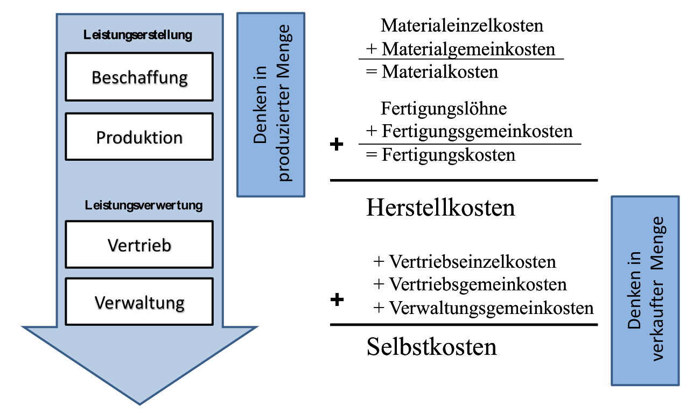

# Zuschlagskalkulation

## Grundschema der Zuschlagskalkulation **[K Vorjahr]**

| | | |
|---|---|---|
| Einzelkosten | Bezugsbasis | 100 % |
| + Gemeinkosten | + Gemeinkostenzuschlag | + 140 % |
| = Gesamtkosten | = Gesamtkosten | = 240 % |

Zuschlags-Satz in % = Gemeinkosten / Bezugsbasis (Einzelkosten) \* 100

## Gewinn- und Verlustrechnung als Ausgangsbasis der summarischen Zuschlagskalkulation

GuV Ali Ömer

| | Aufwand | | Ertrag | |
|---|---|---|---|---|
| EK | Wareneinsatz | 300.000 | Umsatz | 546.000 |
| GK | Miete | 36.000 | | |
| GK | Personal | 16.000 | | |
| GK | Zinsen | 12.000 | | |
| GK | sonstige Kosten | 56.000 | | |
| | Gewinn | 126.000 | | |
| | | 546.000 | | 546.000 |

Zuschlags-Satz in % = Gemeinkosten / Bezugsbasis (Einzelkosten) \* 100

Gewinnzuschlag?

## Grundschema einer summarischen Zuschlagskalkulation

| | | | |
|---|---|---|---|
| | Wareneinkauf | | 1,375 € / Flasche |
| + | Gemeinkosten**zuschlag** | 40% | 0,55 € / Flasche |
| | **Selbstkosten** | | **1,925 € / Flasche** |
| + | Gewinn**zuschlag** | 30% | 0,575 € / Flasche |
| | **Verkaufspreis (netto)** | | **2,50 € / Flasche** |
| + | Umsatzsteuer | 19 % | 0,48 € / Flasche |
| | **Verkaufspreis (brutto)** | | **2,98 € / Flasche** |

## Prozess und Kalkulation bei differenzierender Zuschlagskalkulation

Inhalt der Abbildung:

| Prozess | Stufe | Kalkulation | Beschriftung daneben |
|---|---|---|---|
| Leistungserstellung | Beschaffung | Materialeinzelkosten + Materialgemeinkosten = Materialkosten | Denken in produzierter Menge |
| Leistungserstellung | Produktion | Fertigungslöhne + Fertigungsgemeinkosten = Fertigungskosten | Denken in produzierter Menge |
| | | Materialkosten + Fertigungskosten = **Herstellkosten** | |
| Leistungsverwertung | Vertrieb | + Vertriebseinzelkosten + Vertriebsgemeinkosten | Denken in verkaufter Menge |
| Leistungsverwertung | Verwaltung | + Verwaltungsgemeinkosten | Denken in verkaufter Menge |
| | | = **Selbstkosten** | |

## Notizen

### Grundschema der Zuschlagskalkulation

- Rotes K links über dem Folientitel, dahinter: „100 %. 1 Punkt“ **[K Vorjahr]** (Vorjahr)
- „140 %“ ist rot durchgestrichen. Rot rechts neben den drei Zeilen: neben „100 %“ steht 300.000, neben dem durchgestrichenen „140 %“ steht 82 % 246.000, unter einem Strich neben „240 %“ steht 182 % 546.000 (Vorjahr)
- In der Formel rot eingekreist: „%“ (in „Satz in %“) und „\*100“ (Vorjahr)

### Gewinn- und Verlustrechnung als Ausgangsbasis der summarischen Zuschlagskalkulation

- Rot oben links: EK 300.000 + Zu 246.000 = Umsatz 546.000 (Vorjahr)
- Rot darunter: Zu % = 246' / 300' = 82 %, neben dem Nenner 300' steht „Basis“ (Vorjahr)
- „EK“ ist rot eingekreist (Vorjahr)
- Roter Pfeil über der GuV von der Aufwandsseite zum Umsatz 546.000, beschriftet „+ Zuschlag“, rechts neben 546.000: VK (Vorjahr)
- Blaue Klammer um Miete, Personal, Zinsen, sonstige Kosten: 120.000 (Vorjahr)
- Blau in die Zuschlagssatz-Formel geschrieben: 120.000 / 300.000, davor 40 % (Vorjahr)
- Blauer Strich unter „sonstige Kosten“, rechts daneben: Gesamt (Selbst)kosten 420.000 (Vorjahr)
- Blau unter „Gewinnzuschlag?“: = 126.000 / 420.000 = 30 % (Vorjahr)
- Kurzer grüner senkrechter Strich links neben der Zeile „Gewinn“ (Vorjahr)
- Gelb markiert im Titel: „summarischen“ (Vorjahr)

### Grundschema einer summarischen Zuschlagskalkulation

- Blaue Klammer von „1,375 € / Flasche“ (Wareneinkauf) bis „0,55 € / Flasche“ (Gemeinkostenzuschlag), beschriftet „30 %“ (Vorjahr)
- Blaue Klammer von „1,925 € / Flasche“ (Selbstkosten) bis „0,575 € / Flasche“ (Gewinnzuschlag), beschriftet „40 %“ (Vorjahr)
- Die handschriftlichen 30 % und 40 % stehen damit umgekehrt zu den gedruckten Sätzen der Folie (Gemeinkostenzuschlag 40%, Gewinnzuschlag 30%) (Vorjahr)
- Große blaue Klammer von Wareneinkauf bis Verkaufspreis (netto): 82 % (Vorjahr)

Quelle: kostenrechnung/origin/mitschriebt_3_von_5_aktuell.pdf, Folien 97-100

Vorjahr: kostenrechnung/origin/mitschrieb_letzte_jahr.pdf, Folien 100-103
