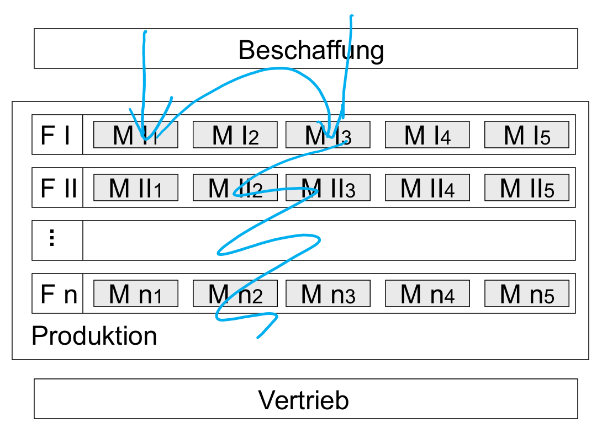
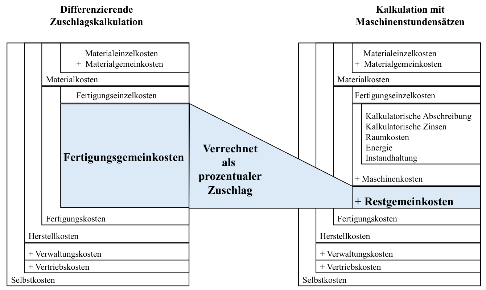

# Kalkulation mit Maschinenstundensätzen

## Platzkosten in der Produktion

Aufbau der Abbildung: oben Beschaffung, in der Mitte Produktion, unten Vertrieb. Die Produktion besteht aus den Zeilen F I, F II, ⋮, F n mit je fünf Plätzen:

| Produktion | | | | | |
|---|---|---|---|---|---|
| F I | M I1 | M I2 | M I3 | M I4 | M I5 |
| F II | M II1 | M II2 | M II3 | M II4 | M II5 |
| ⋮ | | | | | |
| F n | M n1 | M n2 | M n3 | M n4 | M n5 |

## Kalkulation der Selbstkosten ohne und mit Maschinenkosten

| Differenzierende Zuschlagskalkulation | Kalkulation mit Maschinenstundensätzen |
|---|---|
| Materialeinzelkosten | Materialeinzelkosten |
| + Materialgemeinkosten | + Materialgemeinkosten |
| **Materialkosten** | **Materialkosten** |
| Fertigungseinzelkosten | Fertigungseinzelkosten |
| **Fertigungsgemeinkosten** | Kalkulatorische Abschreibung Kalkulatorische Zinsen Raumkosten Energie Instandhaltung + Maschinenkosten |
| | **+ Restgemeinkosten** |
| **Fertigungskosten** | **Fertigungskosten** |
| **Herstellkosten** | **Herstellkosten** |
| + Verwaltungskosten | + Verwaltungskosten |
| + Vertriebskosten | + Vertriebskosten |
| **Selbstkosten** | **Selbstkosten** |

- Eine blaue Fläche verbindet „Fertigungsgemeinkosten“ (links) mit „+ Restgemeinkosten“ (rechts). Sie ist beschriftet: „Verrechnet als prozentualer Zuschlag“.
- Rechts stehen Kalkulatorische Abschreibung, Kalkulatorische Zinsen, Raumkosten, Energie und Instandhaltung in einem eigenen Kasten über „+ Maschinenkosten“.

## Ermittlung eines Maschinenstundensatzes

Die Fertigungsgemeinkosten verzweigen in der Abbildung in zwei Äste: Maschinenkosten und Restgemeinkosten.

Linker Ast:

| | |
|---|---|
| kalk. Abschreibung | 36.000 € |
| + kalk. Zinsen | 18.000 € |
| + Instandhaltung | 7.200 € |
| + Energiekosten | 2.880 € |
| + Raumkosten | 4.800 € |
| **= Maschinenkosten** | **68.880 €** |
| : Maschinenlaufzeit | 1.200 Stunden |
| **= Maschinenstundensatz** | **57,40 € / Stunde** |

Rechter Ast:

Restgemeinkosten : Fertigungslöhne = FGK - Zuschlagssatz

## Beispiel: Kalkulation mit Maschinenstundensätzen

Für einen Auftrag wurden in einer Maschinenfabrik folgende Zahlenwerte ermittelt:

- Fertigungsmaterial: € 8.000 (Gemeinkostenzuschlagsatz 5 %)
- Fertigungsstelle A: Maschinenstunden A3: 4,5 Std. (Maschinenstundensatz 84 €/Std.), Fertigungslöhne € 900 (Restgemeinkostenzuschlag 30 %)
- Fertigungsstelle B: Maschinenstunden B2: 2,0 Std. (Maschinenstundensatz 32 €/Std.), Fertigungslöhne € 300 (Restgemeinkostenzuschlagsatz 70 %)
- Verwaltung und Vertrieb:
  - Auftragsbezogene Verwaltungskosten € 200,-
  - Verwaltungs- und Vertriebsgemeinkosten 12,5 %

Ermitteln Sie die Selbstkosten für diesen Auftrag!

Kalkulation mit Maschinenstunden (Lösung auf der Folie, Spalten ohne Überschrift wie auf der Folie):

| | | | | | | |
|---|---|---|---|---|---|---|
| | **Material** | | | | 8.400,00 | |
| | Materialeinzelkosten | | | 8.000,00 | | |
| + | Materialgemeinkosten | | 5% | 400,00 | | |
| + = | Materialkosten | | | 8.400,00 | | |
| + | **Fertigung** | | | | 2.122,00 | |
| | Fertigungslöhne A | | | 900,00 | | |
| + | Fertigungsgemeinkosten A | | 30% | 270,00 | | |
| + | Maschinenkosten | 84 | 4,5 | 378,00 | | |
| | Fertigung A | | | 1.548,00 | | |
| | Fertigungslöhne B | | | 300,00 | | |
| + | Fertigungsgemeinkosten B | | 70% | 210,00 | | |
| + | Maschinenkosten | 32 | 2 | 64,00 | | |
| | Fertigung B | | | 574,00 | | |
| = | **Herstellkosten** | | | | 10.522,00 | |
| + | Verwaltungseinzelkosten | | | 200,00 | | |
| + | Verwaltungs- und Vertriebsgemeinkosten | | 12,5% | 1.315,25 | | |
| + | Verwaltung und Vertrieb | | | 1.515,25 | 1.515,25 | |
| = | **Selbstkosten** | | | | | 12.037,25 |

## Notizen

### Platzkosten in der Produktion

- Handgezeichnete Linie durch die Plätze, in der Abbildung zu sehen (aktuelle Folie hellblau, Vorjahr dunkelblau mit fast gleichem Verlauf): Pfeil von oben über „Beschaffung“ in M I1, Bogen von M I1 nach M I3, zweiter Pfeil von oben in M I3, von dort im Zickzack über M II2 und M II3 und die Zeile „⋮“ nach unten durch die Zeile F n (aktuell bei M n2, im Vorjahr zwischen M n2 und M n3) (aktuell und Vorjahr)

### Beispiel: Kalkulation mit Maschinenstundensätzen

- In der Lösungstabelle ist „12,5%“ blau eingekreist, rechts daneben blau mit Ausrufezeichen: 12,5 % auf HK (x_a) (Vorjahr)

Quelle: kostenrechnung/origin/mitschriebt_3_von_5_aktuell.pdf, Folien 101-105

Vorjahr: kostenrechnung/origin/mitschrieb_letzte_jahr.pdf, Folien 104-108
